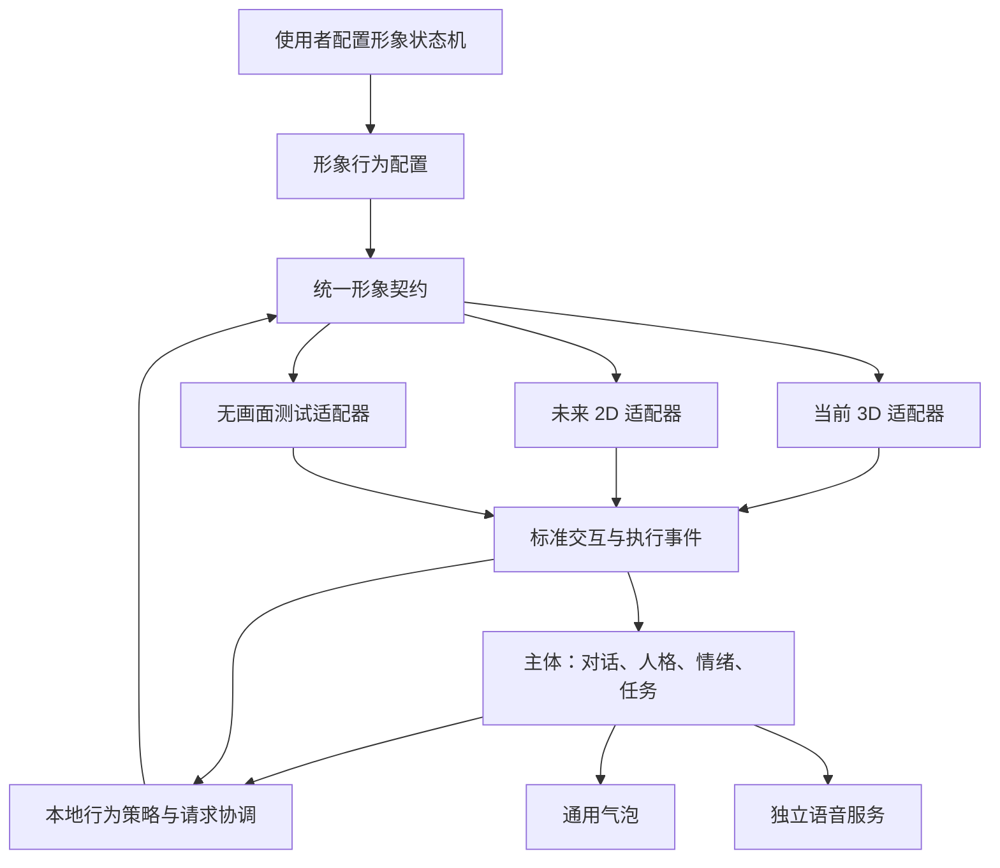

# 形象表现层初步契约

日期：2026-10-12。状态：已作为本轮解耦实现依据；保留初步契约和改造前审阅记录。实际接口、配置与验证结果见[系分](形象表现层-桌面端-系分.md)、[配置说明](../../../config/AVATAR_PRESENTATION.md)及[实现总结](形象表现层-桌面端-impl-summary.md)。

涉及项目：DesktopPet（C++20 / Qt 6 主程序及现有 3D 渲染系统）。本文确定主体与可替换的 2D／3D 形象层之间的边界。接口名称、配置字段和执行语义是供后续技术设计使用的初步建议，区别于第 1 节已确认的产品要求。

## 1. 已确认的产品约束

- 表现层在本文中特指“形象表现层／渲染层”，包括角色渲染、动画和桌面移动。气泡是通用能力，语音独立于渲染层，暂不增加音效。
- 最终采用 2D 还是 3D 尚未决定。主体必须能够通过统一入口自主调用不同形象层。
- 每套形象都需要状态机。模型选择希望转换到的状态，本地依据选择与规则切换状态机，再播放候选动画。
- 动作清单可能因动画系统和形象资源而不同。使用者负责配置状态、转换关系以及哪些动作不可打断；形象包可以提供默认配置。
- 打断规则至少区分：允许立即打断、当前一轮完成后切换、指定退出／过渡动作完成后切换。循环动作必须具有明确的转换边界。
- 眨眼、呼吸、物理效果等可以自动在本地处理，无需主体逐次调用模型。
- 通常优先响应用户，但角色可以依据情绪拒绝某些互动。优先级不能跳过使用者配置的受保护动画过程。
- 身体动画受保护时仍允许拖动。移动位置与切换身体动画是不同操作，不能用一个全局忙碌标记同时封锁。
- 能力不足时允许采用约定的替代表现，也允许主体通过“（行为描述）”进行拟人化表达。
- 本期不允许运行时切换形象；允许运行时显示或隐藏形象，正在运行的任务继续执行。
- 隐藏时动画状态机回到并保持当前形象配置的初始状态，不受理动画状态切换，不进行动画渲染。初态由使用者配置，不固定为 `Idle`。
- 更换形象不改变人格和记忆。独立维护当前形象描述，供模型理解当前外观和相关形象设定。

“睡觉 → 起床 → 清醒”仅是使用者可能配置的示例。契约不强制包含这些状态、动画或事件，也不根据状态名称推断其行为。

## 2. 职责与依赖方向

| 组成 | 职责 |
| --- | --- |
| 主体 | 保持人格、记忆、情绪和任务；理解当前形象；提出目标状态或移动意图；决定回复内容 |
| 本地行为策略与协调 | 综合用户输入、情绪和请求来源，判定受理意愿，统一排队和冲突处理；不持有具体骨骼播放器 |
| 形象状态机运行时 | 按有效配置执行转换，维护权威状态、过渡路径和打断限制；验证请求在执行时仍然有效 |
| 渲染适配器 | 报告资源能力；执行具体动画、物理、命中检测和桌面移动；报告执行事件 |
| 通用输出服务 | 气泡和语音独立接收主体输出；形象适配器不生成对话文本 |

状态机运行时和适配器共同对外提供形象契约。本期可在同一进程内实现；契约不依赖进程间通信，也不暴露 `AnimationPlayer`、`AnimationManager`、骨骼、OpenGL 或具体 2D SDK 类型。原生动画系统可以保留内部状态，但统一契约只有一份权威的对外状态。

## 3. 形象配置与使用者设定

### 3.1 配置内容

建议将同一角色身份下的形象资料分为以下几部分：

| 部分 | 内容及来源 |
| --- | --- |
| 形象标识与描述 | 形象标识、外观、身体特征、穿着及相关设定，由形象包或使用者填写；不覆盖人格成长数据 |
| 资源清单 | 适配器发现的可用动画／动作、显示名称、说明、循环属性和可报告的播放边界 |
| 状态定义 | 使用者配置的状态标识、供模型阅读的含义、候选动作、初始状态，以及是否允许模型直接请求 |
| 转换定义 | 来源状态、目标状态、条件和显式指定的过渡路径；无需为每种形象提供相同的图 |
| 打断规则 | 状态默认规则及需要覆盖的具体动作规则；明确生效阶段和等待边界 |
| 交互与能力 | 支持的交互区域、桌面移动和可选视线等能力；交互区域映射为中性事件标识 |

使用者从真实资源清单中选取候选动作，配置状态及转换限制。资源标识只用于配置与适配器映射，模型主要读取状态含义和可申请的转换，不需要理解底层文件或骨骼。

形象描述是当前自我描述的补充，不自动改写历史记忆。描述中出现某个身体特征，也不能代替真实能力清单，例如有翅膀不代表资源中一定存在飞行动画。

### 3.2 打断语义

下列名称是示意字段，最终配置格式在技术设计时确定。

| 规则 | 执行语义 |
| --- | --- |
| `immediate` | 可在当前动作中途响应合法转换；具体混合方式由适配器处理 |
| `finish_cycle` | 记录转换意图，当前播放轮次结束后再执行；循环动作不继续等待所有循环结束 |
| `complete_transition` | 按配置完成指定退出／过渡路径，再进入目标状态；过渡过程中不被其他身体动作替换 |

状态默认规则用于减少重复配置，具体动作覆盖用于保护选中的动画。对某个正在播放的动作只解析出一个有效规则；请求到达时记录它，并在等待边界重新检查目标的合法性。

例如使用者将任意状态 `A → B` 配置为经过动作 `X`，并保护 `X`：模型请求 `B`，本地完成 `X` 后进入 `B`。这些名称没有预设含义。另一个形象完全可以使用不同状态和不同路径。

受保护身体动画期间拖动继续改变位置。拖动对应的附加姿态如果会替换身体动画，仍需遵守打断规则；不能为了拖动强制切到某个固定的 `Drag` 状态。

以上保护规则约束正常身体动作切换。隐藏属于展示生命周期操作，按第 6.1 节停止当前播放并重置到初态，不等待受保护动作或过渡完成。

### 3.3 配置有效性

配置加载时检查状态和动作引用、初始状态、转换路径及受保护阶段的结束条件。正常待机循环可以无限持续，但被选为退出／过渡路径的环节必须能有限结束；没有可观测轮次边界的动作不能直接配置成 `finish_cycle`。

缺失资源、无效引用或永远无法结束的受保护过渡，应向使用者报告具体配置问题。请求执行失败时返回错误，不伪造成功，也不无限占用行为队列。本轮采用 JSON 文件配置、重启生效；可视化规则编辑器未纳入本轮。

## 4. 建议的统一调用契约

### 4.1 调用入口

| 操作 | 输入与输出 |
| --- | --- |
| 查询形象与能力 | 当前形象描述、状态含义、交互区域、支持的动作类别及移动／视线等可选能力 |
| 查询当前状态 | 当前状态、正在进行的转换、受保护阶段、可见性，以及用于识别旧快照的状态版本；隐藏时报告初态、未播放、无进行中的转换 |
| 查询转换候选 | 当前可以立即或延后申请的目标状态、条件、等待原因；隐藏时可受理候选为空并说明隐藏原因，形象能力定义仍可查询 |
| 请求状态转换 | 请求标识、目标状态、意图说明和有效期；返回受理、等待、拒绝或失败的结果；隐藏时立即拒绝，不进入等待队列 |
| 取消请求 | 撤销尚未执行的意图；已进入受保护阶段时，在合法边界收尾，并报告取消进度 |
| 设置可见性 | 隐藏时停止动画、重置并保持初态；重新显示时从初态恢复播放；不停止主体或任务，不隐式关闭通用气泡和语音服务 |
| 请求桌面移动 | 目标位置等中性参数，由形象层执行窗口移动并反馈结果；与身体动画保护分别处理 |

表中字段与名称是建议，不是已经实现的 API。请求来源和情绪上下文由本地运行时补充，模型不能通过自行声明高优先级跳过规则。2D／3D 共用调用方式，状态标识来自当前有效配置，不使用核心代码中的固定枚举。

### 4.2 反馈与完成条件

接收调用不等于动作完成。建议用同一请求标识关联以下阶段：

`Accepted / Queued → Started → Completed / Cancelled / Failed / Expired`

未受理的请求返回 `Declined`（意愿拒绝）或 `Rejected`（能力、状态或参数不满足），无需伪装成已开始执行。

- 对“进入目标状态”的请求，`Completed` 表示必要过渡已结束，目标状态已经生效且候选动作实际成功启动。目标若为循环状态，无需等循环停止。
- 动作轮次结束是独立的播放事件，供 `finish_cycle` 等规则使用，不能与“进入状态完成”混为一谈。
- 若后续需要等待某个动作完整表演，必须明确等待对应轮次／动作完成事件；不能把状态转换完成当成表演结束。
- 候选资源不存在、播放器未执行或过渡中断失败，返回实际失败；系统仍需保持可查询的实际状态。
- 请求要有有限的等待／执行期限，终态只报告一次；迟到或重复事件不能重新完成已结束的请求。
- 保护规则约束正常动作切换。资源损坏或执行器故障时，应失败收尾并释放请求，不要求损坏动画继续完成。
- 隐藏期间的新动画转换请求返回 `Rejected`，建议原因标识为 `presentation_hidden`。隐藏发生时，已受理但未终结的动画请求及播放等待以 `Cancelled` 和同一原因收尾，不伪造动画完成；已终结请求不重复改写结果。

查询结果仅是快照。实际受理和从队列取出时都重新检查可见性、状态与情绪策略，防止模型思考期间发生的交互使旧选择失效。隐藏时使旧播放周期的回调失效，防止重新显示后收到的迟到事件改变初态或完成新请求。

### 4.3 交互回传

2D 命中区域或 3D 射线拾取统一上报 `Touch(regionId)`、拖动开始／结束等事件。事件标识和区域含义由形象声明，不要求每个形象都有人形的头、手等部位。

交互事实先回传主体，再由策略决定情绪影响和表现反应。角色可以拒绝配合，形象也可能缺少对应动画，但这些情况不抹去已经发生的触摸事件。

## 5. 意愿、冲突与表达兜底

所有 AI 指令、情绪表达、触摸反应及本地空闲行为使用同一套有效状态规则。自动眨眼、呼吸和物理可以留在适配器内部；若某个自动行为会改变对外状态，也需要经过状态机并上报变化。隐藏时暂停形象动画推进与渲染，所有来源均不能触发动画状态切换；主体情绪和任务仍可正常变化。

对动画转换意图，建议的处理顺序为：接收意图 → 检查可见性，隐藏时立即拒绝 → 本地行为策略判断意愿 → 状态机检查能力、路径与保护 → 执行或有限等待 → 回传实际结果。交互事实和主体的其他处理不受这项动画可见性检查阻断。用户请求通常具有较高优先级，但正常动作切换不会跳过受保护过渡。形象层不独立创造一份情绪状态。

| 情况 | 主体得到的含义 |
| --- | --- |
| 因情绪不愿回应 | 角色拒绝，主体可以自然解释或协商 |
| 形象处于隐藏状态 | 动画转换不受理，不排队、不记为情绪拒绝；主体可继续文字表达和任务处理 |
| 当前身体动作受保护 | 需要等待合法边界，或在请求到期后放弃 |
| 形象不支持某个目标 | 能力不足，可选择配置允许的替代表现或文字表达 |
| 动画／移动执行失败 | 技术失败，按实际状态恢复或改用其他表达 |

替代表现应报告实际采用的状态或动作。“（轻轻抱了抱你）”等文字行为描述由主体生成，通过通用气泡和独立语音链路按各自规则输出；内部记录为文字表达，不记录成渲染动画成功。是否自动朗读括号描述沿用或另行配置语音规则，不在形象契约中决定。

## 6. 生命周期与尚需讨论的细节

角色身份、人格、记忆和任务的生命周期独立于形象窗口。形象暂不可用时，依赖形象的请求返回明确结果，其他主体功能继续运行。本期按启动时选定的形象工作，运行时只提供显隐；更改形象于下次启动生效，不能顺带重置角色身份。

### 6.1 显隐规则

使用者于 2026-10-12 明确：隐藏期间不受理动画状态机切换，保持初态，不做动画渲染。由此将生命周期处理细化为：

1. **进入隐藏。** 关闭动画转换受理入口，停止当前动画、自动表现及过渡，清除待执行动画意图，取消尚未结束的动画请求与播放等待。状态机重置到配置的初始状态，播放进度重置，不触发初态的入场动画。隐藏无需等受保护动作播完。
2. **保持隐藏。** 初态保持不变，不推进动画时钟、自动转换或形象物理动画，也不提交动画绘制。任何来源的动画转换请求立即得到隐藏原因的拒绝，不存储为待显示后执行的请求。静态能力和状态查询继续可用，查询应区分“处于初态”和“正在播放初态动画”。
3. **重新显示。** 从配置的初态和初始播放进度恢复正常动画与渲染，再开放转换受理。不恢复隐藏前的中间动作，不补播隐藏期间的意图。模型或本地行为策略如仍需要动作，依据当前情绪与状态重新提出请求。
4. **主体独立运行。** 显隐仅重置形象动画状态，不重置人格、记忆、情绪或任务状态；通用气泡和独立语音服务继续按各自规则运行。动画子请求被取消不意味着其所属任务被取消，等待方得到明确结果后继续任务处理。

可见性变化与请求受理需要有一致的执行顺序；对外进入隐藏状态后，不能再由并发提交或旧播放回调启动动画。重新显示后的播放使用新的执行代次，忽略旧代次事件。

### 6.2 本轮采用的实施选择

以下是依据实现授权采用的可调整设计值，并非新增产品约束：

1. **配置入口与生效时机。** 沿用状态机 JSON，修改后重启；本轮无规则热更新或配置页面。运行时更新规则和运行时更换形象是两个不同需求。
2. **情绪拒绝和请求协调。** 默认 anger 强度达到 0.85 可拒绝用户的动画互动，队列上限 8，请求期限 15000 ms，均可配置。取消和过期不跳过已进入的有限保护路径，收尾后复位初态；隐藏则立即复位。详见配置说明。

## 7. 改造前审阅记录

下表记录实施前的问题及改造入口；这些业务调用现已接入中性契约，最终结果以实现总结为准。

| 现有位置 | 现状与接入方向 |
| --- | --- |
| [RuntimeUiBridge](../../../core/ai/runtime/runtime_ui_bridge.h) | 仍返回具体动画播放器和管理器；提取中性的形象契约，气泡／通知保留通用服务边界 |
| [AI 动画工具](../../../core/ai/tools/animation_tools.h) 与 [工具接线](../../../ui/petwindow_ai.cpp) | 工具直接持有播放器，包含固定动作枚举和 Idle 限制；改为通过契约读取配置、申请转换并接收真实结果 |
| [BehaviorManager](../../../core/behavior/behavior_manager.cpp) | 已有队列和超时基础，但情绪映射和可播放状态固定；可复用请求协调职责，映射与转换约束来自当前配置 |
| [触摸处理](../../../ui/petwindow_interaction.cpp) 与 [拖动处理](../../../ui/petwindow_snap.cpp) | 直接切换具体动画；改为统一交互事件，拖动位置与身体动画切换分别处理 |
| [AnimationPlayer](../../../core/animation/animation_player.cpp) | 现有 `changeState` 返回 void，目标／资源无效会直接退出；适配器需提供真实启动、轮次及失败反馈 |
| [PetWindow](../../../ui/petwindow.h) | 同时持有窗口、AI 和任务／情绪服务；逐步分开形象窗口与主体的生命周期，避免隐藏形象停止任务 |

改造前 `play_animation` 会在请求状态不存在或实际未切换时仍构造成功结果，本轮已改为真实请求反馈。基础聊天可以先于形象后端就绪启动。

原有 [表现层调研](../../../presentation_layer_research.md)继续作为模型格式与引擎选型材料。本文补充渲染技术无关的契约要求，2D／3D 路线仍未确定。

## 8. 后续验收场景

| 场景 | 应满足的结果 |
| --- | --- |
| 两个后端使用完全不同的动作与状态名 | 同一主体和同一套调用工具读取各自配置后均可工作，核心无固定状态名分支 |
| 使用者将动作从可打断改为本轮完成后切换 | 配置生效后，转换等待真实轮次边界；循环动作不会导致永久等待 |
| 使用者配置必须完成的过渡动作 | 其他身体请求不跳过过渡，拖动位置仍可继续且不强制替换身体动画 |
| 角色因情绪拒绝触摸反应 | 交互事实正常回传，主体收到意愿拒绝；人格和情绪来源保持一致 |
| 请求时状态已变化或资源缺失 | 本地重新校验，返回等待、拒绝或失败；不会把发出请求记为完成 |
| 动画能力不支持，采用括号行为描述 | 主体完成文字表达，内部不产生虚假的动画成功记录 |
| 动画或受保护过渡播放中隐藏形象 | 立即停止动画并回到配置初态，无需等待过渡完成；未结束请求得到一次取消结果，动画队列清空，所属任务继续运行 |
| 隐藏期间请求切换或触发自动动画 | 请求立即因隐藏被拒绝、不排队，状态保持初态，动画时钟、自动转换和动画渲染均不推进 |
| 重新展示形象 | 从配置初态和初始进度恢复播放，不恢复中间动作、不补播旧意图；人格、记忆、情绪与任务保持连续 |
| 显隐切换时收到并发请求或迟到播放回调 | 隐藏后的请求无法启动动画，旧播放事件不能改变重置后的状态或完成新请求 |
| 更换下次启动使用的形象 | 当前形象描述和能力更新，原人格与记忆保留，运行中没有形象热切换 |
| 使用无画面适配器运行主体 | 对话、情绪与任务服务可独立运行，表现请求得到可解释的反馈 |

本文保留产品约束及验收场景。配置结构、线程归属、异步事件接口和现有资源接入已经落地；自动化验证与仍需真实窗口验收的边界见实现总结。
