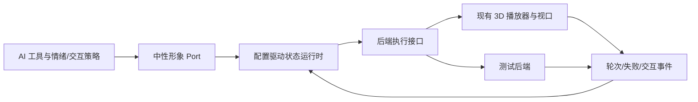

# 形象表现层解耦系分

日期：2026-10-12。实现依据：[初步契约](形象表现层-桌面端-初步契约.md)及用户“根据这份规则优化系统、进行渲染层解耦”的实现授权。

## 1. 全局约束

单仓库 DesktopPet，C++20 / Qt 6。保留现有 3D 渲染资产，通过中性形象契约接入；以无 OpenGL 的测试后端证明不同状态列表可驱动同一主体。当前不新建正式 2D 资产，也不增加形象热切换或语音／气泡重构。

### 1.1 配置与身份

复用现有状态机 JSON 路径和启动加载入口，增加状态说明、语义／交互映射、动作候选、打断和过渡配置；形象说明独立于人格身份。缺省项兼容现有配置，发布配置明确标注现有动作语义。状态名称本身没有框架含义；新后端可使用任意标识。规则编辑暂采用文件，重启生效。

### 1.2 执行语义

统一入口负责状态查询、转换候选、请求、取消、事件、显隐和移动。核心工具和情绪模块不接收具体播放器／引擎。状态机规则只有一处执行，3D 播放器在托管模式下仅采样并报告轮次，不另行自动跳转。

初态来自配置。隐藏立即关闭受理、取消未结束请求、清队列、停止播放与绘制并重置初态；显示从初态重新开始，旧代次事件无效。任务与情绪不停止。保护只限制正常身体动作转换，拖动位置及隐藏不被保护动作阻塞。

情绪策略独立于资产，使用当前情绪快照判定互动意愿；具体阈值采用有说明的可配置默认值。禁用动作策略仍有效。所有路径使用一致的规则，不因 AI、触摸、拖动或调试来源而绕过。

### 1.3 异步、失败与线程

请求具有 ID、有效期及唯一终态。接受和排队不是完成；目标生效并实际启动候选才完成状态转换，动作轮次结束另报。队列有上限和超时，隐藏／资源失效能唤醒等待方。查询和命令在形象所属线程串行化，避免工具线程直接操作 Qt 视图。销毁按停止接收、解除回调、销毁后端的顺序执行。

普通 TTL 到期不能中途切断已开始的受保护过渡。尚在队列的请求立即过期；已进入有限保护路径的请求放弃过期目标，在保护路径的合法结束边界收尾。后端未按资源时长产生边界需作为实际执行故障另行超时收尾；隐藏仍立即终止。取消同样遵守整条已进入的保护路径。

缺失能力或配置错误返回解释性结果；文字行为兜底由主体生成，不能伪装成动画成功。展示不可用不阻止普通聊天启动。重复/迟到回调不能改变新代次状态。

## 2. 架构和变更范围

新增 `core/presentation/`：中性配置、契约、规则执行和事件。新增渲染适配器或视图接口，具体文件名按仓库惯例确定。修改 `engine/render_viewport.*`、`core/animation/*` 接入托管播放；修改 `RuntimeUiBridge`、动画工具、`BehaviorManager`、`PetWindow` 接线，移除业务路径对具体播放器的访问。修改配置／加载器及必要的上下文投影，新增 `tests/test_avatar_presentation.cpp` 等遵循现有 QtTest 组织的测试，接入 CMake。

## 3.1 配置驱动的形象呈现与主体接入

### 1. 模块定位

一个垂直特性：使用者配置形象行为，主体发现并调用能力，本地按规则呈现，结果回传主体；现有 3D 与替代测试后端共用契约。

### 2. 核心服务接口

采用 QtCore 数据和 QObject 事件，不在中性头文件引入 QtGui 骨骼或 OpenGL。下列操作语义固定，具体 C++ 类型可按最终实现整理：

| 操作 | 入参及值来源 | 返回 |
| --- | --- | --- |
| 加载配置 | JSON（配置默认值：ConfigManager 的状态机路径）；可用资源（系统推导：后端发现） | 有效状态定义或字段级诊断 |
| 查询形象 | 无 | 形象描述、能力与状态含义 |
| 查询状态/候选 | 无；策略上下文（系统推导：情绪快照及配置策略） | 当前状态、初态、可见性、保护及可请求目标 |
| 请求转换 | targetState/reason（调用方传入）；requestId（调用方传入或系统生成）；有效期（配置默认值）；来源（系统推导：实际调用链） | 拒绝、接受、排队及关联请求 ID |
| 处理交互 | event/region（调用方传入：视图）；情绪上下文（系统推导：主体） | 事实事件、意愿及状态请求结果 |
| 取消 | requestId（调用方传入） | 已取消或等待合法结束边界 |
| 显隐 | visible（调用方传入：用户操作/窗口事件） | 可见性及重置后的状态 |
| 移动 | 桌面位置（调用方传入；Qt 逻辑坐标，平台适配器转换） | 真实位置或失败 |
| 后端播放 | 动作与循环信息（系统推导：候选选择）；执行代次（系统生成） | 实际启动结果，轮次/失败事件 |

查询需允许后端未就绪的情况。形象端负责位置与命中测试，主体只使用中性的坐标及区域事件。3D 相机调试留在适配器内。

### 3. 模块业务流程

1. 启动读取形象配置与说明；初始化独立主体；创建当前后端并发现可用资源。
2. 验证配置引用、候选和过渡；初态可查询，隐藏时不播放。后端未就绪时正常聊天仍可运行。
3. AI 工具根据动态候选提出目标，或交互/情绪按配置映射提出目标。先检查可见性，再判定意愿、策略、路径与打断规则。
4. 可立即执行则启动候选，真实启动失败就报告错误；受保护则排队到轮次边界或完整退出路径结束。循环状态不无限等待。
5. 后端只推进播放并报告轮次；运行时推进过渡和自动配置转换、释放到期/完成请求。终态可查询并发事件，不依赖模型轮询频率。
6. 隐藏清空一切未结束表现请求并停止帧驱动；重新显示仅启动配置初态。忽略之前代次的完成事件。
7. 拖动直接移动窗口，附加姿态仍需走状态机，禁止原先强制 `Drag` 切换。

### 4. 数据变更

增加/扩展形象状态机 JSON 和独立形象说明；所有文件在启动时读取。形象描述参与当前模型上下文，但不改角色 profileId、人格存储或历史记忆。无数据库表迁移。默认资产映射保存在配置中，不在核心代码按名称硬编码。

### 5. 实现锚点

| 实测锚点 | 接入方式 |
| --- | --- |
| `AnimationImporter::loadStateMachine(const std::string&, AnimationStateMachineDefinition&)` | 现有解析仅状态名/loop/转移，需完整保留新规则和候选配置并验证 |
| `AnimationPlayer::changeState(const std::string&, double)` | 现为 void，且失败会提前退出；改成可验证播放，保证失败不破坏旧状态 |
| `AnimationPlayer::update(double)` | 托管模式中关闭自己的自动状态转换，报告真实轮次边界；零长度资源不能 fmod 除零 |
| `RenderViewport::paintGL()` | 当前在绘制内驱动动画，改为显隐门控和实例计时，隐藏停止 timer/update/render |
| `PetWindow::setupAiAnimationTools()` | 改成注册依赖中性接口的工具，不再分发 raw player/manager 指针 |
| `BehaviorManager::handleExpression` | 保留情绪请求协调作用，映射与可执行性由当前契约提供；隐藏时不残留待补播队列 |
| `PetWindow::triggerTouchReaction` / `beginDragAnimation` | 先上报事实、再请求反应；拖动取消强制状态名跳转 |
| `RuntimeUiBridge` 与 RuntimeStartRequest | 只持有中性表现契约及独立通用输出回调；测试替身无需 3D 系统 |

### 6. 异常场景

- 业务异常：隐藏、目标不可达、被禁用或因情绪拒绝，返回对应原因，不占队列；由全局请求结果规则处理。
- 业务异常：等待到期或队列已满，有限失败并释放请求；状态继续可查询。
- 系统异常：资源丢失/后端启动失败，失败收尾，保留真实可查询状态；必要时表现降级，主体继续。
- 系统异常：后端销毁/旧回调抵达，解除关联并按执行代次过滤；不能解引用已销毁播放器或重复报告终态。

### 7. 关键行为场景

- 两个测试后端使用不同动作名，共用同一套工具，按各自配置转换成功。
- 本轮完成后切换：循环动作完成当前一轮就转到请求目标，重复事件不重复执行。
- 完整过渡：目标路径包含有限退出动作，普通高优先级请求无法跳过，但拖动正常移动。
- 隐藏时终止已排队与正在执行的表现请求，状态保持自定义初态且无后台播放；显示重新启动初态。
- 资源缺失/目标不存在时工具报告真实失败，不返回请求目标冒充当前状态。
- 触摸事实在不支持动画、拒绝或后端未就绪时仍能更新情绪输入。
- 形象说明进入主体当前上下文，更换说明不修改人格、记忆标识。
- 现有 3D 播放采样、对话与任务相关回归通过，窗口显隐不停止任务。

## 4. 验证与交付

先写契约行为测试得到 RED，再完成实现与集成至 GREEN。测试放在 `tests/`，通过现有 `add_desktop_pet_cpp_test` 注册。至少覆盖中性状态机、真实 3D 播放器轮次、工具、情绪/交互与显隐生命周期；编译主程序并运行相关既有套件，必要时扩大到 CTest 全量。禁止仅靠静态字符串搜索宣称运行时正确。

交付包括可工作的代码、配置使用说明、回归结果及仍受平台/真实窗口环境限制的验证项。根据用户后续要求，按设计、实现与测试、验收文档三个阶段分批提交本地 Git；本轮不推送远端。
