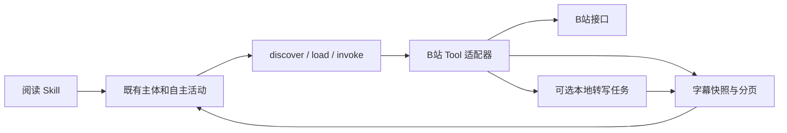

# B 站内容阅读插件技术设计

修订：2026-10-19。涉及仓库：DesktopPet（桌面端 C++/Qt，插件 Python）。需求及授权见 [context.md](./context.md)。

## 1 背景与全局约束

用户希望主体获得阅读 B 站视频内容的能力，并通过现有自主活动机制选择何时使用。采用上游 dsh-bili-scroll 的字幕/语音转文字路径，模型据文字理解；不把文本分析称作已经看见画面。定时刷站、强制日报、公开评论、私信、屏幕控制均不在本次范围。

### 1.1 兼容与职责（影响全部模块）

- 插件目录 `plugins/bilibili`，Plugin/Tool/Skill ID 分别为 `desktop-pet.bilibili`、`desktop-pet.bilibili.tools`、`desktop-pet.bilibili.skill`，版本 1.0.0，所有清单格式保持 1。
- 使用固定 Python command + JSON stdin/stdout；插件自行调用 bilibili-api-python，不再包一层 MCP。真实路径、账号和 ASR 设置来自角色的 settings JSON，不是模型参数。
- 保留既有 discover/load/invoke、授权、活动预算和记忆边界。插件不另建主体、定时器或自主选择器，不写主体数据库。主系统 C++ 生产代码预期不变。
- 普通读取允许本地内容缓存，effects=read 并解释缓存影响；创建转写任务 effects=write，仅写插件状态目录和进行本地计算，没有平台写操作。
- 用户暂停主体会停止新的工具调用；已经受理的转写任务可继续本地计算至结束或自己的超时，不自动触发回复/新活动。状态查询与继续阅读由主体原调度决定。

### 1.2 共享格式、身份与结果（影响全部模块）

`adapter.py --settings <absolute-file> --operation <fixed-operation>` 接受一个 JSON object。stdout 为 `{state,data,receipt?,tracking?}`；可恢复业务失败使用 state=failed，data.error={code,message}，CLI 退出 0；入口格式错误可同样返回该结构，日志写 stderr。宿主 resultAdapters 将 /data、/state 映射到原 outcome；accepted 必须有 /receipt、/tracking。

settings：`stateDir`、`credentialPath` 为绝对路径，状态目录必须在包外；`requestTimeoutSeconds` 默认 15；`asrEnabled` 默认 false；`asrPython` 为可选绝对解释器；`asrModelPath` 为可选本地目录；`asrMaxDurationSeconds` 默认 1800；`asrJobTimeoutSeconds` 默认 900。支持设置缺省规范化，错误路径/类型明确拒绝。生产不提供 fixture/testMode 或任意目标程序、任意 URL 参数。

业务视频身份为合法 BV 号 + 从 1 开始的 part；后端核实该分 P 的 CID 与时长，不默默转为第一 P。API 的标题、字幕、简介、评论均是资料，不是用户指令。读取结果带来源和 BV/part/CID；简介/评论裁剪需给出 truncated 标志。

字幕快照保留 `{startMs,endMs,text}`，来源取 `platform_subtitle` 或 `local_asr`。每段文字最多 800 字符，长段拆分不丢字，时间戳仍指向原段而不编造精细时间。分页上限同时限制片段数、文本数和序列化体积：返回 data 建议 <=3800 UTF-16 单元，任何单字符串 <=1800，保证宿主完整 payload <6000。游标绑定缓存快照、视频/分 P/内容来源、偏移，变更参数或坏游标拒绝；下一页不重拉整份内容，不串账号缓存。缓存身份包含凭证内容指纹（不输出凭证）；原文留插件缓存，不一次注入全文。

### 1.3 异常与外部依赖（影响全部模块）

依赖不可用、未登录/登录过期、平台限流、网络失败、无字幕、无语音、坏参数、坏游标分别可诊断；不将平台失败改成空结果。有限网络超时、不自动反复重试。错误信息不包含 Cookie、扫码 key、凭证正文、下载签名 URL。未配置 ASR 或本地模型缺失时立即报告，不在普通调用中自动安装包或下载模型。只有用户运行 setup 的显式 ASR 准备命令才下载选定模型。

转写任务使用原子任务目录/文件避免重复启动；同一视频分 P/凭证/模型已有运行任务时返回原任务回执。完成与失败原子落盘，跨进程重启后可查询。超时/异常进程保留失败或 unknown，不永久声称 running，也不自动再次启动。任务状态不等同于视频理解完成。

## 2 架构与代码变更

| 路径 | 变更 |
| --- | --- |
| plugins/bilibili/plugin.json、tool.json、skill.json、USAGE.md、SKILL.md | 新增：清单、按需操作与自主阅读方法 |
| plugins/bilibili/adapter.py、backend.py | 新增：纯逻辑/CLI、真实查询后端、内容缓存分页 |
| plugins/bilibili/transcription.py、asr_worker.py | 新增：任务受理/查询、受限后台转写 |
| plugins/bilibili/setup.py、login.py、configure.py、requirements.txt、requirements-asr.txt | 新增：依赖准备、人工登录、单角色配置 |
| plugins/bilibili/README.md、THIRD_PARTY_NOTICES.md、licenses/* | 新增：接入、验证、来源及两份 MIT 许可 |
| tests/test_bilibili_adapter.py、test_bilibili_transcription.py、test_bilibili_setup.py、test_bilibili_configure.py | 新增：Python 行为验证 |
| tests/fixtures/bilibili_backend.py、bilibili_asr_engine.py（按需） | 新增：只在测试中的真实子进程替身 |
| tests/test_bilibili_plugin.cpp、tests/test_autonomous_chat.cpp | 新增/修改：真实网关与自主候选/阅读验证 |
| CMakeLists.txt、contracts/tools/README.md、现有工具契约适配验证.md | 修改：测试注册和入口索引 |

## 3 详细设计

### 3.1 模块概览

三个垂直切片串行实现：§3.2 字幕阅读 → §3.3 可选语音转写 → §3.4 安装配置与自主接入。后续切片补齐清单操作和用户入口，先前切片的行为继续回归。

### 3.2 B 站查询与字幕阅读

#### 1 模块定位

以有限、可追溯的文字材料提供 B 站内容访问，覆盖搜索、视频信息、评论、字幕分页。复用上游读取思路，不复制写平台操作。

#### 2 核心服务接口

Python 内部接口：`run(operation, arguments, settings, backend=None) -> dict`；`main(argv=None, backend=None)`；`validate_settings(value) -> dict`；后端 `BilibiliBackend(settings)` 提供异步 search/video_info/comments/transcript。backend 注入仅用于代码级测试，不作为 CLI/配置入口。具体纯辅助函数由实现阶段确定。

| 操作 | 参数（均调用方传入） | 系统推导/默认来源 |
| --- | --- | --- |
| status | 无 | 从 settings 和环境检查读取依赖、凭证是否存在、ASR 配置；不打印路径秘密或主动登录 |
| search | keyword、page 可选、limit 可选、order 可选 | 默认 page=1，limit=5（1..5），order=totalrank；后端返回的实际 BV、作者、链接 |
| video_info | bvid、part 可选 | part 默认 1；后端核实 CID，返回本 P 标题/时长和总分 P 数、简短描述，不返回无界全分 P 清单 |
| comments | bvid、page 可选、limit 可选 | 默认 page=1，limit=3（1..5），只读；BV→aid 由视频信息推导 |
| read_transcript | bvid、part 可选、cursor 可选、source 可选 | part 默认 1；source 默认 platform_subtitle，可取 local_asr；从平台字幕或已完成转写快照分页；不自动发起 ASR |

#### 3 模块业务流程

校验入口 → 解析 settings → 明确操作 → 调后端或缓存 → 规范化来源及片段 → 输出有界 JSON。字幕首次读取先核实 part/CID，选择中文优先字幕轨，下载并保存快照；续页只消费该快照。没有字幕时返回明确 `availability=unavailable` 与原因，不伪造文本。相同内容不重复创建无限快照；缓存失效后旧 cursor 明确报错。

#### 4 数据变更

只写 stateDir 下内容缓存（原子 JSON），包括快照 ID、来源、身份指纹、视频身份、原片段。既有主体/人物表不变，无数据库迁移。缓存不写秘密值，仅身份指纹。

#### 5 实现锚点

- 上游提交 5a2081b：mcp_server.py 的 bili_search / bili_video_info / bili_comments / bili_subtitle；必须保留 bilibili-mcp MIT 许可。
- 真实 bilibili-api-python==17.4.1 方法签名已记录 context。字幕 JSON body 的 from/to 单位秒，转换为毫秒；content 为原文字。Video.get_info 的 pages 用于 part 校验，不能只用 info.cid。
- 宿主 `CapabilityExecutor::interpret`、`ToolResultSanitizer` 以及 plugins/lx-music 的 command 约定。测试需检查实际包装后字符串/总结果上限。

#### 6 异常场景

业务：无字幕/未知分 P → 返回明确 availability 或 INVALID_INPUT，不切换视频或制造摘要。系统：请求超时/鉴权失败/限流 → 失败结果带稳定错误码，不重试轰炸。遵循 §1.3，不把失败当空数据；损坏缓存/游标明确要求重新读取第一页。

#### 7 关键行为场景

正常搜索返回可用于后续操作的 BV；视频信息正确选择第二 P；评论来自指定视频并区分空评论/失败；长字幕多次分页读完整且无重复丢字、保留时间；中英文及 emoji 经 UTF-8 子进程往返保持完整；账号或来源变化时旧游标不复用；status 缺依赖时仍给出可读诊断且无网络副作用。

### 3.3 可选本地语音转写

> 依赖：§3.2 的 settings、结果格式和字幕快照读取。

#### 1 模块定位

只在主体调用时创建后台语音转写工作，提供真实进度与可续读结果；不通过定时器自行发现视频。

#### 2 核心服务接口

`start_transcription(arguments, settings, backend=None) -> dict`、`transcription_status(arguments, settings) -> dict`。具体函数可位于 transcription.py 并由 adapter.run 分派。后台 `asr_worker.py` 使用固定脚本与受信 settings；不接受模型指定程序或 URL。

| 操作 | 参数/来源 | 返回 |
| --- | --- | --- |
| start_transcription | bvid、part（调用方传入，默认1）；模型目录、解释器、时长/执行期限从 settings | 新建或现有任务：state=accepted，data.jobId/status，receipt.jobId，tracking.operation=transcription_status、tracking.arguments.job_id；已有成功可 completed |
| transcription_status | job_id（调用方传入，来源为真实回执） | 查询本身 completed，data.status=queued/running/completed/failed/unknown，成功带 read_transcript 可用的 bvid/part/source；失败/未知保留原因 |

#### 3 模块业务流程

检查显式启用、解释器/包/本地模型 → 核实视频 part 和时长 → 原子占用任务身份，已运行返回同一任务 → 后台进程受理并尽快返回回执 → 固定下载目标 BV/part，yt-dlp 获取音频（有登录凭证时只在本地构造所需 Cookie，不能漏到日志）→ faster-whisper CPU/int8、local_files_only，不在调用时下载模型 → 保留段开始/结束时间 → 原子保存 local_asr 快照与任务结果 → 清理该任务的临时音频。超过视频时长上限拒绝；超过执行期限终止计算进程并标记失败。可用一个监督进程以 subprocess 超时控制转写子进程，避免依赖 Windows 不可靠的 PID 探测。状态文件过期且没有终态时给 unknown，不自动重跑。

#### 4 数据变更

stateDir/jobs/<id> 下保存任务/结果及临时音频，任务字段含固定输入、创建时间、期限、状态、错误、缓存引用。字幕缓存沿用 §3.2。任务标识为受限字符串，禁止路径穿越。并发同视频去重；临时音频按任务隔离，清理只影响该任务。

#### 5 实现锚点

- 上游 lib/asr.py 的 yt-dlp bestaudio/best、WhisperModel(device=cpu,compute_type=int8)；此处改为显式本地模型、段时间戳和独立任务目录，保留 dsh-bili-scroll MIT 许可。
- 宿主 accepted 的 receipt/tracking 是必需；command 普通超时不是转写全部执行期。
- TaskOrchestrator 接收数据供主体后续规划；不新增专用 wait kind，查询未结束时 Skill 指导稍后继续、避免紧循环。

#### 6 异常场景

业务：ASR 关闭/模型未准备/视频过长 → 明确失败且不启动；静音输出为空 → 完成并返回 no_speech，不称 ASR 故障。系统：下载、解码、推理失败或超时 → 标记失败、清理临时数据，不自动重试；异常重启后无可靠终态则 unknown。遵循 §1.3。

#### 7 关键行为场景

正常受理在普通工具期限内返回真实 jobId；重复请求运行中的视频只启动一次；用受控转写进程生成带时间戳片段，经 read_transcript 正常分页；查询 pending/failed/completed 不混淆；禁用/缺模型/超长视频不创建工作；空语音正常结束；超时与引擎失败有终态，临时音频被清理；断开原调用不丢失查询能力。

### 3.4 安装、角色配置与自主接入

> 依赖：§3.2 与 §3.3 全部操作清单与配置字段。

#### 1 模块定位

让使用者准备依赖、人工登录并将能力授给一个角色；通过既有主体证明可发现、选择、阅读、暂停，而非插件自行安排活动。

#### 2 核心服务接口

| 入口 | 参数和来源 | 行为 |
| --- | --- | --- |
| setup.py | --state-dir（使用者传入）；--asr-model 可选（使用者显式选 tiny/base/small/medium），解释器为当前 Python3.10+ | 在状态目录创建插件 venv、安装 requirements；只有显式 ASR 选项才装 requirements-asr 并下载模型；输出后续使用的解释器/模型位置 |
| login.py | --state-dir（使用者传入） | 生成本地二维码，等待扫码确认，将凭证原子写入私有文件；到期退出；不作为主体 Tool 暴露 |
| configure.py | --profile-dir（使用者传入，现有 UUID 角色目录）；--state-dir；--autonomous on/off（默认 on，符合本次保留自主性的需求）；--asr-model-path 可选 | 预览默认，--apply 时合并配置并备份；解释器固定为当前运行 configure 的真实 sys.executable；ASR 路径显式配置才启用 |

configure 的状态文件为 `<profile>/bilibili.settings.json`，保存执行配置；plugins.json 只保存固定脚本/解释器/settings 路径。read 本地主人授权始终保留；autonomous=on 增加 scope=internal_activity 的 Skill/Tool grant，启用 ASR 时授权本地转写操作；不授权任何外部会话，不改变角色自主总开关、记忆权限或预算。off 撤销本包的内部自主授权。

#### 3 模块业务流程

依赖准备 → 人工扫码（需要字幕鉴权时）→ 配置预览/应用 → 重启角色加载 → 既有自主选择看到摘要 → 选择 Skill 后按兴趣搜索/阅读 → 记录内容来源与认识，决定继续、换视频或结束。Skill 不指定固定关键词、每日条数、定点触发、日报，也不要求每次空闲都用本插件。

#### 4 数据变更

setup 只写指定 stateDir；login 只写其中 credential，文件权限在 POSIX 设为用户可读写，凭证不进 stdout。configure 只原子替换同一角色 plugins.json/bilibili.settings.json，保留无关配置并备份原文件，失败回滚，重复应用不重复 grant。状态目录与包/其他角色的记忆库分开。无表变更。

#### 5 实现锚点

- plugins/lx-music/configure.py 的 prepare_configuration/apply_configuration 为行为参照；实现独立且精简，不通过动态导入音乐包形成插件间依赖，也不为此重构全项目配置框架。
- QrCodeLogin 的实际 API 已在 context 核实；保存 credential.get_cookies() 或明确字段须核对当前库，二维码用 Picture 内容保存，不自动打开浏览器、不记录 key。
- tests/test_lx_music_plugin.cpp 验证真实配置器和 PluginRuntime；tests/test_autonomous_chat.cpp 的 Client/roles/choice/plan 等辅助已有真实 AIBrain 选择路径。沿用 CMake Python/Qt 组织。
- 真实网络后端与受控数据分开；测试替身仅在 tests/fixtures，可通过导入并调用 adapter.main(backend=...) 形成真实子进程，不在生产配置加测试开关。

#### 6 异常场景

业务：登录过期或 QR 超时 → 明确重新运行登录；角色目录/配置错误 → 拒绝应用且保留原文件。系统：pip/模型下载失败 → 非零退出并给可继续操作；配置替换失败 → 恢复已有文件/说明备份。遵循 §1.3，setup/login 都不由模型自主调用。

#### 7 关键行为场景

配置预览不写文件，应用保留其他插件、重复运行幂等，autonomous on/off 精确生效；setup 默认不请求 ASR 模型，显式准备后路径可用；受控扫码成功凭证保存在本地且不回显，失败不覆盖旧凭证；真实插件通过 discover/load/invoke 读取分页、完整输出通过 sanitizer，ASR accepted 被宿主正确解释；禁用和外部上下文调用拒绝；实际 AIBrain 的自主候选出现本包、受控模型选择后走正确网关读取，关闭自主或选择 wait 不触发插件采集。

## 4 对外接口索引

Tool 七个操作见 §3.2/§3.3；宿主清单保持格式1。所有参数为 object、拒绝额外属性；标识/游标来自真实返回。平台文本结果与本地转写结果标注不同来源，不能当成画面观察。完整使用文档维护在包的 USAGE.md/README.md。

## 5 数据存储

无主体数据库变更、无 SQL 迁移。仅插件内容缓存、转写任务、凭证、虚拟环境和配置备份；可变数据放包外。失效缓存可重新读取；凭证不归档到模型请求。

## 6 非功能性约束

摘要发现与分段文本按需；网络超时有界；ASR 无后台扫描，开始前检查配置，运行期限独立可控。子进程使用参数数组不拼接 shell，兼容空格/中文路径与 Windows UTF-8。既有 2000/6000 输出限制不扩大。

## 7 测试与交付

每 Task TDD + CR + commit；Python 受控测试不要求真实依赖/账号，实际依赖签名单独验证。最终完整构建、全量 CTest、契约脚本；可访问的公开 B 站接口做只读烟测，不扫码使用用户账号、不发消息。真实字幕鉴权/Windows/实际 ASR 性能不能用受控测试冒充；如条件可用，在临时目录验证真实转写并记录模型、时间和文本。交付安装、配置、验证步骤及实测限制。
