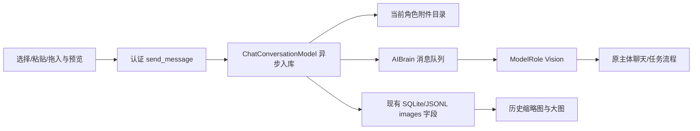
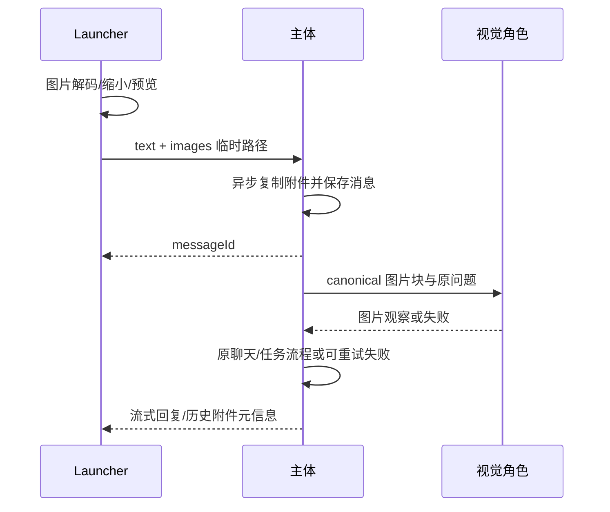

# 聊天图片：桌面端系分

修订：2026-10-18；基线 b33e079；单仓库 DesktopPet，C++/Qt 主体与 Python/PySide6 launcher。

## 1 背景与全局约束
用户需要在现有 launcher 私聊页发送图片，主体能够看图并回复，图片在历史里可查看。支持图文与纯图片、选择/粘贴/拖入、发送前预览移除、历史缩略图与大图查看。

- 当前角色 local_owner 范围，原文本 API 调用保留默认参数兼容。外部 IncomingMessage 不得带本地附件引用。
- ChatHistoryEntry 与 IncomingMessage 新增 QJsonArray images（尾部字段，避免破坏已有聚合初始化）。元信息为 id/name/mimeType/path，id与存储path由主体生成，name仅作纯文本显示，不作落盘路径。
- 图文为空且无附件才拒绝；文字仍上限8000。图片最多4张，发送版JPEG/PNG每张最多2MiB。原始文件最多20MiB/4000万像素，launcher用Qt解码、自动旋转、长边缩至2048，编码发送版。显示/识别都使用这个发送版本，不承诺保留原图分辨率。
- Launcher 临时附件直到发送应答后才清理；失败保留草稿与图片。主体异步复制到 appDataRoot/profiles/<profileId>/chat/images/<uuid>.<jpg|png>，保存终态消息后应答，失败清理本次未引用文件。原文件或 launcher 临时目录消失不影响历史。
- 所有历史、分页、around、最近快照将 images 非空的 user/assistant 计为可见消息。搜索继续检索正文，不做 OCR/图片内容索引；纯图片搜索结果不伪造正文。
- 图片二进制不进入实时快照、历史JSON、日志、记忆或外部会话。模型调用时才由存储副本构建 canonical image blocks。
- 图片使用现有 Vision 角色识别，再由原聊天主体结合观察回复/处理任务；观察被明确标为可能不准确的数据。用户记忆提取仅使用原始文字。
- 不新增库/数据库/通用附件框架。保持发送顺序、忙时输入、停止、重试、角色切换和既有聊天分页/搜索行为。

## 2 架构与改动

🔧 chat_types、conversation_types、conversation_store、profile_chat_history_store、launcher_chat_server、chat_conversation_model、petwindow、ai_brain相关文件；🆕 core/ai/chat/chat_image_store.{h,cpp}；🔧 launcher_chat_client.py、chat_page.py、chat_widgets.py；🆕 launcher/pages/chat_images.py；🔧 CMake与相应tests；🆕 任务验收/合成图片与截图。

## 3.1 模块概览
§3.2 图片消息接收、保存与看图回复 → §3.3 Launcher 图片编辑与历史显示。串行实现，每部分验证并提交。

### 3.2 图片消息接收、保存与看图回复
#### 1 模块定位
建立图片消息从认证发送、可靠存储、排队识别到主体回复的完整后端链路。
#### 2 核心接口与来源
| 接口 | 入参及来源 | 返回 |
| --- | --- | --- |
| ChatImageStore::importImages(imageSources) | sources 调用方传入(path/name)，目录来自构造的profile路径 | Result<QJsonArray,DomainError> 不可变附件元信息 |
| ChatImageStore::contentBlocks(images) | 已保存元信息由内部调用方传入，仅限当前profile附件目录 | Result<QJsonArray,DomainError> canonical image blocks |
| ChatConversationModel::appendUserMessageWithImages(text,sources,completion) | UI请求与回调由server传入，profile/store源于initialize | 异步保存后回owner线程，结果含messageId/images |
| ChatConversationModel::appendUserMessage(text,timestamp,images={}) | 文本/时间/已保存images调用方传入，旧调用默认空 | 稳定消息ID；重试复用已保存附件 |
| ChatConversationModel::sourceImagesForReply(assistantId) | 调用方传入助手ID，来源IDs由当前历史推导 | 原消息images，任何来源缺失时失败/空结果与原sourceInput语义对齐 |
| LauncherChatCallbacks::sendMessage(text,sources,completion) | server验证后的调用方数据 | 异步成功/错误，应答后才更新revision |
| AIBrain::submitUserMessage(text,id,rememberInput=true,images={}) | 调用方提供原文/id/已保存images，保留旧默认值 | 原有接收结果 |
| AIBrain 图片准备/识别与继续方法 | 当前ActiveDialogueResponse、原消息与generation系统推导 | Vision结果后继续现有trigger流程；命名行内自决 |

#### 3 模块流程
1. send_message 验证文字/附件组合，读取认证会话的当前profile。callback异步导入（QtCore文件读写和MIME内容识别），只接受常规可读JPEG/PNG、数量/字节上限与普通文件。名称不参与路径生成；不接受URL。
2. 复用model串行持久化池复制并保存完整ChatHistoryEntry，完成后在owner线程插入内存与通知界面。损坏/超限/磁盘失败无半条消息。销毁/重初始化的迟到结果不进入新角色。文字无附件走原轻量路径。
3. Accepted IncomingMessage及PendingUserMessage保留元信息。local_owner重复入库按原文与附件一致性判断，不能在第二次accept时丢附件。纯图片原文为空，prepareContext中的必要文字提示为临时展示数据，不覆盖持久化原文。
4. 图片消息独立成批，避免与其他排队消息合并后突破4张或丢失图片来源；文本合并行为不变。进入原前台busy/active response后先读图（在worker，避免GUI等磁盘）并调用Vision，requiresVision=true、无工具、原问题与canonical图像块。
5. Vision成功后把明确标注的图片观察加到本轮运行上下文，继续原复杂任务/本地路由/聊天准备流程；用户记忆写入仍读originalMessages的原文。不得把base64或文件路径拼入文字记忆。异步回调按原generation/active id保护；视觉流式中间内容不直接展示为最终回复。
6. 图片读取失败、视觉配置不可用或调用失败时结束为Failed并保留历史图片；停止取消视觉请求，后续迟到结果丢弃。重试收集原文字和附件再走同一队列，不能只重发空文字。

#### 4 数据变更
无DDL。既有 agent_messages.payload_json 及JSONL增加可选images数组；旧记录默认[]。load/query/编码同一字段，scope仍为当前profile/local_owner。附件文件独立于原始来源，history不嵌base64。

#### 5 实现锚点
| 现有入口 | 语义 |
| --- | --- |
| model m_persistencePool / initialize / appendToStore | 单线程持久化、生命周期generation；新增导入沿用，不在worker读写QObject成员 |
| ConversationStore acceptMessage/insertLocal/prepareContext | local_owner原消息可能由UI和消息服务重复写；保持幂等与原文不变 |
| profile store encodeEntry/decodeEntry/isValidEntry/loadLegacy | JSONL兼容与合法性要允许纯图片 |
| LauncherChatServer handleRequest/authorize/writeResponse | 新send callback使用已有异步query的QPointer接收保护；认证与帧限制不变 |
| AIBrain submit/dispatch/triggerThink/beginActiveResponse/cancelActiveResponse | 先占前台，再识别，再继续本轮；图片不可在路由前遗漏 |
| enqueueUserMemoryWrite | 已按originalMessages逐条提取原文；保留这一边界 |
| ModelRouter completeStreamAsync / ChatMessage.contentBlocks | Vision可取消调用，OpenAI/Anthropic编码复用，无需新API协议 |

#### 6 异常场景
业务：空消息、附件过多、非图像/超限 → CHAT_IMAGE_INVALID/CHAT_MESSAGE_INVALID，保留草稿；系统：保存/读取失败 → STORE_UNAVAILABLE；视觉路由失败 → 正常Failed回复与重试。沿用§1，不默默把无图文字当成已看图的回答。

#### 7 关键行为场景
图文/纯图保存、重开与分页可还原；删除来源后副本仍可读；图片消息与普通/诊断消息交错翻页不漏；同ID不同附件拒绝；跨profile读取/外部本地附件拒绝；JSONL旧记录兼容；复制或存储失败清理；异步不阻塞事件循环。假Vision收到真实canonical图像块，主体看到有来源标记的观察且原用户文本不变；停止/失败/迟到回调/后续队列正常；重试带回附件；文本链路无额外Vision调用。

### 3.3 Launcher 图片编辑与历史显示
> 依赖：§3.2 消息images元信息、send_message异步应答与错误。
#### 1 模块定位
提供自然的图片输入、草稿预览、发送与历史查看体验。
#### 2 核心接口与来源
| 接口 | 入参及来源 | 返回/行为 |
| --- | --- | --- |
| LauncherChatClient/AsyncLauncherChatClient.send_message(text,images=None) | 调用方原文和临时文件path/name；默认空 | 原operationFinished/operationFailed；图像发送使用合理的10秒I/O应答期限，模型不计入应答 |
| ChatInput 图片粘贴/拖入信号 | Qt剪贴板图片或本地文件URL用户输入 | 图片交给page规范化，普通文本粘贴仍走原实现 |
| chat_images.py 规范化/草稿与大图控件 | 选中文件或QImage调用方传入；阈值来自§1 | 临时JPEG/PNG、缩略图、错误提示/本地大图 |
| ChatPage 图片选择/移除/发送 | 用户动作，最多4张 | 预览、文字+图片或纯图，发送失败保留；成功只清已提交草稿 |
| MessageRow images渲染 | 消息images调用方传入，宽度由viewport推导 | 缩略图可点击查看，缺失图片友好占位，稳定行高 |
#### 3 模块流程
选图按钮、Ctrl+V粘贴图片或拖入文件 → Qt识别/旋转/缩小/编码临时发送副本 → 草稿缩略图和移除入口 → send_message带文件引用 → 主体应答成功清理本次临时副本；失败保留。发送在途不允许附件删除/替换，文字可以继续编辑，成功不得清掉后来改写的文字。
历史images按元信息显示，首次加载和上滑后都可点开；只对实际图片消息加载缩略图，刷新状态不重复解码未变附件，不改变原滚动锚点。旧文字显示、查询、搜索定位/高亮与任务行为保留。原名按纯文本显示；图片丢失不崩溃。
#### 4 数据变更
仅launcher临时发送文件，生命周期由草稿管理；不直接写主体历史库。保存路径只读，用Qt本地预览，不自动打开外部程序。
#### 5 实现锚点
ChatPage _submit/_send_pending/_operation_finished/_operation_failed 与set_client；ChatInput当前Enter/Shift+Enter逻辑；MessageRow set_available_width/update_message；client队列与请求失败关联；沿用现有tests/test_launcher_chat*.py和visual-qa流程。
#### 6 异常场景
业务：非图片、图片过大/过多、无效剪贴板 → 原地提示并保留合法草稿；系统：临时文件失败、发送失败、断线 → 不丢文字/已选择图片。换角色清理旧附件草稿，禁止误发上一角色图片。缺失历史副本显示“图片不可用”。
#### 7 关键行为场景
选图、剪贴板截图、文件拖入成功且不立即发送；可移除，纯图片Enter可发；普通文字粘贴/发送不变。压缩/像素/数量边界、发送成功清理/失败保留、在途草稿修改、断线/换角色。历史图文/纯图缩略图、大图、缺失图片、上滑/搜索定位和浅深/窄屏不回归；合成图片验证整个接口调用，不访问真实模型。

## 4 认证管道
沿用 action send_message：payload.text 字符串，可选 payload.images 数组，每项 {path:string,name:string}。sessionToken照旧，只允许当前profile。无新frame格式、不传base64。成功 {messageId:string} 可带images元信息，失败沿用领域错误。snapshot/history messages 新增 images 数组 {id,name,mimeType,path}，旧消息[]。

## 5 文件与数据
既有JSON载荷扩展，无DDL/回滚SQL。移除功能时旧文字仍能加载，不删除已发送图片。profile目录隔离，导入文件UUID命名，错误清理只操作本次新建文件。媒体目录使用既有owner-only权限策略。

## 6 性能与一致性
图片不撑大管道帧。导入、读图在后台；最多4张2MiB发送版本；模型生成期间沿用现有busy与停止。图片识别仅当前输入，不每次轮询/历史翻页重复调用。历史检索仍为文字检索，不增加昂贵OCR索引。

## 7 验证与交付
两个Task均先行为RED、实现GREEN、主代理审查/commit。运行相关C++/Python、全量构建与CTest；合成不同宽高/透明图片，实际查看浅深/窄屏截图和原生launcher。README补充图片格式/发送版限制、视觉角色配置和Windows手工步骤；不更改真实模型或发起真实图片请求。
