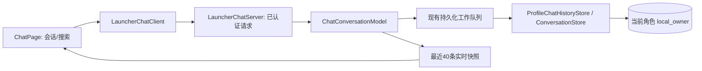

# Launcher 聊天重构：桌面端系分

修订：2026-10-18，基线 dd6c7cd。仓库：DesktopPet（C++/Qt 主体，Python/PySide6 launcher）。用户授权自主设计、实现、验证与分批提交。

## 1 背景与目标
将 launcher 的简陋聊天页改为 QQ 私聊式体验：独立会话标题、头像、左右气泡、时间信息、整洁输入区；首次最近 40 条，上滑才取更早页；聊天记录搜索可查已保存全文并定位上下文。

### 1.1 全局约束
- 不改主体人物/记忆归属，不改当前模型配置。历史与搜索只读当前 profile 的 local_owner，不接受前端指定 profile 或外部会话。
- 复用已有管道会话认证、operationFinished/operationFailed 与 request ID；新增 historyFailed(action,requestToken,detail) 关联查询失败，普通操作信号不变。查询为异步，不能阻塞 GUI 等磁盘；断线/切换角色后丢弃旧查询结果。
- 页大小默认 40、上限 80；搜索默认 30、上限 50，query 去两端空白后 1–200 字符。空历史为成功空页；坏游标/无查询/存储错误显示可重试提示，不重置已有聊天或自动发消息。
- 实时状态只发最近窗口；历史页按消息 ID 合并、去重，滚动锚点不因 prepend、流式更新或新消息丢失。阅读旧消息时新消息不抢滚动，显示返回最新入口。
- 分页、搜索与最近窗口仅计 user/assistant 可见正文；内存最近窗口另保留 pending/streaming 消息。system/空错误占位不占页、不进入对话气泡，诊断通过独立 diagnosticMessages（最近最多20条）供折叠诊断区使用；原 load 行为不变。
- 不添加新第三方依赖或通用防御框架。截图使用合成消息，浅色/深色和窄窗口均可用；纯文本显示防止消息被当 HTML。

## 2 架构与改动

修改清单：🔧 core/ai/chat/{conversation_store,profile_chat_history_store,launcher_chat_server,chat_types}.{h,cpp}，ui/{chat_conversation_model,petwindow}.{h,cpp} 中相关实现，launcher/launcher_chat_client.py；🔧 launcher/pages/chat_page.py；🆕 必要的聊天消息/搜索控件放在 launcher/pages/chat_widgets.py；🔧 tests/test_chat_conversation_model.cpp、test_chat_history.cpp、test_launcher_chat.py、test_launcher_chat_transport.py；🆕 tests/test_launcher_chat_server.cpp（若需要独立协议覆盖）及 CMake 登记。

## 3.1 模块概览
按依赖串行：§3.2 历史查询与协议 → §3.3 QQ 会话页及上滑加载 → §3.4 搜索面板与定位。每节独立提交，最后整体回归及视觉验收。

### 3.2 历史查询与管道协议
#### 1 模块定位
提供真正的分页、全文子串搜索和定位查询；保留最近消息的流式快照，消除 launcher 只能访问 120 条的限制。
#### 2 核心服务接口
| 接口 | 输入及值来源 | 返回 |
| --- | --- | --- |
| ConversationStore::queryLocalHistory(const QJsonObject& request) const | request 调用方传入；profile/path 构造配置；local_owner 系统固定 | Result<QJsonObject,DomainError> 页 |
| ProfileChatHistoryStore::queryHistory(const QJsonObject& request) const | request 调用方传入；后端路径来自 open | 同上，旧 JSONL 后端以相同规则查询 |
| ChatConversationModel::recentHistoryPage(int limit=40) const | limit 配置默认值；消息来自当前 model | QJsonObject 最近消息页 |
| ChatConversationModel::requestHistory(const QString& action,const QJsonObject& request,completion) | action/request/回调由 server 传入 | 工作队列查询后在所属线程回调 |
| LauncherChatCallbacks::queryHistory(action,payload,completion) | server 校验后的调用方输入；PetWindow 绑定当前 model | 异步完成 |
| LauncherChatClient.request_history(before_message_id='',around_message_id='',limit=40,request_token='') / search_history(query,before_message_id='',limit=30,request_token='') | UI 传入；limit 默认配置 | operationFinished / historyFailed；成功与失败均关联 requestToken |
完整字段见 §4。可将 wire 编码提取到 chat_types 复用，具体 helper 名为行内选择。
#### 3 模块业务流程
认证请求 → 校验组合与大小 → model 将查询排到现有持久化串行队列，保证此前终态写入已完成 → Store 使用函数内只读 SQLite 连接和读取事务，按 profile/local_owner 和 ID 对应 rowid 查询（不使用现有 BEGIN IMMEDIATE 写事务） → 回 owner 线程，带 requestToken 响应。socket 或 model 销毁时不访问旧对象。正常实时快照取内存最近 40 条，含正在生成的消息。
页查询在数据库中先筛选可见正文，再取 limit+1 判断是否还有更早，避免过滤产生空页；around 取目标及前后邻居，不将全部历史搬入 launcher。搜索仅 user/assistant 正文非空的已保存消息，按 rowid 倒序取 limit+1；匹配为字面子串，中文/ASCII 英文正常。搜索不到为成功空结果。
#### 4 数据变更
N/A — 无表结构变更，所有查询只读。沿用已有终态持久化、JSONL 迁移和内存消息生命周期。
#### 5 实现锚点
| 现有依赖 | 已核实语义 |
| --- | --- |
| ConversationStore::loadHistory(conversationId,limit) / history(db,profile,conversation,limit,beforeRow) | SQLite 按 rowid 排序；scope 必须限定，不用时间戳充当唯一游标 |
| ProfileChatHistoryStore::open/load/appendFinal | 正式为 SQLite，旧 JSONL/无存储模式仍可用，不影响导入兼容 |
| ChatConversationModel::messages()/m_persistencePool | 内存最近消息与串行终态写入；查询在 worker 读取只读 store 副本，不在 worker 访问 QObject 状态 |
| LauncherChatServer::processFrame/handleRequest/authorize | 当前同步响应；只给新增查询路径增加异步发送，保留认证/rate/frame checks |
| PetWindow callbacks.snapshot | 当前手工编码最近 120 条；替换为 model.recentHistoryPage，统计/任务不变 |
#### 6 异常场景
业务：坏 ID、空 query → 拒绝并说明，遵循 §1.1；系统：库不可读/断线 → 失败回调，不无限重试、不破坏当前消息；已销毁 receiver 丢弃结果。无新全局异常体系。
#### 7 关键行为场景
超过 120 条含相同时间戳的历史可连续获取全部页且不重不漏；分页中追加新消息不改变旧游标；搜索能找到首屏之外的中文/含 %/_ 消息并分页；around 包含命中与邻居，另一角色/外部会话 ID 被拒绝；异步查询不阻塞 Qt 事件循环，断线无迟到回调污染；旧 JSONL 查询仍可用；实时 snapshot 只包含最近 40 条且保留流式内容。

### 3.3 QQ 会话页与上滑加载
> 依赖：§3.2 的 query 协议、最近页和 client 方法。
#### 1 模块定位
重构会话展示为 QQ 私聊视觉与真实上滑分页，保留发送、停止、任务操作与诊断功能。
#### 2 核心服务接口
| 方法/事件 | 输入与值来源 | 行为 |
| --- | --- | --- |
| ChatPage._apply_state(state) | client stateReceived 调用方输入 | 合并最近页、更新状态，不覆盖已加载历史 |
| ChatPage._load_older() | 最早消息 ID 系统推导 | 请求一页，保护锚点与单个在途查询 |
| ChatPage._operation_finished(action,data) | client 回调 | 按 requestToken 接受当前会话结果 |
| ChatPage.scroll_to_bottom() | 用户触发 | 返回最近窗口；历史上下文有缺口时先恢复已缓存最新页 |
| MessageRow.update_message / set_available_width | message 调用方输入；宽度由 viewport 推导 | 头像/气泡/时间、换行与选择文本 |
#### 3 模块业务流程
初次状态 → 40 条底部；用户滚轮向上接近顶端或拖动滚动条至顶部 → 取 older 页 → ID 合并 → 保持第一可见消息与偏移。初始 layout/rangeChanged 不触发自动连页；新页恢复锚点不触发级联请求。无更多时显示起点提示；失败时保留重试入口。
标题显示角色头像/姓名/在线或回复状态；聊天背景浅灰、收到消息白色气泡、发送消息蓝色气泡；头像左右、时间分隔、输入区白底与单独工具栏。任务卡仅有任务时出现，诊断折叠。新消息在阅读历史时提示“回到最新”，不强拉到底部。
#### 4 数据变更
N/A — 仅 launcher 内存页和视口状态，不写存储。
#### 5 实现锚点
ChatPage 当前 _render_messages 保存 messageId/像素偏移，可复用；_client_connections 与 set_client 必须清理历史 query token；现有 _submit/_stop/_task_action 以及 Enter/Shift+Enter、失败保留草稿测试不得退化。现有 _visible_count/PAGE_SIZE 本地展开改为已加载页，移除废弃的 120 条假分页分支。
#### 6 异常场景
业务：无历史/已到顶 → 友好提示，不继续请求；系统：分页失败 → 原地重试，正文仍可读；切换角色/离线 → 清理待取页和搜索状态，沿用 §1.1 代际保护。
#### 7 关键行为场景
首屏只 40 条且不因 resize/首次 layout 请求旧页；上滑仅请求一页；加载前后同一消息屏幕位置基本不变；实时 token、追加消息不破坏历史与已选文本；阅读旧消息收到新消息仍停留原位；发送/忙时继续发/停止/任务控制/断线草稿行为保留；700/1100 宽及浅深主题无横向溢出。

### 3.4 聊天记录搜索与定位
> 依赖：§3.2 检索与 around；§3.3 会话页与锚点。
#### 1 模块定位
提供可折叠的聊天记录面板，按关键字查当前角色历史，结果点击定位到原始上下文。
#### 2 核心服务接口
| 方法/事件 | 输入与值来源 | 行为 |
| --- | --- | --- |
| ChatPage.open_history_search() | 工具栏或 Ctrl+F 用户触发 | 打开侧栏并聚焦输入 |
| ChatPage._search_history() | query 用户输入，token 系统生成 | 请求第一页；Enter/搜索按钮显式搜索 |
| ChatPage._load_more_search_results() | 最后结果 ID 系统推导 | 同一 query 后续页 |
| ChatPage._locate_history_message(id) | 点击已返回结果传入 | around 查询、替换历史窗口、定位高亮 |
| 搜索结果控件 | 角色、时间、内容由响应提供 | 显示纯文本摘要；原文可在上下文选择 |
#### 3 模块业务流程
点击记录或 Ctrl+F → 输入关键词 → 查询 → 结果显示人/时间/摘要 → 更多结果逐页获取 → 点击命中 → 拉取附近记录 → 居中定位并短暂高亮；继续上滑能读取更早。搜索窗口保留，关掉不影响聊天；“回到最新”恢复最新40条和尾随。较窄页面限制搜索栏宽度，聊天输入仍可用。连续搜索或切角色丢弃过期结果。
#### 4 数据变更
N/A — UI 状态与只读历史，不改正文、历史 ID 或已读标记。
#### 5 实现锚点
client.search_history / request_history 及 operationFinished 的 requestToken 作为请求关联；ChatPage 的 _render_messages/_scroll_anchor 负责定位；字符串以 PlainText 展示，不用原始HTML高亮。当前任务和诊断仍接收 state 更新，不因搜索暂停。
#### 6 异常场景
业务：空关键词/无结果 → 清晰空态；系统：搜索或定位失败 → 保留 query/结果并给重试，不把错误混入对话。统一遵循 §1.1。
#### 7 关键行为场景
搜索首屏外历史并定位正确消息；重复搜索迟到响应不污染新结果；搜索翻页去重且无更多按钮正确；无结果/空关键词/断线可恢复；命中上下文不与最新页伪造相邻，返回最新恢复；角色切换清空结果；Ctrl+F/Esc 和鼠标入口可用。

## 4 管道接口
保留 protocolVersion=1，新增已认证 action：get_chat_history、search_chat_history。认证 sessionToken 在 server 归一化请求时剥离，再执行严格查询参数校验。

| payload 字段 | 类型/规则 | 来源 |
| --- | --- | --- |
| beforeMessageId | 可选字符串，排他游标 | UI 已收到的最早 ID 或搜索最后 ID |
| aroundMessageId | 可选字符串，不能与 before/query 同用 | 搜索命中 ID |
| query | 仅 search 必需，trim 后 1–200 字符 | 用户输入 |
| limit | 可选正整数；history 40/80，search 30/50 | 默认配置/调用方 |
| requestToken | 可选字符串，原样回传 | UI 会话/查询代际 |

响应：messages（history 正序，search 倒序；id/role/replyToId/content/timestamp/status/errorMessage），hasMoreBefore、hasMoreAfter、oldestMessageId、newestMessageId、requestToken；search 另有 query、nextBeforeMessageId；around 另有 anchorMessageId。所有状态 snapshot 包含最近页字段及单独的 diagnosticMessages，与 petName/profileId/busy/aiEnabled/task/statistics 并列。查询不变更 revision/openRequestId。

错误沿用 DomainError，参数/游标错误 CHAT_QUERY_INVALID，存储 STORE_UNAVAILABLE，失去会话认证用现有认证错误。原接口继续支持；新增 client 不把查询结果当成发送成功或重置草稿。

## 5 存储
复用 agent_messages(profile_id,id,conversation_id,rowid,payload_json) 和现有 JSONL；不做 DDL，不增加第二套聊天数据库。游标通过绑定 ID 解析 rowid，每次查询固定 profile/local_owner。UI 分页与 model 初始工作集是独立职责，搜索不能被最近工作集上限截断。

## 6 性能与一致性
一次仅一个历史请求在途；搜索明确触发，页有上限；不把全量记录传入 launcher。query 在现有串行工作池执行，正文不阻塞界面。内存失败回退只覆盖现有无持久化模式，不为额外后端造框架。

## 7 验证与交付
每节先 RED 后 GREEN；主代理审查接口、覆盖与线程边界并 commit。最后完整构建、CTest、Python launcher 测试；用合成至少 180 条消息演示分页/搜索定位，保存浅深主题与窄窗口截图并人工查看。新增 Windows 操作清单覆盖此 UI，与既有 Windows 报告的模型配置边界分开记录。
