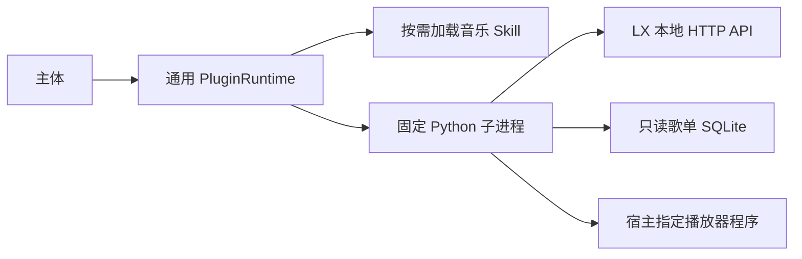
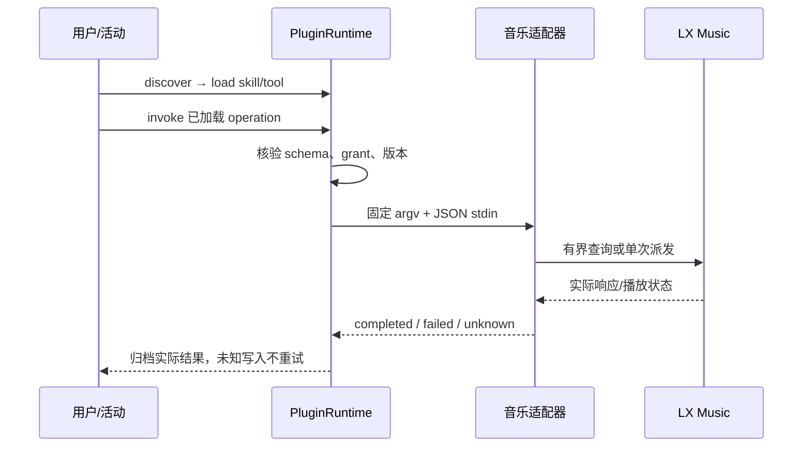

# LX Music 通用能力接入 · 桌面端系分

修订：2026-10-17 v1.0。仓库：DesktopPet（Qt/C++ 宿主，Python 标准库插件）。

## 1. 背景与约束

用户要求在 Windows 实机验证之前完成所有可在 macOS 完成的音乐工具与技能接入工作。本轮交付一个真实可执行的 LX Music 插件，覆盖现有 12 项操作、技能说明、角色配置、故障诊断、可重复的宿主验证与 Windows 验收步骤。QQ 接入另立任务；其他内置工具不在本次音乐样板迁移范围。

沿用 [通用插件契约](../../../contracts/tools/插件运行时接入.md) 和已完成的自主 Agent 设计，不增加软件名称分支、QQ 依赖或人物识别前置条件。用户已授权自主推进并逐阶段 commit，整体与阶段确认沿用此授权。只修改本仓库，不推送，不修改当前角色的真实配置，不安装或启动真实播放器。

### 1.1 公共约束

- 使用 Python 3.9+ 标准库；无新增下载依赖。发行包放 `plugins/lx-music/`，全部运行内容在包内，不依赖源码树的相对导入。
- 插件 ID `desktop-pet.lx-music`；Tool ID `desktop-pet.lx-music.tools`；Skill ID `desktop-pet.lx-music.skill`；版本 `1.0.0`。
- 命令固定为宿主配置的绝对 Python、适配器和连接配置路径；模型只提交业务 JSON。无 shell 拼接、任意 URL、任意程序或数据库路径参数。
- 连接设置由宿主文件提供：`apiUrl`（默认 http://127.0.0.1:23330，仅 HTTP loopback 主机且无凭据/query/fragment）、`database`（绝对 SQLite 路径）、`executable`（可选绝对程序文件）、`requestTimeoutMs`（默认 1000，100–5000）、`verifyTimeoutMs`（默认 8000，100–15000）。禁用 HTTP 代理与重定向；网络/输出/轮询有界。
- read 操作：status、lyric、list_playlists、playlist_songs。查询不启动播放器；不存在的数据库不创建，只读 URI、参数化 SQL、有限返回数量。unknown playlist 与空歌单区分。
- write 操作：launch、play、pause、skip_next、skip_prev、set_volume、search_play、play_playlist。启动必须显式执行 launch 或明确的播放操作。每次业务写请求至多派发一次；断连/超时/派发后无法确认 → unknown，后续只读核对，禁止自动重发。确定的前置条件/输入错误 → failed。
- 适配器 stdout 始终一个 UTF-8 JSON 对象：`{state: completed|failed|unknown, data: {...}}`；业务错误置 `data.error={code,message}`，协议正常时进程返回 0；崩溃/强杀由宿主处理。所有 operation 的 completion=reported，宿主 dataPointer=/data，statePointer=/state，显式 stateMap；不用 errorPointer 将 unknown 强转 failed。
- completed 的边界逐操作声明：只读取得真实响应；launch 验证 API 可用；play/pause/volume 验证目标状态；skip 的 completed 仅代表 API 明确应答（不宣称歌曲已切换）；search_play 验证 playing 且歌曲/可选歌手匹配；play_playlist 验证 playing，但不宣称 API 没有提供的歌单 ID 已确认。无法验证写入结果返回 unknown。
- 既有 C++ 工具及旧 SKILL.md 保持原有路径；新包技能只引用本包操作，不将旧 allowed-tools/Bash 声明当宿主权限。安装不自动授权自主操作，配置默认仅本地主人。
- 不更改身份/记忆/会话库。所有测试用临时文件、临时 SQLite、loopback HTTP 测试后端和受控进程；Windows 真实软件验收单独列出。

## 2. 架构与变更清单

| 变更 | 文件 | 用途 |
| --- | --- | --- |
| 🆕 | plugins/lx-music/{adapter.py,plugin.json,tool.json,skill.json,SKILL.md,USAGE.md} | 自包含音乐能力包 |
| 🆕 | plugins/lx-music/{configure.py,README.md} | 可预览的宿主配置生成、只读诊断和 Windows 步骤 |
| 🆕 | tests/test_lx_music_adapter.py、tests/test_lx_music_configure.py | Python 真实进程/数据库/HTTP 与配置测试 |
| 🆕 | tests/test_lx_music_plugin.cpp、tests/fixtures/lx_music_backend.py | 通用运行时加载及真实子进程集成 |
| 🔧 | CMakeLists.txt、contracts/tools/README.md | 注册测试与接入文档入口 |

## 3. 详细设计

### 3.1 顺序

Task 1 对应 §3.2 完整可执行能力包；Task 2 对应 §3.3 角色配置、宿主验证与 Windows 交接。两项串行，每项审查后提交；本文件与实施计划先单独提交。

### 3.2 音乐工具与技能能力包

#### 1. 模块定位

把现有音乐工具的 HTTP、SQL 和 Scheme 业务封装为自包含 command Tool，加上可加载的使用方法 Skill。复用原有 API 路径、SQL 字段和 Scheme 格式，不依赖 C++ 对象地址。

#### 2. 核心服务接口

命令：`python adapter.py --settings <absolute.json> --operation <id>`，业务参数从 stdin 获取；`--diagnose` 执行只读依赖检查（不需要业务 stdin，不启动播放器）。内部函数签名由实现选择，外部 CLI/JSON 为本节约束。

| 入参 | 值来源 | 说明 |
| --- | --- | --- |
| settings 路径 | 配置默认值（来源: Tool configuration.settings） | 宿主固定文件 |
| operation | 配置默认值（来源: Tool invocation 中的常量） | 下列 12 项之一 |
| volume | 调用方传入 | integer 0–100，不接受 bool/字符串，不静默截断 |
| song、artist | 调用方传入 | song 非空，artist 可选，长度各 ≤256；Scheme 编码 |
| playlist_id | 调用方传入 | 非空 ≤512，参数化 SQL |
| 超时、API、程序、数据库 | 配置默认值（来源: §1.1 settings） | 模型不能覆盖 |

无参数：status、launch、play、pause、skip_next、skip_prev、lyric、list_playlists。set_volume 接收 volume；search_play 接收 song 和可选 artist；playlist_songs/play_playlist 接收 playlist_id。所有对象 additionalProperties=false。

诊断返回 Python/平台、配置是否合法、程序文件存在情况、数据库只读查询结果、API 可达与返回状态；partial/unavailable 明确区分。诊断不生成虚构播放结果，缺失依赖正常报告，便于没有播放器的 macOS 使用。

Skill dependencies 精确列出本包 Tool 版本和 operation，instructions 保留“查歌单→选目标→播放→核对”的方法，同时说明 launch、unknown、暂停/切歌边界。不声明尚未实现的收藏、跳转等旧说明能力。

#### 3. 模块业务流程

先验证宿主配置和业务输入 → 只读 SQL/API 或单次写派发 → 按 §1.1 核对状态 → 输出 JSON。操作中有写派发时记录局部 dispatched 标志；失败不得以“还没成功”再次写。启动使用 argv 数组和绝对程序路径；Windows 用合适的 detach/no-console 选项，POSIX 使用独立会话并关闭 stdio；没有配置程序时明确失败，不猜测任意 shell。

#### 4. 数据变更

不写主体数据库。查询现有 `my_list(id,name,source,sourceListId,position)`、`my_list_music_info_order(listId,musicInfoId,"order")` 与 `my_list_music_info(id,name,singer)`；只读打开。音乐写动作只作用于宿主授权的播放器。

#### 5. 实现锚点

| 已有依据 | 使用约定 |
| --- | --- |
| core/ai/tools/music_tools.h | HTTP /status、/lyric、/play、/pause、/skip-next、/skip-prev、/volume；Scheme searchPlay 与 songlist/play；状态 playing/name/singer |
| core/ai/skills/lx-music-skill/scripts/playlist.py | 表结构及 sourceListId 归一化；提取可复用业务，不引入包外运行依赖 |
| contracts/tools/{plugin,skill,capability}.schema.json | Plugin entries 和 Skill dependencies 必须解析成功 |
| core/ai/plugin/capability_executor.cpp | command stdin JSON，reported 结果配置映射；进程非零退出无法传递业务成功 |

JSON 层级为 envelope.state 与 envelope.data；业务错误在 data.error；原始状态对象保留在 data.status；列表在 data.items，歌词为 data.lyric。输出不能夹带日志。

#### 6. 异常场景

- 非法音量、缺歌单或本地歌单无可播放 source：抛业务错误并转 failed，与 §1.1 一致；不发 HTTP/进程。
- API 不可达、坏 JSON、数据库锁/不存在/结构不符：读操作返回 failed，不能创建数据库或报告空成功。
- 单次写已派发后断连、验证不匹配或超时：降级 unknown，保留可用状态证据，不重发。
- 输入/输出过大：拒绝并返回有界错误；使用有限行数和 HTTP 体积，避免宿主因无限输出强杀。

#### 7. 关键行为场景

- 真实子进程读取临时 SQLite，返回有序歌单及歌曲，缺文件不创建，未知歌单与空歌单区分，特殊字符 ID 不影响 SQL。
- loopback 服务返回状态和歌词，查询成功且不启动程序；坏 JSON、HTTP 错误、超时明确失败。
- 正常播放/暂停/音量在单次写后经状态核实完成；不匹配或连接中断返回 unknown，服务端写入计数始终 1。
- next/prev 单次应答按明确的完成边界返回，不伪造曲目变化。
- 受控启动程序获得 argv，Unicode/空格/引号不经 shell 解释；launch 等待 API，search_play 核对歌名/歌手，play_playlist 的无法播放来源在派发前失败。
- 诊断对存在与缺失依赖分别返回可解释结果，不启动程序、不创建数据库。
- 包清单包含 12 个有实现的操作与一个可加载 Skill；参数越界、附加字段、格式错误被拒绝。

### 3.3 角色配置、运行时验证与 Windows 交接

> 依赖：§3.2 的可执行包、配置/返回格式和操作身份。

#### 1. 模块定位

给 Windows 用户一个可以直接生成、检查和应用的角色配置，并在 macOS 用实际 PluginRuntime 走完整条调用路径，保证交接不止是一份脚本。

#### 2. 核心服务接口

`python configure.py --profile-dir <profiles/UUID> --database <db> [--executable <program>] [--api-url URL] [--autonomous off|read|all] [--apply]`。

| 入参 | 值来源 | 约束 |
| --- | --- | --- |
| profile-dir、database、executable、api-url | 调用方传入 | profile-dir 已存在且末级是 canonical UUID；路径按当前 OS 解析为绝对路径；无需真实 LX 文件存在即可预览 |
| Python/包路径 | 系统推导（来源: sys.executable、__file__） | 使用真正解释器绝对路径，不保存 py 启动器别名 |
| autonomous | 配置默认值（来源: CLI 默认 off） | read 只授权四项查询及 Skill 加载；all 明确授权全部音乐动作 |
| apply | 调用方传入 | 默认只输出预览，不写文件；显式 --apply 写当前指定角色 |
| existing config | 系统推导（来源: profile-dir/plugins.json） | 严格 JSON/type 检查，损坏拒绝；保留无关字段、插件、配置、grant |

预览输出完整拟写 host config 和连接设置及目标路径。应用时为原文件保留备份、临时文件原子替换，失败恢复，重复应用不重复添加条目。仅管理本插件的 entries/configuration/grants/resultAdapters；兼容已有 plugins 条目没有 pluginId 的形式，通过已存在 root/plugin.json 判定身份，冲突拒绝不猜测覆盖。连接设置放角色目录，包本身不存用户数据。默认 grant 仅 LocalOwner；内部自主 grant 需要 --autonomous 选择，Skill grant 不代替 Tool 的 operation grant。

#### 3. 模块业务流程

读取角色路径与现有配置 → 根据实际 manifest 构造精确 grant/resultAdapters/settings → 输出预览或备份并应用 → 用户重启桌宠加载 → 先只读诊断与发现 → 手动调用 → 可选启用自主。C++ 集成测试加载发行包、生成测试配置、实际 discover/load/invoke，通过临时 HTTP 后端和数据库产生业务结果；不用 C++ 内置音乐工具证明新插件通过。

#### 4. 数据变更

只写显式指定角色目录的插件配置及备份，不改 agent_runtime.sqlite、人物/记忆、默认角色配置；测试写临时目录。无需 SQL 迁移。

#### 5. 实现锚点

| 签名/依据 | 调用约定 |
| --- | --- |
| PluginRuntime(profileId, configurationPath) / setHostConfiguration(QJsonObject) | 配置属于同一 profile；真实插件目录 |
| discoverCapabilities(ContextSpec,bool) / loadCapability(CapabilityRef,ContextSpec,bool) | localOwner 默认可发现 Skill；internal 需授权；版本精确匹配 |
| executeGateway(ToolExecutionRequest, completion) | discover_capabilities/load_capability/invoke_capability；异步等待并检查 stage/data/executed |
| tests/test_plugin_runtime.cpp、CMakeLists.txt add_desktop_pet_cpp_test | 同根 tests/ 布局，新专用集成目标；Python 用 find_package 得到的解释器，不硬编码 /usr/bin/python3 |
| AgentRuntimeServices::startAfterStorageReady(const RuntimeStartRequest&,const ProfileMigrationResult&) / ai_brain_plugins.cpp | appDataRoot/profiles/UUID/agent_runtime.sqlite 同目录 plugins.json；README 解释定位方法 |

#### 6. 异常场景

- 无效 UUID、坏 JSON、冲突的插件身份：抛配置错误，保持原文件。
- 磁盘写入/替换失败：回滚原内容并报告，保留备份，不留半个配置。
- Windows 真实程序/API/数据库不可用：诊断明确缺项，README 指导修正路径/开启开放 API，不宣称已完成实机测试。
- 未授权写/自主调用、禁用插件或过期句柄：宿主拒绝，不产生服务端写入。

#### 7. 关键行为场景

- 预览不写文件；应用保留其他插件与字段，创建备份，重复配置幂等；off/read/all grant 范围准确，故障保持原配置。
- 实际 catalog 发现 Tool/Skill，加载方法正文和 12 操作；实际 command 子进程查询 HTTP 和 SQLite 得到完整业务值。
- 从 LocalOwner 执行正常查询/控制；Internal 未授权不能发现/调用，read 只能查询，all 能通过操作 grant 调用；外部会话无默认授权。
- 参数非法、禁用和版本失效不产生网络写；一次已派发但未知的写返回 unknown，结果可由 status 核对，不重复派发。
- Windows README 提供 PowerShell 参数数组、UTF-8 stdin 示例、配置路径、真实播放验收矩阵和回滚步骤；记录 macOS 已验项目与 Windows 未验项目。

## 4. 对外接口

唯一执行契约为 §3.2 CLI/JSON；唯一配置入口为 §3.3。已有 Tool formatVersion=1、Plugin/Skill formatVersion=1 不改版，不引入宿主软件专属 API。

## 5. 存储

无表结构变更；只读 LX SQLite 和可备份配置文件。无 SQL 迁移/回滚。

## 6. 非功能性

请求/轮询/输入输出有界；Python 子进程不阻塞 UI；库读取不创建/修改 LX 数据；错误不泄露配置内容；记录未知效果而不重复执行。

## 7. 验证与交接

阶段内先写行为测试得到 RED，再实现 GREEN；每阶段做代码审查、覆盖映射、锚点核对与完整回归。最终完成构建、CTest 全量、契约检查，形成 Windows 验收 README。实际 Windows 安装、协议关联、播放器 API 版本/数据库结构及出声效果只由 Windows 实测确认。
