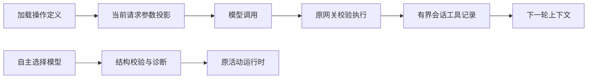
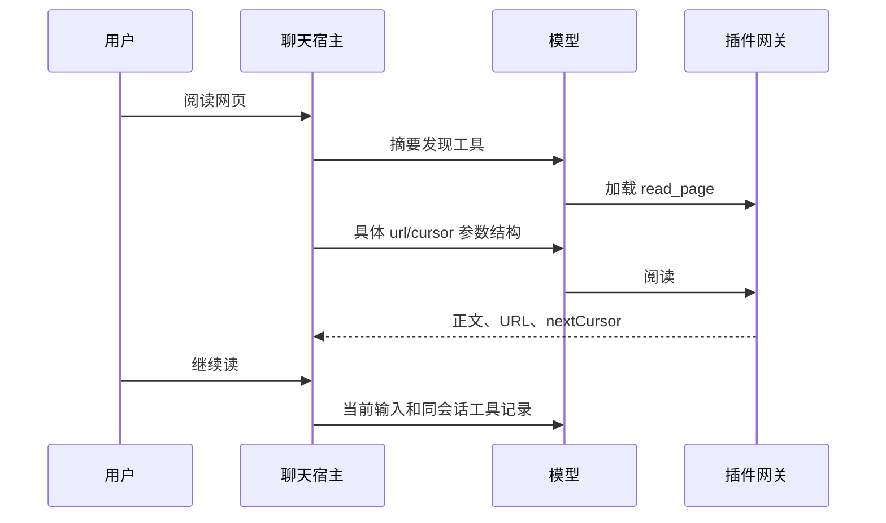

# 验收问题修正

修订：2026-10-20。仓库：DesktopPet（Qt/C++）。来源：Windows 插件验收、记忆修复报告及当前会话的代码审查。本文修订相关旧设计的实现细节，不改变插件包契约。

## 1 背景与全局约束

- 用户已授权在 macOS 修复四项问题并阶段性提交；沿用自主推进安排。真实模型、Windows、B 站登录与 ASR 验收留备注，本地做针对性回归。
- §3.1 保留人物/受众归属限制、现有事务语义，不迁移历史记忆。
- §3.2–3.3 维持按需加载，模型参数必须来自当前请求保留的完整操作定义。投影不授予权限；实际执行仍走 PluginRuntime、ToolRuntime、版本与上下文检查。
- §3.3 工具结果是有界的会话材料，不写成用户事实，不跨人物/会话/角色共享；清空聊天需同时清理它。
- §3.4 保留选择预算、全局开关、证据引用和业务校验。不把无效输出转换成成功或默认 wait，不增加无限重试。
- 异常继续用 DomainError/ToolResult；只处理已发现的真实场景，不建立通用自然语言推断系统。

## 2 架构与文件

变更范围：🔧 memory_statement 与 memory_attribution 回归；🔧 capability_context、ai_brain_loop、task_orchestrator 及相关回归；🔧 聊天上下文/历史生命周期与回归；🔧 model_router、activity_selector、自主结果诊断及回归。必要的小型辅助类放在对应模块，不另建框架。

## 3 功能切片

### 3.1 完整记忆更正

#### 1 模块定位
只在新陈述覆盖旧事实的全部有效信息时标记旧事实失效。

#### 2 核心服务接口
沿用 `MemoryStatement::replacesCompleteFact(const QString&, const Correction&)`。

| 入参 | 值来源 |
|---|---|
| oldFact | 调用方传入（store 中旧 active content） |
| update | 系统推导（原始 evidence 经 correction 解析） |

#### 3 模块业务流程
按现有分句和主体识别；已完整保留的子句通过。涉及旧值的子句必须验证旧值以外的有效内容也在新陈述中保留，不能用 contains(previous) 整句跳过。首句主体后的信息同样检查。只支持可明确核对的文本替换，其余保留旧条目。

#### 4 数据变更
函数不写数据；MemoryPolicy 沿用原事务写 Supersedes 关系和旧 status。人物/受众检查在本函数之前。

#### 5 实现锚点
`MemoryPolicy::discoverRelations` 从单条 user_explicit/rule_v1 evidence 调用 correction 和 replacesCompleteFact；tests/test_memory_attribution.cpp 的 explicitCorrectionSupersedesOnlyCompleteSameSubjectFact 为完整路径参照。

#### 6 异常场景
业务：同星期另含施肥或浇水量未覆盖，返回 false；系统/结构：分句或主体不匹配，沿用 false，不猜补。符合 §1 的保守更正边界。

#### 7 关键行为场景
旧每周三浇水，改每周五且保留位置，旧条目失效；旧每周三浇水 200 毫升，而新语句只有每周五浇水，旧条目保持 active；其他人物/物品不变。首句中同样未覆盖的细节保持有效。

### 3.2 加载后暴露具体参数

#### 1 模块定位
在当前请求加载定义后，给模型具体可填的业务参数结构。

#### 2 核心服务接口
在 CapabilityContext 增加请求级工具投影及调用归一接口（返回工具列表和别名到 ref 的映射）；支持 ChatMessage 和 task steps 两种输入。

| 入参 | 值来源 |
|---|---|
| baseTools | 调用方传入（当前权限范围的工具列表） |
| projected messages/steps | 系统推导（现有 projectMessages/projectSteps） |
| model call | 调用方传入（当前模型响应） |

#### 3 模块业务流程
先执行现有内容预算投影；仅对保留且指令正文可解析的完整操作生成稳定、合法、短的工具名。parameters 直接使用业务 schema，不再包在无属性 arguments 中。模型列表移除通用 invoke，仅保留 discover/load 及最多两个具体操作；原生工具照旧。响应在权限判定之前将当前映射内别名归一为 invoke_capability + ref + arguments；未知别名拒绝。历史保留模型实际调用名和 ID，与 tool 结果配对。任务的 available_tools 和下一步 tool 对象也应用相同投影/归一，内部步骤保存规范网关调用便于恢复。投影同时捕获 catalogRevision/definitionDigest，通过宿主 ToolExecutionRequest/TaskToolCall 附带（默认空兼容原调用，不能从模型对象复制）；executeGateway 构造调用前与当前 loaded 比对，防止旧请求期间其他路径重载同 ref 后偷换版本。

#### 4 数据变更
N/A — 请求级别名不写全局工具注册表或插件包。任务持久化仍使用现有步骤格式。

#### 5 实现锚点
CapabilityContext::hasOperation 有消息/steps 两种重载；PluginRuntime::executeGateway 仍按当前 loaded/ref/grant/schema 执行。聊天入口 thinkInternal、任务入口 TaskOrchestrator::callModel/dispatchTool 必须同时覆盖。AIBrain::refreshTaskDependencies 内对外部/内部任务覆盖 available_tools 时也应用相同投影，不能还原为泛型工具。JSON：工具 function.parameters 为操作 parameters；归一后 arguments 为 {ref,arguments:业务对象}。

#### 6 异常场景
业务：未加载、已释放、伪造别名拒绝；系统：过期目录版本由原网关 STALE_REVISION 拒绝。原安全检查不以历史声明或别名替代，符合 §1。

#### 7 关键行为场景
load read_page 后下一次模型看到必填 url；搜索与读取同时加载时互不混合参数；切换条目后旧别名不可执行；有效调用通过网关读取，空 url/未授权仍失败。聊天和任务行为一致。

### 3.3 跨轮工具上下文

> 依赖：§3.2 参数投影与规范网关执行。

#### 1 模块定位
在当前会话下一轮保留可续读的真实工具结果。

#### 2 核心服务接口
在 AIBrain 会话生命周期记录完整工具回合并向准备完成的当前请求附加同范围的近期记录。可用独立小类实现 add/project/clear 的容量和配对规则。

| 入参 | 值来源 |
|---|---|
| scope key | 系统推导（当前 profile + conversation + origin / context cacheKey） |
| tool round | 系统推导（当轮 assistant tool calls 和经 sanitizer 的对应结果） |
| current messages | 调用方传入（ChatPreparationExecutor 当前准备结果） |

#### 3 模块业务流程
成功回调按模型原调用名/ID 保存配对，只有完整回合进入会话记录。第二轮准备完成后把之前已发生的工具回合放在当前用户输入前；当前轮继续用工作消息，不重复追加。同范围记录最多两个完整回合，全局 32 KiB，按最旧回合剔除。记录范围除 cacheKey 外比较 channel、identityRevision 和 participantPersonIds，参与者变动不能复用。conversationRevision 是每条消息/回复递增的水位，正常聊天变化不能使同受众历史失效。不得保存 transportBlocks/附件；结果正文由原 sanitizer 清理。完整 load 定义只经过现有按需投影进入模型，不无限积累。清空记忆、restoreConversationHistory、角色/运行时切换清理。

#### 4 数据变更
不增数据库表。与现有进程内对话窗口一致，重启不保证保留游标。工具记录不冒充长期人物记忆或可见聊天条目。

#### 5 实现锚点
thinkInternal 保存局部 messages 中工具轮；finishActiveResponse 当前仅将 visibleContent 加入历史；ChatPreparationExecutor::execute 使用 ConversationStore::prepareContext 构建历史，故应在准备结果回到 AIBrain 后合并记录，避免在 worker 持有 GUI 状态。clearMemory 与配置/会话切换路径需核查。

#### 6 异常场景
业务：另一人物/会话无权获取记录，返回空；系统：取消/失效 callback 按原 isCurrent 判断丢弃，不注入新请求。超预算删除完整回合，不产生孤立 tool 消息，符合 §1。

#### 7 关键行为场景
第一轮 web_fetch 返回 URL/nextCursor，第二轮用户说继续读，模型上下文仍有原值；必须用 AgentBootstrap + submitUserMessage 验证消息和回复入库导致 revision 递增后的真实宿主路径。同范围 load/invoke 受 §3.2 约束；两个会话隔离；清空后无旧记录；大量结果容量有界且所有 tool call 都有对应结果。

### 3.4 自主选择输出兼容与诊断

#### 1 模块定位
修复可在本地重现的结构化输出兼容问题，并让未通过的自主选择带可定位原因。

#### 2 核心服务接口
沿用 ModelRouter::completeAsync(ModelRequest, callback) 和 ActivitySelector::parse(QJsonObject, SelectionRequest)。在路由器统一解析对象并提供有限格式归一；DomainError.details 传递结构错误阶段、字段路径和原因。

| 入参 | 值来源 |
|---|---|
| response content | 调用方传入（provider 响应） |
| responseSchema | 调用方传入（ActivitySelector::schema） |
| selection request | 系统推导（现有机会、证据、候选能力） |

#### 3 模块业务流程
检查实际 schema 与 parser；仅接受纯 JSON 对象或整体 Markdown JSON fence，不能从任意说明文字中截取对象。统一使用生产 SchemaValidator 验证，合法归一正文传给 selector。失败一次修复请求包含具体结构错误而不附原始响应；第二次仍失败返回安全 details。Selector 的 capabilityRefs.operationId 改为可选，与 CapabilityRef::toJson 及已有“先选条目、后加载操作”的行为一致；提示说明摘要的 id/version 对应 entryId/entryVersion，写清 start/resume/wait 字段含义和空值写法，业务证据/能力仍严格校验。自主结束时将简短诊断写入已有结果通路，便于下次真实验收定位。Windows 原始响应未入库，不能宣称其确切根因已还原。

#### 4 数据变更
沿用现有结果记录/日志扩展字段，不增表。任何保存诊断不包含模型原始正文、用户输入或密钥。

#### 5 实现锚点
ModelRouter::attemptRoute 当前 schema failure 只保留布尔值；sendAttempt 以 system schema 指令请求对象；ActivitySelector::selectActivity 再次 parse。已核实 responseMatchesSchema 仅校验顶层 type/required，遗漏 enum/嵌套等约束；SchemaValidator 使用 jsoncons 完整校验但仅返回通用错误。统一调用 SchemaValidator，并从其校验事件提供限定的 schema 字段路径/keyword 诊断，禁止返回 message 内可能包含的实际值。ai_brain_autonomy 的 finish 仅传 error code，改用既有 reason 字段保留简短诊断（最长 512 字符）；保持原预算结算。

#### 6 异常场景
业务：错字段/未知引用仍失败，不转 wait；系统：服务连接失败沿用 provider error/fallback，预算不足仍拒绝，不额外重试。符合 §1。

#### 7 关键行为场景
合法 start/wait 通过，start 的 entry-only 引用省略 operationId 也通过，已明确操作的引用仍可用；整体 json fence 按同一对象处理；缺字段修复请求指出字段且下次正确返回可成功；非法对象到最终错误带安全诊断；不把错类型、未知能力和不合法续行转成成功；预算/关闭控制继续有效。

## 4 接口契约

插件 manifest、command envelope、load/invoke 业务契约不变。仅改变模型看到的请求投影；生成的操作工具引用在执行前归一为 invoke_capability(ref, arguments)，另在宿主请求对象绑定所见版本（不进入模型参数）。聊天工具记录不进入用户可见消息列表。模型失败只保留有界、无原始模型正文的诊断。

## 5 数据

不修改数据库表结构；记忆沿用 superseded 事务。跨轮工具上下文采用进程内有界记录，与现有会话窗口相同生命周期，重启后不承诺续读。自主诊断优先使用已有 DomainError.details/预算结果字段。

## 6 容量与一致性

沿用加载投影的一个工具条目、最多两个操作预算。每个会话最多保留近期两个完整工具回合；全部工具会话记录总文本 32 KiB（超限移除最旧完整回合和空会话，不拆孤立 tool 消息）。附件和底层 transportBlocks 不复制到此记录。取消或过期回调不能写入其他会话。

## 7 验证

每个切片先补可重复失败的本地用例，再实现并跑关联测试，主 agent 审查后 commit。最终做构建/契约检查；真实模型跨轮续读、参数填写、自主 start/wait 与 Windows 视觉部署单列复验项。报告明确区分本地受控验证和真实服务验收。
