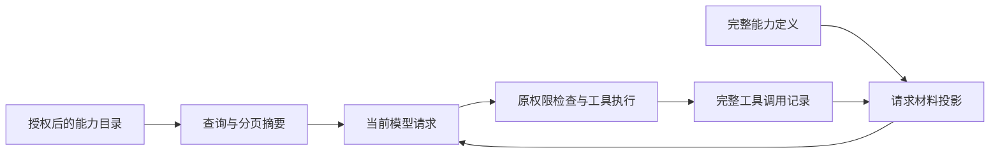
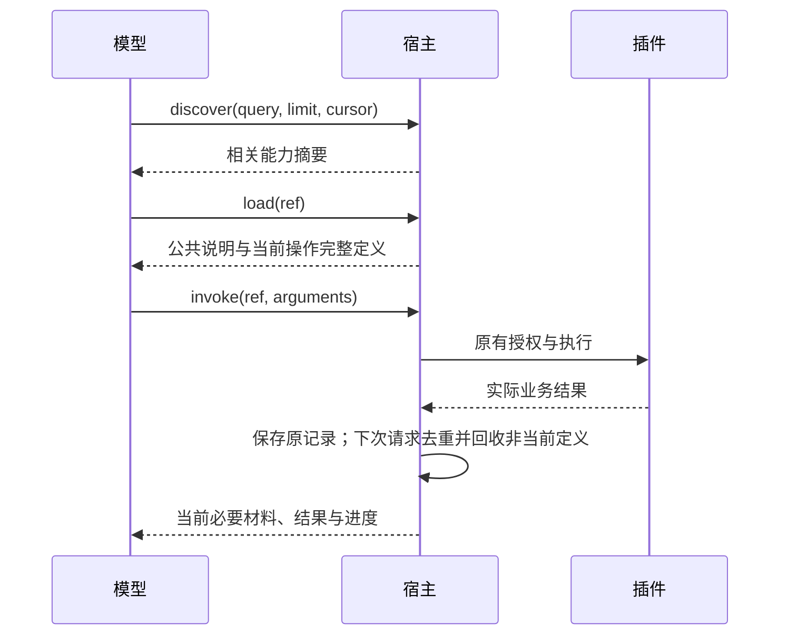

# 插件按需上下文 · 桌面端系分

修订：2026-10-19 v1。涉及仓库：DesktopPet（Qt/C++ 宿主，Python 插件样板）。用户已确认五点方案并要求实现；本文把该方案落为两个依赖有序的特性切片。文件名和切片按已确认主题与实施顺序推导。

## 1. 背景与约束

外部插件已有 discover/load/invoke，源码不会进入模型。但 load 每个 operation 重复携带 USAGE，同一任务持续复制旧加载结果；discover/load 也进入工具记忆。自主候选列表固定截前 16，条目多时后续插件难被发现。

- [2026-10-19] 平时仅候选摘要，选择后才加载 Skill / 必要操作，结束后保留结果与进度。具体操作的参数、effects、result 必须完整。
- 本次不修改原插件清单格式，不为视频增加软件分支，不改用户记忆，不调用真实服务，不新增依赖。
- 持久化 TaskRecord / ActionObservation / 调用日志与模型请求副本分离；仅副本压缩。旧业务结果、accepted/unknown、回执和失败详情不通过摘要伪装成功。
- 同一个宿主读取缓存不等于本次模型知道接口；被裁掉的详情要重新加载才可从模型发起 invoke。内部已经准备好的 reply dispatcher 不受模型上下文门禁影响，仍执行原权限检查。
- 外部正文保持工具材料语义，不提升为宿主系统指令。调用及返回配对、Anthropic transportBlocks/签名不改动。
- 无表变更。能力说明不写长期/工作记忆；发现与加载仍保留调试 trace。实际调用的观察沿用现有记忆规则。
- 不用 LLM 总结工具 Schema。普通业务结果仍按原 sanitizer 处理；宿主标识的能力定义在脱敏后完整保留，有界整项拒绝替代截断约束。失败使用现有 Result / ToolResult，不引入全局异常系统。

## 2. 架构与变更清单





| 标记 | 文件 | 责任 |
|---|---|---|
| 🆕 | core/ai/plugin/capability_context.h/.cpp | 纯请求副本投影、当前操作集合与去重 |
| 🔧 | include/ai_types.h、core/ai/tools/runtime/tool_result_sanitizer.h/.cpp | 宿主元数据标识及完整定义的有界传递 |
| 🔧 | core/ai/plugin/plugin_gateway.cpp、capability_types.cpp | 标识元数据与发现入口 |
| 🔧 | core/ai/ai_brain.h、ai_brain_loop.cpp、ai_brain_router.cpp | 对话请求投影、模型调用前检查、元数据不入记忆、容纳按需加载的轮次预算 |
| 🔧 | core/ai/task/task_orchestrator.h/.cpp、ai_brain_tasks.cpp（必要时） | 任务请求投影与恢复 |
| 🔧 | core/ai/plugin/plugin_runtime.h/.cpp | 发现查询与授权目录 |
| 🆕 | core/ai/plugin/capability_discovery.h/.cpp | 无 I/O 的匹配、分页、候选排序轮转 |
| 🔧 | core/ai/ai_brain_autonomy.cpp、ai_brain.h | 自主候选生成替换固定截前 16 |
| 🔧 | CMakeLists.txt、tests/test_plugin_runtime.cpp、test_streaming_dialogue.cpp、test_task_orchestrator.cpp、test_activity_selector.cpp（必要时）、test_autonomous_chat.cpp | 真实调用路径与回归 |
| 🆕 | tests/test_capability_context.cpp | 双格式投影及请求体积对照 |
| 🔧 | contracts/tools/插件运行时接入.md、contracts/tools/README.md、contracts/tools/插件系统开发指导.md | 公共契约与实测记录 |

## 3. 详细设计

### 3.1 模块概览

§3.2 覆盖已加载工具材料的生命周期与记忆边界；§3.3 覆盖摘要发现和自主候选。按此顺序实施，各自测试和提交。新测试遵循已有 tests/test_*.cpp + QtTest + CMake 注册方式。

### 3.2 已加载能力的请求投影与记忆边界

#### 3.2.1 模块定位

把完整工具记录转换为当前请求必需材料，不修改持久记录、真实执行参数或宿主权限。对话和长任务复用同一套能力定义选择、公共说明去重规则。

#### 3.2.2 核心服务接口

以下接口命名可在同职责下根据实际 C++ 组织细化，语义和字段来源固定；变更跨切片签名须先回填本文。

```cpp
class CapabilityContext {
public:
    static bool isMetadataTool(const QString& name);
    static QList<ChatMessage> projectMessages(const QList<ChatMessage>& messages);
    static QJsonArray projectSteps(const QJsonArray& steps);
    static bool hasOperation(const QList<ChatMessage>& projected, const QJsonObject& ref);
    static bool hasOperation(const QJsonArray& projectedSteps, const QJsonObject& ref);
};
```

| 输入 | 值来源 | 含义 |
|---|---|---|
| name | 系统推导（来源：实际登记的 toolName） | 仅 discover_capabilities/load_capability 为元数据 |
| messages | 系统推导（来源：当前响应 workingMessages） | 原始已完成调用及配对结果，投影返回副本 |
| steps | 系统推导（来源：当前 TaskRecord.steps） | 持久任务步骤，不能原地删改 |
| ref | 调用方传入（模型提出的 invoke.arguments.ref） | 使用现有 pluginId/entryId/entryVersion/operationId |

ToolResult 可新增默认 false 的宿主标志（不进入 JSON/插件业务输入），由网关设置给发现/加载结果，sanitizer 使用此标志保留定义结构；记忆分类也可用固定元数据工具名 helper。现有 aggregate 初始化保持兼容。元数据返回的实际 secret 在 PluginRuntime::publicValue 处已脱敏，定义中的参数名不应按 secret 键名删除。

#### 3.2.3 模块业务流程

1. 网关正常发现/加载。成功 load 的 instructions、parameters、effects、result 完整返回；元数据 JSON 上限 32 KiB（UTF-8），超出整项失败并给出缩短说明的错误，不能截断 Schema 或假装已加载完整内容。其他工具保留原 sanitizer。
2. 每次对话发模型前对 workingMessages 做纯投影。当前材料为最近选择的一个 Tool entry 的最近两个不同 operation（兼容连续组合操作）及最近一份 Skill。同 ref 多次 load 仅最后一次详情有效；定义标识包含版本、catalogRevision 与 definitionDigest。不同版本或 digest 绝不能共用旧公共说明。
3. 同 entry/digest 的 instructions 只保留一份，其余保留显式引用；引用目标必须确实在本次请求内，目标回收后重新保留一份正文。Tool 总览被具体操作替代后缩为已加载/需重新加载的元数据摘要。非当前定义缩为 ref、版本、状态和“调用前重新 load”的说明，保留对应 tool response，不删除 assistant/tool 配对，不改 assistant transportBlocks。
4. 发现列表只在最新一次发现结果完整出现；更早的发现结果压成数量/查询完成标记。业务 invoke 结果保留原事实；本次不对它们进行有损业务摘要。
5. 每次 TaskOrchestrator 发模型，同样只投影 context.steps；TaskRecord.steps / ActionObservation 原样保存。模型其他阶段（assess/verify 等）如果带 steps 也走统一投影，不能绕回全量定义。
6. 模型提出 invoke 时，检查上一请求实际保留的操作详情；缺失时返回可恢复的 CAPABILITY_CONTEXT_REQUIRED，未派发、无业务效果，要求先 load。不以 Host loaded map 代替此检查。直接非模型宿主调用和 prepared reply 路径仍沿用原执行契约。Task 在 callModel 保存当前请求的 projected steps；在 dispatchTool 的 prepareTool 之前检查，缺定义追加未派发的 failed step（business_evidence=false），经原 replan(reason) 及其预算给模型重新 load 的机会，不进入 ActionStore prepare/dispatch 或 unknown 判定。规划提示明确要求当前请求具备对应操作定义；自主宿主预加载仅用于依赖验证，不能替代模型取得正文。
7. 任务恢复、跨角色/新会话不会继承旧请求材料许可。若原任务记录里有加载材料，可重新投影给模型；实际调用仍由运行时的版本/授权/加载状态检查，失效要求重新加载。不自动执行/重放旧操作。
8. discover/load 保留 runtime 调试事件与调用日志，rememberToolOutcome 不创建生活记忆或 WorkingMemoryItem。普通对话的每次元数据结果通过既有 enqueueCallLog(ResponseLog) 归档独立 type=capability_metadata 记录，保留 requestId、toolName、sessionId、executed、时间与已脱敏完整 ToolResult；请求日志继续忠实记录实际投影。这样同批 load 的正文去重不会改变单次加载日志。TaskRecord 原步骤原样保存。清理老数据不在本次范围；新聊天不会新增携带说明的工作记忆。
9. 普通聊天的工具轮次上限由 3 调整到 8，容纳 discover → load 总览 → load operation → invoke，以及必要的翻页或 reload；这是上限，不预先消耗轮次。不引入新的计数器或独立重试机制，沿用既有取消和超限处理，验证正常四轮调用和持续调用达到上限时终止。

#### 3.2.4 数据变更

N/A — 不涉及数据库 schema 或持久记录修改。内存中能力材料投影和可执行集合属于一次模型请求；metadata 标志仅为宿主内部传递。

#### 3.2.5 实现锚点

| 现有签名/路径 | 使用方式 |
|---|---|
| LoadedCapability::toPublicJson() | 现有 load data={ref,kind,instructions,catalogRevision,definitionDigest,parameters/result/effects 或 operations/dependencies} |
| PluginRuntime::executeGateway(const ToolExecutionRequest&, ToolRuntime::Completion) | 在宿主返回上设置元数据标志；直接 dispatcher 的结果仍兼容 |
| ToolResultSanitizer::sanitize / toPayload | metadata 完整有界传递，普通结果原流程 |
| AIBrain::thinkInternal(..., const QList<ChatMessage>& workingMessages) | modelRequest.messages 取投影；原工作记录继续追加以保留日志 |
| AIBrain::rememberToolOutcome(...) | 两类元数据工具只记录诊断，不写 memory / working cache |
| TaskOrchestrator::modelContext() const / callModel(TaskModelRequest, callback) | 统一投影所有发送请求；原 steps 不变 |
| TaskOrchestrator::dispatchTool / callModel | callModel 保存请求投影；dispatchTool 在 prepareTool 之前拦截缺上下文的模型 invoke，记录未派发失败并 replan，不改变 accepted/unknown 写入判断 |

JSON 消歧：对话 tool message.content 是 ToolResult.toJson() 的 {success,data}；Task step.output 直接是 result.data，另有 step.tool/name（以实际步骤字段为准）、arguments、status/error。按实际宿主工具名称识别，不扫描任意业务 JSON 猜能力定义。

#### 3.2.6 异常场景

- 业务：被回收或尚未加载的 operation 直接 invoke → 失败结果 CAPABILITY_CONTEXT_REQUIRED，保留任务可重试状态，只允许后续重新 load；不派发。遵循 §1 的现有结果机制。
- 系统：完整定义超过上限或包发生更新 → 整项错误/现有 STALE_REVISION，提示修订说明或重新加载，不截断约束、不复用旧 schema。
- 并行 tool calls / 签名协议 → assistant/tool 配对与 transportBlocks 均不改写；未知普通结果原样保留。

#### 3.2.7 关键行为场景

- 依次加载同一 Tool 两个操作，共同说明在第二次实际模型请求中恰好出现一份，两个必要 Schema 均完整，原记录仍有两份。
- 切换 Tool 后旧正文回收，返回旧 Tool 时通过重新 load 恢复；缓存命中不能跳过当前模型材料验证。
- 合法 Schema 包含 token/password 等字段名和说明超过 2000 字符时，公共调用链不截断字段；超过完整定义预算时明确失败。
- 长任务多步骤与重启恢复均使用投影；失败、accepted、unknown、tracking/receipt 在副本和原记录中保留原语义。
- 真实 AIBrain load/discover 后，下一轮普通聊天和新写入记忆不含说明哨兵；业务调用事实仍可入记忆，日志可追踪元数据操作。
- 记录相同合成多步骤任务的原始/投影请求 UTF-8 字节数和公共说明次数；报告实测差值，不把字节数称为 token。

### 3.3 摘要查询、分页与自主候选

> 依赖：§3.2 的元数据有界传递；不依赖其模型请求临时状态。

#### 3.3.1 模块定位

目录按用途筛选、稳定分页，自主选择保留相关项并轮换探索其它项，避免前 16 个条目永久遮住后续插件。

#### 3.3.2 核心服务接口

```cpp
// 新增；保留原 discoverCapabilities(context, autonomous) 供宿主内部使用。
Result<QJsonObject, DomainError> PluginRuntime::queryCapabilities(
    const ContextSpec& context, bool autonomous, const QJsonObject& query) const;
// 无 I/O helper，放 capability_discovery.h/.cpp。
QJsonArray selectCapabilityCandidates(const QJsonArray& entries,
    const QString& query, quint64 browseOffset, int limit = 16);
```

| 输入 | 值来源 | 规则 |
|---|---|---|
| context/autonomous | 系统推导（来源：实际调用/活动范围） | 始终先过滤原权限，禁止模型指定权限范围 |
| query.query | 调用方传入（发现工具参数），默认空 | 可选字符串，最多 200 字符；匹配 id/name/summary，Unicode case-fold，支持中文连续片段 |
| query.limit | 调用方传入，配置默认值（代码默认 8） | 整数 1..16 |
| query.cursor | 调用方传入（上次 nextCursor），默认空 | 不透明分页字符串，绑定当前运行时实例、目录/学习技能版本、查询与范围，旧游标明确报错 |
| browseOffset | 系统推导（来源：AIBrain 当前实例内递增探索位置） | 不写持久数据，角色/实例更换不复用身份范围 |
| candidate query | 系统推导（来源：当前活动 cues 的短文本） | 非 LLM 重排；不把私有正文或提示塞进目录/日志 |

返回保留 entries 数组；增加 hasMore / nextCursor / total（当前过滤后的数量），每条仍可直接用于既有 ref。空参数兼容调用形式，默认返回第一页；不用 operation 详情充当摘要。搜索依据目录完整摘要，输出摘要限制为 384 字符、显示名 128 字符（超长带省略号）；身份和版本不裁剪。此限制仅作用于发现展示，load 的正文与 Schema 仍完整。

#### 3.3.3 模块业务流程

1. 按原 discoverCapabilities 取得范围内可见条目；按 id/name/summary 的文本匹配打分，确定性排序（同分按稳定身份）。空 query 为稳定目录顺序。
2. 查询用 Unicode 分词和中文片段匹配，中文自然句可提取连续汉字二元片段以命中名称/摘要；无匹配返回空，不自动调用模型或新依赖。优先 exact id/name，summary 匹配次之。自主搜索每条 cue 取前 128 字符，合并最多 1024 字符，避免主线程对长经历正文建立过多片段；原 SelectionRequest.cues 不改。
3. 当前实例生命周期标识、目录/学习技能版本与查询及范围组成游标版本。实例标识仅内存生成；运行时重建后旧 cursor 失效，避免重置的数字 revision 与旧目录误匹配，不新增持久化版本。调用携带旧/坏 cursor → CAPABILITY_CURSOR_INVALID，建议重新查询，不静默从错误位置续页。权限变化仍按当前配置过滤。
4. 自主候选最多 16 项：有相关项时先取最多 8 项，再从其余条目按轮转位置补满；无相关项时全部轮转。每次选择后推进探索位置，减少 ID 顺序饥饿，不声称安装后必然会选择该插件。
5. 替换 AIBrain::beginActivitySelection 中固定 removeLast 截取；ActivitySelector 的输入上限仍可保留作边界。普通 discovery 不混入自主轮转，保证分页可重复。探索步长不得大于本次探索窗口宽度，确保轮换不会永久跳过中间条目。
6. 继续先摘要后 load；权限、自主总开关和内存读取授权完全复用原路径。

#### 3.3.4 数据变更

N/A — 本模块不涉及持久数据写入。探索位置仅在当前 AIBrain 内存；cursor 是分页数据，不是授权凭据。

#### 3.3.5 实现锚点

| 现有接口/位置 | 使用方式 |
|---|---|
| GatewayTool::parameterSchema() | discover 添加可选 query/limit/cursor；ref/invoke 既有参数不变 |
| PluginRuntime::discoverCapabilities(const ContextSpec&, bool) const | 现有授权目录，query 使用快照，不能直接绕到未过滤 Catalog |
| PluginRuntime::setLearnedSkills(...) | 避免相同快照刷新导致每次查询游标无故失效；版本只随实际条目内容变化 |
| PluginCatalog::discover() | 稳定身份与摘要，不读取操作正文 |
| AIBrain::beginActivitySelection → request.capabilities | query 从 cues 的 text 构造，只把选中的摘要交模型；递增 offset 在 owner 线程 |
| ActivitySelector::selectActivity(...) | 只消费已选摘要；model materials 仍只包含允许的引用 |

#### 3.3.6 异常场景

- 业务：错误 limit/type、坏/过期 cursor → 明确 INVALID_INPUT/CAPABILITY_CURSOR_INVALID，不执行业务操作；空结果为正常 completed。遵循 §1 结果机制。
- 系统：注册配置变化/插件禁用 → 原加载与 invoke 校验仍拒绝过期句柄；分页不能依赖过期权限快照。无联网检索兜底。

#### 3.3.7 关键行为场景

- 30 个混合条目，连续分页无漏项/重复；零参数调用仍能取得第一页与续页提示，正文哨兵从不进入摘要。
- 中文用途与大小写英文关键词找到后排目标；不匹配时为空；稳定 ID/name 优先。
- 相同 learned snapshot 不使 cursor 过期，真正更新、禁用、切换 query/context 的 cursor 被拒绝；旧授权不可用于新上下文。
- 自主候选包含相关后排条目；无相关 query 时多次轮转覆盖超过 16 的所有授权条目。候选不超上限，不包含未授权/禁用条目（按原发现可见性，禁用至少不得进入可执行自主选择）。
- 全链路 discover → load → invoke 继续适配原音乐插件与受控聊天，原清单文件无需改版。

## 4. 对外接口

只有 discover_capabilities 增加可选 query/limit/cursor 和分页返回字段。load/invoke 的 ref、arguments 保持不变；当前上下文中被回收的定义需重新 load。metadata 标志、投影引用和探索位置由宿主产生，插件不能指定。

## 5. 数据存储

无 SQL / 迁移。所有持久工具记录保留原内容；本轮不清理旧记忆数据。

## 6. 非功能要求

纯文本匹配与 JSON 副本投影，不新增 LLM 调用；后台目录加载、取消、grant 检查沿用原线程模型。适当有界且报告限制，避免大而全的防御框架。用实际请求尺寸对照验证节省。

## 7. 验证与交付

每切片按现有 QtTest 目录先 RED 再 GREEN，主 agent CR 后提交。相关目标先构建、测试；整个 Wave 完成后完整构建与 CTest，Python 契约验证/Launcher 相关测试按变更范围执行。真实模型价格/token 不用字符数伪装，未做真实服务请求要明确。文档更新公共接入指南与兼容边界，记录 commit 和测试证据。
