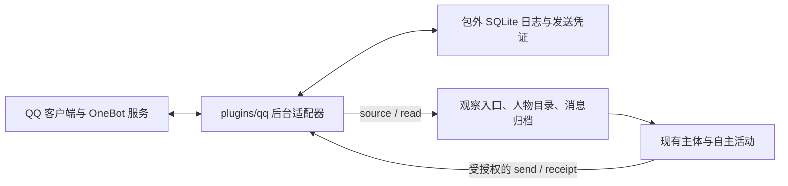

# QQ 插件 — 桌面端系分

2026-10-20；仓库 DesktopPet。借鉴 MaiBot 的连接/编解码/回执分层，以原创实现接入本项目契约。

## 1 全局约束

1. 保留唯一主体：插件负责后台 QQ 读写，不包含模型、记忆、回复生成器或新的自主调度器。宿主继续决定浏览、等待、回复和离开。采用 OneBot v11 正向 WebSocket（NapCat / SnowLuma），不操控屏幕。
2. 首版完整范围为文本私聊/群聊、引用、授权会话查询、可选消息源、可靠发送状态、安装配置和验收。收到图片/语音/表情/文件时明确输出占位；不实现视觉理解、上传图片、群管理、空间、登录客户端。既有宿主仅接受 text/reply，媒体扩展独立进行。保持接收与自主回复分开，默认 source 关闭，可显式启用。
3. 独立 Python 包 `plugins/qq`，只依赖 `websockets==15.0.1`（Python >=3.9）。不引入 MaiBot SDK 或复制其 GPL 代码；文档给出研究来源和固定提交。所有 mutable settings/token/journal/venv 位于包外。每一角色使用独立 stateDir，数据库绑定 namespace+selfId，账号改变必须新建 stateDir。
4. 所有网络连接必须先 get_login_info 对照配置 selfId，再接收业务事件或派发动作；消息不能更改绑定身份。配置明确 backend=napcat|snowluma、wsUrl、selfId、connectionKey、stateDir、allowedConversations（会话键字符串数组），tokenFile 可省略表示服务无 token，存在时读取包外文件。requestTimeoutSeconds 默认 10，整数范围 1–25。会话键 `group:<id>` / `private:<id>` 避免号码碰撞；身份 provider=qq、namespace=connectionKey、remoteActorId=QQ 号。昵称不是身份。不推断主人、不扩张 allowlist。settings/token/state 路径绝对且在包外。
5. OneBot action 使用唯一 echo 相关，成功必须 status=ok 且 retcode=0。连接/响应有时限，WS 最大报文 1 MiB。日志不回显 token、原始异常 URL 或消息正文。配置 URL 禁止内嵌认证信息，token 通过 Bearer header。写动作从不自动重试。连接重连仅用于 source，指数退避上限 30s；stop/EOF 可及时结束。
6. 日志 SQLite WAL，每条消息在一个事务内分配递增 seq，(chat_id,remote_id) 唯一。事件正文首次入库后固定。event/cursor 含 journal UUID+seq；重启重放稳定，外库游标必须报错。source 从宿主 start.cursor 重放，最大未 ACK 64，收到合法 ACK 才更新本地诊断水位；不因 read 推进 source 水位。不裁剪日志，文档告知磁盘增长。缺时间保留未知；查询补入的旧消息标 historicalImport=true，实时已入库消息读取保留原标志。允许断线期间有不可恢复空档，不宣称 exactly once 平台投递。
7. 正常业务错误输出 `{state:failed,data:{error:{code,message}}}`；已派发但未证实的发送输出 unknown，不能当成功。stdout 命令为一个 JSON，source 为协议 JSONL；诊断走 stderr。所有 body 至多 8000 UTF-16，保留明确截断标记。源单行 <=64KiB。源码设置 dont_write_bytecode，不污染包摘要。

## 2 架构与变更



Tool command 每次使用短连接，source 使用独立长连接；共享 journal，不另建本地 RPC 服务。短连接丢弃无关推送，只把显式 history 查询写入日志；source 处理实时推送。read 即使 source 关闭仍可抓取最近历史。来源暂不支持历史时返回带 freshness/warning 的本地结果，不能宣称已同步。网络/认证失败明确失败。

🆕 `plugins/qq/{common,transport,journal,adapter,source,delivery,configure,setup}.py`、manifest/tool/source/skill/USAGE/README/requirements/参考与验收文档。
🆕 `tests/test_qq_{adapter,delivery,configure}.py`、`tests/fixtures/qq_backend.py`、`tests/test_qq_plugin.cpp`。
🔧 `CMakeLists.txt` 和插件文档索引；不修改宿主数据结构或协议。

## 3 模块设计

### 3.1 授权会话读取与可靠观察源

#### 3.1.1 定位
把允许的 QQ 会话转换为已有观察契约，提供离线缓存和在线近期历史查询。

#### 3.1.2 接口
`load_settings(path) -> dict`；`OneBotClient(settings,capture_events=False)` context manager，`call(action, params) -> data`、`receive(timeout) -> event|None`；仅 source 设 capture_events=True，最多暂存 64 条登录验证期间推送，验证后才交付；短命令丢弃推送。`Journal(settings)`，`ingest(event,historical=False,requested_chat=None) -> item|None`、`read(chat_id,cursor='',limit=10) -> dict`、`after(cursor,limit=64) -> items`、`ack(event_id,cursor)`；`execute(settings, operation, arguments) -> result`；`run_source(settings, stdin, stdout)`。

| 入参 | 值来源 |
|---|---|
| settings/path | 配置默认值（来源: entry/source 的 settings 文件路径） |
| operation/arguments/action/params | 调用方传入；action/params 由插件按固定操作构造 |
| chat_id,cursor,limit | 调用方传入；cursor 是该会话向前分页位置，默认最近页，返回按时间顺序的 items 和 next_cursor |
| event/historical | 系统推导（来源: WS 实时事件 / 显式历史查询） |
| stdin start/ack/stop | 调用方传入（宿主观察源协议） |

命令 status/list/read。status 实际连接并验证账号；list 只列配置允许会话并附本地最近消息摘要（160 UTF-16）。read 首次页在线调用 `get_group_msg_history(group_id,count=50)` / `get_friend_msg_history(user_id,count=50)`；分页游标只读本地。返回 `{state,data:{items,next_cursor,freshness,warning?}}`，每个 item 包含 event_id,sequence,cursor,chat_id,message_id,speaker_id,display_name,text,reply_to,historical，可选 occurred_at。source 从同一行构造标准 observation。

#### 3.1.3 流程
校验配置 → 打开绑定账号的 journal → 连接验证 self → 按操作处理。历史响应按时间排序后入库；必须包含平台 message_id（允许 OneBot 有符号整数 ID）。private 由 message_type 判断，即使包含 group_id 仍为私聊。不把未知 actor 伪装为已知身份。结构化 text、at、face、reply 转换，其他类型明确占位；CQ 字符串安全解析为可读文本，正文中的控制串出站始终作为纯文本段。NapCat 的私聊历史中 user_id 是发送者，自己的历史消息可由本次可信查询的 chat_id 确定目标；若实时自己的私聊没有目标字段，则跳过，不能猜目标。历史返回有明确其他目标字段时不得覆盖为当前请求目标。

source：读取 start → 重放日志 → 建立验证连接 → 接收允许事件并事务写入 → 按 seq 发出 → 记录 ACK。每次循环处理控制与日志，重连等待期间仍可 stop/replay。达到 64 条未确认时暂停输出，继续有界地逐条写盘。无 ACK 不丢数据。只跳过明确不支持/未授权/缺 ID 的事件；journal/配置错误停止，避免吞掉存储故障。

#### 3.1.4 数据变更
新建包外 meta、messages、source_ack 表；journal UUID 与 identity immutable。ingest 用事务 INSERT OR IGNORE 去重，返回数据库原行。source_ack 仅 source.ack 写，游标合法性由 journal 校验；read 不改水位。SQL 详见 §5。

#### 3.1.5 实现锚点
| 参照 | 约束 |
|---|---|
| `contracts/tools/examples/controlled-chat/{adapter.py,source.json}` | start/ack/stop、source 配置，不能照抄其无界未确认发送 |
| `core/ai/observation/observation_store.cpp::ingest` | 只允许 text/reply，remote kind 是 group/direct；时间可省略 |
| `ObservationStore::normalize` 的映射路径 | fields 使用 JSON Pointer，historicalImport/speakerDisplayName 可映射 |
| `CapabilityExecutor::execute` | stdin 仅 call.arguments，不含 callId；reported completion 必须绑定 state/data |

#### 3.1.6 异常
未授权 chat：failed/PERMISSION_DENIED（不连网）。账号不符：failed/ACCOUNT_MISMATCH，source 终止，不能更改身份。history 不支持：completed、freshness=local_only、固定 warning。网络失联：命令 failed，source 退避，遵循 §1.5。外库 cursor/数据库失败：明确 failed/退出，不能重建丢失水位。诊断遵循 §1.7。

#### 3.1.7 关键行为
允许私聊和群聊能查询/归档，kind 相同数字隔离；临时私聊有 group_id 仍正确；回复引用、中文 emoji、缺时间、媒体占位转换正确。重启/source+query 去重保持完全相同 ID/正文，query 不 ACK。source 控制真实子进程完成 start/replay/ack/stop，64 条背压和 EOF 有效。错账号不入库；未授权群、自身推送不触发新对话（自身消息可归档）；超过体积受控。历史不支持保留明确 local_only，断线重连不重复分配 seq。

### 3.2 文本发送与可追踪回执

> 依赖：§3.1 配置、传输和 journal。

#### 3.2.1 定位
向精确授权目标发送一次，并区分真实完成、拒绝、结果未知。

#### 3.2.2 接口
`send(settings, arguments) -> result`；`receipt(settings, arguments) -> result`，由 execute 分派。

| 入参 | 值来源 |
|---|---|
| chat_id,text,reply_to（默认空） | 调用方传入（宿主 replyBindings 精确映射） |
| receipt_id,chat_id | 调用方传入（上次 send 返回的 receipt_id，必须同会话） |
| receipt_id 初始值 | 系统推导（来源: 插件生成 UUID；不是宿主 callId） |
| backend,selfId,timeout | 配置默认值（来源: settings） |

send 返回 data 中 receipt_id、delivery 状态；完成必须附 remote_message_id,content,occurred_at。receipt 返回外层 completed 表示查询成功，data.delivery 表示原发送结果，不能误认为发送完成。unknown 附 tracking 提示仅查 receipt，不重发。

#### 3.2.3 流程
先验 allowlist/text/replyTo（只准引用本会话已入 journal 的消息）→ 验证连接身份 → 在 journal 插入 pending attempt 并提交 → 单次 action。NapCat 使用 send_group_msg/send_private_msg；SnowLuma 使用 send_msg+message_type。message 是 text 段和可选 reply 段，禁止 raw CQ 执行。保存 remote id 后 get_msg 查询证实；核对 message_id、发送者=self、message_type、group_id 或 private 目标、正文非空及原始有效 time。SnowLuma 群聊还需正整数 message_seq。返回实际正文/时间，不用本地 now 填充。

NapCat 实际 get_msg 的私聊 user_id 是发送者而非接收者，不强制要求它等于目标。若私聊缺少明确 peer/target 信息，则追加一次目标限定的 get_friend_msg_history(user_id=目标,count=50)，在返回里匹配同 message_id、self sender、有效时间和正文确认目标；明确错目标绝不能用此方式覆盖。不支持或找不到时保持 unknown。

get_msg 不支持/未到/数据不符/超时：unknown 保留 receipt 和已知 remote id；重复 receipt 只重新查询 get_msg/必要的目标历史，永不重发 send。断连前不能确认是否写出也记 unknown。明确 API 拒绝为 failed；进程崩溃留下 pending，查询显示 unknown。宿主 callId 派发幂等继续由宿主负责，不用正文相同推断重复。

#### 3.2.4 数据变更
attempts(receipt_id,chat_id,text,reply_to,status,remote_id,result_json)，发送前提交 pending，action 返回后先保存 remote id，再确认。确认不会修改既有入站正文；receipt 结果持久化，可跨进程检查。无远端 id 时只返回未知，不猜测匹配聊天记录。

#### 3.2.5 实现锚点
`OneBotClient.call(action,params)` 与 Journal 身份绑定复用 §3.1；`plugin_reply_bridge.cpp::prepareCapabilityReply` 必须 external context，`capabilityDeliveryReceipt` 只认 completed+有效实际 id/content/time。不得新增 SDK 绕过宿主。stdin 无 callId，不宣称插件层 exactly-once。

#### 3.2.6 异常
目标不符/引用跨会话：failed，不触发发送。API 明确拒绝：failed；派发超时/异常确认：unknown，不重发，遵循 §1.5/7。错 receipt_id/跨会话 receipt：failed，不查询远端任意消息。磁盘出错导致未保存 pending：不发送。

#### 3.2.7 关键行为
私聊、群聊、SnowLuma 发送正常文本及引用，各执行一次，实际 get_msg 字段进入回执。NapCat 无私聊目标字段用目标限定历史确认，历史无记录则未知。seq=0、错群、错 sender、缺时间、不支持 get_msg 均 unknown。超时无自动重试，重启查 receipt 可恢复已知 id 的确认；无 id 保持 unknown。明确拒绝失败，CQ 字面量不执行，未授权目标无网络调用。

### 3.3 插件打包、角色配置与宿主验收

> 依赖：§3.1 和 §3.2。

#### 3.3.1 定位
提供可安装、可审阅且不破坏其他插件设置的 QQ 能力包，验证真实宿主网关/观察入口。

#### 3.3.2 接口
`prepare_configuration(profile_dir, settings_path, autonomous='on', source='off') -> plan`；`apply_configuration(plan)`；setup CLI 安装包外 venv。configure 使用当前绝对 Python 路径，不 resolve venv symlink 到系统 Python。

| 入参 | 值来源 |
|---|---|
| profile_dir/settings_path | 调用方传入（已存在 UUID 角色目录与包外 settings JSON） |
| autonomous/source | 调用方传入（默认 on/off，互相独立；source on 不改宿主 autonomy 总开关） |
| program | 系统推导（来源: os.path.abspath(sys.executable)） |
| allowed rooms/self | 配置默认值（来源: 已验证 settings；不自动发现扩大列表） |

配置只打印 preview，--apply 才原子备份写 plugins.json。保留其他插件/授权/自定义设置；只替换 desktop-pet.qq 管理的绑定。一个角色一个 QQ 账号。preview 不读取 token、不联网、不打印 token 内容。

#### 3.3.3 流程
加载 settings → 校验已有 profile 配置结构 → 生成 manifest 注册、entry/source configuration、resultAdapters、observationBindings、observationAdapters、replyBindings、grants → preview/apply。local_owner 与 internal_activity 允许 status/list/read/receipt 和 skill，绝不授 send；外部会话 read/send/receipt 的 objectArguments 精确限制 chat_id，外部不授 list（防跨群信息）。source 显式开关；autonomous 控制工具自主授权，不篡改宿主活动配置。

#### 3.3.4 数据变更
仅目标 plugins.json 与备份，使用 compare original 防编辑覆盖，写失败保留旧配置。SQLite 不在配置时创建。setup 不创建/修改个人账号配置。

#### 3.3.5 实现锚点
`plugins/bilibili/configure.py` 的 preview/backup/atomic replace 参照；`controlled-chat/make_host_config.py` 的 UUIDv5 conversationId；现有 `grants.objectArguments` 逐 JSON Pointer 比较精确值，因此外部 grant 使用 `{"/chat_id":"group:123"}`，不是允许值数组。resultAdapters `entry/operation` 键沿用已有 runtime；read 字段 mapping 相对于 outcome.data。`tests/test_bilibili_plugin.cpp`、`test_external_observation.cpp` 为网关/观察 C++ 测试参照；CMake 注册，测试均在 tests 根目录。

#### 3.3.6 异常
配置无允许会话/UUID 无效/包内状态/格式冲突：preview 失败、不写文件；并发编辑 plugins.json：apply 拒绝覆盖。安装依赖失联：显示可重新执行的错误，保留 state。网络必须由 status 显式验证，configure 不假装已连接。

#### 3.3.7 关键行为
配置 preview 无写入、apply 幂等保留其他插件、同数字群/人生成不同会话、身份稳定、read/reply/source/result mappings 被真实 PluginRuntime 接受。假 OneBot 服务配合真实命令子进程贯通发现→按需加载→读取→观察归档→外部发送→回执落库，拒绝其他群与本地直接发送。source 与自主开关独立，禁用阻止新工具调用。包不产生 __pycache__。安装说明、Windows 验收清单、API 来源和局限完整。

## 4 接口索引

插件 `desktop-pet.qq`；tool `desktop-pet.qq.tools`，skill `desktop-pet.qq.skill`，source `desktop-pet.qq.events`，版本 1.0.0。tool: status/list/read/send/receipt。operations completion=reported，resultAdapter dataPointer=/data,statePointer=/state，映射 completed/failed/unknown；send 另含 /receipt 和 /tracking。模型发现仅摘要，USAGE/SKILL 按需加载。

## 5 数据存储

本模块采用 SQLite（不适用 OB DDL）。以下为逻辑 DDL，实现字段可按 Python 数据结构细化但要保持事务与约束：

```sql
CREATE TABLE meta (key TEXT PRIMARY KEY, value TEXT NOT NULL);
CREATE TABLE messages (seq INTEGER PRIMARY KEY AUTOINCREMENT, chat_id TEXT NOT NULL,
 remote_id TEXT NOT NULL, payload TEXT NOT NULL, UNIQUE(chat_id, remote_id));
CREATE INDEX idx_messages_chat_seq ON messages(chat_id, seq);
CREATE TABLE source_ack (singleton INTEGER PRIMARY KEY CHECK(singleton=1), event_id TEXT NOT NULL, cursor TEXT NOT NULL);
CREATE TABLE attempts (receipt_id TEXT PRIMARY KEY, chat_id TEXT NOT NULL, text TEXT NOT NULL,
 reply_to TEXT NOT NULL, status TEXT NOT NULL, remote_id TEXT NOT NULL DEFAULT '', result_json TEXT NOT NULL DEFAULT '{}');
```

禁用/卸载不删 journal；回滚只撤销本插件配置。若明确不再需要并已备份，离线删除整份插件 state 即可；不执行宿主数据库迁移。代码不得自动 drop 表。

## 6 非功能性

不启动第三方 bot 大脑；一个 source 连接加工具短连接。history 50、read 1–20、WS 报文 1MiB、source pending64，降低上下文占用。无模型调用测试。长期 journal 增长需用户保管；不凭 TTL 丢掉未确认消息。source 仅记录真实收到的推送，断线历史补齐能力取决于后端。

## 7 测试与交付

先 Python 单测/假 WS 集成（RED→GREEN），再 QQ 专用宿主网关 C++ 测试、既有 plugin/observation/autonomy/identity 回归和 contract verifier。全量非实网 CTest 最终一次验证；已知 macOS Qt6.8.3 WebCommand 的 AMFI 阻断单独记录，不能算 QQ 失败或通过。真实 NapCat/SnowLuma/QQ 账号以及 Windows 接入留明确人工验收，不实际登录/发消息。每切片 review 后 commit。

参考：MaiBot `ff0fe42500f5f7581e9655d1e78379407233207a`，QQAdapter `a93a0ad1e27e75e699a4e10571a2cda2884a81cd`。架构启发和 API 行为，非 GPL 源码移植。
