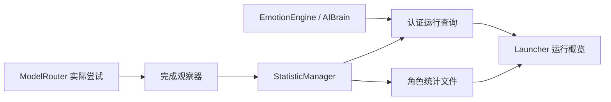
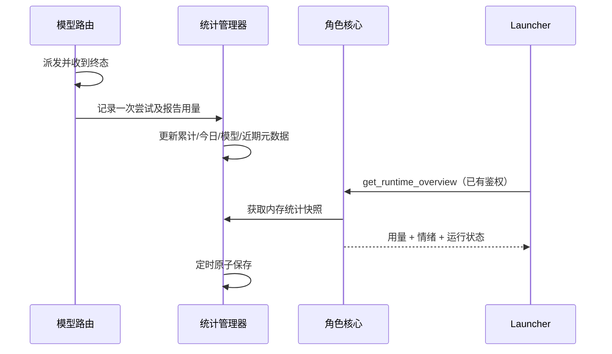

# 运行概览 — 桌面端系分

修订：2026-10-20，初版。涉及仓库：DesktopPet（Qt C++ 核心 + PySide6 launcher）。

## 1 背景和全局约束

用户需要统一查看模型用量和角色基本运行状态，并希望利用现有统计、日志设施。采用改造 StatisticManager、扩展现有认证本地管道、增加 launcher 页面；不新增外部监控服务或 UI 依赖。

1. **统计口径（影响 §3.1–3.3）**：一次实际模型客户端调用是一条记录，路由 fallback、结构修复和服务重试分别计数；同一回调重复完成不重复累计。调用成功表示客户端成功返回，不代表任务结果符合业务要求。未派发的路由/预算拒绝不计。取消单独统计。总量是已报告用量之和；无用量单独计数，不伪装零消耗；不估算金额。
2. **token 定义（影响 §3.1–3.3）**：promptTokens 是完整输入（包含缓存），completionTokens 是输出，totalTokens 优先用提供方返回，否则按输入+输出。reasoning/cached/cache-hit/cache-miss 是子项，不能重复加到总量。Anthropic input_tokens 不含缓存，需要加 cache_read_input_tokens 和 cache_creation_input_tokens；流式增量不得重复相加。LlmUsage 增加 reported 标志，真实解析器设置，旧构造的非零计数兼容视为有用量。
3. **身份（影响 §3.1–3.3）**：生产统计写 AppData/profiles/<UUID>/statistics.json，绑定 profileId；当前显示名可以改变，存储身份不变。旧默认 initialize API 为独立测试/已有直接使用保留。仅首次、角色清单只有一个角色且旧文件有精确名称匹配时导入旧累计；没有日期/模型信息的旧记录不编入今天和模型表。其他旧数据保留原文件，不猜归属。
4. **有界数据与持久化（影响 §3.1–3.3）**：累计及模型分组保留；日汇总保留最近 90 天，最近调用元数据保留 200 条。数据在内存更新，10 秒原子存盘，退出时保存；异常退出最多损失上次保存后数据，不宣称账单级精度。本次运行用量不跨进程继承。运行时长保存包含已运行检查点，重启不能重复累计。日志/保存失败不阻断聊天，界面显示统计持久化告警。
5. **数据内容（影响 §3.1–3.3）**：新的近期调用只记录时间、调用 ID、用途、provider/model/route、结果、耗时和用量，不保存 prompt、回复、私有日记、密钥或原始服务错误。旧 AI 详细日志仍服务排障，但移到 profile/logs 并轮转；界面只给目录入口，不自动读取其敏感正文。
6. **实时性（影响 §3.2–3.3）**：运行查询是只读的，不调用模型、不推进情绪、不唤醒活动。使用已有本地凭据/会话鉴权。页面显示时每 2 秒查询，隐藏不轮询；用户聊天操作优先，轮询合并。离线可以读当前角色已保存的统计，心情/活动标记不可用，不能把缓存当实时。
7. **异常处理**：正常无数据、AI/情绪关闭、未连接是明确空态。文件损坏、读写失败显示简洁告警并保留原文件；无隐式删除重建。数据按合理用户场景做校验，不引入通用遥测框架或无关防御层。

## 2 架构、流程和变更清单

| 变更 | 文件 |
|---|---|
| 🔧 统计及用量来源 | include/ai_types.h、include/statistic_types.h、statistic/statistic_manager.*、core/ai/model/model_router.*、core/ai/llm/{llm_chat_service,llm_chat_model_client,openai_compatible_client,anthropic_messages_client}.*、core/ai/ai_brain.cpp、main.cpp |
| 🔧 运行查询、日志隔离 | core/ai/chat/launcher_chat_server.*、ui/petwindow.{cpp,h}、core/ai/ai_brain.{cpp,h}、core/ai/ai_call_logger.* |
| 🆕 运行状态序列化 | core/ai/runtime/runtime_overview.{h,cpp}（只组装显式输入，无服务所有权） |
| 🆕 Launcher 页面 | launcher/pages/statistics_page.py、launcher/statistics_data.py |
| 🔧 Launcher 集成 | launcher/launcher_chat_client.py、launcher/main.py |
| 🔧/🆕 测试和文档 | tests/test_statistic_manager.cpp、test_model_router.cpp、test_llm_chat_service.cpp、test_anthropic_messages_client.cpp、test_llm.cpp、test_launcher_chat_server.cpp、test_runtime_overview.cpp、test_ai_call_logger.cpp、test_launcher_statistics.py、test_launcher_chat_transport.py；CMakeLists.txt、launcher/README.md、本任务验收文档与合成截图脚本 |

## 3 详细设计

### 3.1 角色用量与运行统计

#### 3.1.1 定位
改造现有统计设施，提供按真实模型尝试累计、角色隔离和可查询的持久统计；兼容原触摸/时长/调用计数消费者。

#### 3.1.2 核心接口

新增轻量 `ModelAttemptReport`（放 include/ai_types.h），包含 attemptId/profileId/petName、role（QString，用途键；直接服务调用用 unclassified）、provider/model/routeId、success/cancelled、durationMs、usage、completedAt。`ModelRouter::setAttemptObserver(std::function<void(const ModelAttemptReport&)>)`；AIBrain 安装不捕获自身的观察器转调 `StatisticManager::recordLlmAttempt(report)`。观察器仅获取元数据，不包含请求/响应正文。

统计 API：`initializeForProfile(appDataRoot, profileId, petName, legacyPath, allowLegacyImport)`、`recordLlmAttempt(report)`、`overview(now = currentDateTime()) -> QJsonObject`。旧查询/recordLlmCall/recordLlmUsage 保留，通过同一累加路径实现。提供只读 persistence warning。低层 LlmChatService 两个 WithConfig 接口增加末尾 `bool recordStatistics = true`，LlmChatModelClient 传 false，避免路由和低层双计。

| 入参 | 值来源 |
|---|---|
| appDataRoot/profileId/petName | 调用方传入（main 已解析 profileMigration 与 PetProfile） |
| legacyPath/allowLegacyImport | 系统推导（旧 log/statistics.json；registeredProfileIds.size()==1） |
| report.role/profileId/petName | 系统推导（ModelRequest）；缺失 profileId 的兼容请求只绑定当前进程角色 |
| report.provider/model/routeId | 系统推导（实际选中 route；响应 model 非空时记录实际模型） |
| report.attemptId/completedAt/durationMs | 系统推导（派发 UUID、完成时间和 QElapsedTimer） |
| success/cancelled/usage | 系统推导（客户端终态和用量；取消使用请求取消状态或固定取消错误码） |
| now | 调用方传入；默认当前时间，供确定性测试与今日筛选 |

#### 3.1.3 流程
身份解析后初始化角色统计 → 读当前 v2 或合条件的旧累计 → 启动计时。路由预算通过后开始计时、派发 → 首个终态报告元数据 → 统计锁内更新旧兼容计数、累计/会话/日/模型指标、最近 200 条 → 锁外发 signal。有 profileId 且与已配置身份不匹配的记录拒绝，不混入。服务直调每次真实重试也分别记录；路由调用关闭低层统计。

回调重复报告由路由一次性 completion gate 保证；观察器捕获副本，可记录发送后、路由对象销毁前后收到的结果，不依赖 UI 指针。不改变预算 reserve/settle 语义。

#### 3.1.4 数据变更
JSON v2，无数据库表变更。保存根含 version=2、profileId、petName、lastSaved、statistics。statistics 的 allTime/today/session 是计数对象，包含 callCount/successCount/failureCount/cancelledCount/unknownUsageCount/promptTokens/completionTokens/totalTokens/reasoningTokens/cachedTokens/promptCacheHitTokens/promptCacheMissTokens；today/session 为生成快照，加载只恢复累计和日/模型/近期数据，本次 session 从零开始。daily 每项含 date 和计数；byModel 每项含 role/provider/model 与计数；recentCalls 最新在前，条目含 report 元数据及 usageReported；uptime 含 totalMs/sessionMs/sessionCount/touchCount，触摸部位计数一并保留；legacyImported 标识旧累计。允许增加内部恢复字段但不能靠 session 快照重复累加。保存失败记录告警；坏文件不自动覆写。

#### 3.1.5 实现锚点
`StatisticManager::initialize(QString,int)` 当前加载全局 pets 数组；recordLlmCall 三参并在锁外 emit。`ModelRouter::sendAttempt` 已有 completionReceived 原子门及 settle 生命周期，观察器在首个客户端结果、settle 前调用。`LlmChatModelClient` 已将 retryCount=0。`LlmChatService` 当前重试只统计最终结果，需修正为逐次。OpenAI parseResponseBody 解析 usage，Anthropic mergeUsage 在 start/delta 合并，需统一完整输入含缓存。main 在角色解析后、PetWindow 构造前初始化统计；修改该位置即可隔离生产角色。

#### 3.1.6 异常
无 usage：降级为 unknownUsageCount，仍记录调用结果；取消不伪装成功。错 profile：拒绝累计并保留可诊断告警。读取损坏/写盘失败：降级内存统计并给 warning，不阻断核心、不覆盖坏原文件（§1.7）。旧数据多角色不明确：保留旧文件而不导入。

#### 3.1.7 关键行为
完成一次有用量调用后，累计/今日/会话/模型/近期记录一致；失败 fallback 与成功各计一次，重复回调不重复；结构修复另计；预发送预算拒绝不计；取消有独立结果。OpenAI 缺 usage 与显式 0 区分，Anthropic 缓存命中/写入计入完整输入且增量不重加。角色重启保留累计而会话归零，改名同 UUID 保持数据，其他 UUID 隔离；旧累计有导入标记而无伪造明细。运行中多次保存、正常退出和恢复都不重复时长；切换初始化不残留前一文件数据。日志容量有界，坏文件/写失败可见。

### 3.2 认证运行快照与日志维护

> 依赖：§3.1 overview 和角色存储。

#### 3.2.1 定位
向 launcher 提供轻量只读实时状态，整理旧详细日志存储；保持聊天历史查询与诊断数据分开。

#### 3.2.2 核心接口
`LauncherChatCallbacks` 新增可选 `std::function<QJsonObject()> runtimeOverview`；认证后 action `get_runtime_overview` 无业务参数，缺回调返回 ACTION_UNSUPPORTED。PetWindow 注入回调，读 StatisticManager::overview、EmotionEngine::snapshot(now)、AIBrain 的公开状态及 sleepCycleCoordinator::isActive。

`RuntimeOverviewInput` + `runtimeOverviewJson(input)` 纯组装函数放 runtime_overview.*，输入含 profileId/petName/capturedAt、aiEnabled/storageReady/busy/pendingMessageCount、autonomy QJsonObject、taskStatus、sleeping、emotionEnabled 和可选 EmotionSnapshot、statistics。必要时增加 AIBrain `isDaydreamRunning() const` 读取既有标志；不要让快照触发 advanceTo。

| 入参 | 值来源 |
|---|---|
| 身份/时间 | 系统推导（PetWindow profileMigration/modelName、当前 UTC） |
| runtime 状态 | 系统推导（AIBrain 公共方法、taskSnapshot 只取状态、RuntimeServices 睡眠状态） |
| emotion | 系统推导（已启用的 EmotionEngine::snapshot；关闭不返回伪造数值） |
| statistics | 系统推导（StatisticManager::overview） |
| aiCallLogPath | 系统推导（runtimeDatabasePath 同级 logs/ai_calls.jsonl） |
| 日志轮转阈值 | 配置默认值（AiCallLogger 默认 8 MiB，3 个备份；构造可传小阈值供测试） |

#### 3.2.3 流程
认证与限流 → 生成状态快照 → 输出既有 envelope，profileId 固定由服务器校正，不能由 payload 指定其他角色。独立查询不改变聊天 revision，不携带 messages 或私有反思文本。旧聊天 statistics 字段继续来自同一 manager 保持兼容。

AI 详细日志路径在 AIBrain::startChatSideEffectQueue 内根据可信 runtimeDatabasePath 设置，继续由现有副作用队列写。AiCallLogger 写前按大小轮转 .1–.3，单条大日志超过上限时写小型 omitted 元数据，避免一条日志突破容量；检查写入结果，沿用既有队列告警。历史全局日志不读取、不删改。

#### 3.2.4 数据变更
不写新运行状态表。详细日志从全局默认路径迁到各 profile/logs；旧文件保留。轮转为文件管理，无 DB DDL；统计仍由 §3.1 管理。情绪数据库本次只读展示，不迁移。

#### 3.2.5 实现锚点
`LauncherChatServer::handleRequest` 当前先 authorize/consumeRequestBudget，get_chat_state 才取 revision；在同级增加只读 action。`PetWindow::setupLauncherChatBridge` 构造 callbacks；`EmotionSnapshot` moodValence [-1,1]、moodArousal/intensity/confidence [0,1]，active 用 emotionTypeToString。`AIBrain::autonomyStatus()` 返回 enabled/ready/state/error/isIdle/canDeliberate/reason/paused；展示安全状态而非内容。`ChatSideEffectQueue` 自己持 AiCallLogger 并异步写，不能再在 UI 同步重写旧日志。

#### 3.2.6 异常
没有 runtime 回调：返回 ACTION_UNSUPPORTED，UI 提示升级核心（§1.7）。情绪关闭/引擎无值：enabled=false 或 available=false。运行尚未初始化：storageReady=false，其余按真实状态显示。日志不可写/轮转失败：返回 false、原队列告警，不阻断聊天；无自动删除原日志“修复”。

#### 3.2.7 关键行为
认证后可返回当前角色状态和所有 token 子项，不带聊天/密钥/日记；未经认证不可查询，旧回调缺席明确 unsupported。查询不改 revision，也不推进情绪状态。关闭情绪无默认假心情；空闲/忙碌/睡眠/暂停状态正确映射。详细日志保留请求/响应配对 ID、角色隔离、大小轮转、单条超限诚实省略，写失败可诊断。

### 3.3 Launcher 运行概览与调用记录

> 依赖：§3.1 统计格式、§3.2 运行查询。

#### 3.3.1 定位
在现有 Fluent 导航增加“运行概览”，用一处界面理解当前状态和消耗，并查看近期模型调用。

#### 3.3.2 核心接口
`AsyncLauncherChatClient.request_runtime_overview()` + `overviewReceived(dict)`，独立合并的 pending 标志；同步 facade 增加 `get_runtime_overview()`。`StatisticsPage.set_profile(profile_id,pet_name)`、`set_client(client,profile_id)`、`refresh_theme()`、可选 `set_core_log_path(path,profile_id)`。`statistics_data.py` 负责读取 v2 保存文件和显示格式，路径从 AppData 与验证后的 UUID 构造。页面依赖现有 PySide/Fluent，不新增图表库。

| 入参 | 值来源 |
|---|---|
| profile_id/pet_name | 调用方传入（PetPage 当前选择/已启动的角色，不能用昵称作路径） |
| client/client profileId | 调用方传入（main 完成握手的当前进程连接和启动时捕获的 UUID） |
| snapshot | 系统推导（overviewReceived；只接受匹配所选角色） |
| range/filter | 调用方传入（今天/本次运行/累计、用途/结果/模型文字筛选） |
| core log path | 调用方传入（main 创建的当前进程日志路径，不从模型输出读取） |

#### 3.3.3 流程
选择角色 → 页面展示时加载保存文件 → 若该角色有在线连接，发只读请求并每 2 秒刷新 → 隐藏停轮询。切换角色清空旧状态、筛选缓存和在线判断；连接变更解绑旧 signals；延迟旧角色响应忽略。断线保留已知统计、标最后更新时间，情绪/活动不可用；离线“本次运行”不可用。共享 client 新轮询不能挤占用户发送/停止/历史请求，不引发聊天页操作错误提示。

布局沿用 Fluent：页首角色/连接与更新时间；状态卡（AI、忙闲、排队、当前任务、自主状态、睡眠/后台整理、运行时长、触摸）；情绪卡（平静/愉快等、心境正负和活跃度、强度，有真实数据才画）；用量卡（范围选择、总/输入/输出、调用与成功/失败/取消、未知用量、缓存/推理子项）；近 7 日趋势（绘制简单柱图）和累计用途/模型表；最近 200 条调用提供结果/用途/模型过滤、每页 25 条。明确“模型用途”不是聊天人物角色。提供打开当前角色详细日志目录及可用时打开本次运行日志。保留聊天页简短调试，不造第二套统计来源。

#### 3.3.4 数据变更
N/A — 页面不写统计/情绪/配置；只读文件和 IPC。合成 QA 产物写任务 visual-qa 目录，与个人数据隔离。

#### 3.3.5 实现锚点
`launcher/main.py` 创建 ChatPage 后 addSubInterface，set_client 发生在 `_on_chat_connected`，关闭在 `_close_chat_session`；宠物组合框 currentTextChanged 先更新 AppState，可随后同步页面。`AsyncLauncherChatClient` `_operations` 用户操作队列与 `_pending_revision` 合并轮询，增加 overview 槽；结果在 `_accept_response` 分发。`pet_registry._app_data_dir()` 与 C++ AppData 一致。UI 参照 pages/_ui.py 和 chat_page.py 的主题切换/离线处理；测试参照 test_launcher_chat_transport.py 的真实 QLocalServer。

#### 3.3.6 异常
无数据：正常空态，不显示假的在线状态。保存文件损坏/身份不符：显示读取告警，不展示其他角色数据。断线/查询失败：保留旧统计并清楚标非实时，不弹重复聊天错误。旧核心 ACTION_UNSUPPORTED：显示版本提示、停重复查询，可读保存统计。窄窗口/高 DPI：可滚动，表格可横滚，避免数值和状态重叠。

#### 3.3.7 关键行为
在线展示给定用量/心情/活动，三种范围不混；输入和输出及缓存子项解释清楚，未知调用单列。隐藏停止查询，重新显示刷新，用户聊天操作优先，多个 overview 请求合并。切换角色/断线/重连无旧数据串入；离线读取已保存累计但不显示旧心情为实时。近期筛选/分页和模型表可用；浅/深色与宽/窄尺寸可读；与现有聊天并用无回归，旧核心失败提示有界。

## 4 本地接口

`get_runtime_overview` 复用 protocolVersion=1、requestId、sessionToken。成功 data 含 schemaVersion=1、profileId、petName、capturedAt、runtime、emotion、statistics。runtime 固定元数据字段；emotion 含 enabled/available，available 时才有 active/moodValence/moodArousal/intensity/confidence/updatedAt。statistics 见 §3.1.4。错误沿用 CHAT_AUTH_FAILED/RATE_LIMITED/ACTION_UNSUPPORTED，不增加公网端口或凭据机制。

## 5 存储

无数据库 DDL。JSON v2 文件位于角色目录，原子替换；迁移只读取合条件旧累计，原文件保留。回滚程序不修改旧全局文件，保留新增角色统计与轮转日志供重新升级，不删除数据。

## 6 性能和限制

统计是本地观察工具，不能替代供应商账单；服务未返回 usage、进程崩溃前未落盘时会缺数据。只保留 90 天日曲线和 200 条近期记录，累计持续保留。统计快照不读取完整详细日志、聊天或人物库；保存体积随模型种类增长，但不随每个聊天正文增长。只展示既有运行属性，不新造饥饿/精力等不存在的属性。

## 7 测试与交付

按三个切片串行 TDD、审查、针对性回归、commit。最终构建与可用全套回归，人工检查合成截图（浅/深/窄/空态/离线），留下 Windows 100%/150% DPI、真实调用后台任务后统计对照、关闭重启及多角色的验收文档。测试不调用真实模型、QQ，也不修改个人角色数据。
