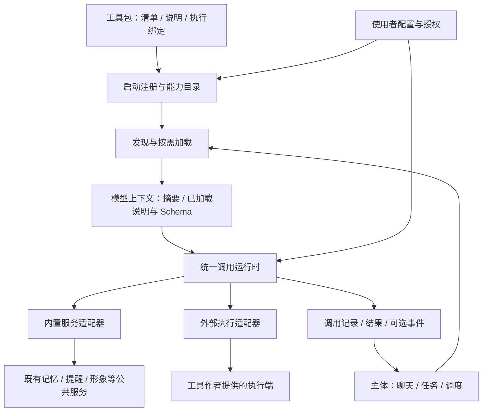
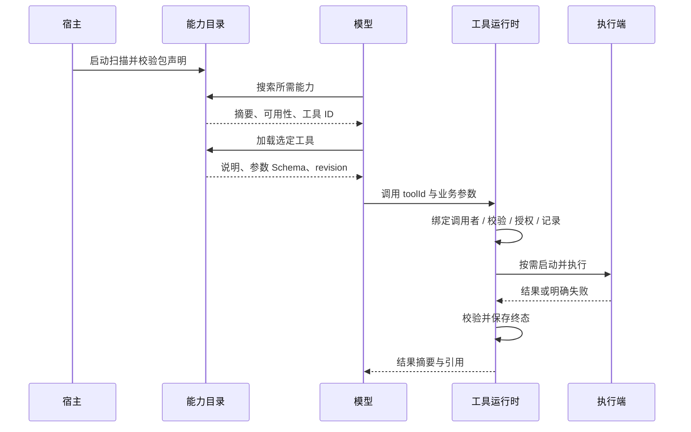

# 已撤回：过早展开的工具层技术设计草稿

日期：2026-10-15。状态：已撤回，不作为工具准入契约、已确认需求或后续解耦实施依据。

使用者纠正：当前首先需要讨论工具的准入标准，尚未进入系分。下文是过早展开的设计记录，其字段、限制、生命周期、目录结构和实现选择均未获确认为契约；保留仅供追溯，不据此推进实现。

本文定义使用者、工具包作者与 DesktopPet 主体之间的可执行契约，作为后续解耦的输入。文中的接口、配置和行为是目标规范；“现状”表才描述已有实现。本次交付不修改运行代码。

## 文档修订历史

| 日期 | 版本 | 变更 |
| --- | --- | --- |
| 2026-10-15 | 1.0.0 提案 | 定义包声明、发现与按需加载、调用生命周期、执行适配、宿主边界及验收标准 |

## 涉及仓库

| 仓库 | 技术栈 | 本次范围 |
| --- | --- | --- |
| DesktopPet | C++ / Qt、Python launcher、SQLite | 工具层契约文档；后续普通聊天、复杂任务、调度入口共同遵守 |

## 1. 背景、目标与全局约束

### 1.1 已确认的需求

- [2026-10-15] 保留当前激活池、海马体及记忆存储设计。
- [2026-10-15] 先完成工具层契约，再进入工具解耦阶段；本次不实施解耦。
- [2026-10-15] 使用者应能按契约提供说明和操作实现，在启动时注册，模型需要时加载与使用。
- [2026-10-15] QQ 仅是扩展能力的举例，不构成本次业务需求，也不进入核心工具枚举。
- [2026-10-15] 外部工具允许直接使用脚本/CLI，并兼容 MCP，不要求所有工具先包装成 MCP 服务。其余未由使用者逐项指定的字段和限值是本提案的设计选择。

验收目标：在已经支持的执行方式下，增加、替换或移除一个合规工具包，只需调整包目录或宿主配置，不需要修改或重新编译主体；普通聊天与复杂任务都可发现和调用。新增一种执行协议可以增加通用适配器，但不能要求每增加一个业务工具都改主体。

### 1.2 术语与权威来源

| 概念 | 定义 | 权威来源 |
| --- | --- | --- |
| 工具包 Package | 一组能力说明、工具声明和执行绑定的分发单元 | 使用者选定的包文件 |
| 工具 Tool | 具有参数、结果和完成语义的一项具体操作 | 已验证的工具描述符 |
| Provider | 执行绑定所指向的命令、服务或内置适配器 | 执行端的实际状态 |
| 能力目录 Catalog | 已注册包与工具的轻量索引，含可用性 | 宿主目录服务 |
| 加载集 LoadedSet | 某次会话或任务当前可交给模型的说明与 Schema 集合 | 宿主上下文服务 |
| 调用 Call | 一次有身份、参数、期限及唯一结果的操作 | 宿主调用记录 |
| Skill / 工作流 | 如何组合工具解决问题的说明或经验 | 说明作者或既有 SkillStore；不能创造不存在的工具 |

**注册、加载上下文、启动执行端、授权是四件不同的事。** 包存在不代表已启用；已注册不代表已授权；说明加载不执行操作；模型知道名称不等于可绕过运行时调用。

### 1.3 依赖与职责边界（影响 §3.2—§3.5）

1. 主体负责对话、人格、记忆、任务意愿和编排。工具包负责声明能力和执行具体操作。
2. 通用运行时负责发现、校验、调用路由、期限、取消、授权、结果和调用追踪，不理解音乐、天气、聊天软件等具体业务名称。
3. 普通聊天、复杂任务和调度器使用同一能力目录与运行时。它们可有不同的预算和授权范围，但不能各自维护业务工具白名单、名称工厂或风险推断表。
4. 外部契约只使用 JSON、UTF-8 文本和不透明资源引用，不暴露 `AIBrain*`、`MemoryStore*`、`PetWindow*`、QObject 或数据库连接。Qt 线程切换由内置适配器封装。
5. 内置记忆、提醒、形象工具可以通过适配器调用既有公共服务；这不要求本次重写这些服务，也不改变形象契约与记忆策略。
6. 外部操作结果是材料，不是系统指令。包说明不能授予自身权限，工具也不直接重写人格、记忆或任务状态。是否提取记忆继续由主体决定。

### 1.4 标识、版本与快照（影响全部模块）

- `packageId`：小写点分命名，正则 `^[a-z][a-z0-9]*(?:[.-][a-z0-9]+)*$`，最长 80 字符。
- `toolName`：包内标识，正则 `^[a-z][a-z0-9_]{0,47}$`；完整 `toolId = packageId + "/" + toolName`。名称不携带权限语义。
- 同名工具只能来自同一个有效包版本。重复包 ID 不按目录顺序覆盖：冲突包均不可用，使用者显式选择一个路径。
- `contractVersion` 与 `packageVersion` 均为 SemVer。v1 宿主支持契约主版本 1；遇到高于自身支持的次版本或未知必需能力时返回不兼容。Schema、必需字段、完成语义的破坏性变更提升包主版本。
- 宿主为一次注册生成不透明 `revision`，绑定清单、声明文件、说明和绑定配置的内容摘要。`catalogRevision` 表示整个目录快照；包 revision 与两者不能混用。
- 调用固定包 revision、工具 ID、参数摘要及调用者范围。文件变更或服务 Schema 漂移后，旧描述不可继续用于新调用；返回 `CAPABILITY_CHANGED` 并要求重新加载。执行端程序及包依赖必须在运行会话内保持不可变，普通内容摘要并非对任意外部可执行文件的完整性沙箱。
- 安装、升级与移除在下一次启动注册时生效。运行中可启用/禁用已有包，禁用立即阻止新调用；不承诺文件热替换。已开始调用按 §4.5 收尾。

### 1.5 Schema 与数据约定（影响全部模块）

- JSON 必须拒绝重复键，时间使用 RFC 3339 UTC；相对等待使用宿主单调时钟。
- 输入与成功数据采用 JSON Schema 2020-12 的约定子集：`type`（单一类型）、`properties`、`required`、`additionalProperties`、`items`、`enum`、`const`、`minimum`、`maximum`、`minLength`、`maxLength`、`minItems`、`maxItems`、`description`。对象根必须声明 `additionalProperties:false`。
- v1 不支持 `$ref`、组合 Schema、远程解析或隐式类型转换；不支持的关键字报 `SCHEMA_UNSUPPORTED`，不静默忽略。日期等格式在字段说明和业务实现中校验。
- 输入缺失和 `null` 不等价；可选字段缺失传递为缺失，不自动套用 JSON Schema 默认值。工具实现处理其声明的可选值。
- 内部有效结果与提供给模型的裁剪摘要分开。先校验完整结果，再生成摘要；不得裁剪后把非法 JSON 伪装成合法结构化数据。
- UTF-8 主说明限 16 KiB、单工具参数限 64 KiB、单次结构化结果限 1 MiB；超限报错或使用资源引用。数值为本提案的可配置默认上限，宿主可降低，目录需报告有效上限。

### 1.6 授权、状态与重试（影响 §3.3—§3.5）

包声明操作性质与所需权限，宿主维护实际授权。决定规则为“安装启用范围 ∩ 调用主体权限 ∩ 当前任务策略”。既有有效授权可复用，不要求每次调用都确认；未授予时返回明确的授权缺口，由宿主交互层处理。模型和包文件不能自行修改授权。

调用状态：`queued → running → succeeded | failed | cancelled | timed_out | unknown`；执行前拒绝为 `rejected`。所有终态不可改写。另设 `effectState = none | applied | partial | unknown` 表达副作用情况；只读成功为 `none`。不能用 `failed/cancelled/timed_out` 推导“没有产生副作用”。

宿主停止等待或取消传输不等于外部动作撤回。无法判断动作是否完成时报告 `unknown` 效果；后续核查作为新观察关联原调用，不能悄悄覆盖原结果。业务成功以工具声明的 `completionMeaning` 为准，收到请求和进程启动都不算完成。

重试必须同时满足调用期限、任务预算与安全重放条件。`retryable:true` 只是执行端建议，不是重试授权。相同逻辑动作的重放遵守 §4.5 的幂等规则，不保证跨任意第三方系统“恰好一次”。

## 2. 架构与后续改造入口





以下为后续解耦锚点，不是本次已修改文件；🆕 表示需引入的职责，最终类名由实施设计确定。

| 标记 | 现有位置 / 新职责 | 现状与目标 |
| --- | --- | --- |
| 🔧 | `ui/petwindow_ai.cpp` | 当前逐个构造业务工具；收敛为组合入口和内置服务适配器装配 |
| 🔧 | `core/ai/ai_tool.h`、`tool_registry.*` | 当前同步 execute 和全量 Schema；映射到中性描述符、目录、调用句柄 |
| 🔧 | `core/ai/ai_brain_loop.cpp`、`ai_brain_tasks.cpp` | 当前全量工具 / 名称筛选；共享发现和加载集 |
| 🔧 | `core/ai/tools/runtime/task_tool_executor.cpp` | 当前按名字构造工具；按 provider 绑定执行 |
| 🔧 | `core/ai/task/task_orchestrator.cpp` | 当前按名称判断白名单、只读性与来源工具；改为描述符、策略及能力检索 |
| 🔧 | `core/ai/tools/runtime/tool_policy.*` | 当前按名称猜风险；消费声明与宿主授权 |
| 🔧 | `core/ai/tools/runtime/tool_runtime.*` | 当前同步结果、通用 timeout 未执行；落实异步调用及生命周期 |
| 🔧 | `core/ai/skill/skill_store.*` | 保留学习工作流，引用真实 toolId；不兼任包执行注册器 |
| 🔧 | `core/ai/mcp/*` | 当前为占位原型；实现为执行适配器之一 |
| 🔧 | `core/ai/scheduler/agent_scheduler.*` | 后续计划动作通过统一运行时，复用调度授权与预算 |
| 🆕 | 包目录与描述符校验器 | 启动注册、版本固定、冲突与能力可用性 |
| 🆕 | 会话工具加载集 | 搜索、说明资源、动态 Schema 与协议降级 |
| 🆕 | Provider 与调用记录接口 | 外部执行、取消、恢复、结果引用及可选事件 |

## 3. 契约模块

### 3.1 模块概览与依赖

| 模块 | 职责 | 依赖 |
| --- | --- | --- |
| §3.2 工具包注册 | 将作者提供的声明变成可寻址能力目录 | §1 全局约定、§4.1 包格式 |
| §3.3 发现与按需加载 | 让模型找到能力并只加载需要的说明和 Schema | §3.2、§4.3 模型接口 |
| §3.4 执行与结果管理 | 对调用实行统一授权、期限、取消、结果和恢复 | §3.2、§3.3、§4.4—§4.5 |
| §3.5 执行适配与宿主交互 | 将协议差异限制在适配器内部 | §3.2、§3.4、§4.6—§4.7 |

### 3.2 工具包注册

#### 1. 模块定位

接收工具作者的声明，将其变成可查询且具有版本身份的能力目录。依赖 §1 全局约束和 §4.1 包格式。注册阶段不执行包内业务命令。

#### 2. 核心服务接口

以下为语言无关接口签名，C++ 可用值对象与异步回调实现，不构成二进制 ABI：

```text
registerPackages(roots, installationConfig) -> RegistrationReport
setPackageEnabled(packageId, enabled, callerScope) -> PackageState
getDescriptor(toolId, expectedRevision, callerScope) -> ToolDescriptor
```

| 入参 | 含义 | 值来源 |
| --- | --- | --- |
| roots | 有序绝对包根目录，不代表重复 ID 的覆盖优先级 | 配置默认值（来源：宿主 tools.packageRoots） |
| installationConfig | 启用包、执行路径、配置、凭据引用和授权 | 配置默认值（来源：宿主安装配置） |
| packageId / toolId | 已注册包或完整工具标识 | 调用方传入 |
| enabled | 是否允许新调用 | 调用方传入 |
| expectedRevision | 调用方所依据的描述符快照；首次查询允许缺失 | 调用方传入 |
| callerScope | profile、会话/任务与管理权限 | 系统推导（来源：可信宿主请求入口） |

返回 RegistrationReport 的 `packages` 数组逐包包含 `packageId/path/status/reasonCode/message/revision`，一个包的失败不丢弃其他结果；PackageState 同 §4.2。只有管理入口可改启用状态，模型工具接口不提供此方法。

#### 3. 模块业务流程

解析根目录的直接子目录中的 `tool-package.json` → 校验语法、标识、版本、Schema、资源路径和工具引用 → 合并宿主执行配置 → 建立目录 revision → 报告可用性。

重复 ID、资源越出包根、缺少必需字段均隔离该包。包内文件引用必须是 UTF-8 相对路径，拒绝绝对路径和 `..`；解析符号链接后仍须位于包根。外部可执行路径只能通过宿主显式配置引用，不把模型参数当可执行路径。

声明注册成功时可以处于 `unverified`，不要求外部服务已启动。实际依赖检查失败为 `unavailable`；MCP 工具 Schema 须在第一次调用前握手核实。禁用包清除新调用资格与模型加载资格，旧调用按生命周期收尾。

#### 4. 数据变更

启动时写派生目录缓存和诊断；启用/禁用写宿主安装配置，然后发布新 catalogRevision。配置写入失败保持旧状态并返回错误，不出现“界面禁用成功、运行时仍允许”的分裂。无记忆表变更。

#### 5. 实现锚点

| 当前入口 | 已有签名/事实 | 对接方式 |
| --- | --- | --- |
| `ToolRegistry::registerTool(std::unique_ptr<AITool>)` | 注册执行实例，重名时覆盖 | 仅供内置适配器内部过渡；对外目录必须检测冲突 |
| `ToolRegistry::allToolSchemas() const` | 返回所有 Schema | 由 §3.3 按加载集提供 Schema |
| `ui/petwindow_ai.cpp` | 直接创建音乐、文件、提醒等工具 | 后续只装配 Provider 和公共服务 |

数据层级：`manifest.tools[]` 是工具声明；`installation.packages[packageId]` 是使用者配置。两者都不是执行结果，禁止把安装凭据合并进发给模型的描述符。

#### 6. 异常场景

- 业务异常：同 ID 包冲突。策略：降级，隔离冲突包并返回 `PACKAGE_CONFLICT`。适用 §1.4，不自动覆盖。
- 系统异常：读取文件或写安装配置失败。策略：降级，返回 `PACKAGE_IO_ERROR`，保留既有有效状态。统一错误封装见 §4.8，不抛穿 GUI 回调。

#### 7. 关键行为场景

- registerPackages：放入一个有效包，启动后能查询工具摘要，尚未启动其进程，也未把完整说明交给模型。
- setPackageEnabled：禁用一个包后新调用被拒绝，排队调用取消，正在运行的调用获得明确收尾结果。
- getDescriptor：同 revision 请求得到相同业务 Schema；旧 revision 在变更后返回 `CAPABILITY_CHANGED`，不会悄悄取得新接口。

### 3.3 发现与按需加载

#### 1. 模块定位

向模型暴露轻量目录，并按需要装入选定能力的说明和 Schema。依赖 §3.2；具体接口为 §4.3。

#### 2. 核心服务接口

```text
search(query, cursor, limit, callerScope) -> CatalogPage
load(toolIds, callerScope) -> LoadResult
readResource(packageId, resourceId, revision, callerScope) -> InstructionResource
unload(toolIds, callerScope) -> LoadedSetSummary
```

| 入参 | 含义 | 值来源 |
| --- | --- | --- |
| query | 能力描述；空字符串表示分页浏览 | 调用方传入 |
| cursor | 绑定 catalogRevision 的不透明分页游标；首屏缺失 | 调用方传入 |
| limit | 本页最大项数 | 调用方传入；缺失时配置默认值（来源：宿主目录上限） |
| toolIds | 要加载/卸载的完整工具 ID 数组 | 调用方传入 |
| packageId / resourceId / revision | 从 load 返回的说明引用读取；不得传任意文件路径 | 调用方传入 |
| callerScope | 加载集归属与可见范围 | 系统推导（来源：当前可信会话/任务） |

#### 3. 模块业务流程

1. 开始会话时只提供少量通用发现入口，可附包摘要；不提供所有业务工具 Schema。
2. search 按名称、摘要、标签和用途查询；空查询可穷举分页，检索算法不能使注册能力永久不可发现。不以某个业务工具名写死关键词路由。
3. load 原子校验整组工具，返回对应包主说明、选定工具 Schema、可用性、revision 和资源引用。超过预算或任一引用无效时本次 load 不改变原加载集。
4. 加载集属于当前会话或任务，不全局串用。自动触发和恢复任务也须建立自己的加载集。
5. 支持动态函数工具的模型：下一轮请求附加新 Schema，宿主将模型函数别名映射到 toolId；不要求模型在同一次返回中调用尚未提供的函数。
6. 不支持动态 Schema 的模型：使用通用 `tool_call`，运行时仍校验已加载工具的实际参数 Schema。两条路径的权限、结果与调用生命周期完全相同。
7. 工具完整说明较长时，主说明引用声明过的资源，模型通过 readResource 按需读取；不允许跳过截断后的关键约束继续执行。资源限值与主说明相同，作者将长文按逻辑拆成多个资源。
8. 工作流可以要求多个工具，load 一次加载所需集合。SkillStore 的 `requiredTools` 后续引用完整 toolId；缺失能力明确返回，不将描述文字当作操作实现。

#### 4. 数据变更

更新会话/任务加载集；不写长期记忆，不启动业务操作。可以记录工具 ID 和 revision 供恢复核对，但不把旧 Schema、旧授权当成重启后的有效授权。unload 只移出上下文，不取消在途调用。

#### 5. 实现锚点

| 当前入口 | 现状 | 对接方式 |
| --- | --- | --- |
| `AIBrain::thinkInternal(...)` | 每轮取 allToolSchemas | 消费当前加载集及通用发现入口 |
| `TaskDependencies::availableTools` | 目前还按 allowedTool / supports 过滤 | 改为相同加载集视图，策略只收紧调用范围 |
| `formatMatchingSkills(...)` | 匹配后附最多两个工作流全文 | 保留经验提示，工具说明由包目录管理 |

接口数据必须区分 `catalogRevision`、包 `revision` 与 `loadedSetId`；前者用于分页一致性，中者固定工具定义，后者用于定位上下文。load 不授予新权限。

#### 6. 异常场景

- 业务异常：加载超过工具数或字节预算。策略：兜底值，返回 `CONTEXT_LIMIT` 和有效上限，原加载集不变；调用方可卸载无关能力后重试。
- 系统异常：包说明已损坏或服务定义漂移。策略：降级，标记该能力不可调用并返回 `CAPABILITY_CHANGED` / `PACKAGE_IO_ERROR`。遵守 §1.4 与 §4.8，不静默使用缓存旧说明。

#### 7. 关键行为场景

- search：描述“读取一个文本资源”可返回合适工具；不命中时仍可通过空查询浏览目录。
- load：加载一个工具后下一轮只增加该工具 Schema 和对应主说明，其他包仍只有摘要；重复加载同 revision 不重复占预算。
- readResource：读取 load 提供的资源 ID，得到同包 revision 的完整 UTF-8 文本和内容摘要，不能读取未声明路径。
- unload：移出闲置工具后释放上下文预算，已经发出的调用仍能按 callId 获取结果。

### 3.4 执行与结果管理

#### 1. 模块定位

将模型或宿主的操作意图转换成可追踪调用，确保统一校验、授权、期限、取消和完成含义。依赖 §3.2、§3.3；请求和结果详见 §4.4—§4.5。

#### 2. 核心服务接口

```text
invoke(toolId, arguments, revision, logicalActionKey?, callerScope) -> CallReceipt
getCall(callId, callerScope) -> CallView
cancelCall(callId, reason, callerScope) -> CallView
subscribeCall(callId, callerScope, observer) -> Subscription
```

这些宿主接口均异步，不在 GUI 线程阻塞等待。模型的 `tool_call` 由桥接层等待有限时间后返回终态或仍在运行的 CallView，不把 CallReceipt 当业务成功。

| 入参 | 含义 | 值来源 |
| --- | --- | --- |
| toolId / arguments | 已加载工具及业务参数，参数对象不含权限元数据 | 调用方传入 |
| revision | 宿主加载集固定的包版本快照 | 系统推导（来源：当前加载集） |
| logicalActionKey | 同一任务动作的稳定幂等键，独立的新动作使用新键 | 系统推导（来源：会话操作或任务步骤身份） |
| callerScope | profile、session/task、授权、有效预算 | 系统推导（来源：可信运行时上下文） |
| callId | 宿主生成的调用 UUID；查询/取消时由调用方引用 | 调用方传入 |
| reason | 取消原因文字，不作为权限证据 | 调用方传入 |
| observer | 生命周期通知接收者，不传给外部工具 | 调用方传入 |

#### 3. 模块业务流程

读取固定描述符 → 校验加载资格及 revision → 校验参数 → 解析实际权限与范围 → 检查预算/并发 → 创建调用记录 → 写派发意图 → 启动或复用 Provider → 执行 → 校验结果 → 持久化唯一终态 → 通知等待者。

有效授权不足时返回 `rejected / AUTHORIZATION_REQUIRED` 和缺失权限，不自动反复弹窗。交互层可以按使用者选择授予一次、会话或持久范围，然后发起新调用；授权等待不锁住 Provider 队列。

执行前可拒绝；排队时可取消；开始后按声明的取消能力请求收尾。期限覆盖启动和排队。迟到结果只进入诊断/核查记录，不把已终结调用重新变成成功。取消、结果与超时并发时，由运行时串行状态转换或 CAS 决定唯一终态。

getCall 与 subscribeCall 返回同一权威记录。观察者断开不等于取消；重连先获取当前快照，然后接收递增序号的更新，避免错过终态。查询/取消只允许拥有对应调用范围的主体。

#### 4. 数据变更

按 §5 持久化调用身份、派发标记与终态；结果正文可存引用。外部动作与本地记录不存在共同事务。更新调用记录失败时不执行新的外部动作，已经执行的动作按已知效果报告并保留核查路径。工具日志不逐条写入 memory_items。

#### 5. 实现锚点

| 当前接口 | 限制 | 契约接入 |
| --- | --- | --- |
| `AITool::execute(const QJsonObject&) -> ToolResult` | 同步且没有取消句柄 | 内置适配器包装；耗时操作异步执行 |
| `ToolRuntime::execute(const ToolExecutionRequest&)` | `timeoutMs` 当前被忽略 | 统一记录有效期限，落实超时终结 |
| `TaskToolReply::outcomeKnown` | 已表达动作结果是否明确 | 映射 effectState，不能丢失 unknown |
| `ToolRuntime::resolveConfirmation(requestId, approved)` | 当前待确认请求保存在运行时 | 后续统一授权结果并在派发前重新校验 |

`CallResult.data` 是完整且已校验的业务数据，`modelSummary` 是可裁剪展示内容，`resourceRefs` 是受范围约束的引用；三者不可混淆。

#### 6. 异常场景

- 业务异常：前置条件失效。策略：兜底值，`failed / PRECONDITION_FAILED`，效果按实际事实报告；调用方可获取新状态再决定，不自动重放动作。
- 系统异常：已派发后连接断开。策略：降级，终态 `unknown / PROVIDER_DISCONNECTED`，效果通常 `unknown`；使用状态查询能力核查，遵守 §1.6。
- 系统异常：调用记录无法写入。策略：降级，`CALL_JOURNAL_UNAVAILABLE`；派发前不得执行，派发后不得声称无副作用。统一结果封装见 §4.8。

#### 7. 关键行为场景

- invoke：合法、已授权的调用只派发一次，成功数据符合 outputSchema，完成含义与声明一致。
- getCall：调用者在页面重连后按 callId 获取已持久化终态；其他 profile 无法读取它。
- cancelCall：排队调用取消后不派发；运行中的取消结果明确说明是否停止及效果是否可知。
- subscribeCall：订阅者得到当前快照和序号递增的更新，重复通知可按序号去重，终态只提交一次。

### 3.5 执行适配与宿主交互

#### 1. 模块定位

把外部命令、MCP 服务与既有宿主服务统一成相同调用语义，协议差异止于适配器。依赖 §3.2、§3.4。本提案采用 `command / mcp / builtin` 三种绑定；包作者选择适合的一种即可。

#### 2. 核心服务接口

```text
prepare(binding, resolvedConfig, executionScope) -> ProviderHandle
execute(providerHandle, executionRequest, observer) -> ExecutionHandle
cancel(executionHandle, deadline) -> CancelReceipt
close(providerHandle, deadline) -> CloseReport
pollEvents(eventSource, checkpoint, executionScope) -> EventBatch   // 可选
```

| 入参 | 含义 | 值来源 |
| --- | --- | --- |
| binding | 声明过的执行方式和操作绑定 | 系统推导（来源：固定 revision 的包描述符） |
| resolvedConfig | 绝对程序路径、配置与凭据，按最小必要项分配 | 系统推导（来源：宿主安装配置解析） |
| executionScope | 不透明安装实例、调用 ID、有效期限、自有数据目录 | 系统推导（来源：当前调用记录和宿主配置） |
| providerHandle / executionHandle | 执行适配器返回的句柄 | 调用方传入 |
| executionRequest | 工具参数及执行关联信息 | 系统推导（来源：§3.4 已验证请求） |
| observer | 进度/终态回调 | 调用方传入 |
| deadline | 取消或关闭的最晚收尾时间 | 系统推导（来源：调用期限及宿主关闭预算） |
| eventSource / checkpoint | 声明过的来源及已持久化游标 | 系统推导（来源：包声明及宿主事件记录） |

#### 3. 模块业务流程

- **command：** 宿主把业务参数映射为结构化 argv 或 JSON stdin，直接启动程序，不经过 shell。结束时依据绑定约定解析 stdout、退出码并校验结果。stderr 为有界诊断。
- **mcp：** 宿主适配器负责标准握手、工具清单与调用协议；工具 ID 映射到 `remoteToolName`。MCP 工具注解只是辅助信息，不能代替宿主授权和本文完成语义。
- **builtin：** 由组合入口注册适配器工厂，工厂只接收其需要的公共服务门面。涉及 GUI 的动作由适配器协调线程，不要求模型或任务知道对象所属线程。
- **宿主数据：** 业务工具只收到明确声明的参数与配置，不自动收到整个对话、人格、日记或记忆库。外部工具使用宿主功能时由主体通过已注册的宿主工具编排；v1 不开放外部进程任意回调 AIBrain 或执行宿主代码的通道。
- **事件：** v1 可选事件源采用明确的轮询工具契约；普通命令工具不必实现。MCP 通用通知不被擅自解释为任意业务事件，业务事件经过 §4.7 映射。主体独立决定是否回应、记忆或触发任务。

Provider 被禁用或关闭时，先停止新派发，再取消排队和在途调用。关闭期限结束后即解除宿主等待；无法确认外部结果的调用终结为未知，不让工具进程拖住应用退出。

#### 4. 数据变更

执行端只能通过协议接收已授予的上下文；其自有状态放在安装实例数据目录。宿主事件接收写去重 ID 与 checkpoint，先可靠接收再推进游标。调用与事件记录遵守 §5，不把原始事件直接写成用户事实。

#### 5. 实现锚点

| 当前接口 | 已有事实 | 对接方式 |
| --- | --- | --- |
| `TaskToolExecutor::supports(name)` | 用 makeTool 按名字判断 | 改为执行适配器支持的 binding.kind |
| `McpToolAdapter::execute(...)` | 返回 not_implemented | 用真实调用结果映射到 §4.4 |
| `McpServerProcess::start(...)` | 有同步 waitForStarted | 在 Provider 工作线程准备，不阻塞 GUI |
| `AvatarPresentation::request/cancel/requestResult` | 已有状态与异步动作约定 | 内置适配器按真实 requestResult 完成，不把受理当成功 |
| `AgentRuntimeServices` / `EventDraft` | 已有宿主服务和事件归属 | 适配层填写可信 profile/source，包不能伪造 |

数据消歧：外部提供的 `data` 不是宿主 `EventDraft`；`source/profileId/sessionId` 等权威字段由适配器从安装与调用范围补齐，忽略业务 payload 中同名的自授字段。

#### 6. 异常场景

- 业务异常：命令不支持当前平台或 MCP 缺少声明工具。策略：降级，标记该能力 unavailable，返回 `DEPENDENCY_MISSING` / `CAPABILITY_CHANGED`。
- 系统异常：进程崩溃、输出超限或断连。策略：降级，返回结构化错误，终态和副作用按实际阶段判定；不得因进程崩溃自动重放动作。
- 可选事件异常：游标失效。策略：降级，报告 `EVENT_CURSOR_EXPIRED`，保留已收事件，显式记录缺口后由宿主决定重新定位，不能宣称连续无丢失。

#### 7. 关键行为场景

- prepare：第一次调用才准备执行端，失败只影响该包；其他工具仍可调用。
- execute：同一业务 Schema 的 command、mcp 与 builtin 实现都返回相同结构化数据和完成含义。
- cancel：支持停止的命令被请求终止；无法确认子进程或远端副作用时效果为 unknown，CancelReceipt 不伪装成最终取消结果。
- close：期限内关闭空闲 Provider；在途调用全部有终态或可恢复未知状态，不遗留永久等待者。
- pollEvents：重复返回相同事件 ID 只接收一次，checkpoint 在接收成功后推进；没有事件源的包正常完成所有调用操作。

## 4. 对外与跨边界接口规范

### 4.1 工具包格式

包根目录至少包含 `tool-package.json` 与主说明；执行程序可以随包提供，也可以引用宿主配置中已安装的 CLI。示例目录名称仅用于示范，不是主体硬编码：

```text
example-text/
  tool-package.json
  USAGE.md
  references/             # 可选、逐项声明的说明资源
  bin/                    # 可选、随包提供的脚本/程序
```

清单根对象字段如下。除 `extensions` 外禁止未知字段；extensions 是可选对象，键使用包名空间，不能改变 v1 基础语义。

| 字段 | 类型 / 必需性 | 约定 |
| --- | --- | --- |
| contractVersion | string，必需 | 采用的契约 SemVer |
| packageId / packageVersion | string，必需 | 包身份与版本，见 §1.4 |
| summary | string，必需 | ≤500 字符，说明这个包能做什么，用于目录检索 |
| instructions | object，必需 | `{main:相对路径, resources:[{id,path,summary}]}`；resources 可为空 |
| providers | array，必需 | 包内执行端，至少一个，provider ID 唯一；见 §4.6 |
| tools | array，必需 | 工具描述符，至少一个，name 唯一 |
| eventSources | array，可选 | 事件轮询定义，见 §4.7；缺失表示不支持 |
| platforms | string array，可选 | `windows / macos / linux`；缺失表示作者声明三者均可用，实际仍检查依赖 |
| extensions | object，可选 | 非基础语义的扩展元数据 |

工具描述符：

| 字段 | 类型 / 必需性 | 约定 |
| --- | --- | --- |
| name / description | string，必需 | 包内名称；描述 ≤1000 字符，包含用途与主要限制 |
| tags | string array，可选 | 检索提示，不影响权限 |
| inputSchema / outputSchema | object，必需 | 分别约束 arguments 与成功结果 data；见 §1.5 |
| completionMeaning | string，必需 | 什么事实成立才算业务完成，不能仅写“调用成功” |
| effect | enum，必需 | `read / write`，表示是否可能产生业务副作用；日志与只读查询缓存不算业务写入 |
| permissions | string array，必需 | 请求的权限 ID；只读也可能需要权限，数组可为空 |
| resourceInputs | array，可选 | `{pointer,kind,permission}`；pointer 是参数 JSON Pointer，kind 为 `path / url / opaque`，permission 必须在 permissions 中 |
| idempotency | enum，必需 | `safe / keyed / none`；safe 重复执行效果不变，keyed 需要执行端承诺按逻辑键去重 |
| cancelMode | enum，必需 | `cooperative / terminate / unsupported`，不是取消成功保证 |
| maxTimeoutMs | positive integer，必需 | 包所支持的最长调用时间；宿主可进一步缩短 |
| providerId | string，必需 | 引用本包 providers[].id |
| binding | object，必需 | 该工具的执行绑定，按 Provider 种类判别，见 §4.6 |
| sensitiveArguments | string array，可选 | 日志与展示需隐藏的参数 JSON Pointer；宿主可额外隐藏 |
| extensions | object，可选 | 同根扩展规则 |

主说明 USAGE.md 至少说明：适用与不适用场景、输入来源、前置条件、操作顺序、完成含义、失败处理、相关工具。业务参数名与描述符一致；说明中的工具引用使用完整 toolId。说明描述如何使用已经存在的操作，不替代 Schema，也不要求模型生成并执行未声明代码。

下面是完整的中性清单示例；`textInspector` 是使用者配置的 CLI 路径引用，不是本项目已经实现的命令：

```json
{
  "contractVersion": "1.0.0",
  "packageId": "example.text",
  "packageVersion": "1.0.0",
  "summary": "读取文本文件的基本统计信息。",
  "instructions": {"main": "USAGE.md", "resources": []},
  "providers": [{"id": "local", "kind": "command", "programRef": "textInspector", "workingDirectory": "package"}],
  "tools": [{
    "name": "inspect",
    "description": "读取已授权文本文件，返回实际读取文件的行数。",
    "tags": ["文本", "统计"],
    "inputSchema": {
      "type": "object",
      "properties": {"path": {"type": "string", "minLength": 1}},
      "required": ["path"],
      "additionalProperties": false
    },
    "outputSchema": {
      "type": "object",
      "properties": {"path": {"type": "string"}, "lineCount": {"type": "integer", "minimum": 0}},
      "required": ["path", "lineCount"],
      "additionalProperties": false
    },
    "completionMeaning": "文件已成功读取；lineCount 为按文本行分隔规则统计的行数，空文件为 0。",
    "effect": "read",
    "permissions": ["filesystem.read"],
    "resourceInputs": [{"pointer": "/path", "kind": "path", "permission": "filesystem.read"}],
    "idempotency": "safe",
    "cancelMode": "terminate",
    "maxTimeoutMs": 30000,
    "providerId": "local",
    "binding": {
      "argv": ["inspect", "--path", {"argument": "/path"}, "--json"],
      "stdin": "none",
      "stdout": "json",
      "successExitCodes": [0]
    }
  }]
}
```

对应 USAGE.md 示例内容：

> 使用 `example.text/inspect` 查看已授权文本文件的行数。path 来自使用者指定文件或其他工具给出的文件引用，不猜测路径。先确认路径属于获准目录；调用成功只证明文件被读取并完成行统计，不表示理解全文。文件不存在或编码不支持时说明错误并请求新的输入，不创建文件、不尝试提升权限。

宿主安装配置中，`tools.packageRoots` 为绝对包根数组；`tools.packages` 按 packageId 映射安装设置。每个设置包含 `enabled`、可选 `selectedPath`、`executables`、`environment`、`grants`。未配置包可被注册和展示，默认禁用；使用者可显式为某个受信任根配置 `autoEnable:true`，调用仍受已有授权策略约束。

配置示例采用同一包；配置属于使用者，不随清单给模型加载：

```json
{
  "tools": {
    "packageRoots": ["C:/DesktopPet/tool-packages"],
    "packages": {
      "example.text": {
        "enabled": true,
        "executables": {"textInspector": "C:/Tools/text-inspector.exe"},
        "environment": {},
        "grants": [{"permission": "filesystem.read", "decision": "allow", "kind": "path", "values": ["C:/notes"]}]
      }
    }
  }
}
```

`grants` 中 permission 是稳定权限字符串；decision 为 allow/deny/ask，kind 为 path/url/opaque/global。path 比较解析后的路径根（含符号链接与平台大小写规则）；url 比较 scheme/host/port 的精确 origin，重定向逐跳检查；opaque 比较不透明资源 ID；global 明确授予该权限全部资源，values 必须为空。没有匹配授权的工具不能自行默认为 allow；deny 优先于 allow。此规则约束宿主的请求检查，外部程序不是由此获得 OS 沙箱。

### 4.2 目录与可用性

CatalogEntry 字段：`toolId/packageId/packageVersion/revision/description/tags/effect/permissions/availability/reasonCode`。搜索摘要不包含参数全文、凭据、执行路径或长说明。

availability 为 `ready / unverified / disabled / unavailable / incompatible / conflict`；含义分别是可用、依赖尚未验证、使用者禁用、依赖当前不可用、版本不兼容、身份冲突。ready 不等于当前调用已授权。底层 Provider 状态独立为 `stopped / starting / ready / stopping / failed`。

CatalogPage 为 `{catalogRevision, items, nextCursor}`，最后一页 nextCursor 为 null。游标固定查询条件与目录版本；变更返回 `CATALOG_CHANGED`，从第一页重查。目录呈现禁用或不可用项时必须带原因，不能向模型宣称可执行。

### 4.3 模型发现与加载接口

以下名称是宿主保留的少量通用工具入口，不能被工具包替换。业务工具别名统一由宿主生成，不直接占用这些名称。

| 接口 | 请求字段（额外字段拒绝） | 成功 data | 主要错误 |
| --- | --- | --- | --- |
| tool_search | `query:string`；可选 cursor:string、limit:int（1—20） | CatalogPage | CATALOG_CHANGED、CATALOG_UNAVAILABLE |
| tool_load | `toolIds:string[]`（1—12，去重） | LoadResult | TOOL_NOT_FOUND、CAPABILITY_CHANGED、CONTEXT_LIMIT、PACKAGE_DISABLED |
| tool_unload | `toolIds:string[]` | `{loadedSetId,remainingToolIds}` | TOOL_NOT_FOUND |
| tool_read_instruction | `packageId,resourceId,revision`，均 string | `{resourceId,revision,text,contentHash}`，完整文本 | RESOURCE_NOT_FOUND、CAPABILITY_CHANGED、RESULT_TOO_LARGE |
| tool_call | `toolId:string, arguments:object` | CallView；可能仍为 queued/running | 参数/授权/执行错误见 CallView |
| tool_call_status | `callId:string` | CallView | CALL_NOT_FOUND、ACCESS_DENIED |
| tool_call_cancel | `callId:string`；可选 reason:string | CallView，可能仍在收尾 | CALL_NOT_FOUND、ACCESS_DENIED |
| tool_read_result | `callId:string,resourceId:string` | `{resourceId,mimeType,sizeBytes,content或交付引用}` | CALL_NOT_FOUND、RESOURCE_NOT_FOUND、ACCESS_DENIED、RESULT_EXPIRED |

这些控制接口统一返回 `{ok:true,data:...}` 或 `{ok:false,error:{code,message,retryable,details}}`。ok 只表示接口是否成功处理，不表示 CallView 中业务调用成功。errors.details 为对象，message 不携带凭据。未知调用与越权调用可统一对外返回 CALL_NOT_FOUND，内部仍记录真实原因。

LoadResult 包含：`loadedSetId`、`tools`（完整描述符＋revision＋模型别名）、`instructions`（按 packageId 去重的主说明和 revision）、`resources`（声明的资源 ID 与摘要）、`effectiveLimits`。调用者范围由宿主注入，模型不能指定任意 profileId/sessionId。

`tool_load` 可以加载 unverified 工具并提示依赖未验证；disabled、incompatible、conflict 或 unavailable 时返回具体错误且不改变加载集。额外说明资源只允许从已加载包读取。

支持原生函数工具时，宿主为 toolId 生成 `t_` 加 SHA-256(toolId) 前 24 个小写十六进制字符的别名；发生别名碰撞必须拒绝冲突映射，不覆盖。别名映射固定在加载集中，与 provider 的命令或 MCP 名称无关。动态 Schema 与通用 tool_call 最终都调用 §3.4 invoke。

例如先 `tool_search({"query":"统计文件行数"})`，再 `tool_load({"toolIds":["example.text/inspect"]})`；下一轮可用对应动态函数，或使用：

```json
{
  "toolId": "example.text/inspect",
  "arguments": {"path": "C:/notes/demo.txt"}
}
```

模型桥接层可等待至当前调用有效期限；需要提前返回时，返回带 callId 的非终态 CallView，模型后续查询。不能用相同新参数不断发起新调用来代替状态查询。

### 4.4 调用请求、结果与资源

宿主 ExecutionRequest 固定字段：

| 字段 | 类型 | 含义 / 值来源 |
| --- | --- | --- |
| callId | UUID string | 系统推导：宿主为新调用创建 |
| toolId / revision | string | 系统推导：已加载工具描述符 |
| arguments | object | 调用方传入，经输入 Schema 校验 |
| deadlineAt | RFC 3339 string | 系统推导：宿主有效期限的墙钟表示；宿主内部仍用单调时钟 |
| logicalActionKey | string，可缺失 | 系统推导：调用者操作身份；keyed 工具必需 |
| installationId | opaque string | 系统推导：安装实例与 profile 绑定，不暴露原始角色记录 |
| config | object | 系统推导：仅该 provider 已声明且配置的必要值；不会出现在模型调用参数中 |

不必把完整 ExecutionRequest 传给每种协议。command 按 §4.6 映射 argv/stdin/环境，MCP 只映射业务参数及适配器支持的关联信息，builtin 接收中性值对象；未经声明的上下文不下发。

CallReceipt 为 `{callId,status,toolId,revision,deadlineAt}`，status 只能 queued/running，拒绝则直接给终态 CallView。CallView 增加 `sequence`、`cancelRequested`、可选 `result`；sequence 从 1 递增。result 仅在终态存在：

| result 字段 | 类型 | 语义 |
| --- | --- | --- |
| effectState | enum | none/applied/partial/unknown，见 §1.6 |
| data | object，可选 | succeeded 时必需并符合 outputSchema；其他状态的诊断不塞进成功数据 |
| error | object，可选 | 非 succeeded 终态必需，含 code/message/retryable/details |
| resourceRefs | array | 输出资源元数据，可为空；每项 `{resourceId,name,mimeType,sizeBytes}` |
| modelSummary | string | 宿主生成的有界摘要，不是完整业务数据 |
| dataAvailable | bool | 是否仍保留完整 data 或可读取引用 |
| completedAt | RFC 3339 string | 宿主收到并提交终态时间，不代替业务时间 |

成功示例中的 revision 为示意不透明标识，UUID 与路径也仅用于展示字段：

```json
{
  "callId": "b1458c8d-2ec8-4e58-8ae2-50b54c17bca8",
  "status": "succeeded",
  "toolId": "example.text/inspect",
  "revision": "rev_example_1",
  "deadlineAt": "2026-10-15T08:00:30Z",
  "sequence": 3,
  "cancelRequested": false,
  "result": {
    "effectState": "none",
    "data": {"path": "C:/notes/demo.txt", "lineCount": 3},
    "resourceRefs": [],
    "modelSummary": "已读取指定文件，共 3 行。",
    "dataAvailable": true,
    "completedAt": "2026-10-15T08:00:01Z"
  }
}
```

大型文本、图片、音频和文件使用资源引用。宿主验证来源后分配 resourceId，并绑定 callId 与调用者范围；模型不能用任意本地路径或 URL 冒充已有引用。读资源不自动把远端 URL 当作可抓取地址；由原 provider 或宿主已批准的资源适配器读取。

成功的结构化 data 在宿主内部必须完整验证。给模型的 CallView 可以省略较大的 data，保留摘要、dataAvailable 与指向完整 JSON 的资源引用；`status:succeeded` 仍以内部已验证结果为准。输出 data 超过 1 MiB 时应由工具主动改为符合 outputSchema 的资源索引，不能靠事后裁剪让不合格结果通过。

### 4.5 取消、期限、幂等与恢复

1. **取消不是最终结果。** cancelCall 先设置 cancelRequested 并向 provider 请求取消；若已终态返回原结果。queued 可直接 cancelled/none；running 需等待 provider 收尾或取消宽限期限。默认宽限 2 秒，受宿主剩余关闭/调用期限限制。
2. **不能把终止进程当回滚。** terminate 表示可以请求停止进程；cooperative 表示 provider 有显式取消协议；unsupported 只能停止等待。效果是否发生由实际证据决定。子进程无法完全终止时必须报告，不能声称全部停止。
3. **到期有有限终态。** 到达有效期限返回 timed_out，已开始的写操作默认 effectState=unknown；执行前超时则 none。只读调用任何失败均无业务副作用，可记 none。
4. **重复 callId 不重复派发。** 相同 callId、toolId、revision、参数摘要和调用者范围返回原 CallView；任何绑定不同返回 CALL_ID_CONFLICT。callId 由宿主生成，不接受模型自行指定。
5. **逻辑动作幂等。** keyed 工具必须声明逻辑键如何传给执行端及保证窗口。安装实例内相同 logicalActionKey、toolId 和参数摘要的执行在窗口内最多产生一次业务效果，执行端需持久记录；同键不同参数拒绝。宿主保证窗口内不换键重放，窗口外或包版本变化时先核查，不能凭缓存猜测。
6. **keyed 的可选 binding 字段。** `idempotencyBinding` 为 `{location:"environment"|"argument", name:string, retentionSeconds:positive integer}`。command 只允许 environment，设置声明环境变量；mcp 只允许 argument，注入已与服务协商的顶层参数。该参数不属于模型 inputSchema，由适配器合成后校验远端 Schema。builtin 直接读 ExecutionRequest 的键，location 使用 argument、name 固定 logicalActionKey。不支持该承诺的执行端只能声明 none/safe。
7. **safe 不等于允许随意重试。** 只读查询通常可安全重做；写操作只有在重复结果确实等价时才能声明 safe。自动重试也必须受错误类别、预算和有效期限约束。
8. **恢复。** 宿主记录未派发调用可终结为 cancelled/none；已派发而未得到可靠终态的写操作标记 unknown。可用只读查询核查，或者把不确定性报告给使用者；不自动执行第二次动作。包版本变化后必须重新发现加载。
9. **记录保留。** 本提案默认终态结果保留 7 天，未知动作记录保留到核查完成；幂等标识至少保留 provider 承诺窗口。正文过期可返回 RESULT_EXPIRED，但应保留足以防止窗口内重放的身份与参数摘要；使用者显式清理不能让宿主继续声称历史幂等保证仍在。

### 4.6 Provider 绑定

#### 4.6.1 公共字段与执行配置

每个 provider 必需 `id` 与 `kind`；id 使用 toolName 的命名规则，kind 为 command/mcp/builtin。可选 `configKeys:string[]` 声明所需非密配置，`secretKeys:string[]` 声明所需凭据，`maxConcurrency:int` 声明期望并发；缺失分别为空数组、空数组和 1。使用者安装设置中的 `config` 和 `secrets` 按这些键提供值/凭据引用；仅宿主解析凭据，给模型的目录不包含它们。

缺少必需配置或运行依赖时 unavailable。宿主不在注册时下载依赖、执行安装命令或运行包的任意探测脚本。可执行文件存在性/平台检查不等于业务服务可用，调用前可进行有限握手。

#### 4.6.2 command：直接接入脚本与 CLI

provider 字段：

| 字段 | 规则 |
| --- | --- |
| programRef / programPath | 二选一：programRef 引用安装设置 executables 中的绝对程序路径；programPath 为包内相对可执行路径 |
| workingDirectory | 可选 package/data，默认 data；不采用模型输入路径 |
| baseArgs | 可选 argv 元素数组，置于各工具 binding.argv 前；可用于解释器脚本路径 |

工具 binding 字段：`argv`（必需数组）、`stdin`（none/arguments/request，默认 none）、`stdout`（json/text/result，必需）、`successExitCodes`（非空整数数组，默认 [0]），以及 keyed 工具的 idempotencyBinding。

argv 元素只能是字面字符串，或单字段对象 `{"argument":"/字段"}`、`{"packageFile":"bin/脚本.py"}`。argument 用 JSON Pointer 从已校验参数读取；字符串原样成为一个 argv 元素，其他类型用紧凑 JSON 编码为一个元素，不进行分词、模板求值或 shell 展开。packageFile 解析为包内绝对路径并检查边界。缺失引用字段返回 ARGUMENT_BINDING_MISSING，不默默变成空字符串；有可选复杂参数的 CLI 可通过 JSON stdin 或薄包装脚本接入。

stdin=arguments 时发送 arguments JSON 加换行；stdin=request 时发送 §4.4 ExecutionRequest JSON 加换行；随后关闭 stdin。包配置 environment 由宿主作为字面环境变量注入，不通过 shell 展开，不继承宿主服务的全部秘密。

stdout 为业务协议通道，stderr 为诊断，分别设置有界输出。进程退出码不在 successExitCodes 时判定失败，不执行成功映射；输出超限停止等待并返回 RESULT_TOO_LARGE。成功映射：

- **json：** stdout 必须恰好一个 JSON 对象，仅允许前后空白；作为 data 校验 outputSchema。
- **text：** data 固定为 `{"text":完整stdout文本}`，作者的 outputSchema 必须接受此结构。
- **result：** stdout 为单个 ProviderResult：`{status,effectState,data?,error?,resources?}`。status 仅 succeeded/failed/cancelled；data 和 error 的条件与 §4.4 相同，succeeded 的 data 仍需符合 outputSchema。此模式可精确说明失败时是否产生部分效果。

json/text 的正常退出表示完成了 completionMeaning；这项保证由 CLI/包装脚本作者负责。read 成功映射 none，write 成功映射 applied；非正常退出或结果不合法的写操作默认 unknown。现有 CLI 的退出码不足以表达完成时，作者提供薄包装脚本；主体不通过日志关键词猜成功。

ProviderResult.resources 为可选 `[{path,name,mimeType}]`，path 必须是宿主分配给本调用 artifactDir 下的相对路径；宿主检查实际文件、大小与路径边界，再生成 resourceRefs。artifactDir 通过固定环境变量 `DESKTOPPET_ARTIFACT_DIR` 传入，不作为模型参数。通用运行时不主动执行输出资源。

例如 Python 工具无需运行 MCP server：programRef 指向已安装 Python，baseArgs 为 `[{"packageFile":"bin/inspect.py"}]`，stdin=arguments，stdout=json 即可。

#### 4.6.3 mcp：复用标准服务

provider 字段：`transport` 为 stdio/streamable_http；stdio 按 command 的 programRef/programPath、baseArgs 和 workingDirectory 定位进程；streamable_http 使用 `endpointRef` 引用宿主安装设置 `endpoints` 中配置的地址，凭据仍通过 secretKeys 引用。v1 不把旧式 SSE transport 当作 streamable_http 的别名。

工具 binding 必需 `remoteToolName:string` 和 `resultMode:structured|text`；keyed 可选 idempotencyBinding。连接由 MCP 适配器完成 initialize、协议版本/能力协商、初始化通知与 tools/list，执行通过 tools/call；具体支持的 MCP 协议版本由适配器公布，与本文 contractVersion 独立。

第一次执行前核对远端工具存在、参数约束与清单匹配。v1 按可支持 Schema 规范化后比较；远端缺少 outputSchema 时仍由清单提供本地输出校验。无法映射的 Schema 返回 SCHEMA_UNSUPPORTED。服务新增的未声明工具不自动取得执行资格；使用者更新包声明并重新注册后接入。

- resultMode=structured：使用 structuredContent 作为 data；缺失或不符合 Schema 返回 INVALID_TOOL_RESULT。
- resultMode=text：将标准文本内容块按返回顺序以换行连接，映射为 `{"text":...}`；对应 outputSchema 必须接受此结构。
- 工具错误 isError=true 映射 failed；连接/JSON-RPC 错误根据是否派发区分 none/unknown。MCP 注解不证明写操作的实际完成或撤回。
- 资源、图片等内容块由适配器映射为 resourceRefs；不支持的内容类型明确报 INVALID_TOOL_RESULT，不能丢掉关键结果后假装成功。远端资源只经该 provider 已协商的资源读取能力访问。
- 工具取消使用协商能力，无法停止时按 unsupported 处理。若声明的 cooperative 实际不可用，目录报告能力不匹配，不能仍然声称支持。

工具可以明确把“提交外部任务并获得任务 ID”定义为工具级完成；这种成功不代表用户的整体目标已完成。任务后续状态须由另一个查询工具或约定事件返回，主体按 completionMeaning 决定是否继续。

#### 4.6.4 builtin：既有宿主服务适配

provider 必需 `adapterId:string`，由宿主组合入口注册工厂；工具 binding 必需 `operation:string`。adapterId 与 operation 只由适配器解释，主体不做按业务名称分支。

内置适配器把公共服务的受理、状态、取消与最终结果转成本文调用语义。基础服务无需为可插拔而迁出进程，外部工具也不必链接这些 C++ 类型。添加新的 C++ adapter 实现可能需要构建宿主，但添加遵守 command/mcp 协议的新业务工具包不需要。

### 4.7 可选事件输入

外部工具的最低契约是被调用并返回结果；事件能力是可选扩展，不要求每个工具实现后台监听。

v1 事件源由 manifest.eventSources 声明，每项为 `{id,pollToolName,eventType,dataSchema,intervalMs,sensitivity}`；pollToolName 引用本包工具，必须 effect=read、idempotency=safe。intervalMs 为正整数，宿主可限制最短周期，默认不低于 5 秒；sensitivity 为 normal/sensitive，宿主可提升隐私级别。事件源安装后默认未启用，独立由使用者配置。

轮询工具的标准 arguments 为 `{cursor?:string,limit:integer}`，limit 为 1—100。成功 data 为 `{events:[{eventId:string,occurredAt:RFC3339,data:object}],nextCursor:string}`，空批次也必须返回 nextCursor。每个 data 另按事件源 dataSchema 校验，错误批次不推进游标。工具的 inputSchema/outputSchema 必须完整描述此结构，不使用外部引用。

宿主为轮询建立非模型调用范围、加载对应工具并检查授权，绑定 source=`packageId/eventSourceId` 与可信 profile。接收流程为：验证格式及范围 → 按安装实例＋source＋eventId 去重 → 可靠保存事件/待处理记录 → 推进游标。应用未运行期间不承诺持续接收，恢复时从已保存游标继续；去重记录至少覆盖源承诺的游标可重放窗口。

事件类型与数据是观察事实；不直接执行包含在 payload 中的指令，不自动当作使用者输入。触发对话、任务、提醒或记忆由主体现有策略处理。轮询本身有独立的调用频率和资源预算，不占用某个无关用户任务的预算。

游标失效时返回 EVENT_CURSOR_EXPIRED，并在 error.details 中给出可选 resumeCursor 和已知缺口范围。宿主记录缺口再按配置恢复，不能默默跳过并声称数据完整。MCP tools/list_changed 仅使目录定义需要复核，不等同于本节业务事件。

### 4.8 错误与处理约定

所有错误使用 `{code,message,retryable,details}`，code 是稳定程序标识，message 为可读说明，details 为对象。业务领域可在 details 中提供包命名空间的细分错误；不得通过任意错误码触发主体绕过统一权限。

| 错误码 | 含义 | 宿主处理 |
| --- | --- | --- |
| PACKAGE_INVALID / PACKAGE_CONFLICT / PACKAGE_INCOMPATIBLE | 包无效、冲突或版本不兼容 | 隔离包，报告具体字段或路径 |
| PACKAGE_IO_ERROR / PACKAGE_DISABLED / DEPENDENCY_MISSING | 资源读取失败、禁用、缺依赖 | 保留主体与其他工具可用；使用者修复配置 |
| SCHEMA_UNSUPPORTED / SCHEMA_INVALID | 不支持的关键字或非法 Schema | 注册/加载拒绝，不能弱化为不校验 |
| CATALOG_UNAVAILABLE / CATALOG_CHANGED | 目录读取失败或分页快照失效 | 返回可重试状态或从首屏重新查询 |
| TOOL_NOT_FOUND / CAPABILITY_CHANGED | 工具不存在或已加载定义失效 | 重新发现/加载，不猜旧映射 |
| CONTEXT_LIMIT / PROVIDER_BUSY | 上下文或并发预算不足 | 明确有效限值，不隐式抢占其他调用 |
| INVALID_ARGUMENTS / ARGUMENT_BINDING_MISSING | 参数或命令映射不满足 | 派发前拒绝，提示缺失字段 |
| AUTHORIZATION_REQUIRED / ACCESS_DENIED | 缺少授权或越权 | 返回缺口，交宿主授权流程；不重复自发确认 |
| PRECONDITION_FAILED / TOOL_EXECUTION_FAILED | 业务前置条件或操作失败 | 保留实际效果，按错误建议及预算决定下一步 |
| PROVIDER_START_FAILED / PROVIDER_DISCONNECTED | 启动失败或连接中断 | 根据是否派发报告 none/unknown |
| TOOL_CANCELLED / TOOL_TIMEOUT / CANCEL_UNSUPPORTED | 已取消、超时、不支持取消 | 按 §4.5 区分调用终态与实际效果；不支持取消可仍然运行到期限 |
| INVALID_TOOL_RESULT / RESULT_TOO_LARGE | 输出不合法或超限 | 不作为有效业务成功；写操作效果可能未知 |
| CALL_NOT_FOUND / CALL_ID_CONFLICT | 调用不存在或身份绑定冲突 | 拒绝查询或重复派发 |
| CALL_JOURNAL_UNAVAILABLE | 调用记录无法可靠写入 | 未派发不执行，已执行需核查/恢复 |
| RESOURCE_NOT_FOUND / RESULT_EXPIRED | 资源无效或已按保留策略清理 | 明确不可读取，不返回空文本伪装正常 |
| EVENT_CURSOR_EXPIRED | 事件游标不再可重放 | 记录缺口后显式恢复 |

前置语法错误可以直接返回控制接口错误，不创建调用；已经具备可识别 toolId 的有效 invoke 请求原则上生成 CallView，即使最终 rejected。调用记录不可用时允许直接返回 CALL_JOURNAL_UNAVAILABLE，并且不得派发。

## 5. 存储、兼容与迁移边界

1. 包清单、说明、Schema 与绑定属于工具定义；角色或会话数据不能写回包目录。包自有持久数据写入宿主为安装实例分配的独立数据目录。
2. 宿主配置保存包启用状态、执行路径、环境变量/凭据引用和授权。主目录是派生缓存，可从包和配置重建。
3. 加载集只在会话/任务范围内有效。恢复任务可以恢复工具 ID 需求，但必须重新加载和验证 revision、授权与执行端可用性。
4. 调用记录必须保存 `callId`、调用者范围、包 revision、参数摘要、逻辑动作键、派发标记、期限、终态、效果状态与结果引用。**先持久化派发意图，再执行动作。** 持久化失败时不得派发新动作。
5. 对已派发动作不能宣称 SQLite 记录与外部执行原子提交。重启时未终结调用按“未派发可取消；已派发需核查”处理，不能直接重放。只读查询可以重新发起。
6. 最终结果写入失败时保留可恢复调用身份，不向调用者宣称“已可靠记录成功”；外部动作仍可能已经发生。错误使用 `CALL_JOURNAL_UNAVAILABLE`，效果状态根据已知事实返回。
7. 既有提醒幂等机制、任务预算和恢复确认规则继续生效。兼容层可以暂时映射旧工具名，但映射集中在内置包适配层，不重新散落到主体。
8. 本文不变更 `memory_items` 或激活快照，不新增数据库 DDL。调用记录的物理存储复用或迁移由后续解耦实施设计确定，必须满足上述持久语义；本次没有 SQL 变更或回滚 SQL。

## 6. 非功能性约束

- GUI 线程只接收不可变请求和回调；扫描、读说明、进程握手、网络及文件 I/O 在工作线程执行。内置 GUI 操作只把必要的短动作派发给对象所属线程。
- 启动注册可分批后台完成，单包失败不阻止主体启动。没有任何可用外部包时，主体仍可对话。
- 目录默认每页 20 项，搜索默认 8 项；每加载集最多 12 个业务工具、说明与 Schema 总计最多 64 KiB UTF-8。超限明确返回 `CONTEXT_LIMIT`，不得静默删去规则或替换正在调用的工具。
- provider 默认最多并发 1 个执行、等待队列 16 项。作者可以请求更高并发，实际值取宿主上限；超限返回 `PROVIDER_BUSY`，等待时间计入期限。
- 默认调用超时 30 秒，宿主最大值默认 300 秒；有效期限取调用请求、工具上限、任务剩余预算的最小值。连接启动、排队、授权等待和执行均受期限约束；超时停止接收该调用的有效结果。
- 加载集、调用和自有数据按安装实例及 profile 隔离。共享外部服务不意味着可跨角色复用聊天上下文或授权。
- 卸载上下文不终止已开始调用；禁用包阻止新派发并取消排队项，运行项按取消能力收尾。停止 provider 必须把在途调用归结为明确终态，不能无限等线程退出。
- 只记录必要诊断：ID、时长、错误码、效果状态、字节数和摘要；敏感参数按描述符标记处理。工具结果不自动进入长期记忆，继续走现有任务经历/对话记忆策略。
- 运行外部程序不是操作系统沙箱。声明权限约束宿主调度与宿主服务访问，不能声称能阻止任意本机程序自行访问文件或网络；使用者决定安装哪些执行端。

## 7. 契约验收与进入解耦的条件

### 7.1 必须通过的行为场景

| 编号 | 场景 | 可观察的验收结果 |
| --- | --- | --- |
| C01 | 加入一个新的中性工具包后重启 | 无主体改动、无重新编译即可发现、加载、调用 |
| C02 | 替换具体业务执行端，保持描述符契约 | 主体、普通聊天和任务编排无需改变业务逻辑 |
| C03 | 两个包声明相同 packageId | 产生明确冲突；不因扫描顺序静默覆盖 |
| C04 | 输入类型错误或 Schema 不受支持 | 在派发前拒绝；执行端没有被调用 |
| C05 | 包已注册但尚未加载 | 仅摘要可发现；未把全部说明与 Schema 注入模型 |
| C06 | 普通聊天与复杂任务查询同一能力 | 同一描述符和运行时；仅调用者预算/授权可不同 |
| C07 | 模型接口不能追加动态函数 Schema | 使用通用 tool_call 调用已加载工具，仍执行同样的输入校验 |
| C08 | 相同调用重复送达或执行中断后恢复 | 不重复执行已知完成动作；不明动作先核查或请求决策 |
| C09 | 执行后连接断开 / 取消 / 超时 | 释放等待，明确报告效果是否未知，不能伪造撤销成功 |
| C10 | 请求返回“受理”，尚未完成业务动作 | 调用仍非终态；完成判定符合 completionMeaning |
| C11 | 包禁用、服务不可用或平台不支持 | 目录解释原因，其他包及主体继续运行 |
| C12 | 包说明声称已获授权、模型伪造 profile 或权限 | 宿主忽略自授字段，只使用可信调用范围与配置 |
| C13 | 已加载包文件/服务 Schema 变更 | revision 失效，新调用拒绝，重新加载后才能继续 |
| C14 | 对已有 CLI 传入空格、引号或 shell 元字符 | 参数作为原样 argv 元素传递，不进入 shell 求值 |
| C15 | 工具返回大数据、无效 JSON 或与 Schema 不符 | 返回明确错误或结果引用，不伪装成有效业务结果 |
| C16 | 原生形象动作需要等待受保护过渡 | 适配器遵守既有形象契约，GUI 可继续响应 |
| C17 | provider 只支持调用，不支持主动事件 | 完整完成调用场景；不伪造事件订阅能力 |
| C18 | 可选事件重发或越过授权范围 | 去重或拒绝，不自动成为用户命令，也不重复触发任务 |
| C19 | 无工具包、坏包、缺解释器 | 主体可启动；逐包呈现可操作的不可用原因 |
| C20 | 工具实现或安装配置变化后恢复旧任务 | 重新校验权限和完成条件，不用旧名称映射盲目继续 |

### 7.2 验证方式与后续顺序

本次文档检查：核对现有调用锚点；解析文中 JSON 示例；检查字段、状态、版本及示例的交叉一致性。上述 C01—C20 是后续实现验收用例，本次静态文档验证不能证明它们已运行通过。

进入解耦前，需要把本文作为契约基线，尤其确定包接入方式、发现/加载语义、调用终态与宿主权限边界。随后实施设计应给出存储落点、类接口、迁移兼容和上述行为测试；不能在解耦过程中按各业务工具临时重定义契约。

回退原则：恢复旧装配入口时保留工具调用记录与外部动作结果，不重放未知动作；不改动记忆库。包可以被禁用，但禁用本身不是业务动作回滚。
