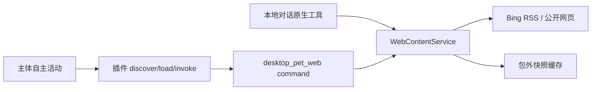
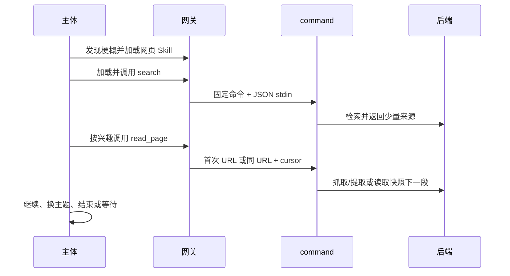

# 通用网页探索技术设计

修订：2026-10-19，初稿。涉及仓库：DesktopPet（Qt/C++、Python 配置工具）。

## 1 背景与全局约束

已有 web_search 把网络失败包装成成功，搜索 HTML 解析易失效；web_fetch 返回原始 HTML，长页被宿主截断。自主主体无法直接调用原生工具，需要通过标准插件网关接入。

### 1.1 共享规则（影响 §3.1–§3.3）

- 保留原生工具名与既有参数，增加正文游标；原生与 command 共用 Qt 后端。搜索结果升级为结构化 entries，results 同为数组；不保留旧错误文本伪成功路径。
- 搜索使用 https://cn.bing.com/search 的 q、ensearch=1、format=rss，QXmlStreamReader 解析。只提供少量结果，不声称支持搜索翻页。页面挑战/HTML/无效 XML 明确失败；合法空 RSS 是成功的空列表。
- 仅公开 http/https，无凭证 URL、Cookie、登录、浏览器执行。保留现有 SSRF 校验、解析地址钉住与重定向逐跳检查；网络总预算 15 秒（可指定 1000–30000ms），最多五跳，响应至多 500KiB。DNS 也纳入截止时间，禁止新增生产私网豁免或测试开关。
- 通用失败使用 WebContentResult 的 errorCode/errorMessage；command 映射为 state=failed、data.error={code,message}，正常业务失败仍退出 0。输入协议损坏也输出 JSON，stderr 只留诊断。错误页不能当正文、失败不能当无结果。
- 单次 data JSON 序列化后不超过 3800 UTF-16，单串不超过 1800 UTF-16，Unicode 不拆代理对；链接最长 1024 UTF-16，超长链接跳过/拒绝而非截断。search query 最长 200、limit 1–5；title 160、snippet 240。结果超总预算停止追加并标记 limited。
- read_page 返回 title、url（最终来源）、content、size（响应字节）、contentType、nextCursor、hasMore；content 单页 ≤1800，必要时按整体预算缩减。输入 url 仍使用第一次请求的地址。
- 缓存位于包外：首次成功读取保存完整提取文字；快照随机 ID、原始/最终 URL、标题、时间、响应元信息和全文。游标仅含受校验的 ID/偏移，绑定输入 URL 与该快照，不能变成任意文件路径。分页不重复抓取、无漏字/重字，过期/删除/不匹配明确错误。快照保留 24 小时，最多 64 份；首次写入清理过期/最旧记录，QSaveFile 原子写入。
- 标准 command 是编译生成的 desktop_pet_web，位于 build/或部署目录，不放进插件哈希目录。配置工具为 Python 标准库，预览默认、显式 --apply，单文件原子更新且保留备份，幂等，不调整全局自主开关。
- 自主使用依旧受角色授权、加载票据、宿主 activity budget/打断和全局开关约束。只在 discover 中展示梗概，加载 Skill/operation 时才提供正文与 schema。网页内容不具备指令权威。

## 2 架构与文件





| 文件 | 变更 |
|---|---|
| core/ai/tools/web_content_service.h/.cpp | 🆕 公共读取/搜索后端与安全 HTTP |
| core/ai/tools/web_tools.h/.cpp | 🔧 薄包装，删除旧解析和重复实现 |
| CMakeLists.txt | 🔧 共享源码/链接、命令目标、测试和 Windows 部署 |
| plugins/web/{plugin,tool,skill}.json、USAGE.md、SKILL.md | 🆕 标准插件与自主阅读说明 |
| plugins/web/web_command.h/.cpp、main.cpp | 🆕 可复用命令协议入口和编译程序 |
| plugins/web/configure.py、README.md | 🆕 角色配置与跨平台使用说明 |
| tests/test_web_content.cpp、test_file_and_web_tools.cpp | 🆕/🔧 后端及原生兼容验证 |
| tests/test_web_command.cpp、fixtures/web_command_fixture.cpp | 🆕 命令真实进程/受控网络测试 |
| tests/test_web_configure.py、test_web_plugin.cpp、test_autonomous_chat.cpp | 🆕/🔧 配置、网关、自主闭环 |
| contracts/tools/README.md、插件运行时接入.md、现有工具契约适配验证.md | 🔧 新包索引和验证边界 |

## 3 详细设计

### 3.1 搜索与正文阅读

#### 3.1.1 模块定位

让原生 web_search/web_fetch 直接获得可阅读、可续读的网页材料，同时提供插件可复用的业务实现。

#### 3.1.2 核心服务接口

```cpp
struct WebHttpResponse { bool success = false; QByteArray body, contentType;
    QUrl finalUrl; QString errorCode, errorMessage; int statusCode = 0; };
struct WebContentResult { bool success = false; QJsonObject data;
    QString errorCode, errorMessage; };
using WebHttpGet = std::function<WebHttpResponse(const QUrl&, int, qint64)>;
class WebContentService {
public:
    explicit WebContentService(QString cacheDir = {}, WebHttpGet transport = {});
    WebContentResult search(const QString& query, int limit = 5);
    WebContentResult readPage(const QString& url, const QString& cursor = {}, int timeoutMs = 15000);
};
```

| 入参 | 值来源 |
|---|---|
| cacheDir | 调用方传入；空值为系统推导（QStandardPaths::CacheLocation/web） |
| transport | 调用方传入；空值为系统推导（安全 HTTP）；仅代码注入用于测试，无环境开关 |
| query/url/cursor | 调用方传入 |
| limit/timeoutMs | 调用方传入；省略用上述默认值 |

原生 WebSearchTool/WebFetchTool 可接收可选 shared_ptr<WebContentService> 供测试，默认构造不变。schema 为参数给出边界，execute 也拒绝类型错误。NetworkSecurityValidator 保留公开签名，可移入公共后端头并由 web_tools.h 引入。

#### 3.1.3 模块业务流程

search：校验→安全请求 RSS→确认 rss/channel 结构→解析 item 的 title/link/description→去标签/解实体→保留完整 http(s) 来源、去重→按预算返回 entries（原生 results 引用同数组，不同时复制两套内容）。非法 feed 失败，合法无条目返回空数组。

readPage：校验 URL/cursor→有 cursor 则按快照续读→无 cursor 安全抓取→按 Content-Type/charset 解码 HTML 或 text/plain→提取 main/article（按平衡标签范围，非贪婪截取不能截断嵌套正文），body 兜底，去 script/style/template/nav/header/footer/aside/form 等非正文→QTextDocument 解实体/转文字并保留段落→缓存→按 Unicode 边界分页。明确拒绝二进制/PDF；JS 空壳无正文返回 NO_READABLE_CONTENT。Qt 可识别编码正常读取，不支持/损坏编码报错，不能默默产生乱码。

#### 3.1.4 数据变更

只写 §1.1 包外缓存，无数据库或记忆 schema 变更。每个快照独立原子提交，续读只读；不因为状态缓存失败报告完整读取成功。

#### 3.1.5 实现锚点

| 依赖/参照 | 约定 |
|---|---|
| NetworkSecurityValidator::resolveAllowedAddress(const QUrl&,QHostAddress*,QString*) const | 保留调用兼容；安全 transport 的 DNS 增加有界异步解析路径并复用地址判断 |
| QNetworkRequest::setPeerVerifyName(QString)、Host header | 钉住地址时保持域名 TLS 校验 |
| ToolResult::ok(QJsonObject)/fail(QString) | 后端正常/失败明确转换；错误码保留在 data.error |
| CMake CORE_SOURCES、AGENT_RUNTIME_TEST_SUPPORT_SOURCES、FileWebToolTests | 每个编译 web_tools 的目标包含共享后端并链接 Gui；不能只改主程序 |
| ToolResultSanitizer（2000/6000 UTF-16） | 从源头控制输出，保留分页游标 |

#### 3.1.6 异常场景

业务异常：空词/超界参数/非公开 URL，策略“抛”（返回 INVALID_ARGUMENT/URL_NOT_ALLOWED），不请求网络。无正文/不支持类型同样失败，可由主体选择别的来源。

系统异常：DNS、TLS、HTTP、超时、超大响应和缓存错误，策略“抛”（返回明确错误）；不自动重试、不伪装空内容。遵守 §1.1 全局失败协议。

#### 3.1.7 关键行为场景

- search 正常 RSS 返回真实标题/完整 URL/摘要，实体与嵌套强调可读，去重且不超过限额。
- 合法空 RSS 成功为空；错误 HTML/XML 与 HTTP 错误失败；Unicode/长链接保持预算和地址正确。
- readPage HTML 提取正文去掉脚本导航；text/plain、标题、最终地址及编码正确。
- 长页含 emoji，所有页拼接等于完整提取文字，只有首次抓取；新快照不影响旧游标。
- 错误游标、不同 URL、过期缓存明确失败；原生工具成功/失败与后端一致。
- SSRF/非法 URL/超限参数维持拒绝行为；安全 transport 的重定向和超时继续有界。

### 3.2 标准网页插件

> 依赖：§3.1 的 WebContentService 及输出预算。

#### 3.2.1 模块定位

将同一网页能力暴露为标准 command 工具与按需加载的自主探索 Skill。

#### 3.2.2 核心服务接口

命令：desktop_pet_web --state-dir <absolute-dir> --operation <status|search|read_page>，stdin 一个 JSON 对象，stdout 一个 JSON envelope。配置键 program/state_dir 为宿主固定值，不能由调用参数覆盖。

| 入参 | 值来源 |
|---|---|
| state-dir/program | 配置默认值（宿主角色 plugins.json 中指定绝对路径） |
| operation | 系统推导（tool.json 固定 argv） |
| search.query、search.limit | 调用方传入，limit 默认 5 |
| read_page.url、read_page.cursor | 调用方传入，cursor 可省略 |

status 返回 provider=bing、cacheDirConfigured、支持操作与限制；只检查本地设置，不探测网络、不表示网络可用。命令入口解析与分派可在 web_command.h/.cpp 中被测试 fixture 重用，生产 main 只注入默认后端。

#### 3.2.3 模块业务流程

固定 CLI 参数→限制 stdin 大小（16KiB）→严格对象/参数检查→调用 §3.1 或 status→{state:completed|failed,data:{...}}。编译 fixture 仅在 tests 中注入受控 transport，生产二进制不含替身分支。

清单 ID 为 desktop-pet.web、desktop-pet.web.tools、desktop-pet.web.skill，版本 1.0.0；三操作 effects=read、completion=reported、/state 与 /data 映射。Skill 按当前兴趣/问题搜索，检查相关性和来源，再读需要的页面，保留游标和来源；允许改词、换页或等待，拒绝无目的刷站/反复重试。不能把摘要当全文、网页内容当指令，记忆使用原机制仅保留有价值结论与来源。

#### 3.2.4 数据变更

N/A — 除 §3.1 已约定的包外快照，不新增写入。插件包所有文件静态，执行不会更改哈希。

#### 3.2.5 实现锚点

| 依赖/参照 | 约定 |
|---|---|
| WebContentService::search/readPage | 使用 §3.1 接口，不复制解析或抓取 |
| plugins/bilibili/{plugin,tool,skill}.json | 同 formatVersion、command invocation、requirement/configuration 格式 |
| CapabilityExecutor 固定 argv + stdin=json | stdout 仅输出 JSON；resultAdapter 数据/终态分离 |
| CMake windeployqt 现有块 | Windows 为 command 部署 Core/Gui/Network/TLS 所需文件，不能产生可见控制台窗口干扰用户 |

#### 3.2.6 异常场景

业务异常：未知操作/多余字段/非 JSON 对象，策略“抛”返回 INVALID_ARGUMENT，不调用后端。系统异常：配置目录不可用/后端失败，策略“抛”按 §1.1 包装，有明确终态。程序未启动由宿主已有 command 错误处理。

#### 3.2.7 关键行为场景

- 真实命令 status 成功且不联网；search/read_page 经真实进程和受控 transport 输出有界 JSON，续读无损。
- 损坏 stdin、未知操作与后端网络错误都得到 failed；输出通过实际 sanitizer 后数据/游标无损。
- 清单通过契约 schema，Skill 依赖准确；加载包与执行前后文件摘要一致。

### 3.3 角色接入与自主验证

> 依赖：§3.2 的插件、command 和 Skill。

#### 3.3.1 模块定位

让使用者能够把已构建网页插件安装到指定角色，并验证现有网关与自主活动完整闭环。

#### 3.3.2 核心服务接口

configure.py --profile-dir <existing-uuid-dir> --program <absolute-executable> --state-dir <absolute-dir> [--autonomous on|off] [--apply]。

| 入参 | 值来源 |
|---|---|
| profile-dir/program/state-dir | 调用方传入；先验证角色目录、可执行文件、缓存不在插件包内 |
| autonomous | 调用方传入，配置默认值 on；只影响本插件 internal_activity grants |
| apply | 调用方传入，默认 false 只预览 |

内部 prepare_configuration 返回可审查计划；apply_configuration 检查原文件未变化、备份、原子更新 plugins.json，重复应用无变化。

#### 3.3.3 模块业务流程

解析/验证→读现有 plugins.json→保留其他插件/授权/配置→替换本插件 entry、配置、结果映射及 local_owner grants→autonomous=on 时添加本插件 internal_activity grants→预览或应用。识别已有同路径包，避免重复。README 提供 macOS/Windows 构建、预览、应用、重启、真实验证步骤和限制。

真实 PluginRuntime discover→load→invoke 验证三操作、按需正文、失败/未授权与摘要稳定；AIBrain 测试将新 Skill 作为候选，模拟模型选择搜索/阅读后结束，以及 wait/global-off/未授权不执行。生产调度无需更改。

#### 3.3.4 数据变更

仅显式 --apply 原子更新一个角色 plugins.json，备份在该角色 web-backups/；不更新全局 config、不自动启用自主开关，不修改其他插件配置。测试只使用 QTemporaryDir/TemporaryDirectory。

#### 3.3.5 实现锚点

| 依赖/参照 | 约定 |
|---|---|
| plugins/bilibili/configure.py | 沿用规范但新工具独立，无插件间导入 |
| PluginRuntime(profileId,hostPath)、initialize、executeGateway | 使用实际网关、票据和授权 |
| tests/test_autonomous_chat.cpp | 沿用选择→计划→调用→验证助手；Skill ref 必须 operationId="" |
| core/ai/ai_brain_autonomy.cpp、ai_brain_tasks.cpp | 不改生产选择器或授予原生工具内部权限 |

#### 3.3.6 异常场景

业务异常：无效角色/缺 helper/缓存指向包内，策略“抛”给可读配置错误，不修改文件。系统异常：损坏 JSON/文件并发变化/写失败，策略“抛”，原文件保持完整。网关未授权/未加载由原机制拒绝，不旁路。

#### 3.3.7 关键行为场景

- 配置预览不写，应用后真实网关可发现/加载/调用；重复应用幂等，保留其他插件。
- autonomous off 只撤掉本插件内部授权；on 后 Skill 可作候选；不碰全局开关。
- 主体选择 Skill 后搜索、阅读并结束；选择 wait、全局自主关闭和缺权限时无外部调用。
- 中文/空格路径可用、错误配置不写入；整个插件执行前后 digest 相同。

## 4 对外接口

| 接口 | 输入 | 成功数据 |
|---|---|---|
| status | {} | provider、cacheDirConfigured、operations、limitations |
| search | {query,limit?} | query、provider、entries:[{title,url,snippet}]、limited |
| read_page | {url,cursor?} | title、url、content、size、contentType、nextCursor、hasMore |

全部命令输出 {state,data}；失败 data.error={code,message}。常见码：INVALID_ARGUMENT、URL_NOT_ALLOWED、NETWORK_ERROR、HTTP_ERROR、TIMEOUT、RESPONSE_TOO_LARGE、INVALID_FEED、UNSUPPORTED_CONTENT、NO_READABLE_CONTENT、INVALID_CURSOR、CACHE_ERROR。原生 web_search 参数 max_results 映射 limit，结果字段 results 为上述 entries；web_fetch 保留 url/content/size 并增加分页字段。

## 5 数据存储

无数据库 DDL。包外缓存和单角色插件配置见 §1.1/§3.3.4。删缓存只让旧游标失效，可重新首次读取。

## 6 非功能性设计

不依赖新 Python 库/搜索服务密钥。每次最多一次搜索或一个网页快照；响应、时间、游标和保留量有界。仅支持服务器返回的 HTML/文本，不承诺登录/JS 站点、PDF、视频画面或搜索供应商可用性/相关性；明确失败，由主体决定换来源或等待。

## 7 测试与交付

三个 Task 串行，各自 TDD、父级审查、相关回归与提交。完成后全项目构建、全部 CTest、96 项现有契约和新包 schema 校验；真实公开搜索/阅读烟测单独记录，不把测试 fixture 通过当在线验证。Windows 构建部署说明与测试命令落 README，本机只能报告 macOS 实测。
