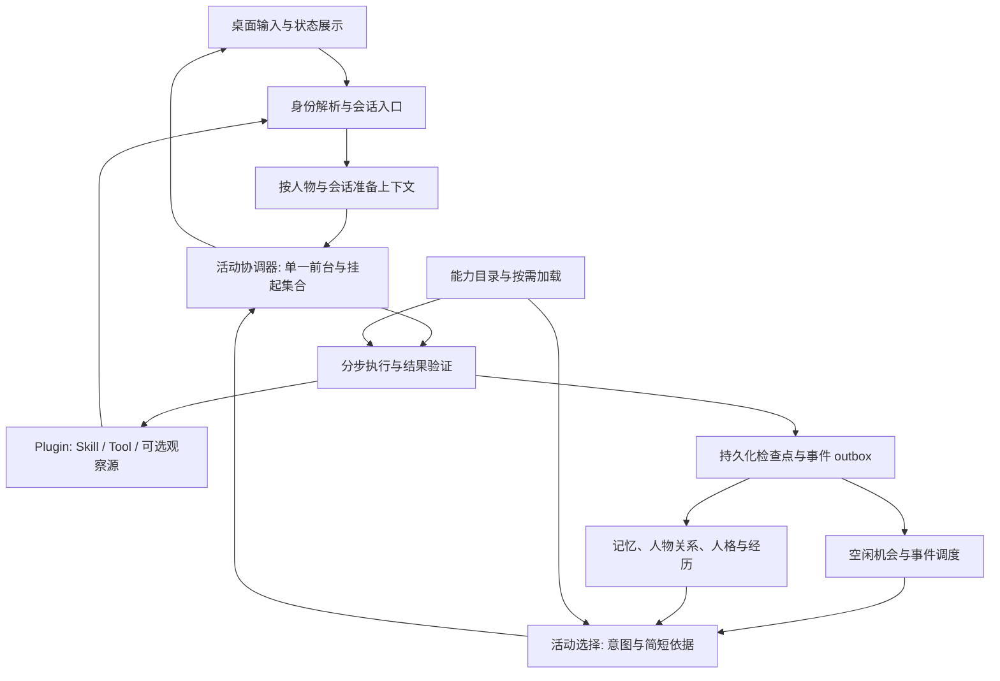
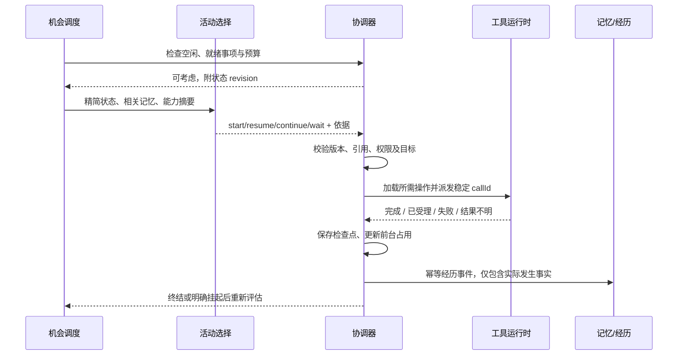
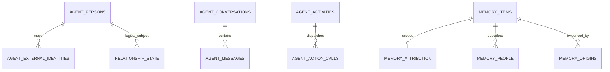

# 自主 Agent：身份、记忆与活动运行时设计

## 文档状态与阅读顺序

本文件是后续顺序实施的主设计文档。2026-10-16 的会话已确认产品方向、人物识别与记忆归属优先、通用自主活动循环，以及主体空闲与电脑无人操作的区分。文中的接口、表结构和配置默认值是落实这些方向的首版工程设计；实现前以对应切片核对源码，调整时同步修订本文件。

**设计已落盘，已进入顺序开发。** 实施状态以本地 `.evo/tasks/autonomous-agent/自主Agent-身份记忆与活动运行时-桌面端-impl-plan.md` 为唯一来源；本文定义目标契约与验收门槛。每个切片须满足 §7 的验收，再推进下一项；不得把本文描述的目标行为当作现有能力。

| 版本 | 日期 | 内容 |
| --- | --- | --- |
| 1.0 | 2026-10-16 | 固定主体与插件边界，定义人物、记忆归属、会话、活动选择、空闲、执行恢复及顺序验收 |
| 1.1 | 2026-10-16 | §3.2 开发核对：明确绑定版本与已接受事件、来源兼容边界、身份表增量迁移 |
| 1.2 | 2026-10-16 | §3.3 开发核对：来源提交验证、过渡期本地上下文、写入归属与分批迁移边界 |
| 1.3 | 2026-10-16 | §3.4 开发核对：会话库唯一权威、异步生产入口、宿主连接绑定与持久发送回执、原始消息消费去重与历史导入边界 |
| 1.4 | 2026-10-16 | §3.5 开发核对：标准 Schema 验证、宿主配置与授权、结果映射、工具元数据和生产异步调用入口 |
| 1.5 | 2026-10-16 | §3.6 开发核对：runtime schema 3、后台活动执行、旧任务投影、动作回执、恢复依据与经历消费接管 |
| 1.6 | 2026-10-16 | §3.7 开发核对：宿主 readiness、机会租约、默认关闭设置、每次模型发送的共享预算与生产接线 |
| 1.7 | 2026-10-17 | §3.8 开发核对：宿主范围与引用材料、内部活动授权、原子采用选择、持续意图及真实生产选择器 |

| 仓库 | 技术栈 | 涉及范围 |
| --- | --- | --- |
| DesktopPet | C++20 / Qt 6、SQLite、Python launcher | 主体运行时、记忆与关系、插件加载执行、状态展示 |

正式设计在本目录维护；本地过程记录可放入 `.evo/`。本文承接[插件系统开发指导](../tools/插件系统开发指导.md)、[分类与按需加载约定](../tools/Skill与Tool分类及按需加载约定.md)及[Tool 格式 1](../tools/能力包声明模板.md)。后者继续作为 Tool 兼容基线。本文明确扩展原先“本次不改变记忆设计”的工作范围，但不把已经撤回的工具层系分恢复为要求。

## 1. 背景、目标与全局约束

### 1.1 产品定位与已确认结论

主体是一个具有持续身份、记忆、关系和自主活动能力的 Agent；桌宠是表现与交互形态。它既能响应主人，也能根据当前状态选择看消息、阅读、听音乐、继续之前的事情或休息。QQ 是验证这一能力的具体例子。

- 新能力通过 Plugin 交付，Skill 提供方法，Tool 提供操作；新增软件不应在主体业务代码中增加软件名称分支。
- 自主性包括选活动、保持活动连续性、等待、恢复和结束；活动是运行实例，不新增一种要求所有插件作者填写的“活动插件”。
- 先补人物识别和记忆归属，再补自主活动运行机制，最后以 QQ 等外部能力验证完整路径。
- 主体可主动调用工具“去看看”；持续监听外部消息是可选能力。
- 关系、兴趣、人格和记忆保持为同一个主体的状态。人物身份用于明确对象，人物归属不等于信息可公开范围。
- 安装插件、允许自主使用、加载详细定义、依赖就绪、操作执行成功分别判定。

### 1.2 术语与共享身份

| 名称 | 含义及约束 |
| --- | --- |
| profileId | 当前 Agent 角色；沿用现有角色隔离边界 |
| personId | 该角色认识的人；新人物使用稳定 UUID 字符串，现有主人保留保留值 `owner`，身份键为 (profileId, personId) |
| ExternalIdentity | (provider, namespace, remoteActorId)；namespace 由适配器按远端 ID 的唯一范围声明，昵称不是身份 |
| conversationId | 稳定交互空间，如桌面主人对话、某次接入下的 QQ 私聊或群；跨多轮请求保持 |
| sessionId | 一次模型处理/任务会话；沿用现有 AgentSession，不替代 conversationId |
| activityId | 一项有目的的活动，可跨多轮请求并多次挂起恢复 |
| requestId / generation | 单次派发与有效代次；用于拒绝取消后或上下文失效后的迟到结果 |
| capabilityRef | 插件、条目、版本、操作的结构化引用；显示名称不作为执行定位 |
| originId | 原始经历来源；重复读取、反思和派生记忆保留该来源，不生成新的独立事实证据 |

一个人物可对应多个外部身份。群是会话而非人物；“小明说小红喜欢猫”的来源人物是小明、描述对象是小红。身份无法确定时保留未解析引用，不统一塞给主人或一个共享的“未知人”。Agent 自身使用 profileId 表示，不创建一个普通联系人当作自身；适配器连接中已核实的登录账号用于识别自身消息回显，不能根据消息正文中的“我是你”判定。

### 1.3 状态、并发与数据所有权（影响 §3.2—§3.9）

1. 人物与关系、会话、活动归主体；插件只通过公开协议提供观察和操作，不读写主体数据库。
2. 每个 profile 同时只有一个前台活动拥有注意力；可以保留多个挂起活动。准备模型、执行工具、观察结果和验证之间连续占有前台，不以“这一瞬间没有请求”释放。
3. 主体采用单一串行协调入口拥有会话/活动状态；第一版可用 QObject 协调器和不可变消息实现，不要求同步重写成完整 Agent Actor。单一前台决策不等于 GUI 线程执行；工具和存储继续使用异步工作线程。
4. 普通后台记忆整理维持已有并发与按批提交方式。人格巩固与前台任务的独占规则继续由调度器协调。
5. runtime 数据库事务只写 runtime 表与既有 event_outbox；memory 数据库事务只写记忆及其关联。跨库使用已提交事件、幂等消费和 checkpoint，不建立跨库外键或假定跨库原子事务。
6. 同一数据库的工作线程使用独立连接；迁移和写入开启外键，现有 WAL、busy timeout 与写队列约定继续适用。runtime 中先读取版本再写入的事务须以 BEGIN IMMEDIATE 预留 writer（包括共享 RuntimeUnitOfWork、身份仓库自有 CAS 和事件检查点事务），避免 WAL deferred 读快照升级因并发机会写入立即 SQLITE_BUSY；版本校验、幂等及失败回滚不变，纯读取不因此取得写锁。
7. 模型输出是提案；身份、引用、预算、参数和状态转换由程序校验。调用是否实际发生及完成边界来自工具结果，不能由模型自述替代。
8. 原始消息、会话处理日志和派生反思分开保存；关系、人格及日记的独立来源始终回溯实际原始消息。历史导入与自身回显不成为新的互动证据，也不触发新的自主回复（影响 §3.3、§3.4、§3.8、§3.9）。
9. 插件目录、宿主授权与配置属于对应 profile 的 PluginRuntime；目录只在短临界区交换不可变快照，不持锁等待进程或 MCP I/O。已准备与已派发的调用分开处理：禁用、版本变化或取消使尚未派发的调用失效，已派发的实际回执仍带原 profile、callId、activityId 和版本归档，不因前台切换丢失（影响 §3.5、§3.6、§3.9）。

### 1.4 活动状态与空闲定义（影响 §3.4、§3.6—§3.9）

| 活动状态 | 前台占用 | 语义 |
| --- | --- | --- |
| Ready | 否 | 已形成/恢复候选，尚未被选中 |
| Running | 是 | 规划、模型请求、工具等待、观察和验证；executionPhase 在检查点记录细分阶段 |
| WaitingExternal | 否 | 已提交动作且在等待对方回复或远端任务事件；已有订阅/复查条件 |
| WaitingUser | 否 | 需要明确的用户输入；等待本身不阻止其他允许的活动 |
| Paused | 否 | 用户暂停、预算不足、应用重启或依赖缺失；记录 pauseReason 与恢复规则 |
| Completed / Cancelled / Failed | 否 | 终结；结果和终结原因分别记录 |

工具请求尚未返回通常属于 Running。只有明确的 accepted 结果和可跟踪的后续事件/查询入口，才可转 WaitingExternal；网络超时不等于已经安全挂起。

`isIdle = 无前台活动或选择预留占用 && 无需要优先处理的已就绪事项`。

`canDeliberate = isIdle && 主体运行中 && 自主活动启用 && 未暂停/休眠 && 冷却到期 && 预算允许`。

就绪事项包括尚未分流的输入事件、已到期且须履行的任务、需要处理的执行结果；任意低优先级候选或长时间等待不自动阻止空闲。输入先合并、识别来源并分流；普通群消息可只形成观察，不要求逐条回复。

电脑无键鼠操作不是 isIdle 的前提。工具需要操作 GUI 时，再取得桌面输入资源；用户正在操作时延后该动作或选择其他允许活动。资源不足属于执行条件，不改变人物身份或伪装为情绪。

### 1.5 异常、预算与恢复（影响所有切片）

统一返回现有 `Result<T, DomainError>`；不引入 Java Facade 或 OB 规则，接口与迁移按本仓库 C++ / SQLite 实现。I/O 回调携带错误和请求身份，不在 GUI 回调抛未处理异常。

| 错误类别 | 程序处理 |
| --- | --- |
| INVALID_INPUT / IDENTITY_CONFLICT / UNKNOWN_REFERENCE | 返回明确错误，不执行相关动作；等待有效输入或修正绑定 |
| STALE_REVISION / STALE_CONTEXT | 丢弃旧提案/迟到结果；用最新状态重新评估，仍受原预算约束 |
| DEPENDENCY_UNAVAILABLE / PLUGIN_DISABLED | 当前活动保存检查点并暂停；目录记录具体状态 |
| STORE_UNAVAILABLE | 暂停新的外部动作；保留可报告结果，不假装持久化成功 |
| MODEL_INVALID / MODEL_TIMEOUT | 同一次决策至多一次有界重试；仍失败则延后选择，不伪造主观拒绝 |
| ACTION_OUTCOME_UNKNOWN | 保存未知状态，先核对结果；不自动重发有副作用的请求 |
| BUDGET_EXHAUSTED | 保存累计用量并暂停/延后；模型与插件不能自行重置预算 |

首版配置使用保守、可调整的工程默认值，不把它们当作人的心理定律：消息聚合窗口 1 秒且最长等待 3 秒；自主考虑最短间隔 60 秒；无事可做时 5 分钟后再评估，重复相同空闲状态退避至 30 分钟；兜底本地检查 15 秒且不调用模型。新输入可绕过“无事可做”的退避，但仍受消息聚合和调用预算约束。模型可以提议下一次考虑时间，宿主按配置夹取。

每次考虑至多 4 个候选、1 次选择调用及 1 次修复；同一 profile 每小时自主考虑默认至多 12 次模型调用（修复也计数）。活动沿用现有 12 次工具、2 次重规划、5 分钟活跃执行默认预算，另加自主活动每小时累计 15 分钟活跃执行上限；选择调用与活动模型请求另受共用 token/费用上限控制。未知 token 用量采用发送前预算预留并保守结算。等待与停机不算活跃时间；恢复不清零累计计数。

预算与时间的工程约定（§3.7—§3.8）：

- §3.8 的内部材料授权另由 `aiSettings.autonomy.memoryAccess={owner:false, conversationIds:[]}` 控制。owner 必须为布尔值，conversationIds 最多 32 个非空、去重的本 profile 稳定会话 ID；错误类型/超限明确拒绝或关闭对应授权，不能扩大范围。它只影响无会话的 Internal 自主材料投影，与工具 effects/executor/autonomous 授权独立。外部机会始终重新加载当前会话范围。首版作为 JSON 工程配置保留，Launcher 保存不得丢失。

- 配置位于 `aiSettings.autonomy`，不随模型配置切换：`enabled=false`、`paused=false`、`coalesceWindowMs=1000`、`coalesceMaxWaitMs=3000`、`minDecisionIntervalMs=60000`、`noOpBackoffMs=300000`、`maxNoOpBackoffMs=1800000`、`localTickMs=15000`、`ticketTtlMs=120000`、`maxSelectionCallsPerHour=12`、`maxActiveMsPerHour=900000`、`maxTokensPerHour=120000`、`maxEstimatedCostMicrosPerHour=1000000`、`unknownAttemptCostMicros=50000`。非正上限、超界数值、错误类型使用保守默认或明确拒绝，不能解释为无限预算。Launcher 行为设置提供自主启用与暂停开关，其余工程参数保留在 JSON；保存不覆盖其他配置。
- token 与费用上限针对自主选择及 `intent.origin=self/event` 的自主活动模型请求共享；明确用户请求的普通对话/任务保持原规则，不因自主预算耗尽被阻断。自主性是宿主保存的活动属性，不能从是否 External/LocalOwner 推断。选择次数限额只计选择/修复，活动请求另计共享 token/费用。
- 每次实际 provider attempt（包括 fallback、格式修复）在发送前写入不可复用的宿主 attemptId 及预算预留；选择一张 ticket 最多允许两次实际发送，跨路由不重置。底层 retryCount 保持 0。输入预留按完整序列化 messages/tools/schema 的 UTF-8 字节数加固定封装余量 1024，再加正数 output maxTokens；这是保守估计，不宣称精确 tokenizer。费用预留为 `max(route.estimatedCostMicros, unknownAttemptCostMicros)`，均以宿主配置的同一微费用单位计，不宣称账单精度。
- 有有效 usage 则按真实 totalTokens（或完整的输入/输出和）结算；缺失、非法、断连、取消、销毁或重启未结算请求保留预留，不能记成零。费用没有真实 provider 账单接口时始终保留预估收费。实际用量大于预留时如实入账并阻断下一请求，不截断已发生用量。迟到结果按原 profile/attemptId 幂等更新，不能被新前台或已销毁 GUI 丢弃。
- 滚动一小时账本持久化；已完成收费在窗口外才清理，未结算预留在重启时转保守已用，不能通过重启或等待租约过期退款。运行内用单调时钟计算间隔和 activeMs；持久 UTC 只负责跨重启恢复。墙钟回拨冻结窗口淘汰，前跳不使运行内预算提前到期。活跃时长按实际自主运行区段累计并定期保存，等待不计；恢复使用剩余额度，抵达上限保存检查点并暂停。

新自主功能默认关闭，完成验收后由设置启用。第一版 quiet/focus 模式均不发起新的自主探索，保持既有模式含义；明确请求的活动仍按其自身执行规则处理。用户暂停后仅用户恢复；重启的未完成活动先进入 Paused/restart，与现有恢复习惯一致。无结果风险且已明确允许的外部等待，在同次运行内可由匹配事件成为 Ready。重新激活须检查版本、最新消息、能力状态和剩余预算。

## 2. 总体设计与现状差距

### 2.1 架构



以上是逻辑分工，模型角色可复用同一服务；不要求每一块启动独立 Agent、进程或模型。

### 2.2 一次自主活动



### 2.3 代码变更清单

路径为实现锚点；🆕 表示建议新增，当前尚不存在。

| 类型 | 位置 | 变更 |
| --- | --- | --- |
| 🆕 | core/ai/identity/person_directory.* | 人物档案与外部身份解析 |
| 🔧 | [relationship_service](../../core/ai/identity/relationship_service.h)、[runtime_types](../../core/ai/runtime/runtime_types.h) | 复用 subjectId，消除外部输入默认 owner |
| 🔧 | [memory_extractor](../../core/ai/memory/memory_extractor.h)、[memory_policy](../../core/ai/memory/memory_policy.cpp)、[memory_metadata](../../core/ai/memory/memory_metadata.h) | 带主体的抽取、去重、冲突与来源合并 |
| 🔧 | [memory_retriever](../../core/ai/memory/memory_retriever.h)、[active_memory_pool](../../core/ai/memory/active_memory_pool.h)及巩固链路 | 人物/可见范围过滤、按 context 分离话题缓存 |
| 🆕 / 🔧 | core/ai/chat/conversation_store.*；[chat_types](../../core/ai/chat/chat_types.h)、[chat_preparation_types](../../core/ai/chat/chat_preparation_types.h) | 稳定会话与发送人、输出目标、异步结果隔离 |
| 🆕 | core/ai/plugin/*、core/ai/ai_brain_plugins.cpp | Plugin / Skill 清单、发现目录、按需加载、宿主授权和主体调用绑定 |
| 🔧 | [tool_registry](../../core/ai/tool_registry.h)、[tool_runtime](../../core/ai/tools/runtime/tool_runtime.h)、[mcp_client](../../core/ai/mcp/mcp_client.h) | 动态工具、异步执行、完整 MCP 调用和生命周期 |
| 🆕 / 🔧 | core/ai/ai_tool.h、core/ai/tools/runtime/tool_policy.*、ui/petwindow_ai.cpp、third_party/jsoncons、contracts/tools/* | 内置工具宿主元数据与工厂注册、离线标准 Schema 验证、Plugin / Skill 清单及配置示例 |
| 🆕 | core/ai/activity/* | ActivityStore、ActivityRuntime/串行执行 worker、OpportunityCoordinator、ActivitySelector 与有界材料准备 |
| 🔧 | core/ai/reflection/{inner_thought_service,sqlite_private_psyche_repository}.*、core/ai/memory/、core/ai/identity/、core/ai/runtime/ | 为选择器读取真实记忆/内心引用和人格关系投影，保持私有内容及线程边界 |
| 🔧 | [task_orchestrator](../../core/ai/task/task_orchestrator.cpp)、[task_store](../../core/ai/task/task_store.cpp)、[agency_decision_service](../../core/ai/task/agency_decision_service.cpp) | 复用执行检查点，支持挂起集合，移除按工具名字固定的准入分支 |
| 🔧 | [ai_brain](../../core/ai/ai_brain.h)、[ai_brain_loop](../../core/ai/ai_brain_loop.cpp) | 单一协调入口、从专用主动聊天触发过渡到通用选择 |
| 🔧 | [event schema](../../core/ai/event/event_schema_registry.h)、[runtime growth](../../core/ai/runtime/agent_runtime_growth.cpp)、[反思类型](../../core/ai/reflection/reflection_types.h) | 带人物与上下文的来源、运行记录与长期经历分流 |
| 🔧 | [runtime personality](../../core/ai/runtime/agent_runtime_personality.cpp)、[personality consolidation](../../core/ai/reflection/personality_consolidation_stage.cpp)、[runtime services](../../core/ai/runtime/agent_runtime_services.cpp) | MessageObserved 原始证据、聚合处理日志的多来源回溯、历史导入排除及本地主人人格范围 |
| 🔧 | launcher、配置与测试 | 当前活动、暂停/恢复、等待原因、身份对应和插件状态；按切片补回归 |

实施前基线：关系表按 profile_id + subject_id + version 保存版本，可复用。现有记忆去重主要按 type + summary，偏好冲突解析默认 subject=user，须在多人输入前修正。现有聊天 history 缺稳定 conversationId；ActiveMemoryPool 只有一组 topic 状态。TaskStore 的 `complex_tasks_single_unfinished` 唯一索引与单任务接口不能直接承载挂起集合。MCP 适配器目前返回 `mcp_tool_execution_not_implemented`，现有契约检查通过不证明其能执行。

## 3. 详细设计

### 3.1 模块概览与顺序

| 顺序 | 切片 | 完成后的可用能力 | 依赖 |
| --- | --- | --- | --- |
| 1 | §3.2 人物识别 | 同名不同人、同人多账号、主人兼容 | 现有关系机制 |
| 2 | §3.3 记忆归属 | 写入、召回、去重与巩固正确区分人物和来源 | §3.2 |
| 3 | §3.4 会话与上下文 | 多个会话独立保存，回复与异步结果定位正确 | §3.2—§3.3 |
| 4 | §3.5 能力交付与执行 | 三种执行入口与两类条目可按需使用 | 现有 Tool 格式 1，§3.4 上下文 |
| 5 | §3.6 活动生命周期 | 一个前台、多个挂起、结果可核对并恢复 | §3.4—§3.5 |
| 6 | §3.7 空闲机会 | 状态驱动的空闲判断、聚合、冷却和预算 | §3.6 |
| 7 | §3.8 活动选择 | 自主形成意图、保持连续性、允许休息 | §3.2—§3.7 |
| 8 | §3.9 外部实践 | 主动查看 QQ 式会话、等待回复后恢复及可选事件输入 | §3.2—§3.8 |

顺序是依赖关系，不裁剪最终范围。§3.5 是执行底座，其交付仍属于“主体自主活动机制”的第二步；§3.9 才接入具体软件并验收扩展性。

### 3.2 人物识别与外部身份对应

#### 1. 模块定位

提供稳定人物身份，将外部账号映射到人物，并保留现有主人身份与关系历史。负责身份对应，不根据一次发言推断现实身份或修改关系数值。

#### 2. 核心服务接口

```cpp
Result<void, DomainError> initialize(); // 宿主启动：幂等回填当前 profile 的人物
Result<PersonResolution, DomainError> resolvePerson(const ResolvePersonRequest& request);
Result<void, DomainError> bindIdentity(const BindIdentityRequest& request);
```

请求/返回字段按 §4.1，接口由新增 PersonDirectory 提供。

PersonDirectory 绑定宿主当前 profile 和 runtime 数据库，不接受请求切换角色。profileId、ownerLocal、provider/namespace 的可信性由宿主调用边界保证；本切片校验字段完整性，不用软件名称白名单代替后续插件注册契约。C++ 的 `namespace` 为保留字，对应成员命名 `nameSpace`，JSON 与 SQL 仍为 `namespace`。缺少稳定远端 ID 返回 unresolved；已有 ID 却缺 provider/namespace 属于 INVALID_INPUT。

| 输入 | 值来源 | 说明 |
| --- | --- | --- |
| profileId | 系统推导（来源: 当前运行角色） | 不接受外部消息正文指定 |
| externalIdentity | 调用方传入 | 适配器提供的 provider、namespace、稳定 remoteActorId |
| displayName | 调用方传入 | 展示信息，可变化，不参加身份去重 |
| ownerLocal | 系统推导（来源: 已认证的本地主人入口） | 外部同名或自称主人不设置此位 |
| personId、expectedRevision（bind） | 调用方传入 | 目标人物及其 agent_persons.revision，由人物目录和身份管理操作取得 |
| bindingEvidenceRef（bind） | 系统推导（来源: 已接受的身份对应操作事件） | 记录跨账号对应的依据；与发言中的声称区分 |

#### 3. 模块业务流程

1. 校验 profile 与适配器声明的账号命名空间；本地主人入口解析为该 profile 下的 owner。
2. 已有精确账号映射则返回 personId，更新展示名不改变身份。
3. 有稳定外部账号但无映射时，在一事务内创建人物及账号映射；人物先标记 provisional，表示身份信息有限而非消息不可使用。
4. 缺少稳定账号标识时返回 unresolved，保留原始引用；不按昵称生成跨会话共享人物。
5. bindIdentity 可将未绑定的另一个账号关联至现有人物，需来源可追溯。若账号已经属于另一人物，返回 IDENTITY_CONFLICT；不自动合并人物或迁移历史。
6. 对误关联的更正走有记录的主体身份管理操作，增加 identityRevision 并重新投影受影响上下文；完整人物合并/拆分不是自主推断的副作用，实施时采用同一 revision 与来源原则。

版本与证据的落地规则：

- PersonResolution.identityRevision 是该人物的 agent_persons.revision；未解析为 0。新人物从 1 开始；换昵称不改变身份版本。新增账号绑定以目标人物 revision 做 CAS，成功后加 1；映射行的 revision 是独立的映射版本，不拿不存在的新账号映射版本做 CAS。
- bindingEvidenceRef 必须引用 runtime 账本中已提交的 IdentityBindingAccepted 事件；source 为宿主身份管理入口 `IdentityManagement`，同一 profile，payload 的 person_id、provider、namespace、remote_actor_id、expected_revision 必须逐项匹配本次请求。昵称与普通聊天声明不构成此类证据。外部插件没有直接创建宿主事件的权限。
- 同一账号、人物、证据的成功绑定请求可幂等重试，不再增加 revision 或追加 IdentityBound；账号已属于另一人物时优先返回 IDENTITY_CONFLICT。其他版本过期返回 STALE_REVISION，引用不存在/类型或内容不匹配返回 UNKNOWN_REFERENCE，均不改变映射或关系。
- 绑定写映射、提升人物版本及 IdentityBound outbox 使用同一 RuntimeUnitOfWork，任一步失败全部回滚。新身份绑定不自动将 provisional 人物升级为已核实的现实人物，也不修改关系统计。

输入来源与历史兼容：

- 使用 OriginKind 的 local_owner/external/internal，宿主填入 metadata 和新事件 payload.origin_kind。ChatPreparationRuntimeMetadata 默认 internal、空 subject；现有本地 `chatPreparationRuntimeMetadata()` 显式返回 local_owner/owner。只有 local_owner 可以把空 subject 解析为 owner，external/internal 保持无对象。
- `captureSnapshot(sessionId)` 的既有默认参数 owner 保留以兼容现有本地调用；显式传空 subject 表示未解析，不再回退 owner。
- 历史缺 origin_kind 的 UserMessageReceived 仅在 source=AIBrain 时按本地入口兼容；TaskExperienceRecorded 仅在 source=TaskExperienceAdapter 时兼容。显式 external/internal 永远不走历史 fallback；未知或无效来源不创建主人关系。
- TaskStartRequest 与 TaskRecord 带同一 OriginKind，TaskStore 在 task JSON 及 complex_task_experience_outbox 保存 origin_kind，TaskExperienceAdapter 原样投影到事件。旧 complex_tasks 来自既有本地任务入口，缺此字段可按 local_owner 读取；显式但无效的字段按 internal 保守处理。不能在重启或 outbox 转换时丢掉 external 标记后走历史兼容。
- 关系证据写已解析且存在的人物；未解析来源跳过身份相关效果并正常推进消费 checkpoint。外部对象即使经过绑定解析为 owner，也不因此获得本地主人配置/显式人格指导权限。普通外部关系反馈只更新相应人物关系。

#### 4. 数据变更

runtime 库新增 agent_persons、agent_external_identities。创建人物与映射同事务提交；唯一键保证并发首次识别返回同一人物。既有 relationship_state 不重复建表，subject_id 引用 personId；owner 值保持。人物更正与其事件 outbox 同事务，原始外部 ID 和已记录来源不覆盖。

本切片仅增量创建这两张身份表及索引，不提前创建其他切片的会话、活动或记忆表。schema 入口继续为 SqliteEventRepository::open；PersonDirectory 在角色初始化时以 INSERT-if-absent 回填 owner 与既有非空关系 subject，原始关系行、JSON、时间、版本不改写，重复启动不重置人物数据。本切片尚未切换多人记忆写入，因此无需等待后续 memory attribution 迁移后才启用人物目录。

回填由显式 initialize() 返回 Result，profile 和数据库依赖由宿主构造时注入，失败使身份能力降级；构造函数不吞存储错误。resolvePerson 对缺远端 ID 的输入直接返回 unresolved，不为此触发 owner 或其他人物创建。

#### 5. 实现锚点

| 现有位置/签名 | 接入方法 |
| --- | --- |
| RelationshipService::applyEvidence(const QString&, const RelationshipEvidence&) | 第一个参数由已解析 personId 提供；不再对外部事件默认 owner |
| SqliteIdentityRepository::currentRelationship(profileId, subjectId) | 读取当前人物的既有关系统计 |
| ChatPreparationRuntimeMetadata::subjectId | 从请求上下文投影，清除“空值自动 owner”对外部入口的隐式含义 |
| agent_runtime_growth.cpp | 关系证据按发言/互动对象关联；人物身份与“谁有权修改主体配置”分别判断 |
| AgentRuntimeServices::captureSnapshot(sessionId, subjectId) / chatPreparationRuntimeMetadata() | 前者显式空 subject 保持空；后者明确本地来源；运行时持有 PersonDirectory |
| SqliteEventRepository::open / SqliteRuntimeUnitOfWork::begin | 前者建身份表；后者为目录变更提供独立线程连接与单库事务 |
| EventOutbox::enqueue(RuntimeUnitOfWork&, const EventDraft&) | IdentityBound 与映射同事务；错误映射为 STORE_UNAVAILABLE |
| TaskStore::save(const TaskRecord&, bool enqueueExperience) / TaskRecord::toJson、fromJson / TaskExperienceAdapter | 既有任务记录与经历 outbox 连续保留 origin_kind，防止重启后身份归属倒退；不改任务生命周期 |

#### 6. 异常场景

- 业务异常：已绑定账号试图绑定另一人，返回 IDENTITY_CONFLICT，保留原映射并要求有效更正操作。
- 系统异常：唯一键竞争按精确键重读一次；存储不可用返回 STORE_UNAVAILABLE，此次消息保留未解析状态，停止依赖身份的持久化效果。
- 均走 §1.5 的 Result 错误路径，不因错误创建 owner 兜底身份。

#### 7. 关键行为场景

- resolvePerson：同一 QQ 账号换昵称仍返回同一 personId；两个同名账号生成不同人物，关系不共用。
- bindIdentity：主体已接受“两个账号是同一人”的对应操作后，新账号查询得到已有 personId，关系历史仍只有一份。
- 不同 profile 看到相同外部账号时保持角色隔离；无法取得账号 ID 的转述不会创建一个共享“未知人”。
- 旧 owner 关系版本在升级前后读取一致，已有 subject_id 不因迁移被统一重命名。
- initialize：当前角色首次启动建立 owner 和既有 subject 的人物记录；重复运行不改变任何已有身份、关系版本或状态；存储失败明确返回错误并停止依赖目录的入口。
- 新账号绑定使用目标人物版本；缺证据、伪装的普通消息事件、证据指向不同账号、旧 revision 均不产生绑定；同一次成功请求重复执行不重复事件或版本。
- 并发首次解析同一精确账号只产生一人；人物/映射/事件写入失败回滚，没有半个人物或成功绑定假象。
- 外部空对象不读取 owner 关系；外部甲的反馈只影响甲，本地主人的既有关系与成长继续可用；外部绑定 owner 的反馈不成为主人配置指导。
- 任务来自外部时，经保存、重启读取、经历 outbox 和 adapter 后仍标 external；其关系效果不改记主人，人格指导权限也不升级。

### 3.3 人物记忆归属、召回与迁移

> 依赖：§3.2 的稳定 personId；§1.2 的来源标识。

#### 1. 模块定位

让同一记忆库正确表达“关于谁、由谁提供、发生在哪里、在哪些上下文可以使用”，并贯穿抽取、去重、冲突、召回、强化和巩固。海马体与已巩固记忆的生命周期继续使用现有 memory_items 及分区策略。

#### 2. 核心服务接口

```cpp
Result<MemoryWriteResult, DomainError> ingestMemory(const AttributedMemoryInput& input);
Result<QList<RetrievedMemory>, DomainError> recallForContext(const ScopedMemoryQuery& query);
Result<MigrationProgress, DomainError> migrateAttribution(const AttributionMigrationRequest& request);
```

| 输入 | 值来源 | 说明 |
| --- | --- | --- |
| entry、describedPeople、claimKind、explicitRequest | 调用方传入 | 抽取候选及原有显式记忆请求标记；描述对象须有原文/事件依据，可为空且标 unresolved |
| originId、speakerId、conversationId | 系统推导（来源: 已提交原始输入事件与身份解析） | 抽取模型不能伪造来源 |
| audience、attributionStatus | 系统推导（来源: 来源会话、现有隐私规则与已确认分享范围） | 按 §4.1，不把人物关联视为公开授权 |
| query.text、subjectPersonIds | 调用方传入 | 当前活动目的及已解析参与人 |
| query.context | 系统推导（来源: 当前会话/内部活动的 ContextSpec） | 主体负责 scope 与上下文版本 |
| migration.cursor、batchSize | 配置默认值（来源: attributionMigration 批量设置） | 首版每批 100 条，进度持久化 |

#### 3. 模块业务流程

1. 将“我”解析为已知发言人；转述拆分来源人物与描述对象。未知对象保留未解析引用，不以昵称猜同一人。
2. 记忆正文与 attribution、people、origins 一事务写入；来源事件未提交或身份尚未确定时保留待归属状态。
3. 去重键至少比较人物对象集合、命题属性/极性、事实/转述/推测种类与 audience。相同摘要但不同人物不能去重；同一人物不同事实不能因共同标签合并。对象 unresolved 时只按相同 originId 去重，不能把“未知对象集合都为空”当作同一人。
4. 冲突边只在同一已确定对象、同一属性且相反命题之间建立。独立原始来源合并为 origins 集合；重复读取不形成新来源。
5. 召回先求当前可用 memoryId 集合，再让各候选通道读取/过滤。图传播只穿过当前允许的节点，结果排序、强化和缓存复用再复核一次；不可见中间节点不参与跨范围传播。
6. 巩固继承全部原始来源；描述对象有歧义或 audience 无合法交集时保留分开的记忆。派生的更通用知识仍须经明确分类与范围判定，不能由摘要措辞自动放宽。
7. 存量迁移按批补关联，不重写原文、记忆 ID、分区、强度或原始时间。可追溯到本地主人输入时只确认来源人物为 owner；只有明确的第一人称自述才能同时将描述对象归 owner。主人转述他人的内容单独解析对象。仅含“用户”等字样不构成证明，保持 unresolved 与 owner_only 兼容范围。

来源提交与现有写队列接入：

- `MemoryAttributionService` 组合 MemoryStore、既有抽取/策略/召回器与宿主注入的来源查询、人物存在性查询。来源查询按 profile + originId 读取已提交 runtime 事件，返回实际 speaker、conversation、occurredAt、原文、originKind 及 resolvedPeople；数据库故障与未找到明确区分。来源查询不能以“调用方说已提交”的布尔值替代。
- `MemoryOriginSource.resolvedPeople[{personId, role}]` 是原事件内由宿主解析并保存的人物引用；来源事件的 `resolved_people` 不接受模型任意填写。非第一人称的 describedPeople 必须属于这个已验证集合，且人物存在于本 profile；不在集合内返回 UNKNOWN_REFERENCE，不因目录存在就认定原文指向这个人。没有可靠引用时，抽取入口保持 describedPeople 为空并保存 unresolved 候选。严格第一人称仍可从已验证 speaker 推导 subject。现有本地规则抽取不凭昵称生成人物引用；来源适配器只信任宿主 AIBrain/UserMessageReceived 与未来 ConversationStore/MessageObserved 写入的结构化引用，其他来源不投影 resolvedPeople。
- 会话库启用前，AIBrain 为每次原始本地输入预分配稳定 canonical UUID，写入 UserMessageReceived.eventId 与记忆 originId；重试复用该 UUID。事件 payload 保存 request_id、conversation_id、origin_kind 和 subject_id，事件时间在首次生成时固定。§3.4 启用会话库后，MessageObserved 承担唯一原始消息来源，UserMessageReceived 只保留处理日志并引用原 origin 集合。写队列使用 appendIdempotent，记忆写在同一串行 writer 上读取已提交原始事件后确定归属。相同 request/session 字符串本身不是来源证明。
- 尚未找到事件时仍可持久化候选，但 origin.sourceStatus=pending，resolution=unresolved，不保存已确认 speaker/subject，不产生人物冲突边，只在原来的受限范围内留存。待原始事件可查后，重复 ingest 同一 origin 可补全；不新增独立证据。事件查询失败返回 STORE_UNAVAILABLE，不能当作“未找到”。已存在事件但输入的 profile/会话/人物与事实不匹配时返回 UNKNOWN_REFERENCE，不接受伪造归属。
- 新增字段归 MemoryEntry 的类型化 attribution 投影，关联表为 SQLite 权威存储；JSON 序列化包含同一字段。正文、归属、人物及 origins 在原 MemoryStore 事务中一起提交或回滚。mergeContext 与提交 rebase 对 originId 做集合合并，不能让旧提案删除新来源。pending 不因普通 rebase 自动成为 committed。
- GUI 可以继续保存待提交的候选快照；最终去重、冲突和落库必须基于 writer 的已提交来源及最新记忆状态，禁止先按未确认人物合并正文再单独补归属。工具结果和任务经历使用实际工具/任务事件为来源，未具备会话信息的旧任务经历先按 owner_only/unresolved 保存；不能把执行结果归成用户自述。
- writer 保留既有 MemoryPolicy 的敏感信息、显式请求和置信度写入门槛，不能因接入 ingestMemory 将所有候选视为 explicitRequest。本地用户候选默认 reported；可信本地入口设置 `inferSelfStatementClaim=true`，只有核验原始来源后的直接自述才可归 fact，此标记不接受模型赋值；工具已发生结果仍可为 fact。强化在提交前同时复核当前 audience、PrivacyLevel、状态和到期时间。

过渡期上下文与迁移：

- `core/ai/context/context_spec.h` 提供无 runtime/memory 循环依赖的共享 DTO。可信桌面入口使用 channel=desktop、conversationId=local_owner（在 profile 内稳定）；§3.4 创建正式会话行时沿用此 ID。显式 external/internal 元数据绝不回退本地主人。
- 内部读取需宿主投影 `allowOwnerMemory`、`authorizedConversationIds`、`allowInternalMemory`，默认全部拒绝；这些是 audienceProjectionRef 对应授权快照，不能由模型赋值。外部读取只允许当前明确会话和 shareable；没有 conversationId 的 external 只能读取 shareable。所有场景还须满足既有 PrivacyLevel 过滤。
- 旧无 ContextSpec 的低层调用只作为本地 owner 兼容包装；所有生产聊天查询显式传 ContextSpec，profile 不匹配的记录始终不可见。续问缓存键包含 profile、conversation 或 activity、originKind 及授权投影；按上下文保留独立候选和话题，最多 32 个上下文，闲置淘汰。全局激活分值不能绕过可见性检查。
- WorkingMemoryItem 同样携带归属投影，进入查询线索、activeGoals、临时候选及长期记忆前均按当前 ContextSpec 过滤；缺归属的旧工作记忆仅可在本地主人兼容场景使用。不能先把不可见 summary 拼进 query.text 再仅过滤最终结果。清理时沉淀长期记忆继承原归属与 origins。
- 先部署所有新写入的归属兜底：带 profile 的 MemoryStore 将无来源的新记录写为 unresolved/owner_only，不伪造 origin；新写不会生成“缺关联”旧记录。之后在既有串行 writer 上按 memoryId 每批 100 条补旧关联，cursor 与本批关联在同一事务提交。由此允许批次间继续带归属写入，避免长期暂停；迁移只改关联表，已存在归属不覆盖，完成标记可重复读取。无 profile 的旧独立测试/导入路径保持本地兼容，但外部召回不得读取它们。
- `migrateAttribution` 以数据库持久化 cursor 为准；请求 cursor 非空但不一致时返回 STALE_REVISION，不回退已提交进度。旧记录只在存在可核对的原始事件引用时查询来源，不能用记忆文字、文件时间或 request_id 猜事件。明确第一人称自述与转述分别判断。
- 启动迁移前先恢复已持久化的 `maintenance/daydream_maintenance` 批次，复用 DaydreamConsolidator 的维护恢复函数，不调用模型；原 changeId、payload hash、语义 CAS 和 finalized 标记保持不变。正常 AgentBootstrap 在启动 writer 前已同步运行 SleepCycleCoordinator::recoverIncomplete；如果独立 writer 或恢复能力不足留下正式睡眠 staging，则整批归属迁移延后、cursor 不动。维护恢复后，在迁移写事务内再次检测所有 `status=Prepared` 行，只排除 `maintenance-retry/daydream_retry` 的已知租约；正式 `daydream_change_set`、未来类型和恢复检查后新出现的维护批次均阻塞该批迁移。返回 `deferredForRecovery=true`，下一次先恢复维护再重查。由单个 1 秒 QTimer 复查，正式 staging 仍只能由睡眠协调器的 Commit/Abort 决策处理；查询失败停止迁移并报告，shutdown 取消计时。不得为升级兼容放宽 sameSemanticRevision 或重新生成模型决定。

#### 4. 数据变更

memory 库新增 memory_attribution、memory_people、memory_origins、agent_attribution_migrations，详见附录 A。people 为多对多；origins 保存每个原始事件的发言人和会话。人物在 runtime 库，跨库只存稳定 ID，不设跨库 FK。

memory 库 user_version 从 1 增至 2；0/1 库增量升级，未知高版本拒绝打开写入。现有 v1 程序已经拒绝大于 1 的版本，以此阻止旧写入口丢失新归属。四张新增表、索引与版本号在 schema 升级事务中一起提交。

实体正文与其关联使用 MemoryStore 的同一写事务；新增投影加载与序列化需同时覆盖 SQLite 和现有 JSON 备份兼容路径。删除记忆级联删除这些关联；人物删除/更正不抹除真实历史，改为失效或 revision 驱动的归属重审。

#### 5. 实现锚点

| 位置/现有接口 | 必须修改的行为 |
| --- | --- |
| MemoryExtractor::extractFromUserInput(input, triggerTag) | 新调用增加 AttributionContext；旧签名仅由可信本地入口兼容包装 |
| MemoryPolicy::stageCandidates(candidates, store) | type + summary 去重、默认 subject=user 的偏好冲突与首次偏好判断均带人物和范围 |
| MemoryMetadata::mergeContext / semanticRevision | 保留 origin、人物与 audience；归属修改使语义版本失效，读取次数不使其变化 |
| MemoryQuery / MemoryRetriever | 增加 ContextSpec 和可用 ID 投影，所有召回与图扩展路径应用 |
| ActiveMemoryPool::assessTopic / recordRecall | 按 conversation/activity context 管理 topic 状态；全局激活值可共享，可见候选和续问缓存不能共享 |
| DaydreamConsolidator、MemoryConsolidationService | 合并计划和提交校验覆盖关联表与来源；旧模型提案不能移除未看到的新来源 |
| MemoryStore::setDatabasePath / loadDatabaseOnly / persistMutationBatch | 新增 setProfileId、关联表原子写入与保守新写归属；源查询通过注入适配器解耦 runtime 库 |
| ChatSideEffectQueue::Worker::process / appendEvent | 稳定原始事件幂等提交；writer 验证来源再进行记忆策略；启动后在同一 worker 分批迁移 |
| AIBrain::appendRuntimeEvent / enqueueUserMemoryWrite；TaskExperienceAdapter | 传原始事件身份；任务沿用已提交经历事件，不凭 session 推导 speaker |
| ChatPreparationExecutor::prepare；MemoryRetriever::retrieveWithGraphPropagation | 请求 ContextSpec 贯穿候选、图节点、最终结果、强化及缓存；原有 graph mayParticipate 回调复用 |
| WorkingMemoryCache::add / cleanup；ChatPreparationExecutor 的 memoryQueryFor | 临时观察继承人物/来源/范围；构建查询线索前过滤，不通过工作记忆旁路泄露 |
| MemoryOrganizeTool 的 merge_duplicates / canonical 合并（core/ai/tools/memory_tools.cpp） | 既有维护工具也必须检查人物、命题与 audience 兼容，并保留 origins；不能成为后台巩固之外的无范围合并入口 |
| MemoryStore::summaryForContext；ai_brain_tasks.cpp 的 memory_material | 旧任务材料入口也接收 ContextSpec 并过滤 audience；未提供范围时仅兼容本地主人，外部无会话时只能选 shareable |

#### 6. 异常场景

- 业务异常：模型声称一个未解析人物已确定，返回 UNKNOWN_REFERENCE，候选保留 unresolved，不扩大访问范围。
- 系统异常：写关联失败则回滚正文同批变更；跨库人物暂不可读时降级为已有稳定快照，不按名称重建人物。
- 迁移失败保留上一已提交 cursor；重跑按 memoryId 幂等。遵循 §1.5；库不可用不返回伪造“无记忆”。
- 已存在的归属关联读取失败或 audience JSON/枚举无效时，传播 STORE_UNAVAILABLE，不能伪装成无归属的旧记忆或默认 owner_only；只有确实不存在关联的旧记录进入迁移兼容路径。

#### 7. 关键行为场景

- ingestMemory：甲乙同说“我喜欢猫”形成两条各自归属；甲改口只影响甲。
- recallForContext：在群 B 询问类似话题，不读取私聊 A 的 conversation 范围记忆；分享范围内关于甲的知识可跨允许会话召回。
- migrateAttribution：两次跑同一批结果一致，已确认来源保留；未知旧记录仍可在 owner 上下文按既有隐私规则使用，不流入外部聊天。
- “甲说乙喜欢猫”巩固后仍能指出来源甲与对象乙，关系更新不会误记为主体与甲共同喜欢猫。
- 同一原始输入反复 ingest 不增加 origin 数；独立事件相同事实可合并 origins。来源未提交先 unresolved，之后同一 origin 补全；错配事件和查询故障不伪造已确认人物。
- 关联写入失败正文同步回滚；JSON 往返保留人物、范围与来源；迁移仅改关联，失败后从上次已提交 cursor 恢复。
- 续问在私聊 A、群 B 切换后分别恢复；不可见节点既不能作为最终结果，也不能作为图传播桥梁或被强化。巩固不扩大 audience，不合并未知对象的不同 origin；过期提案保留新到达来源。

### 3.4 会话输入、上下文准备与回复定位

> 依赖：§3.2 身份解析、§3.3 带范围的记忆。

#### 1. 模块定位

提供稳定会话及其输入/输出定位，使不同私聊、群聊、桌面输入与活动在切换后保持各自历史。保持一个前台执行者，多会话数据可同时存在。

#### 2. 核心服务接口

```cpp
Result<AcceptedMessage, DomainError> acceptMessage(const IncomingMessage& message);
Result<PreparedContext, DomainError> prepareContext(const ContextRequestV2& request);
Result<ContextSpec, DomainError> currentContext(const QString& conversationId) const;
Result<void, DomainError> publishResponse(const RoutedResponse& response);
Result<void, DomainError> recordDeliveryReceipt(const DeliveryReceipt& receipt);
```

| 输入 | 值来源 | 说明 |
| --- | --- | --- |
| channel、connectionKey、remoteConversationId、remoteMessageId | 调用方传入 | 适配器的稳定标识；connectionKey 由宿主绑定，不是消息正文里的 URL |
| speakerIdentity、content、replyToRemoteId、occurredAt | 调用方传入 | 来源数据；按公开协议校验长度和类型 |
| profileId、personId、conversationId | 系统推导（来源: 活跃角色、§3.2 与会话目录） | 群和人分开定位 |
| activityId、requestId、generation、contextRevision | 系统推导（来源: 协调器分配及上下文快照） | 绑定本次处理，不跨会话复用 |
| result、replyTarget | 调用方传入 | 模型/执行结果；replyTarget 必须等于此次宿主绑定的目标或明确验证过的新目标 |
| kind、title、localMessageId | 调用方传入 | 适配器会话类型/展示名；本地 UI 提供稳定消息 ID，外部不能伪装 local_owner |
| HostConversationBinding | 系统推导（来源: 宿主连接设置） | 精确 channel/connectionKey/remoteConversationId、kind、已核验 selfIdentity、发送工具与策略绑定；不由消息正文注册 |
| DeliveryReceipt | 系统推导（来源: 宿主异步执行回调） | 原 requestId/generation、绑定目标、实际结果及远端消息 ID；不接受模型宣称已发送 |

#### 3. 模块业务流程

1. 归一化输入、解析人物，以 profile + channel + connectionKey + remoteConversationId 定位会话。
2. 将消息和 MessageObserved outbox 放入同一 runtime 事务，以 conversation + remoteMessageId 去重；提交后即确认接收。没有远端 messageId 但有稳定 sourceEventId 时，以其来源命名空间生成确定性本地消息 UUID，并用主键去重。外部 eventId 同样规范化为现有账本要求的 canonical UUID，原始 ID 保留在 payload。
3. 增加会话 revision，在该会话队列内聚合连续片段。其他会话输入单独排队；重复事件不增加来源证据。
4. prepareContext 取得该会话历史、当前活动检查点、参与人关系投影和当前范围允许的记忆。群中对谁回复就使用对应关系；无明确对象时传参与人摘要，不回退成 owner 关系。
5. 发起模型请求时保存不可变上下文；新消息使生成内容可能过期时，在发布或工具派发前检查 revision，必要时重新准备。
6. publishResponse 只向绑定 ReplyTarget 输出。桌面状态展示与 QQ 发消息分开；外部回复经过 ToolRuntime 并有发送回执，模型自然语言输出不直接视为已发送。发送回执与自身消息回显用同一远端 messageId 合并，senderKind=self 且 speaker_id 为空，不为自身创建新人物或再触发回复自身。

现有生产入口与异步接入：

- ConversationStore 按 profileId/runtimeDatabasePath 工作，仅持有可跨线程复制的路径和配置；每次存储操作使用当前线程独立连接与原有单库事务。ConversationService 作为 QObject 单 worker 异步 facade，提供 acceptMessageAsync/prepareContextAsync/publishResponseAsync，完成值使用既有 Result；组合存储、人物目录和宿主派发器，runtime 暴露访问器。同步 Store 方法只做数据读写和派发预留，不执行网络。不存在可用服务时明确失败，不静默改写其他角色库。
- currentContext(conversationId) 供宿主活动恢复读取当前会话、人物集合、origin、channel、audience 与 revision，conversationId 来自已保存活动或已接受消息。复用会话库的 readContext，不创建 response_dispatch 预留，不假定将要发送回复；未知会话或读取失败明确报错。实际发送仍须 prepareContext/publishResponse 的固定目标校验。
- ProfileChatHistoryStore::open 保留原 JSONL 导入规则，再将已有历史幂等导入 local_owner；完成后 load/appendFinal 均使用 agent_messages，旧文件保留为迁移来源。SQLite 迁移已完成时重新打开直接使用权威库，不再要求旧 JSONL 可读；未完成时真实读取 I/O 失败与可跳过的坏行警告分别处理，前者不得标记导入完成。options.runtimeDatabasePath 由生产 UI 明确传入并启用 v2；空路径仅保留旧 JSONL 解析/兼容入口，不用于生产会话。v2 失败不能回退为 JSONL 写入。UI 继续使用现有串行异步持久化，不把 SQLite 连接跟着被复制的 store 跨线程传递。
- 本地 UI 与 AIBrain 准备可能先后提交同一输入；以 UI 的稳定消息 ID 去重。ChatPreparationExecutor 的 worker 在准备前确认原输入已入会话库，必要时幂等补入，再读权威历史和版本；不能依赖另一个 worker 已恰好完成写入。原始消息与来源事件保持一一对应，聚合输入不创造独立来源，重试记忆仍使用原 originId。
- AIBrain 提供通用会话输入入口，接收/落库异步完成后进入既有单前台队列；本地 submitUserMessage 为兼容包装。队列只聚合同一 conversation 的片段，按 conversation 保存窗口；外部历史不进入桌面窗口。§3.9 将观察源接入此入口，不另造聊天状态机。此阶段不增加自主活动选择。
- 外部输入标记 external_message，不进入本地主人的命令/复杂任务快捷入口，也不继承主人全部工具 schema。外部模型只能拿当前 scope 已授权的能力；§3.4 过渡期尚无 §3.5 的授权目录，因此先不向外部暴露原全量工具，消息发送仅走宿主绑定 ReplyDispatcher。现有 SkillStore 学习文本没有 audience，外部 request.skills 同样清空；§3.5 再接范围授权的通用能力。外部记忆仍从 MessageObserved 原来源抽取，originKind 始终 external。
- ChatPreparationRequest 携带 ContextSpec、ReplyTarget 和 sourceMessageIds；worker 从会话库读取历史并确定相关人物/范围。PreparedContext 返回最终版本、主体关系对象、来源与不可变目标，AIBrain 保存到 ActiveDialogueResponse。参与人集合变化使 conversationRevision 变化；identityRevision 为该集合人物当前 revision 的和，校验时对同一集合重算。无明确回复对象的群聊使用参与人投影，不回退 owner。
- 有 sourceMessageIds 的准备按本轮原始消息顺序水位读取此前历史，不能把已入库但仍等待下一轮处理的后到消息提前拼入；无 source 的内部/主动请求取当前快照。historyLimit 在入口校验为 1—1000，拒绝负数及超限值。
- 外部历史及本轮多条消息逐条携带宿主核验的 message_id、speaker_id，和原始正文分别编码；只给参与人集合不足以说明每句话是谁说的。消息体始终是 user 数据，不能提升为 system 指令。记忆抽取仍逐条使用原纯文本和 origin，格式标签不参与事实抽取。
- ContextAssembler 的 ContextRequest 增加可选 ContextSpec，ContextProjection 增加宿主提供的 audience/profile 范围。除模型角色可见分区外，还须满足该上下文的范围；明确 external/internal 上下文不能读取缺范围投影。旧无 ContextSpec 调用保留已存在的本地/内部调用约定，不用于新外部路径。

原始来源与现有成长/反思接入：

- 对已接收的会话消息，AIBrain 可继续记录 UserMessageReceived 供会话反思取得本轮文本和 session，但由宿主写入 `original_origin_ids`、`source_message_ids` 及会话定位。它是处理日志，不是新原始事实；数组可含聚合输入的多个来源。字段由已提交 ConversationStore 消息推导，外部载荷和模型不能赋值。
- growth 消费 MessageObserved，以原 originId 作为幂等证据；跳过带 `original_origin_ids` 的 UserMessageReceived。缺该字段的旧 UserMessageReceived 沿用 §3.2 的来源兼容门禁。已解析外部消息只进入对应人物关系，不成为本地主人配置或显式人格指导。
- PersonalityConsolidationStage 的原始材料判定排除处理日志，接纳合格的 MessageObserved；通过已提交且匹配 profile/会话的原始引用，将处理日志、助手回复和内心反思的 alias 展开为原 origin 集合。聚合输入不得只保留一个来源，不把处理日志 ID 再算成一份证据。无法验证的引用不转为原始证据。
- outbox 恢复可能让原消息晚于处理日志进入 event_log；来源必须已包含在本轮 cutoff 且匹配原 message/person/conversation，事实时间与投递 sequence 分开核验。不能仅因原始事件的 sequence 较大就永久丢弃合法来源，也不能越过 cutoff 引用未提交材料。
- runtime personality 读取窗口包含 MessageObserved，但人格/日记原始材料继续限定本地主人范围。schedulePostResponseReflection 仍可从处理日志取得本轮内容，派生来源沿助手回复、处理日志回溯真实消息；不把外部反馈提升为主人指导。
- 旧 JSONL 导入所生成的 MessageObserved 标记 `historical_import=true`。历史导入和 `sender_kind=self` 均排除新的 growth、人格、日记来源计数及自主回复触发；迁移只恢复消息与来源链，避免旧 UserMessageReceived 已消费的互动再次计入。旧无新字段的事件保留原兼容语义。
- 消息接收、回执保存和迁移的成功边界是各自事务提交；随后将持久 outbox 投递 event_log 失败，不将已经提交的事实报告为未接收/未发送，也不因重试的 duplicate 标记漏掉首次输入处理。ConversationService 使用一个低频计时器在串行 worker 重投原 outbox，保留 eventId 和重试退避，不重新收消息或派发发送。原始事件尚不可查询时记忆沿用 §3.3 pending 归属，不能将 outbox 存在冒充已验证 event_log 来源。

发送绑定、幂等与回执：

- HostConversationBinding 按精确连接/会话注册，包含核验过的登录 selfIdentity；只有 speakerIdentity 与其稳定账号键匹配才识别自身回显，不信任消息自报 selfEchoVerified 或“我是你”。local_owner 仅允许可信 desktop/local_owner 入口，外部消息不能借 originKind 获得主人权限。
- prepareContext 持久化 requestId/generation、目标、ContextSpec 和 sourceMessageIds。publishResponse 校验这些字段与当前会话/人物版本，然后 CAS prepared→dispatching；重复 dispatching/unknown/completed 不重发。目标不同返回 INVALID_INPUT，旧快照返回 STALE_CONTEXT。
- 外部发送使用宿主注入的异步 ReplyDispatcher，接收不可变派发描述并返回实际工具结果/回执。受控实现经过现有 ToolRuntime；不得在 GUI 上同步调用阻塞工具，不提前扩写按软件名字选择的执行器。缺绑定或派发器返回 DEPENDENCY_UNAVAILABLE。§3.5 的通用能力执行器接入此接口。
- 异步 worker 预留完成到真正发送之间仍可取消：ReplyDispatch 携带宿主创建的共享 ToolDispatchToken，加载定义、MCP Schema 和排队过程中仅检查有效性，不提前标记 started。最终执行器在实际调用前以同一 token.begin() 原子取得派发权；服务取消或销毁同步取消尚未取得派发权的 token。只有 token 证明未开始时，才可将预留 dispatching 标记 cancelled；真正开始后不抹去已发生副作用，继续接收回执。宿主自定义 dispatcher 同样必须在真实发送点核对 token，派发不能仅凭稍早的预留成功绕过停止操作。
- §3.5 接入真实异步执行后，已派发的发送使用独立回执归档队列，按值固定原 ConversationStore 的 profile/path。回执先进入后台持久化队列，再向仍存在的服务通知结果；不得将归档工作仅排在可能销毁的 QObject 事件队列中。每次发送的回执按到达顺序处理，原库幂等规则继续生效；角色切换、服务释放及迟到回执都不能改写当前角色库或恢复旧界面回调。
- 本阶段绑定的工具参数为 connection_key、conversation_id（远端）、reply_to_message_id（远端，可空）、text；结构化发送回执包含 remote_message_id、content、occurred_at。宿主注册的适配器负责从 ToolExecutionOutcome 提取并验证这些字段，不将任意自然语言 success 当作回执。发送失败区分未执行和结果未知，结果未知只留记录，不自动重发。
- recordDeliveryReceipt 只处理已登记的 requestId/generation 和原目标，dispatcher 在宿主线程异步启动，完成回到 worker；完成状态及 outgoing 消息在 runtime 单事务保存，可接受当前生成任务已经过期后的真实结果。remoteMessageId 与先到的自身回显合并，保留同一原始消息，重复回执不增加 revision 或事件。新副作用不能由过期模型结果触发。本地流式输出在首次实际展示时绑定请求；后到消息不抹掉已经开始的流式结果，终态按既有 Complete/Interrupted/Stopped/Failed 保存。尚未发生的外部发送始终检查当前 revision。
- 自身回显先到时，回执合并同一消息的宿主 replyToId/sourceMessageIds，保留原 ID、origin 和原始时间；已有引用冲突明确拒绝，不再次制造 MessageObserved。历史迁移每批 100 条与 cursor/冲突 ID 映射同事务，真正的旧文件读取失败不标记为空历史成功。

#### 4. 数据变更

新增 agent_conversations、agent_messages、agent_response_dispatches，复用 agent_runtime_migrations 保存历史导入位置；正文在现有角色存储边界内保存，敏感内容继续执行现有隐私处理。桌面旧 history 以稳定导入 ID 幂等导入 local_owner 会话，旧文件保留为来源。agent_messages 是会话事实来源，内存 conversationMemory 是可重建窗口。agent_response_dispatches 仅维护消息发布绑定/回执，不拥有活动状态；§3.6 的 action_calls 可引用此发布记录。runtime 库 user_version 从 1 升至 2，0/1 库增量建表与版本同事务提交，未知高版本拒绝打开；旧程序已有的高版本拒绝逻辑阻止继续以旧历史模式使用升级角色。SleepSessionRepository 与事件仓库使用同一 runtime 库，其版本识别同步允许 2 且不得降写版本，睡眠表和恢复逻辑不变；private_psyche 使用另一数据库版本，不随本次修改。

已处于 v2 的事件仓库只做版本门禁，不在每次准备/接收时重跑 DDL。0/1 迁移使用 BEGIN IMMEDIATE，并在取得写锁后重新检查版本。会话读后写事务在首次读取前预留 writer，避免独立 worker 在 WAL 快照上升级写锁失败；普通只读不占 writer，不修改其他模块的全局事务语义。

#### 5. 实现锚点

| 位置 | 接入 |
| --- | --- |
| ProfileChatHistoryStore::load / appendFinal | 迁移入口与兼容读取；v2 生效后不让两套存储同时成为权威 |
| ChatHistoryEntry、ChatPreparationRequest | 增加 ContextSpec / speakerId / ReplyTarget；sessionId 仍是一次处理 |
| AIBrain::m_memory、m_activeDialogueResponse | 状态按 conversation 保留；只有前台快照进入当前模型调用 |
| ChatPreparationExecutor::prepare | 现有 requestId + generation 外增加 contextRevision 与身份 revision 校验 |
| ConversationStore::currentContext(conversationId) | 活动恢复复用当前 readContext 只读投影；不预留回复，返回最新参与人、范围与版本 |
| ContextAssembler::assemble(ModelRole, ContextRequest) | 角色可见范围与场景 audience 共同投影 |
| ui/petwindow.cpp、ChatConversationModel::appendToStore | 提供 runtimeDatabasePath，沿用串行后台持久化和原 UI 消息生命周期 |
| include/ai_types.h 的 ContextRequest / ContextProjection | 宿主 ContextSpec 与投影范围，无范围材料不流入显式外部/内部请求 |
| SqliteEventRepository::open、EventOutbox::enqueue | 新会话、消息、派发和迁移表；消息与 MessageObserved outbox 单事务提交 |
| SleepSessionRepository::migrateSchema | 共用 runtime 库允许 schema v2，不降低现有 user_version，不修改睡眠表/恢复语义 |
| ChatSideEffectQueue 来源查询 | 读取 ConversationStore/MessageObserved 的实际发言人、文本、会话及已解析引用，与 UserMessageReceived 使用同一归属契约 |
| AgentRuntimeServices::processIdentityEvents / readCommittedEvents / schedulePostResponseReflection | 成长使用唯一原始来源；人格窗口按本地主人范围投影；会话处理文本仍可供反思 |
| PersonalityConsolidationStage::isOriginal 及 source alias 展开 | 处理日志不作为原始事件，聚合输入展开已验证多来源；排除 historical_import 与自身消息 |
| event_types::isOriginalOwnerExperience | 人格与日记共享原始材料门禁；显式 external/internal 不走历史兼容，历史无 origin 仅接受约定宿主来源 |

#### 6. 异常场景

- 业务异常：响应目标不匹配、引用了另一会话的消息，返回 INVALID_INPUT，不尝试猜目标。
- 系统异常：收消息落库失败不确认游标；适配器重试后依赖稳定 messageId 去重。上下文准备失败返回错误，不清空已有会话记录。
- 系统异常：仅 event_log 投递失败时，消息与 outbox 已提交则接收仍成功；后台按原 eventId 重投，来源验证保持 pending，不触发再次发送。
- 迟到回调按 STALE_CONTEXT 丢弃；如果工具已发送，照常归档实际回执，不能因为 UI 回调过期而遗失事实。按 §1.5 处理。

#### 7. 关键行为场景

- acceptMessage：同一远端消息重试三次只保存一次；两个群相同远端局部消息 ID 不冲突。
- prepareContext：桌面主人对话切到 QQ 私聊再切回，历史和续问话题分别恢复。
- currentContext：群内新人物消息入库后读取返回更新的人物集合、会话/身份版本与原范围，不增加回复派发表记录；未知会话及读取故障返回错误。
- publishResponse：回复群 A 时恰好收到私聊 B，A 的内容仍只发到 A；B 不修改 A 已保存的目标。
- 已过期的模型回复不被发送；已经成功发送的回执仍入正确会话。
- recordDeliveryReceipt：派发后切换会话或取消生成，原发送成功回执仍只进入原会话；重复回执和先到自身回显合并，不能再次发消息。
- 旧 JSONL 历史含用户、助手、错误/中断状态与 reply 链时导入后保持；重复导入不增加消息或事件，失败保留可恢复 cursor，后续 UI 新写只进会话库。
- 原本地输入被 UI writer 和准备 worker 同时提交时仅一条消息/来源；新旧会话不会混拼历史，接收失败不进入模型处理或确认观察游标。
- 一条 MessageObserved 加上会话处理日志、助手回复和派生反思，只计一份原始证据；聚合两条消息仍保留两个原 origin，重试不增加关系证据。
- 外部用户的反馈只更新对应人物关系，不变成人格主人指导；旧历史导入及自身回显不增加互动成长、不再次触发回复，旧未带新字段的本地事件仍能按原规则消费。
- event_log 暂时拒绝插入但 outbox 已提交时，外部输入仍恰好进入一次处理，恢复投递不再次回复；群中两个人的历史和本轮消息均可逐条核对发言人。

### 3.5 插件发现、按需加载与通用执行

> 依赖：现有 Tool 格式 1；§3.4 为执行提供 ContextSpec。

#### 1. 模块定位

使符合契约的新能力能够被登记、选择和执行。清单与执行适配器使用通用路径，主体不按 QQ、音乐、阅读等软件名称添加分支。

#### 2. 核心服务接口

```cpp
Result<PluginRegistration, DomainError> registerPlugin(const PluginLocation& location);
Result<LoadedCapability, DomainError> loadCapability(const CapabilityRef& ref,
                                                    const ContextSpec& context);
void invokeCapability(const CapabilityCall& call, CapabilityCompletion completion);
Result<void, DomainError> setPluginEnabled(const PluginStateChange& change);
```

invoke 为异步接口，completion 恰好结算一次，迟到回执单独归档。公开清单、调用与结果字段见 §4.2—§4.3。

| 输入 | 值来源 | 说明 |
| --- | --- | --- |
| PluginLocation | 配置默认值（来源: 宿主插件安装目录/注册路径） | 模型不能指定任意程序路径 |
| CapabilityRef | 调用方传入 | 来自已登记目录；加载时校验版本与内容摘要 |
| callId、activityId、ContextSpec、grantRef | 系统推导（来源: 活动与宿主授权绑定） | 模型不能生成自授予授权 |
| catalogRevision、definitionDigest | 系统推导（来源: 已加载详情句柄） | 派发前复核，不把模型回传值当作可信授权 |
| timeoutMs | 配置默认值（来源: 宿主执行预算） | 由调用方剩余预算夹取，插件不能延长 |
| operationId、arguments | 调用方传入 | 操作公开定义内的业务输入 |
| enabled、pluginId | 调用方传入 | 主体插件管理操作，更新状态 revision |
| PluginHostConfig、resultAdapter、replyBinding | 配置默认值（来源: 宿主 profile 设置） | 安装路径、执行器、配置、授权与数据映射；不由 Skill 正文生成 |

#### 3. 模块业务流程

1. 按 §4.2 解析 Plugin 清单，枚举 Skill / Tool 的稳定身份、简短描述、版本和入口。纯 Skill 不要求 operations。
2. Tool 的能力详情采用现有 capability.json#/definition；Skill 加载方法与依赖。依赖只登记引用，不因加载 Skill 就加载全部工具。
3. 选中操作后读取参数 Schema、结果含义、effects 和绑定。JSON Schema 2020-12 使用 vendored jsoncons v0.178.0，保留许可证和版本来源。Plugin / Skill / Tool 清单 Schema 随 Qt resource 编译入程序；标准 metaschema 离线解析，业务 `$ref` 仅可指向同文件或规范化后包内文件，不访问任意网络地址。不支持的关键字返回明确不兼容，不能忽略；关键字识别只遍历 Schema 位置，不把业务属性名误判为关键字。
4. 在派发前绑定配置、检查依赖与自主授权，调用通用 command 或 MCP 执行器。command 按参数数组与 JSON stdin 运行，不拼接 shell。
5. MCP 完成 initialize、tools/list、tools/call、错误和超时处理；source=mcp 取得实际 schema 才可调用。进程的启动不代表协议连接就绪。
6. 统一返回调用阶段和业务数据引用，保留 completed、accepted、reported 语义。操作效果读取声明并经适配器约束，不以名字猜 read/write。
7. 禁用阻止新调用、停止观察源；进行中请求按取消能力收尾。升级使旧详情缓存失效，已有活动必须重新校验兼容性；未知副作用不因升级而重发。
8. AIBrain 随 profile 初始化 PluginRuntime，加载宿主配置，并向同一个 ToolRegistry 注册 discover_capabilities、load_capability、invoke_capability 三个简短入口。发现只给摘要，详情只在选择后加载；外部会话只看到当前 ContextSpec 已获授权的能力。SkillStore 通过 LearnedSkillAdapter 的值快照暴露，仅限 local_owner，保持原学习与管理接口。
9. ToolRegistry 对内置工具登记 HostToolMetadata、WorkerFactory 或 AsyncExecutor，拒绝重名；元数据含 effect、risk、taskAllowed、executor 类型和可选 scopePathArgument。默认缺少元数据的条目不进入任务执行。UI 的既有工具逐项登记真实属性与线程归属；PolicyEngine 使用该宿主元数据和原配置约束，不再按工具名称猜风险或路径字段。
10. ToolRuntime::executeAsync 统一完成策略检查、派发和事件。worker 工具在单 worker 内用注册工厂创建；plugin gateway 调用注册的异步执行器。TaskToolExecutor 成为注入 ToolRuntime 的兼容 facade，移除独立工具构造分支；AIBrain 聊天循环和复杂任务均走此入口，不在 GUI 执行 load/command/MCP，也不向同一 worker 同步等待自己排队的工作。
11. TaskOrchestrator 通过目录与 toolReadOnly(name, arguments) 查询准入/effect，移除 sourceToolsForGoal 的文字与名称猜测。已知必需来源由 TaskStartRequest.requiredSourceTools 的宿主字段给出；模型规划提出的新 capability 需求须经目录与授权校验。真实结果/来源证据门槛继续保留，discover/load、模型自述或未调用工具不能充当已获取的外部证据。
12. PluginRuntime::makeReplyDispatcher 将宿主 ReplyBinding 转为 §3.4 的异步发送接口。目标、原消息引用、operation/grant 与参数和回执映射由宿主固定；模型只提供回复正文。发送成功仍需真实远端消息回执，unknown/accepted 不伪装为 completed，迟到完成回到原请求与目标。

#### 4. 数据变更

插件包与静态清单保存在宿主管理目录；PluginHostConfig 位于 profile runtime 目录的 plugins.json，保存 rootPath、启用状态、configuration、grants、MCP stdio 连接绑定及结果映射。secret 值仅供执行绑定，不写模型上下文、发现摘要或普通错误。管理状态用 QSaveFile 原子保存成功后再发布新 registry revision，保存失败不改变内存启用状态。目录索引可重建，详情摘要包含实际依赖文件的内容变化；重启后仍须重新验证磁盘内容，不仅比较内存计数。调用记录由 §3.6 的 agent_action_calls 持久化；本切片不另建第二份动作账本。

#### 5. 实现锚点

| 位置 | 必须落实 |
| --- | --- |
| ToolRegistry::registerTool / executeTool | 动态身份、卸载/禁用、按需导出 schema 与冲突报告；注册 WorkerFactory/AsyncExecutor 和 HostToolMetadata |
| TaskOrchestrator::allowedTool / readOnlyTool / sourceToolsForGoal | 按目录、声明和宿主策略替换固定名称集合与按目标文本猜必需工具 |
| TaskToolExecutor 的工具构造分支 | 改为注入 ToolRuntime 的 facade；内置工具由 UI 显式注册工厂，删除第二份构造白名单 |
| ToolRuntime::execute / PolicyEngine | 提供异步派发，检查 ContextSpec 与授权范围；保留执行前后事件 |
| McpClient / McpToolAdapter | 当前原型补齐真实协议调用；协议内容与模型内容分离 |
| SkillStore | 保留其学习工作流用途，通过独立适配器暴露；不冒充外部 Skill 清单加载器 |
| AIBrain::thinkInternal、setToolRegistry、ai_brain_tasks.cpp、PetWindow::initAI | profile 生命周期持有 PluginRuntime，聊天/任务都接通异步发现、加载、调用；外部上下文仅导出范围内入口 |
| ConversationService::ReplyDispatcher | 保留现有异步签名，使用 makeReplyDispatcher 的宿主绑定；结果带原请求、generation 与目标 |

#### 6. 异常场景

- 业务异常：条目冲突、依赖断裂、版本不同、参数不符，返回对应引用/输入错误；不自动找同名工具替代。
- 系统异常：命令失败、MCP 断连、安装路径不可用，按 §1.5 返回依赖/执行错误。命令超时若可能产生副作用，结果为 unknown。
- registry revision 变化后旧提案按 STALE_REVISION 处理；禁用既不删除历史，也不报告正在执行的动作已撤销。
- 缺授权、缺结果映射、未知 Schema 关键字、包外路径或 MCP 实际 schema 缺失均明确拒绝，不根据自然语言补猜；MCP isError 保留业务失败，不能被声明的 completion 覆盖。

#### 7. 关键行为场景

- registerPlugin：纯 Skill、纯 Tool、混合包均能登记，目录只包含简短选择信息。
- loadCapability：选择群聊总结 Skill 后只加载其方法；需要读消息时再取得 QQ Tool 的 schema。
- invokeCapability：脚本、CLI、可控 MCP 服务均能完成一次真实测试调用，区分查询空结果、错误、已受理与完成。
- setPluginEnabled：关闭插件后无法发起新调用；在途回执仍可定位原 activity/callId；重新启用后旧缓存不跨版本使用。
- registerPlugin/loadCapability：依赖精确版本、包内引用和符号链接边界可验证；未知 Schema 关键字失败，标准组合/条件/引用约束真正生效，未选择的正文和 secret 不进入发现输出。
- invokeCapability：ContextSpec/grant/object/path 任一不符均不启动进程；reported 映射和 accepted 跟踪完整，JSON 标量可解析；MCP 错误、多内容、实际 schema、断连和超时分别处理。
- executeAsync：生产聊天/任务可调用任意合规新名称工具，旧风险策略不放宽；GUI 在慢命令期间可处理事件，禁用/取消拒绝排队未派发工作，已派发回执保留原身份。
- makeReplyDispatcher：受控外部会话经真实通用执行器获得远端回执，延迟/失败不跨会话或 profile 发送。

### 3.6 活动执行、挂起、恢复与经历

> 依赖：§3.4 的上下文和 §3.5 的通用执行。

#### 1. 模块定位

管理一项意图从启动到终结的连续过程，保证一个前台、多项等待/暂停、进度可恢复。活动可为短暂查看、聊天或长期任务，不要求每项都产出文档或对外回复。

#### 2. 核心服务接口

```cpp
Result<ActivitySnapshot, DomainError> startActivity(const ActivityIntent& intent);
Result<ActivitySnapshot, DomainError> transitionActivity(const ActivityTransition& transition);
Result<ActivitySnapshot, DomainError> resumeActivity(const ResumeActivityRequest& request);
Result<void, DomainError> observeAction(const ActionObservation& observation);
Result<ActionSnapshot, DomainError> prepareAction(const ActionPreparation& request);
Result<ActionSnapshot, DomainError> markActionDispatched(const ActionDispatch& request);
```

| 输入 | 值来源 | 说明 |
| --- | --- | --- |
| intent.goal、reason、evidenceRefs、stopWhen、reconsiderWhen | 调用方传入 | §3.8 的模型提案或已接受的用户任务 |
| activityId、profileId、stateRevision、generation | 系统推导（来源: 协调器/活动库） | CAS 与迟到结果门禁 |
| ContextSpec、capabilityRefs | 系统推导（来源: 经过校验的活动目标及目录） | 被选中的能力，实际定义按需取 |
| budget | 配置默认值（来源: 宿主任务/自主预算） | 模型可建议成本，不自行提高上限 |
| targetState、checkpoint、waitingCondition | 调用方传入 | 执行器或控制操作；程序检查合法转换 |
| callId、outcome、receipt | 调用方传入 | 真实工具回调；不能由一般模型文本结算 |
| logicalStepId、logicalKey、argumentRef | 系统推导（来源: 已保存执行步骤、规范化操作/参数摘要及受控参数槽） | 新查询可创建新步骤；同一写动作核对/重试沿用原逻辑键 |
| expectedForegroundId/Revision | 系统推导（来源: 当前前台检查点） | 恢复时需要挂起另一活动则在同一事务核对双方版本 |
| ActivityTransition.activeMs、ResumeActivityRequest.foregroundActiveMs | 系统推导（来源: worker 内 runner 的单调计时累计值） | 默认 -1 表示未提供；不从模型提案读取，不修改预算上限 |
| validatedContext、capabilityValidation、triggerRef | 系统推导（来源: 宿主会话准备、插件目录/授权及已提交事件） | 不接收模型提供的 trusted 标志或自行声明的匹配结论 |

接口及线程落点：

- ActivityStore(profileId, databasePath) 只持有路径/角色值，initialize、find(activityId)、list(states)、状态/CAS/动作/经历读写每次使用独立连接；写前预留 writer 并使用 RuntimeUnitOfWork。上述 Result 方法属于此核心服务，不执行模型、网络或等待其他线程。
- ActivityRuntime 是生产 QObject facade，提供上述生命周期命令的 Async 版本、listActivitiesAsync 及已发布的活动/前台快照。它拥有专属串行 worker，TaskStore 与 TaskOrchestrator 及其 QTimer 在 worker 内创建、使用和销毁；模型/工具请求经不可变 DTO 发到宿主线程，完成值回 worker。不跨线程读取 runner.currentTask()，不把 GUI 上的同步保存作为生产兼容方案。
- TaskStore::open(path, profileId) 使用 ActivityStore 后端；原 open(path) 只服务旧库读取/迁移 fixture，遇到 schema 3 必须拒绝旧写模式。TaskRecord 是活动行的兼容投影，新增 context、activityRevision、activityGeneration 字段用于宿主传输，SQL 状态与预算仍是权威。TaskOrchestrator 增加按 activityId 恢复/激活入口，驱动已选中的实例；原同步方法只在其 owner worker 或单测调用。
- AIBrain 持有 ActivityRuntime 及已发布快照，start/resume/pause/stop 发送异步命令，旧 bool 入口表示命令是否被受理，实际结果由现有 taskProgressChanged/userMessage 等信号传递。模型与工具请求附 activityId/generation/ContextSpec，不再依赖 GUI 读取当前 runner。普通回复占用期间不得抢占已运行活动；用户输入引起切换时先在检查点挂起活动。没有活动 runtime 的旧独立测试入口保留兼容；生产 runtime schema 3 只走新路径。
- TaskDependencies 增加异步 prepareTool(call, completion) 宿主准入入口。TaskToolCall 携带原 activityId/generation/ContextSpec、工具引用及参数；AIBrain 在自身线程使用对应 profile 的 PluginRuntime/PolicyEngine 检查当前授权和真实参数，返回允许结果、错误及宿主判定的 readOnly。worker 等待准入时仍占前台，回调须复核原实例/generation/请求身份，再创建动作准备记录；取消或切换后不能因旧准入结果继续派发。实际 ToolRuntime 在执行前再次检查权限与共享 token。同步 metadata/policy 回调仅用于同线程测试或不可变宿主快照，禁止 worker 直接访问 GUI registry、使用阻塞式 GUI 调用或让模型声明 readOnly。

#### 3. 模块业务流程

1. 创建活动与首次检查点；原子申请该 profile 的前台位置。已有 Running 时不覆盖它，新意图进入候选。
2. 规划下一步并加载所需能力；保存 prepared 调用记录。派发前更新 dispatched，然后进行外部调用；仅记录提案不算动作发生。
3. 工具、模型、存储回调分别校验 activity/request/generation；按真实结果更新检查点和累计预算。
4. 已取得消息发送回执且等待对方回复时，保存消息 ID、会话和等待条件，转 WaitingExternal 并释放前台。工具仍未返回、需要立即观察/验证时保持 Running。
5. 在失败、重要新输入、预算或阶段完成处重新评估；继续当前活动、保存后切换、等待或终结。轻微情绪波动不触发每步重选。
6. 恢复读取最新会话、关系与能力状态，检查 remaining budget；沿用原任务人格版本，实时关系/情绪使用检查点快照。用户暂停只由用户恢复。
7. 终结时同事务写状态和 ExperienceReady outbox。有意义事实经幂等消费者进入情景记忆/反思；空消息检查等只更新运行记录，避免污染长期记忆。

动作与迟到结果：

- prepareAction 在同一事务校验 activity/profile/generation/前台和预算，保存固定 callId、结构化 capabilityRef、logicalKey、argumentRef，重复同一键返回原调用。logicalKey 由宿主已保存步骤及规范化操作/参数推导，写动作去重还沿用原签名；模型不能自行换键绕过未知/成功写动作记录。参数只存 profile 受控执行槽并以 argumentRef 引用，不写普通日志、事件正文或宿主 secret。
- markActionDispatched 在提交后才向异步执行器交出调用；该状态表示可能执行，不证明外部副作用成功。它复核 revision/generation、前台及剩余预算，累计失败/重试也计入的工具用量。最终执行仍受共享 ToolDispatchToken 控制；交出后取消但执行器能证明未执行，可记 cancelled/failed；断连/重启没有证明则记 unknown。
- 已有明确无副作用的失败或取消结果时，宿主可建立新的重试步骤并累计预算，保留原调用及失败事实；同一宿主步骤的重复请求仍返回原 callId。结果未知或成功的写动作不得通过新步骤名、更换逻辑键或旧任务迁移绕过去重；旧签名与新操作/参数身份须等价核对。
- 每次实际执行的 completion 先使用按值原 profile/path/action 身份的归档器保存 ActionObservation，再向仍有效的 runner 投递推进通知。runner 销毁、任务切换或 generation 过期只影响推进，不丢弃真实回执。重复终态回执幂等；不能用任意模型 JSON 修改调用状态，不能将后续旧 TaskRecord checkpoint 覆盖动作账本中的结果。
- execution_json 保存计划、阶段、人格/关系/情绪和执行检查点；steps 的调用状态/结果由 agent_action_calls 投影，预算由 budget_json 投影，排除 id/profile/state/revision/generation/budget/counters 的第二份权威值。恢复沿用 personalitySnapshot，实时关系/情绪及外部上下文由宿主重新准备。

恢复与等待：

- waitingCondition 包含 kind、conversationId/sourceId、原消息/动作锚点、resumeRule 及实际 receipt/tracking 引用。WaitingExternal 只接受已归档完成发送的消息等待，或 accepted 且有有效跟踪方式的远端事件等待；仍在工具返回、观察或验证阶段保持 Running。
- accepted 远端任务的原回执 tracking 至少包含非空 sourceId、remoteJobId，并保存于原动作；kind=event 的等待绑定同一 callId/sourceId/remoteJobId。后续真实成功回执须匹配原 tracking，observeAction 才在结算动作的同一事务写 ActionCompleted outbox。其 payload 使用 profile_id、activity_id、call_id、source_id、remote_job_id 和实际完成时间，eventId 由 profile/activity/call/type 确定性生成；重复回执只产生一个完成事件。身份不匹配的结果不得结算或唤醒。Event/Scheduler 恢复读取已提交事件并核对这些字段；Scheduler 还要求 resumeRule 明确允许 scheduler，不能将 event 规则视为调度授权。
- event 恢复必须读取已提交 MessageObserved/允许的完成事件，核对 profile、conversation/source、原等待锚点之后的消息水位及非自身回显；找不到证据则拒绝。user 恢复只来自宿主明确用户入口；scheduler 仅可处理原 waitingCondition 明确允许且已经就绪的等待，不能恢复 user pause 或 restart pause。
- 宿主重新准备 ContextSpec 并核对人物、会话 revision、所需能力的版本/启用/授权及剩余预算；校验结果不能由选择模型传入。进入事务再核对活动、前台及会话 revision。若目标需替换当前前台，只有当前没有未结算工具/验证且可保存检查点时，才在一个事务将原前台 Paused/checkpoint、目标 Running；失败保持两者原状。事件等待没有匹配事件不得唤醒，Cancelled/Completed/Failed 不恢复；自主 checkpoint/budget/dependency 暂停另按 §3.8 的有效选择票据与宿主资格恢复，user/restart 暂停仍仅用户可恢复。
- 有会话的活动在写事务外通过 ConversationStore::currentContext 取得最新完整范围，再以该范围验证能力；写事务内复核 conversationRevision 与 identityRevision，不复制人物目录算法或仅给旧 ContextSpec 增加版本号。不含会话的 Internal 活动保持自身真实来源与已授权范围，不借用 local_owner。
- worker 在活动转换或切换前读取当前 runner 的累计 activeMs，随内部 DTO 交给对应事务，以 max(原累计,宿主累计) 更新预算。双活动切换将原前台最后一个活跃时段与暂停状态一并提交，再释放 runner 并刷新投影；不先做一笔使 expectedRevision 失效的独立保存，也不在切换后拿旧 TaskRecord 覆盖新状态。小于 -1 的输入和整数溢出拒绝，等待与停机不计入。
- PluginRuntime 提供捕获共享状态的能力校验器 factory，ActivityRuntime 将其交给 worker/ActivityStore 使用。校验器通过短锁取得当前配置与目录快照，复用现有 scope/grant 规则，检查启用、版本、引用和宿主授权，并接受活动库从真实 intent 推导的自主属性；退役后拒绝新启动/恢复。不得捕获 GUI QObject 并跨线程调用，也不得把一次启动时的授权快照永久当成当前权限；实际执行仍进行最终权限检查。
- startActivity 前台空闲时取得前台，有 Running 时保存 Ready 候选；选择预留有效时不得越过其所有权。Ready 的普通候选不自动抢前台。用户暂停标记 user，重启统一标记 restart；预算/依赖/模型错误分别保留原因。真实 TaskOrchestrator 以宿主枚举/字段传递 pauseReason，TaskRecord 兼容保存不能把所有 pause 都映射成 user，亦不能从模型理由或显示文案推断类型。自主恢复仍只接受 §3.8 明确允许且条件已恢复的原因，累计预算不清零。
- 已验证为空的查询可用实际 completed 调用证据结束活动，无需伪造聊天或文档结果；此类检查不生成长期经历。模型失败只能 Failed/Paused，模型文本的“没有消息”不是空查询证据。
- Completed 的类型化和 TaskRecord 兼容入口都须确认该活动没有 prepared/dispatched/accepted/unknown 调用，再核对成功证据；不能用一个已成功步骤掩盖仍未结算的另一个动作。Cancelled/Failed 可以保留未知动作事实供后续核对。

#### 4. 数据变更

新增 agent_activities、agent_action_calls、agent_runtime_state。agent_activities 的 focus_owned 部分唯一索引限制每个 profile 一个前台；execution_json 内复用 TaskRecord 的计划、步骤和证据，预算只以 budget_json 为权威。

runtime SQLite user_version 由 2 升至 3，在同一事务增量建立上述活动表并提交版本；0/1/2 库都可升级，3 的 fast path 不重复 DDL，未知高版本拒绝。SqliteEventRepository 为版本权威，SleepSessionRepository 允许 3 且不得降低版本。主设计中“activity v2”指活动新模型，不等同 SQLite user_version=2；附录完整 runtime-up 的最终版本为 3。

活动库成为执行状态权威。旧 complex_tasks 按原 id/profile 幂等导入：非终结记录 Paused/restart，终结记录保留原事实；正在派发的写调用 unknown，原 callId/签名/预算/人格版本保留，迁移 cursor 与记录同事务提交。旧表、单任务唯一索引及旧 outbox 留作只读来源；生产和 v3 兼容层不再 INSERT/UPDATE 旧表。

旧 TaskStore 在 open 时拒绝 schema 3 后必须关闭连接并保持 isOpen=false；每次旧模式写入还须在事务内复核版本，防止先打开的旧连接在其他连接完成升级后继续修改只读来源。读投影、迁移标记和活动列表查询失败须作为存储错误返回，不以空集合或部分列表代替成功。

ExperienceReady 的 eventId 为固定 namespace 下 profile/activityId/type 的确定性 UUID，与原 taskId 不同；它是消费意图，不是第二份原始经历。原 taskId 继续作为 TaskExperienceRecorded 和经历记忆的幂等 ID。ready payload 只包含受限事实及 ContextSpec/来源引用，不包含模型推演、完整步骤参数或 secret。

TaskExperienceAdapter 通过异步活动后端读取未消费 Ready（包含已投递 event_log 或仍在 event_outbox 的原记录）并复用现有事实落库、记忆与私密感受流程；完成标记使用 agent_runtime_migrations 的 experience:<activityId> 条目，cursor 保存原来源引用，state=completed。终结时如已有同 taskId 的旧经历 outbox/已落事件，不再创建第二份事实；旧 outbox 的 delivered 状态只读，未消费内容由新 marker 接管，原已消费状态同样映射 marker。失败保留待消费，消费或 outbox 投递失败不撤销已提交终态。

通用活动没有明确 subject 时，经历仍将已验证 ContextSpec.participantPersonIds 保存为 Participant 关联，支持按参与人物召回；不把参与人猜成 subject 或原话 speaker。活动创建/终结时间由宿主提供，确保真实 TaskExperienceRecorded 的 occurredAt 有效；不依赖手工旧任务记录补齐时间。

#### 5. 实现锚点

| 位置/现有接口 | 复用与调整 |
| --- | --- |
| TaskStore::open / unfinished / find / save | 新 open(path,profileId) 代理 ActivityStore；list 与按 activityId 激活替代 LIMIT 1；旧无profile入口不得写 schema 3 |
| TaskOrchestrator::start / assess / plan / verify | 复用规划与验证流程，拆开“执行实例”与“全局只有一项未完成”的限制 |
| AgencyDecisionService::request(task, checkpoint) | 保留受理/检查点判断，活动选择在其上游；不让两个角色重复协商同一事件 |
| RuntimeUnitOfWork::connectionName / commit | 活动检查点和事件 outbox 使用同一 runtime 连接事务 |
| TaskExperienceAdapter::drain / processNext | 增加异步活动后端，复用事实先落库与私密感受处理；旧 outbox 只读接管，消费 marker 在 runtime 同库 |
| AIBrain::initializeTaskRuntime / taskSnapshot / isTaskActive | worker 内创建 runner/store，GUI 使用缓存快照与异步控制；模型/工具 DTO 携带原活动上下文 |
| PluginRuntime::makeCapabilityValidator / ActivityRuntime::setCapabilityValidator | 共享状态校验器交给活动 worker，当前启停/版本/授权与退役状态在启动和恢复时核对 |
| SqliteEventRepository::migrateSchema / SleepSessionRepository::migrateSchema | 支持 runtime schema 3，与活动 DDL 同事务且不降级 |
| task_budget / callId | 预算包含失败与重试，callId 固定；恢复不重复执行已成功写动作 |

#### 6. 异常场景

- 业务异常：前台被占、revision 过期或非法恢复，返回 STALE_REVISION/INVALID_INPUT；既有活动保持。
- 系统异常：外部调用返回前进程退出，恢复将 dispatched 写动作标 unknown；核对回执或要求有效处理后继续。persist 失败停止新派发，遵循 STORE_UNAVAILABLE。
- 同一 callId 的迟到成功回执可以补齐原调用事实，但不能让已取消活动继续新派发；§1.5 统一收口。

#### 7. 关键行为场景

- startActivity：开始读文章后多步执行连续占前台，步骤间不存在误判空闲。
- transitionActivity：QQ 消息已发送，保存回执并等待回复，前台释放，阅读可成为 Running。
- resumeActivity：匹配回复到达后，阅读在检查点挂起，聊天恢复；结束聊天后阅读从原进度继续。
- observeAction：重启后的未知发送收到可验证回执，调用只结算一次且不重发；预算累计值保持。
- 已确认“没有新内容”的查看活动可以 Completed；模型请求失败只能 Failed/Paused，不能伪装为“看完了”。
- prepareAction：相同逻辑写步骤重试取得原 callId，缺活动/超预算/旧 generation 不创建调用；markActionDispatched 成功后才进入实际执行，存储失败时外部调用数为零。
- v2 旧库升级为 3 后，多次初始化不重复导入任务或经历；原预算与 unknown 写调用保留，旧 TaskStore 写入口拒绝。
- 外部来源经历保留人物、会话和 audience；空查询不产生记忆，消费失败重试不重复记录 TaskExperienceRecorded。
- 生产活动慢存储/慢工具期间 GUI 计时器正常处理；切换前台和销毁 runner 后，迟到回执仍入原活动且不启动下一步。

### 3.7 空闲判定与自主机会调度

> 依赖：§3.6 的活动状态与前台占用事实。

#### 1. 模块定位

由运行状态判定是否空闲，再决定是否提供一次自主考虑机会。与模型是否想休息、电脑是否无人操作分开。

#### 2. 核心服务接口

```cpp
IdleDecision evaluateIdle(const RuntimeReadiness& readiness);
Result<OpportunityTicket, DomainError> considerOpportunity(const OpportunitySignal& signal);
Result<void, DomainError> finishOpportunity(const OpportunityFinish& finish);
Result<ModelBudgetReservation, DomainError> reserveModelAttempt(const ModelBudgetRequest& request);
Result<void, DomainError> settleModelAttempt(const ModelBudgetSettlement& settlement);
```

| 输入 | 值来源 | 说明 |
| --- | --- | --- |
| foregroundActivity、readyObligations、pendingResults | 系统推导（来源: 协调器与持久化活动状态） | 不只读取 m_busy |
| autonomyEnabled、paused、sleeping、budgetRemaining | 系统推导（来源: 宿主控制状态与预算账本） | 与空闲本身分别输出原因 |
| signal.kind、eventIds、contextId | 调用方传入 | 活动终结/挂起、消息、到期检查、依赖恢复等 |
| now、lastDecision、nextConsiderAt | 系统推导（来源: 可注入时钟及 agent_runtime_state） | 间隔用单调时钟，持久化时刻使用 UTC |
| coalesceWindow、cooldown、rateLimit | 配置默认值（来源: §1.5 首版配置） | 不让事件载荷改写 |

工程接口与所有权：

- `OpportunityStore(profileId, databasePath)` 使用现有 runtime schema 3，每次操作独立 UoW；`OpportunityCoordinator` 在 `ActivityRuntime` 的同一 serial worker 内拥有 Store、时钟和计时器。GUI 只投递命令/接收快照，不等待 SQLite。现有控制 JSON 必须读后合并，并以 runtime revision CAS 提交；仅更新自己拥有的 key，不覆写 §3.6 的前台或 §3.9 的 sourceCursors。
- `RuntimeReadiness` 是宿主 DTO：前台活动/阶段、有效 selectionReservation、输入准备/模型/工具/验证是否待完成、readyObligations、pendingResults、running/enabled/paused/sleeping/mode、hostEpoch/hostRevision。AIBrain 根据自己的输入/准备队列、ActivityRuntime 快照和 AgentScheduler 已到期事项构造；worker 再读取活动库及预留核对。每次宿主状态变化递增 hostRevision，旧快照不覆盖新值。hostEpoch 由每个 ActivityRuntime 的协调器实例生成并在初始化时绑定；新实例原子换代、重置该 epoch 内版本并撤销旧 ticket，同时保留已观察水位和用量。时钟 session 与宿主实例 epoch 分开，同进程重建也必须换代；旧实例发布或调用的 epoch 不匹配时拒绝，不能覆盖新实例。后台普通记忆整理、电脑正在被人使用不是主体忙碌证据；正式睡眠通过 `SleepCycleCoordinator::isActive()` 的宿主只读状态取得，不能将 capability.available 当作正在睡眠。
- `OpportunitySignal` 的 kind/contextId/eventIds 是提示，真正 inputWatermark、hostRevision、nowUtc/monotonicMs/clockSessionId 由宿主传入且可注入时钟测试。事件水位只使用已提交消息/回执；相同事件不反复结束退避。普通 tick 不产生新水位。新重要输入可结束 no-op 退避，但不能绕过最短考虑间隔、预算、暂停或未完成输入。
- `OpportunityTicket` 保存 ticketId、profileId、发行时 runtimeRevision/hostRevision、输入水位、UTC expiresAt、运行内 monotonic deadline 与预算许可；selectionReservation 同事务写入。预留决策位置不等于发生模型调用：实际调用收费由 reserveModelAttempt 在发送前提交；无发送的取消/过期可释放许可，已发生用量不得退回。相同机会或并发 revision 仅一张 ticket。
- `finishOpportunity` 只接受当前 ticketId 及有效宿主水位，可 wait/cancel/failure；wait 保存简短理由、水位与夹取后的 nextConsiderAt 并增加无变化退避，cancel/failure 不伪装正常休息。§3.8 的 adopted/start/resume 必须在活动转换的同一事务校验并消耗 ticket，禁止先释放再另开活动的竞态。预算自身更新会增加数据库 revision，但不使同一有效 ticket 因自身收费失效；采用时核对当前 reservation 身份、捕获的 host/input 版本、活动/目录版本和最新事务 revision。
- 用户输入、已就绪承诺、暂停/关闭、休眠或 profile 退役使未采用 ticket 失效。已发送模型调用仍按原 ledger 结算。到期租约会释放前台预留，但不能通过续发 ticket 绕过最短间隔/实际调用预算。
- `ActivityRuntime` 提供异步配置/宿主 readiness 发布、pause/resume、consider/finish 及预算 reserve/settle facade。配置的 paused 初值与宿主明确操作同步持久化，运行时用户暂停只接受显式宿主用户恢复；普通 tick、消息、配置 refresh 或对象重建不得清除暂停。自主关闭时保留旧主动聊天行为；开启时旧主动聊天、屏幕主动聊天和延迟 idle retry 都只投递通用机会，不能双跑。提醒到期照常处理并优先于新自主探索。
- Task 6 提供可注册的异步 ticket consumer，Task 7 安装真实选择器；没有 consumer 时只做本地 readiness 检查，不占前台、不发模型、不预留次数，不伪造模型 wait。测试可安装受控 consumer。生产 15 秒兜底与事件回调均经同一入口。
- 模型费用接线在 `ModelRouter` 每次 `ModelCompletionClient::completeOnce/completeOnceStream` 之前，以每个 ModelRequest 的可选宿主 attempt hooks 异步预留，完成/失败先结算原账本再向上回调或尝试下一线路；账本失败返回存储错误，零新发送。不带自主 budget hooks 的原请求保持原行为。hooks 不写入提示词，不由模型填写；异步回调回到 router 所属线程并核对生命周期，原 profile 值对象负责迟到结算。AIBrain 的 task model bridge 从宿主活动属性附加 hooks，Task 7 选择器沿用同一服务。

#### 3. 模块业务流程

1. 活动完成/挂起、输入分流结束、等待结果就绪、暂停/恢复时重新计算 RuntimeReadiness。
2. 使用 §1.4 公式返回 isIdle 和可解释原因；工具等待与模型调用间隙仍保持前台占用。
3. 若空闲，继续检查 enabled、pause/sleep、冷却和预算。用 stateRevision + 输入事件水位生成机会键，原子预留考虑次数与前台决策位置。
4. 同一会话的连发消息在 1 秒窗口合并，最多等 3 秒；控制操作与操作回执不因消息聚合延后。事件持续到来时以已提交水位快照处理一批，后续批次等待，避免无限重置窗口。
5. 交给 §3.8 选择。wait 结果保存 nextConsiderAt 和观察水位；没有新变化时退避。15 秒兜底仅检查本地状态，条件不满足不调用模型。
6. 执行需要键鼠的工具时另外申请桌面资源。用户正在用电脑可令该工具延后，仍可选择授权范围内的非 GUI 活动。

#### 4. 数据变更

agent_runtime_state.control_json 保存 nextConsiderAt、lastDecisionAt、observedWatermarks、相同机会退避、用户暂停标记和滚动预算。机会预留与 revision CAS 同事务；失败决策也消耗已发生的调用预算。不是每次本地 tick 都落盘，只在状态/账本改变时写。

`hourlyBudget` 保存按 attemptId 的 token/预估费用预留与结算、选择调用时间、按活动的 active 区段与最后宿主采样；保留必要幂等标识，不能以相同 callId 重收或退款。时钟 session 只由宿主生成。配置更新保留既有用量和窗口，不因提高/降低开关或重载配置重置。`selectionReservation`、预算和源游标通过同一 UoW/CAS 合并写入。模型预算已用的变更先于新发送；活跃累计同时反馈活动预算并在边界暂停。

热账本保持有界：逻辑一小时外的 active 区段淘汰，同活动相邻的秒级采样可合并，按活动的累计基线仍保存，不能重收旧时长。窗口外已结算的模型 attempt 在同一 UoW 转入 `agent_runtime_migrations` 的 `model-attempt:<attemptId>` 幂等 marker（state=completed），再从 control_json 移除；cursor 保留原 at/tokens/cost/purpose/ticketId/activityId/usageKnown。reserve 同时核对热账本与 marker，禁止复用 ID；迟到 usage 可补齐原 unknown 归档事实，但不能把已退出窗口的用量再次收进当前小时。未结算预留仍在热账本，重启按原约定保守结算。该 marker 与 experience/migration 前缀隔离，不新增第二份可写用量权威。

#### 5. 实现锚点

| 现有位置 | 调整 |
| --- | --- |
| AIBrain::canStartProactiveChat | m_busy、待处理消息和冷却作为输入；升级为活动级 readiness |
| AIBrain::setupTriggerTimers / scheduleTrigger | v2 启用后只向通用调度提交机会，不同时运行旧主动发言循环 |
| proactive_chat_policy.h | 性格、情绪与未获回应的节奏调制可复用，未回应计数按对象/会话保存 |
| AgentScheduler | 到期提醒形成 ready obligation；不修改“提醒已到期”的业务语义 |
| get_user_idle_state | 作为环境观察与 GUI 资源判定信号，不作为主体空闲开关 |
| ActivityRuntime / ActivityStore | 复用 serial worker 与 control_json；选择预留和实际前台互斥 |
| ModelRouter::completeAsync / completeStreamAsync | 每次真实 provider attempt 的异步预算门禁与结算；registry 维持 retryCount=0 |
| ConfigManager / launcher AppState、AI 设置、apply_settings | aiSettings.autonomy 统一默认值与保存；默认关闭及显式暂停/恢复 |
| SleepCycleCoordinator / AgentRuntimeServices::sleepCycleCoordinator | 新增 isActive() 只读快照，正式睡眠与普通后台整理分开 |

#### 6. 异常场景

- 业务异常：两个机会争用同一 revision，只接受一个 ticket；其余等待新状态，不重复模型调用。
- 系统异常：账本写失败不放行考虑；系统时钟跳变时按持久化 nextConsiderAt 保守夹取，运行间隔仍用单调时钟。
- 预算不足返回 BUDGET_EXHAUSTED 并给出下一窗口时间；等待并非任务失败，遵循 §1.5。

#### 7. 关键行为场景

- evaluateIdle：工具未返回、验证未结束或还有已就绪事项时为 false；等待朋友回复、只有后台记忆整理时可以为 true。
- considerOpportunity：空闲且开关/冷却/预算允许，只发一个 ticket；空闲但用户暂停时零模型调用。
- 连发消息聚合后只处理该会话；其他群消息不会拼成同一条用户请求。
- 同一空状态连续检查不反复看 QQ；新的重要事件能结束无事退避，但不能绕过用户暂停。
- finishOpportunity：正常 wait 持久退避；取消、超时、重启释放租约但不退已发送费用；过期结果不能采用。
- reserveModelAttempt / settleModelAttempt：首发、fallback、修复分别计数，晚回调幂等；无 usage、重启保留预留，超额真实 usage 阻断下一发送；存储失败时 provider 调用数为零。
- 共享预算：选择与自主活动共同消耗 token/费用，选择至多两次发送；用户显式任务不受自主账本限制；自主执行抵达小时 active 上限后暂停，等待不计时。
- 配置与生产：默认关闭保留旧循环，开启后只进入通用调度；无 consumer 的阶段性接线不占 ticket、不调用模型。两个会话交错突发分别聚合，最长 3 秒固定批次结束，控制与回执立即处理。
- 墙钟前跳/回拨与重启不会提早清空用量；共享 control_json 的预算、预留、sourceCursors 相互保留。

### 3.8 自主活动选择与持续意图

> 依赖：§3.2—§3.7。ActivitySelector 是新增逻辑角色，复用现有模型连接、机会账本和活动执行器。

#### 1. 模块定位

取得一次机会后，依据人物、经历、兴趣和已有承诺，提出“现在值得做什么”。选择负责目的，TaskOrchestrator/AgencyDecisionService 负责已接受目的的持续执行；工具只提供可发现的能力，不负责替主体制造动机。

#### 2. 核心服务接口

```cpp
void selectActivity(const SelectionRequest& request, SelectionCompletion completion);
Result<AppliedSelection, DomainError> applySelection(const SelectionProposal& proposal);
```

上述为语义入口；生产使用 ActivitySelector 的异步材料准备/模型选择、ActivityRuntime 的异步采用 facade，以及 ActivityStore 同 UoW 的 ticket 消耗/活动转换。不得只在测试里组合几个 Store 调用代替生产接线。

| 输入 | 值来源 | 说明 |
| --- | --- | --- |
| ticket、runtimeRevision、hostEpoch、catalogRevision | 系统推导（来源: §3.7 预留、宿主实例与当前能力目录） | 旧提案不取得前台；自身预算写入不误使票据失效 |
| ContextSpec、可恢复活动的上下文 | 系统推导（来源: 宿主机会分流、ConversationStore 当前上下文及已保存活动） | 模型不能修改人物/权限/profile 或任意切换会话 |
| currentActivity、suspendedActivities、readyObligations | 系统推导（来源: 活动库与调度） | 只列出经宿主判断可继续的活动；用户/重启暂停不能自行恢复 |
| persona、emotion、relationships | 系统推导（来源: 现有人格投影及相关人物的关系快照） | 长期人格与本次情绪分别提供 |
| memoryCues、observedMessageCues、unresolvedIntentRefs、recentActivitySummary | 系统推导（来源: 本上下文获准的真实记忆、ticket 原事件、内心活动和经历） | 每条有真实 ID/来源；不能用字符串摘要替代可核对引用 |
| capabilitySummaries | 系统推导（来源: PluginRuntime 的授权范围与轻量目录） | 当前可用性、版本与摘要；方法/参数按需加载 |
| proposal.decision、candidates、intent、evidenceRefs、nextConsiderAt | 调用方传入（来源: 模型结构化输出） | 不含程序路径、任意命令、宿主 grant 或预算增量 |
| 宿主预算及自主属性 | 系统推导（来源: §1.5 和已采用意图 origin=self/event） | 使用 §3.7 真实 attempt hooks，不能由模型关闭计费 |

工程边界：

- 每次机会固定宿主范围：普通空闲为 Internal 且无会话；已分流的外部消息机会使用实际 External 会话。开始活动只采用该范围，恢复活动重新读取原范围。无会话 Internal 的 owner/conversation 记忆权限来自宿主 memoryAccess 显式配置，不由插件、模型或关系亲疏授予。Internal 材料不直接复制给外部活动；外部执行重新准备人物、记忆与能力。已有不同会话的承诺可列为引用，但不得把其他会话的私有正文混进本次外部材料。
- 材料有界：首版最多 8 条记忆线索、8 条本次已提交消息线索、4 条未解内心线索、8 个近期/待恢复活动及 16 个能力摘要，并限制单条/整体文本。消息线索从 ticket.eventIds 读取同会话的已提交原始 MessageObserved，排除 self/history，不从模型或任意日志制造；没有旧记忆也可依据实际新消息选择。全部身份/能力材料装配完成后再执行整体长度门禁。从相关人物与内容检索；无特定线索时使用有界近期候选。来源不明、不可解密或库不可用分别标注不可用；不会伪造“没有牵挂”。
- 关系材料至多包含 8 个真实人物的当前关系快照：External 取当前会话相关参与人；Internal 取本次获准 cue 的真实 person 引用。关系查询使用临时投影，不把被提及人物加入活动的 participantPersonIds。缺状态表示未知，不伪造亲密度。
- 记忆使用带 ID/attribution 的结构化投影；InnerThoughtSummary 的 desire/unresolved 通过已有加密服务按真实 entryId/sourceEventId 获取。私有全文只在本次获准 Internal 材料中短暂使用，不把完整快照复制到普通日志或未加密 intent_json。源事件、personId、activityId 和 CapabilityRef 必须属于本 profile 并存在；输出引用只能来自所提供且仍有效的集合。
- 数据库读取在独立 worker/UoW，已有对象的投影在其 owner 线程使用；不跨线程携带 QSqlDatabase、身份仓库或私有加密对象。AIBrain 安装真实 consumer 时处理 opportunity 配置/初始化错误，不把初步 GUI readiness 当作最终准入；最终授权来自持久 Store。无法启用时返回明确故障并允许宿主重新初始化。
- 新宿主 grant 范围为 `scope=internal_activity`，仅匹配 Internal + 空 conversationId，配置中不得同时给出 conversationId；旧 local_owner/具体 conversationId 规则保留。缺失/未知 scope 不扩大权限。effects、executor、对象参数与路径限制照常检查；`autonomous=true` 仍是独立要求。discover/load/生命周期 validator/实际 invoke 使用同一授权逻辑。ActivityStore 从真实 intent 判断自主性，validator probe、TaskToolCall、ToolExecutionRequest 和 CapabilityCall 全程保留该属性，不能假冒 LocalOwner。

#### 3. 模块业务流程

1. §3.7 提供当前 ticket，选择器异步准备同一范围内的有限材料。显式用户任务、到期提醒及可验证的等待回复义务优先；原始输入须先完成归档和宿主分流，普通外部线索不能一直留作阻塞自身选择的 ready obligation。
2. 模型产生至多 4 个候选并选择 start/resume/continue/wait，理由、真实来源、目标、首步能力及 stopWhen/reconsiderWhen 都须可校验。始终允许休息；不得强制发言或为了活跃度制造任务。
3. 通过 ModelRouter 和 §3.7 hooks 发起选择；一张票据最多两次真实发送，包含任何 fallback/修复。结构错误最多修复一次；依赖/模型/存储故障与正常 wait 分开。
4. 宿主校验全部引用、范围、目录/活动版本、当前 host/input 水位与预算。首次使用工具先 load；包禁用、版本变化、授权缺失或未知来源拒绝采用，不能挑一个名字近似的工具代替。
5. 采用 start/resume/continue 时，同一 runtime UoW 校验有效 ticket、当前前台/上下文并消耗选择预留、创建/激活目标活动。任一 SQL/CAS/授权失败全部回滚；不得先 finish ticket 再调用普通 start。提交后 worker 激活真实 TaskOrchestrator，后续调用保持原活动身份。
6. wait 保存简短理由、来源水位和夹取后的 nextConsiderAt，并释放预留。未采用候选仅有界诊断，不批量写长期记忆。已发生的模型用量仍保留。
7. 多步执行持续同一意图；小幅情绪变化、普通 heartbeat 不重新选择。重要回复可由宿主请求在安全检查点切换；未结算工具/验证不允许抢占。继续原活动须保留 checkpoint、累计用量、人物/会话及人格版本。
8. 自主 Paused/checkpoint 可以凭有效选择票据及宿主资格恢复；预算/依赖原因需先证明额度/依赖恢复。Paused/user、Paused/restart 仍仅用户恢复；不得把模型选择包装成 ResumeActor::User。WaitingExternal 仍核对真实已提交匹配事件和原 resumeRule。
9. 真实空查询可按 §3.6 完成并记录 lastCheckedAt；选择 wait 本身不表示查过消息。仅有外部证据的结果进入事实和经历；反思通过原流程逐渐影响兴趣，不由单次活动选择直接改人格或关系。

#### 4. 数据变更

沿用 agent_activities.intent_json 保存目的、理由、证据引用、stopWhen、reconsiderWhen、CapabilityRef 和必要选择版本；已有 execution_json 保存实际检查点。暂停恢复沿用原预算。agent_runtime_state 保存 wait/失败的简短诊断、下次考虑时间及实际查看时间；查看时间由已完成查询的真实证据产生。票据消耗与活动状态转换共享 UoW，不增加独立的第二活动或预算表。

已有内心活动和记忆来源引用承载持续意图；若新增只读近期内心索引查询，不复制私有全文或新增每分钟自增的心理数值。

#### 5. 实现锚点

| 现有位置 | 接入 |
| --- | --- |
| AIBrain / ActivityRuntime::setOpportunityConsumer | Bootstrap 后安装真实选择器，处理配置失败；旧实例 consumer 失效 |
| OpportunityStore / ModelRouter::completeAsync、completeStreamAsync | 复用当前 ticket、每次实际请求计费与有界修复；不另计免费调用 |
| ActivityStore::startActivity / resumeActivity | 抽取同事务采用路径；保留普通用户入口、原状态机和未知动作保护 |
| AgencyDecisionService::request / TaskOrchestrator | 仍负责已给定目的的接受/继续；完整执行计划沿用同一活动 |
| PersonaProjector / IdentityBaseline / taskIdentityContext | 使用 initiative、openness、sociability、persistence 等现有投影 |
| MemoryAttributionService / MemoryStore 的范围查询 | 提供带真实引用及人物归属的有界线索 |
| InnerThoughtService::readSummary / SqlitePrivatePsycheRepository | 扩展只读近期未解线索入口，保留加密与原始事件来源 |
| PluginRuntime::findGrant / makeCapabilityValidator / executeGateway | 显式 internal_activity scope 与自主标记贯穿；摘要发现后再加载 |
| TaskRecord::completionCriteria、TaskBudget | stopWhen 与宿主上限分开；超时不能冒充成功 |

#### 6. 异常场景

- 未知人物/活动/记忆/能力、范围不匹配或模型自填授权返回 UNKNOWN_REFERENCE/INVALID_INPUT/PERMISSION_DENIED；最多一次结构修复，不自动降低权限门槛。
- 模型失败、材料库故障、不可解密与正常休息分开记录。任何未发送请求不得绕过预算门禁；存储失败不派发新动作。
- 考虑期间用户输入、宿主换代、目录/活动版本改变使旧 ticket 失效；实际请求费用照常结算，旧提案不抢占用户。
- 用户/重启暂停、终结活动和缺少真实唤醒证据都不能由选择模型强行恢复。

#### 7. 关键行为场景

- selectActivity：朋友考试线索来自实际人物记忆和原事件，提出对应的获准查看；虚构人物、来源或错误受众的线索不采用。
- applySelection：新阅读包进入目录并启动真实 runner；替换包/操作名字后主体没有软件名称分支。
- Internal 活动通过显式内部自主 grant 使用能力；只有 owner grant 或 autonomous=false 时拒绝，实际调用标记完整传播。
- start/resume 原子消耗票据；写失败保持原预留和前台，新主人输入优先于旧选择结果。
- 自主阅读的小幅情绪变化不重选；重要回复在安全检查点切换并可恢复阅读进度，用户/重启暂停仍拒绝自主恢复。
- 实际空查询可完成并更新查看时间，随后 wait 不产生“和朋友聊过”的假经历。
- 没有合适活动是正常休息；格式错误修复计入两次发送上限，服务故障单列，不伪装成休息。
- 未解内心线索具有真实 sourceEventId，外部上下文不继承 Internal 的私有材料或授权。
- 生产 AIBrain consumer → ModelRouter 受控 provider → ActivityRuntime/ActivityStore → 真实执行器的链路可验证，不能仅证明解析器输出正确。

### 3.9 外部观察与 QQ 式自主使用验证

> 依赖：前述全部切片；后台观察源是可选扩展，主动查看路径不依赖它。

#### 1. 模块定位

以消息软件验证“只交付能力包即可使用”的完整流程，包括主体主动查看、认识不同人物、聊天等待和恢复。具体 QQ 接入程序属于插件实现，主体不导入其 SDK。

#### 2. 核心服务接口

```cpp
Result<ObservationAck, DomainError> ingestObservation(const ObservationEnvelope& observation);
Result<SourceStatus, DomainError> setObservationSource(const SourceControl& control);
```

插件侧的查询/发送操作继续使用 §3.5 的调用接口。观察传输和载荷见 §4.4。

| 输入 | 值来源 | 说明 |
| --- | --- | --- |
| provider、sourceId、eventId、cursor | 调用方传入 | 适配器给出可去重标识和可恢复游标 |
| conversation、speaker、message、occurredAt | 调用方传入 | 外部事实，不获得主人控制权限 |
| profileId、connectionKey、sourceGrant | 系统推导（来源: 已绑定插件源） | 不由载荷自选 profile 或权限 |
| source enabled、configuration | 调用方传入 | 宿主管理操作；配置秘密不写入事件正文 |

#### 3. 模块业务流程

1. 先提供可控消息适配器，按 Tool 格式公开会话查找、分页读消息、发送、发送结果核对。操作名字是该插件的契约，主体只识别已注册引用。
2. 主体选择“去看看”后调用查询，结果转换成统一观察并走 §3.4 输入路径；同一消息的轮询与推送使用相同远端身份去重。
3. 没有新内容则完成查看并退避；有话题则可形成/继续聊天，按真实发送回执进入 WaitingExternal。
4. 如启用观察源，后台只接收并归一化事件，提交后更新游标；模型是否处理仍由主体调度决定。
5. 插件禁用时停止源并阻止新调用；重新启用按游标补拉，防止“收到过”被重复写为新经历。
6. 真实 QQ 后端按账号身份和实际接口能力选择；机器人接口、普通账号桥接、GUI 自动化使用各自能力声明。没有历史查询/发送回执等能力时明确报告限制，不能由文档示例推定支持。

#### 4. 数据变更

消息保存到 agent_messages，源游标和去重水位保存在 agent_runtime_state 的 sourceCursors。接收记录、游标与事件 outbox 同 runtime 事务，提交后 ack。原始 QQ 账号仍通过 ExternalIdentity 对应 personId；插件仅保存自己的登录/连接状态。

#### 5. 实现锚点

| 参照 | 复用/扩展 |
| --- | --- |
| [Tool MCP 示例](../tools/examples/mcp/capability.json)、[CLI 示例](../tools/examples/cli/capability.json) | 声明方式沿用；示例不等于已安装 QQ 服务 |
| EventSchemaRegistry、EventLedger、EventOutbox | 注册 MessageObserved/ActivityExperience 等版本化事件及消费幂等 |
| LauncherChatServer / 既有本地 IPC | 仅作输入/控制分层参考；外部源不伪装成已认证本地主人 |
| §4.4 的 SourceEnvelope | 独立观察连接，不将 Tool 的 stdout 日志混作业务消息 |

#### 6. 异常场景

- 业务异常：重复、乱序、缺人物 ID 的消息，分别去重、按远端时间与接收顺序记录、保留 unresolved；不误确认身份。
- 系统异常：断连后按已提交 cursor 重连与有界退避；不把服务断连解释为无人回复。GUI 操作失焦不能宣称发送完成。
- 无法核对的发送进入 ACTION_OUTCOME_UNKNOWN；按 §1.5 保存并停止相同动作重试。

#### 7. 关键行为场景

- ingestObservation：轮询与推送取得同一消息，最终只有一条消息和一份原始经历来源。
- setObservationSource：启用、断连重连、禁用不会重复触发或遗失已提交游标；不启用源也可主动查询。
- 端到端：主动看群 → 识别人和话题 → 决定发言或旁观 → 等待回复 → 继续其他活动 → 回复到达后恢复。
- 扩展性：替换成另一可控聊天插件，仅更换包和绑定；人物、记忆、空闲与活动主体不增加软件专用分支。
- 真实 QQ 验收单列后端、账号类型、支持操作及实际结果；可控适配器通过只证明主体与契约链路。

## 4. 公开契约与数据格式

### 4.1 主体请求与返回类型

本节定义语义字段；C++ DTO 使用 QString、QStringList、QDateTime、QJsonObject 与显式枚举。字段名沿用 camelCase；SQLite 使用 snake_case。外部输入不能填写标为宿主生成的字段。所有时间序列化为 UTC ISO-8601 毫秒格式，未发生的时间为空而非伪造当前时间。

| 类型 | 必需字段与语义 |
| --- | --- |
| ExternalIdentity | provider、namespace、remoteActorId 非空；displayName 可选；只有宿主已注册的适配器可确定命名空间 |
| ResolvePersonRequest / PersonResolution | 输入 profileId、externalIdentity 或可信 ownerLocal（两者不可同时提供）；返回 personId 可空、status=resolved/provisional/unresolved、人物 identityRevision（未解析为 0）、externalIdentity |
| BindIdentityRequest | profileId、externalIdentity、personId、expectedRevision（目标人物版本）、bindingEvidenceRef（已提交 IdentityBindingAccepted 事件 ID）；校验与幂等规则见 §3.2 |
| OriginKind | local_owner/external/internal，C++ 显式枚举；由宿主确定，未知值不按本地主人解释 |
| AttributionContext | profileId、originId、speakerPersonId 可空、conversationId 可空、occurredAt、claimKind=fact/reported/inferred、audience、resolution=resolved/unresolved；inferSelfStatementClaim 为宿主本地抽取开关，默认 false；origin.sourceStatus=pending/committed 由宿主来源查询决定 |
| MemoryOriginSource（宿主内部来源查询 DTO） | profileId、originId、speakerPersonId、conversationId、text、occurredAt、originKind、resolvedPeople[{personId,role}]；全部由已提交原事件与宿主解析取得，不能由抽取模型填写 |
| AttributedMemoryInput / MemoryWriteResult | entry、attribution、describedPeople[{personId, role=subject/participant}]、explicitRequest=false；返回 memoryIds、written、merged、unresolved |
| ScopedMemoryQuery | text、subjectPersonIds、ContextSpec、limit；返回现有 RetrievedMemory 数组，不改变 ACT-R 等评分含义 |
| AttributionMigrationRequest / MigrationProgress | profileId、cursor、batchSize；返回 nextCursor、processed、unresolved、complete、deferredForRecovery；cursor 以稳定 memoryId 扫描，不依赖会被更新的时间 |
| ContextSpec | profileId、channel、conversationId 可空、activityId 可空、participantPersonIds、originKind=local_owner/external/internal、conversationRevision、identityRevision、audienceProjectionRef；内部活动可以没有会话；宿主授权投影 allowOwnerMemory=false、authorizedConversationIds=[]、allowInternalMemory=false |
| ReplyTarget | channel、connectionKey、conversationId、remoteConversationId、replyToMessageId 可空；host 绑定，外部目标必须是当前连接可访问的会话 |
| IncomingMessage / AcceptedMessage | 输入远端定位、speakerIdentity、remoteMessageId 可空、sourceEventId、content、occurredAt、引用消息、kind/title、可信本地 localMessageId；originKind 由宿主入口核验；返回 messageId、conversationId、personResolution、duplicate、revision、originId、ContextSpec、ReplyTarget；外部重复投递须有稳定 messageId 或来源事件 ID |
| ContextRequestV2 / PreparedContext | 输入 ContextSpec、requestId、generation、reason、replyTarget、sourceMessageIds；返回 messages、允许的能力引用、快照版本、来源引用和 subjectPersonId 可空；群无明确回复对象时使用参与人投影 |
| RoutedResponse | requestId、generation、ContextSpec、replyTarget、content、sourceMessageIds；执行前再次核对目标与版本 |
| HostConversationBinding | 宿主配置的 channel、connectionKey、remoteConversationId、kind、selfIdentity 可空、toolName、ToolPolicyContext 和异步 ReplyDispatcher；没有派发器不允许外部发送 |
| DeliveryReceipt | 已登记的 requestId/generation、原 ReplyTarget、实际执行结果和 remoteMessageId/content/occurredAt；仅由宿主执行回调提供，可在生成已失效后归档 |
| ContextRequest / ContextProjection 范围 | ContextRequest.context 为可选 ContextSpec；projection 附 profileId 和 audience；显式新上下文同时满足模型角色及 audience，缺范围材料不得进入 external/internal |
| ActivityIntent | goal、reason、origin=user/self/event、ContextSpec、evidenceRefs、capabilityRefs、stopWhen、reconsiderWhen；预算由宿主附加 |
| ActivitySnapshot | activityId、profileId、state、revision、context、intent、executionPhase、checkpoint、waitingCondition、budget、generation |
| ActivityTransition | profileId、activityId、expectedRevision、targetState、reason、checkpoint；进入等待附 waitingCondition，终结附 result 与 evidenceRefs |
| ResumeActivityRequest | profileId、activityId、expectedRevision、triggerRef、resumeActor=user/event/scheduler/selection、expectedForegroundId/Revision；selection 仅在原子采用有效选择票据时适用。validatedContext/能力验证由宿主服务获取，按 pauseReason 和等待证据校验谁可恢复 |
| ActionObservation | profileId、activityId、callId、dispatchGeneration、outcome、receipt、observedAt；从实际执行器生成并绑定原派发身份 |
| ActionPreparation / ActionDispatch | 前者包含活动版本、宿主 logicalStepId、CapabilityRef、参数与预算引用；后者包含已准备 callId、活动版本与generation。logicalKey/argumentRef由宿主生成 |
| RuntimeReadiness / IdleDecision | 输入前台活动/选择预留、readyObligations、pendingResults；返回 isIdle、reason、blockingRefs |
| OpportunitySignal / OpportunityTicket | signal 含 kind、contextId、eventIds，宿主附 readiness/hostRevision/时钟及已提交水位；ticket 含 ticketId、profileId、runtimeRevision、hostRevision、inputWatermark、预算许可、expiresAt/单调 deadline |
| OpportunityFinish | ticketId、宿主 hostRevision/inputWatermark、outcome=wait/cancel/failure、reason、nextConsiderAt 可空；adopted 必须与活动转换同事务 |
| ModelBudgetRequest / ModelBudgetReservation | 宿主 attemptId、profileId、ticketId 或 activityId、purpose=selection/activity、完整输入估计、maxOutputTokens、routeEstimatedCostMicros 与时钟；返回持久预留及剩余额度 |
| ModelBudgetSettlement | 原 profile/attemptId、实际 usage 或 unknown、已发送状态与宿主时间；按原账本幂等，不从当前前台取归属 |
| SelectionRequest / SelectionProposal | request 含精确 ticket（含 hostEpoch）、host ContextSpec、catalogRevision、快照和有界真实引用材料；proposal 含 decision=start/resume/continue/wait、至多四个候选、activityId 或 intent、evidenceRefs、reason、nextConsiderAt 可空。票据由宿主绑定，不由模型回填；模型不得填写授权/profile/任意会话，实际采用由宿主再次校验 |
| AppliedSelection | accepted、activityId 可空、nextConsiderAt 可空、stateRevision、reason；未采用提案不代表创建活动 |

audience 为宿主结构化属性：

- owner_only：既有主人的私有场景及获准内部处理；不自动向外部聊天投影。
- conversation：包含明确 conversationIds，只有这些会话及获准内部处理可用。
- shareable：可在外部场景选取，仍受既有 PrivacyLevel、模型角色和具体任务约束。
- internal：内部反思用途，不直接投影到聊天或发送参数。

人物是记忆内容的对象，audience 是用途边界。内部选择可以参考获准材料形成“联系某人”的意图，但不能把内部原文随 intent 灌入外部执行提示；外部回复重新按目的会话 prepareContext，传递的自由文本也保留来源与 audience。对分享范围无法判断的内容保持原范围。

### 4.2 Plugin / Skill 清单与引用

以下为本设计选定的目标格式；§3.5 实施时先提供对应 JSON Schema 与正反例。当前仓库的 capability.schema.json 仍只验证 Tool 格式 1，不能拿它校验下列清单。

Plugin 文件固定入口为 plugin.json：

```json
{
  "formatVersion": "1",
  "id": "example.chat-plugin",
  "name": "消息软件能力",
  "version": "1.0.0",
  "summary": "提供消息查看与发送，以及可选的群聊整理方法。",
  "entries": [
    {"kind": "tool", "id": "example.chat", "definition": "tools/chat/capability.json"},
    {"kind": "skill", "id": "example.chat-summary", "definition": "skills/summary/skill.json"}
  ],
  "sources": []
}
```

顶层上述字段必需，sources 可省略。entries 非空，kind 仅 tool/skill；id 必须与目标清单 id 一致。路径为包内相对路径，规范化与符号链接解析后仍位于包内。Tool 调用依赖的外部可执行文件通过 configuration 绑定，不能利用 definition 跳出包目录。

Tool 使用现有 formatVersion=1，不增加未定义字段。Skill 文件：

```json
{
  "formatVersion": "1",
  "id": "example.chat-summary",
  "name": "群聊整理",
  "version": "1.0.0",
  "summary": "根据可访问的群聊消息归纳话题、决定和待办。",
  "instructions": "SKILL.md",
  "dependencies": [
    {
      "kind": "tool",
      "id": "example.chat",
      "version": "1.0.0",
      "operations": ["read_messages"],
      "required": true
    }
  ]
}
```

Skill 的上述字段必需，dependencies 可为空。首版依赖固定版本，避免引入未实现的范围匹配；宿主登记范围内条目 id 唯一，明确报告跨插件冲突。依赖的 operation 名须在实际 Tool 中存在。required=false 表示方法中有明确的无此依赖分支，不表示可猜替代工具。instructions 是相对 skill.json 的包内路径。

注册可以解析文件以校验声明，但仅将 kind、id、pluginId、name、version、summary、definitionRef 与 readiness 放入发现目录。模型只在选中后取得正文/schema。身份、名称、summary 缺失均不能靠扫描 Markdown 文件名补猜。

CapabilityRef 为 {pluginId, entryId, entryVersion, operationId?}。Tool 的公开旧引用 id/operation 在注册时规范化为该结构；绑定和授权不由模型通过描述文本推导。加载句柄另带 catalogRevision 与定义内容摘要，更新后旧句柄失效。

LoadedCapability 对模型提供 kind、正文、所选 schema、result、effects、CapabilityRef、revision/digest 与依赖状态；执行路径、实际 setting/secret 和 grant 实例保留在宿主句柄中。required 依赖缺失时保留明确 readiness，不自动替换同名条目。纯 Skill 的加载授权以 entry 为单位，Tool 的执行授权细到 operation；本地主人可以查看安装目录摘要，外部上下文只可发现宿主授权范围内条目。

### 4.3 调用、结果与管理

| 接口类型 | 输入 | 返回/异常 |
| --- | --- | --- |
| registerPlugin | PluginLocation{rootPath}，由安装设置提供 | pluginId、entries、diagnostics、catalogRevision；格式/引用冲突返回错误 |
| loadCapability | CapabilityRef，宿主 ContextSpec | kind、instructions、选中操作 schema、宿主内部执行绑定句柄、版本；缺依赖与版本差异明确报告 |
| invokeCapability | callId、activityId、ContextSpec、CapabilityRef、arguments、宿主 grantRef、catalogRevision、definitionDigest、timeoutMs | CapabilityOutcome；非法参数/无授权不派发，依赖/连接错误明确记录 |
| setPluginEnabled | pluginId、enabled、expectedRevision | 新 registry revision；禁止/恢复条目发现与执行状态 |

CapabilityOutcome 包含 callId、activityId、原 profile/context 标识与目录版本、stage、data、receipt、error、effectCertainty：

- stage=completed：该操作承诺的工作完成，不推导“对方已读”等未提供的事实。
- stage=accepted：请求被受理，必须包含可用的任务/消息引用以及后续跟踪方式。
- stage=failed：已知调用失败；effectCertainty 明确 no_effect / partial / unknown。
- stage=unknown：无法证明操作结果；保留 receipt/诊断，进入核对流程。

宿主先按 Tool result 的 successMeaning、completion、stateDescription 建立安装绑定，再用机器可执行的宿主 resultAdapter 转换为该内部结果。Tool 格式 1 不扩充未定义字段；自然语言说明不承担运行时字段定位。resultAdapter 在 plugins.json 中按能力与操作绑定，定义下列语义：

| 映射 | 值来源与约束 |
| --- | --- |
| dataPointer | 宿主配置的 JSON Pointer，空串表示完整结果；JSON stdout 默认完整解析（含标量），有 result.schema 时验证选定业务值 |
| statePointer / stateMap | completion=reported 必需；将实际状态值映射到 completed/accepted/failed/unknown，不允许以任意真值判断成功 |
| receiptPointer / trackingPointer | 从真实返回定位可追踪引用/方式；accepted 必须具备两者，否则结果不明，不声称完成 |
| errorPointer | 可选业务错误定位；进程失败、MCP isError 和协议错误仍优先保留，不被成功映射覆盖 |

MCP 默认保留完整 structuredContent/content 协议结果，有业务 schema 时由 dataPointer 指向实际结构；不默认解析第一段文本作为 JSON。inline 参数同时受清单 schema 与 MCP 实际 schema 校验，source=mcp 必须先获得当前 tools/list 定义。MCP 初始化、分页枚举、notifications/initialized、tools/call 均由绑定的工作线程执行。协议不通、工具不存在、isError、进程退出和请求超时分别记录。无法证明写操作未发生时保守返回 unknown，查询空数组/null 则可按声明完成。

command 与 MCP 绑定继续遵守[调用模板](../tools/能力包声明模板.md)。PolicyEngine 采用注册能力和 effect 元数据，加上宿主验证的执行器类型/对象范围检查；禁止插件自授予权限。对现有内置工具，注册时附实际 effect 元数据以替代名字猜测。

PluginHostConfig 的 grants 由宿主安装/设置入口建立，每项绑定 profileId、具体 conversationId 或 local_owner 或显式 scope=internal_activity 范围、pluginId/entryId/operationId、允许 effects、执行器程序或 MCP connection、可选对象参数/允许路径及 autonomous 开关。internal_activity 必须没有 conversationId，仅匹配 Internal 且无会话；与 conversationId 同填或未知 scope 一律拒绝。旧配置没有 scope 时仍使用原 conversationId 规则。自主属性由真实 intent.origin 推导，发现/加载/生命周期能力校验与实际调用均复用范围判定并保留此属性；模型不能关闭自主收费或授权要求。没有匹配记录不授予执行；context/grantRef 由宿主选择，模型传同名字段不覆盖宿主值。路径限制按规范化与符号链接后的实际目标检查。执行器配置、grant 或包内容修改使旧加载句柄失效；派发点复核后才启动。禁用请求不等待执行完成再生效，正在运行的调用使用原快照结算。

ReplyBinding 将 §3.4 的 channel/connection/目标与 CapabilityRef/grantRef 绑定。argumentBindings 的键是非空 JSON Pointer，装配可嵌套的参数对象，值仅为 content、remoteConversationId、replyToRemoteId；引用消息 ID 使用 ConversationService 已解析的远端 ID，不能使用宿主本地 messageId。非法 Pointer、未知来源或父子路径冲突在发送前拒绝。回执 remoteMessageIdPointer、contentPointer、occurredAtPointer 从 CapabilityOutcome.data 提取实际远端 ID、正文与 ISO 8601 时间，默认分别为 /remote_message_id、/content、/occurred_at；缺失或格式非法视为 unknown，不能用模型建议正文或本地时钟补造成功回执。这些映射复用 JSON Pointer 和通用对象装配，不添加 QQ 等软件判断。未知发送状态不重发；完成由 ConversationStore 原幂等回执路径记录。

### 4.4 可选观察源协议

Plugin.sources 每项为 {id, summary, definition}，definition 指向包内 source.json；这是插件可选入口，不是第三类模型技能。source.json 定义 formatVersion=1、id、protocol=agent-observation-1、requirements、configuration，以及 invocation={kind:command, program:{setting:…}, arguments:[固定字符串或setting引用]}。配置类型沿用 Tool 格式，观察源不接受模型任意 argv。

首版使用独立进程的 UTF-8 JSONL 双向流：host 在 stdin 发送 start{cursor}、ack{eventId,cursor}、stop；source 在 stdout 发送 observation 或 status，诊断写 stderr。底层服务可为 HTTP、QQ 桥接或其他软件，适配器负责转接。普通 Tool 的 stdout 仍只返回一次结果，不混用此流；MCP Tool 调用也不会自动具备事件输入。

ObservationEnvelope 字段：

| 字段 | 约束 |
| --- | --- |
| type | observation |
| eventId、cursor | 来源内稳定、不因重连变化；没有远端游标时适配器提供持久化序列 |
| kind | 首版支持 message；新增 kind 需要独立事件 schema，未知类型明确拒绝 |
| occurredAt | 远端发生时间；缺失时原始发生时间为空并另存 receivedAt；进入既有事件账本时以 receivedAt 作为账本时间，同时注明 originalTimeKnown=false |
| conversation | remoteConversationId、kind=direct/group、title 可选 |
| speaker | ExternalIdentity；缺稳定 ID 时保留 unresolved |
| message | remoteMessageId、text、replyToRemoteId 可空、附件引用可空 |

单条消息默认上限 64 KiB，源队列上限 256；超限返回拒绝/补拉要求，不截断后当完整消息接收。宿主将 sourceId 与其 profile/connection 绑定，载荷不能切换身份。ObservationAck 返回 eventId、cursor、duplicate、committed；只有 committed 才更新源的提交游标。status 只报告连接状态，不触发虚假消息。

轮询 Tool 读出的消息使用相同来源标识转换为 ObservationEnvelope。轮询没有平台消息 ID 时，适配器必须公开其去重和可重复读取限制；宿主不得以“同样文字”吞掉不同的真实消息。

## 5. 存储与迁移

### 5.1 数据分布与 ER 关系



人物与记忆关联、活动 ContextSpec 与会话、现有 relationship_state 与人物之间的联系按逻辑 ID 校验；只有附录明确列出的同库外键由 SQLite 强制执行。每个 profile 的 runtime/memory 路径继续由 ProfileResolver 提供，插件没有路径访问权。

| 表 | 主键/查询入口 | 字段与用途 |
| --- | --- | --- |
| agent_persons | (profile_id, person_id) | kind、display_name、status、revision；owner 保留，未知身份不创建公共占位人物 |
| agent_external_identities | (profile_id, provider, namespace, remote_actor_id) | person_id、display_name、revision、binding_evidence_ref；精确对应与更新依据 |
| relationship_state（现有） | (profile_id, subject_id, version) | 复用 state_json、版本和来源；subject_id 解释为 personId |
| agent_conversations | (profile_id, id)，远端定位唯一 | channel、connection_key、remote_id、kind、title、revision |
| agent_messages | (profile_id, id)，会话内远端 ID 唯一 | conversation_id、speaker_id、remote_id、direction、payload_json、occurred_at、received_at |
| agent_response_dispatches | (profile_id, request_id, generation) | conversation_id、context_json、target_json、source_ids_json、content、status、receipt_json；消息发布幂等绑定 |
| agent_activities | (profile_id, id)，profile 的 focus_owned=1 唯一 | state、revision、context_json、intent_json、execution_json、waiting_json、budget_json、generation、next_eligible_at |
| agent_action_calls | (profile_id, call_id)，activity 内 logical_key 唯一 | capability_ref_json、argument_ref、status、result_json、generation；敏感参数留在受控存储引用 |
| agent_runtime_state | profile_id | revision、control_json；自主开关、暂停、选择预留、来源游标、预算与退避 |
| agent_runtime_migrations | (profile_id, migration_id) | cursor_json、state；启动恢复、旧任务/history 导入位置及 experience:<activityId> 消费完成标记 |
| memory_attribution | memory_id | profile_id、resolution、claim_kind、audience_json、revision |
| memory_people | (memory_id, person_id, role) | 描述对象与参与人，来源发言人位于 memory_origins |
| memory_origins | (memory_id, origin_id) | conversation_id、speaker_id、original_at、evidence_ref；保留未确定字段 |
| agent_attribution_migrations | profile_id | cursor、completed、policy_version；分批迁移断点 |

所有新表及索引的完整定义见附录 A；主键使用已有项目一致的稳定文本 ID。修改操作采用 revision CAS，只有影响语义或身份的变更增加对应 revision。人物昵称改变不会生成另一人物；同一条消息重投不会增加会话 revision。

### 5.2 JSON 字段规范与唯一事实来源

| 字段 | 结构 | 事实来源 |
| --- | --- | --- |
| agent_messages.payload_json | {text, externalSpeaker, senderKind, replyToRemoteId, attachments, originId, role, status, replyToId, sourceMessageIds, errorMessage} | 适配器输入经宿主校验；senderKind=person/self/unknown，由连接身份与解析结果确定；SQL speaker_id 只表示已解析人物 |
| agent_response_dispatches.status / receipt_json | prepared/dispatching/completed/failed/unknown/cancelled；receipt 为已校验的实际工具结果 | 发布预留与回执服务；unknown/dispatching 不自动重发 |
| context_json | §4.1 ContextSpec + replyTarget | 宿主上下文绑定；记录快照值，不用远端名字做 join |
| intent_json | goal、reason、origin、evidenceRefs、capabilityRefs、stopWhen、reconsiderWhen | 已接受的意图；并不证明执行发生 |
| execution_json | executionPhase、plan、steps、completionCriteria、evidence、checkpoint、personalitySnapshot、relationshipSnapshot、emotionSnapshot | 执行器保存；从 TaskRecord 投影，排除其 id/status/budget 等重复权威字段 |
| waiting_json | kind=message/event/user/dependency、conversationId/sourceId、afterMessageId/cursor、wakeAfter、resumeRule | 转等待时由宿主核对；约束对象，不能任意消息唤醒任意活动 |
| budget_json | limits、used、reservations | 宿主预算器；活动行的唯一预算事实来源，恢复按原值结算 |
| control_json | autonomyEnabled、paused、selectionReservation、nextConsiderAt、lastDecision、backoff、hourlyBudget、sourceCursors、inputWatermarks、identityRevision | 协调器 CAS 更新；配置变化与预算更新使用同一串行写入口 |
| result_json | stage、effectCertainty、receipt、dataRef、error、observedAt | 实际执行器回执；重复回执按 callId 幂等 |
| audience_json | {kind, conversationIds:[]} | 归属/范围策略；conversation 要求非空目标集合 |
| cursor_json | {source, lastImportedId, sourceSnapshotRef, schemaVersion} | 迁移器；不在升级中改写旧数据证明其已迁移 |

JSON 在 C++ 边界用明确 schema 校验，附录不依赖 SQLite JSON 扩展。SQL state、revision、generation 是权威值，不再从 execution_json 的旧 TaskRecord 镜像覆盖。

### 5.3 迁移流程

1. 以已有 ProfileResolver 找到角色库，离线一致性备份由 SQLite backup API 完成，连同旧 history 和配置保留恢复说明。不得只复制运行中的单个 .db 而遗漏 WAL。
2. 各切片只迁移其负责的附录 A 结构，runtime schema 与 memory schema 分别以单库事务执行。涉及多人记忆写入切换时，两库均成功、迁移标记一致前不启用该新写路径；任一失败可从对应 migration 标记继续。§3.2 的身份目录可在自己的两张表与回填成功后使用，不依赖尚未开发的活动表。
3. 创建 owner 人物；既有 relationship_state 中其他非空 subject_id 创建同 ID 的 provisional 人物记录，不按名字合并，不改关系版本。
4. 先切换所有新写入口到带归属模式，缺来源的新记录保守写 unresolved/owner_only；随后在串行 writer 上异步按稳定 memoryId 每批 100 条迁移旧关联，批次间允许正常带归属写入。旧读路径限已有主人场景；新 UUID 即使排在 cursor 前也已经有归属，避免漏迁移。没有可靠来源的旧记录明确 unresolved/owner_only，正文、强度及时间均不改。
5. 旧主人 history 幂等导入 local_owner 会话；保留原 message ID，有冲突时采用记录在 migration 中的确定性命名空间 ID，不改变原 reply 链含义。
6. 旧 complex_tasks 逐条按原 id 导入活动，非终结状态变 Paused/restart。若正在派发写工具，记录 unknown；旧 task experience outbox 先完成或关联接管，沿用原 taskId 防重复经历。
7. 活动存储迁入 schema 3 时停用旧任务写入口，存量表保留只读。新自主选择默认关闭，保留原主动聊天模式及节奏；§3.7—§3.8 完成且宿主明确启用 autonomyEnabled 后，停用专用主动聊天派发，改由通用机会调度选择，不能让两套循环同时运行。数据库版本或 ActivityRuntime 对象存在本身不代表新自主功能已启用。

迁移器每批事务保存数据和 cursor，重跑结果一致。旧版本缺少多人范围与活动语义，不能在 v2 写入后直接降级启动；启动版本门禁需要拒绝不兼容的旧写入模式。

## 6. 非功能性与调度边界

- **响应与线程：** 保留 README 中 GUI 逻辑 P95 < 4ms、UI acknowledge P95 < 16ms、准备完成到网络派发 P95 < 50ms 的现有目标。动态工具与命令不得在 GUI 上同步阻塞。
- **队列：** 事件来源各自有界；按 (profile, conversation) 聚合而不混拼不同会话。控制命令和执行回执优先于探索机会；满载时先合并重复观察，明确记录丢弃/补拉游标。持久化输入成功后才确认接收。
- **注意力：** 切换在检查点进行；用户停止立即阻止新派发，已发生副作用不回滚为“未发生”。候选按准备就绪时刻稳定排序，低优先级探索不得无限打断承诺任务。
- **可观测性：** 记录 idleReason、decisionId、简短选择依据与输入来源引用、activityId、context revision、工具结果阶段、用量和延后原因。工具日志与私密正文沿用脱敏/引用规则，不保存完整模型推演。
- **可见输出：** 自主思考的中间文字不自动发到桌面或 QQ。桌面展示活动状态；聊天输出必须带明确 ReplyTarget，外部发送经工具执行。
- **检索成本：** 人物与范围过滤进入候选读取；保持现有分层召回和缓存，按 context + audience + identity revision 失效，避免每次切换重建全部向量索引。
- **升级与禁用：** 已加载定义绑定版本。插件禁用后取消观察订阅并阻止新调用；在途调用继续归档回执，结果不明进入核对状态。卸载不删除主体的人物、会话和历史经历。
- **自主授权：** 宿主保存能力/操作/对象范围的自主使用设置，可一次设置持续生效；安装或 Skill 文本不能自行授予权限。已有明确范围内的动作不逐条重新询问。

## 7. 测试、实施顺序与验收门槛

### 7.1 当前状态与执行规则

实施状态只在 `.evo/tasks/autonomous-agent/自主Agent-身份记忆与活动运行时-桌面端-impl-plan.md` 维护。

| 顺序 | 内容 | 推进门槛 |
| --- | --- | --- |
| 1 | §3.2 人物识别与身份对应 | 稳定身份、同名隔离、owner 兼容与迁移可复现 |
| 2 | §3.3 人物记忆归属 | 多人偏好不互相去重/冲突，跨上下文召回不过界，巩固保留来源 |
| 3 | §3.4 会话与上下文 | 两个会话来回切换不串记录、记忆与回复，迟到回调被隔离 |
| 4 | §3.5 插件加载与执行 | 纯 Skill、纯 Tool、混合包及 script/CLI/MCP 全链路通过 |
| 5 | §3.6 活动运行时 | 一个前台、多挂起、预算持久化、未知副作用不重放 |
| 6 | §3.7 空闲与机会 | 空闲矩阵、消息聚合、退避和预算都可用虚拟时钟验证 |
| 7 | §3.8 活动选择 | 能开始、继续、恢复、等待；新能力进入候选且不改主体软件分支 |
| 8 | §3.9 外部实践 | 可控 QQ 式适配器通过端到端；真实接入单列依赖与验证事实 |

每项先核对本节依赖和接口，再实现、验证、更新实施计划与必要设计修订。保留问题及证据，不把“代码写完”“Schema 合格”“mock 通过”写成真实软件已可用。

### 7.2 必测行为

1. 甲乙同说“我喜欢猫”，分别形成有各自对象与来源的记忆；乙改口不覆盖甲。
2. “甲说乙喜欢猫”保留甲为来源、乙为描述对象；两人同名不误合并。
3. 旧记录只有“用户”文字且无可靠来源时保持 unresolved；已有明确主人来源继续在主人上下文使用。
4. 私聊 A 的续问、话题缓存和可见记忆不成为群 B 的续问；图谱扩散也执行范围过滤。
5. 不同人物的拒绝/沉默不自动变成对主人的负面关系证据；同一原始事件只影响一次关系/成长。
6. 两次模型请求之间、工具等待、结果持久化之前仍占前台；等待朋友回复可以释放前台。
7. 空闲但自主关闭、暂停、休眠、冷却或预算不足时不发起选择；电脑有人操作时仍可执行允许的非 GUI 查询。
8. 没有新消息时查看活动完成并退避；不会立即再次生成同一查看意图，也不强迫发言。
9. 阅读挂起后处理回复，再恢复到原进度；不重复发送已有 messageId 对应的消息。
10. 重启时 dispatched 写动作变 unknown，核对实际结果后再恢复；预算不重置。
11. 插件禁用/升级、MCP 离线、命令非零退出、返回 accepted 均被准确解释。
12. 只添加一个符合契约的阅读或消息插件，不改主体的工具名称判断，即可发现、加载、选择并执行。

现有回归入口：[身份](../../tests/test_identity_state.cpp)、[记忆策略](../../tests/test_memory_strategy.cpp)、[召回](../../tests/test_memory_recall.cpp)、[聊天准备](../../tests/test_chat_preparation_executor.cpp)、[任务编排](../../tests/test_task_orchestrator.cpp)、[任务经历](../../tests/test_task_experience.cpp)、[事件账本](../../tests/test_event_ledger.cpp)、[调度](../../tests/test_agent_scheduler.cpp)、[工具注册](../../tests/test_tool_registry.cpp)。新语义增加对应行为测试；不以断言实现细节代替行为验证。

### 7.3 上线与回退

按切片使用临时库和受控工具，再对备份副本进行迁移演练。新增 schema 不自动启用自主活动。Windows 为当前运行验证目标；本地文档/SQLite 检查不宣称完成桌宠 GUI 或真实 QQ 验证。

启用 activity v2 后，新协调器成为唯一写入口，旧 AIBrain 专用主动聊天定时链和旧单任务写入口停止调度，避免双份主动回复。原定时提醒保留独立语义，通过就绪事项向协调器申请前台。

功能回退先关闭新活动选择、停止插件新调用、等待回执并保存检查点。新增数据保留，旧版本不得绕过版本门禁读取多人数据或重新启动旧单任务；新数据产生后如需降级，使用离线迁移/兼容读取方案，不直接执行删表。DDL 撤销仅用于无新业务数据的迁移演练，详见附录。

### 7.4 本次文档验证（2026-10-16）

8 个实施切片均包含定位、接口与参数来源、流程、数据变化、实现锚点、异常和行为场景。本文及同步入口文档的 57 处本地文件链接可解析，2 段 JSON 示例可解析，未保留未填写的章节占位。

附录的 4 段 SQL 在临时 SQLite 内存库完成 20 项检查：两库迁移及重复执行、外键、空库撤销保留旧表、同名人物与多账号、跨角色隔离、一个前台与多挂起、消息/动作去重、记忆来源关联与级联删除，以及有新数据时拒绝撤销。检查只证明这些 DDL 与约束在测试 SQLite 中成立，不证明人物解析、活动运行时、Qt 集成或真实 QQ 已实现；应用行为验收仍以 §7.1 的实际实施结果为准。

## 附录 A. SQLite 迁移与撤销

下面 SQL 是设计迁移，未对实际用户数据库执行。runtime 与 memory 块分别连接对应数据库执行；memory 库要求现有 memory_items(id TEXT PRIMARY KEY)。应用在迁移期间停止相关写入口，任何语句失败立即 ROLLBACK 并结束该次迁移。应用层负责字段来源、JSON 校验、原始数据备份及 §5.3 的回填。

### A.1 runtime 库新增结构

```sql
-- migration: runtime-up
PRAGMA foreign_keys = ON;
BEGIN IMMEDIATE;
CREATE TABLE IF NOT EXISTS agent_persons (
    profile_id TEXT NOT NULL,
    person_id TEXT NOT NULL,
    kind TEXT NOT NULL CHECK(kind IN ('owner','person')),
    display_name TEXT NOT NULL DEFAULT '',
    status TEXT NOT NULL DEFAULT 'provisional' CHECK(status IN ('active','provisional','inactive')),
    revision INTEGER NOT NULL DEFAULT 1 CHECK(revision > 0),
    created_at TEXT NOT NULL DEFAULT (strftime('%Y-%m-%dT%H:%M:%fZ','now')),
    updated_at TEXT NOT NULL DEFAULT (strftime('%Y-%m-%dT%H:%M:%fZ','now')),
    PRIMARY KEY(profile_id, person_id),
    CHECK((kind = 'owner' AND person_id = 'owner') OR
          (kind = 'person' AND person_id <> 'owner'))
);
CREATE TABLE IF NOT EXISTS agent_external_identities (
    profile_id TEXT NOT NULL,
    provider TEXT NOT NULL,
    namespace TEXT NOT NULL,
    remote_actor_id TEXT NOT NULL,
    person_id TEXT NOT NULL,
    display_name TEXT NOT NULL DEFAULT '',
    binding_evidence_ref TEXT,
    revision INTEGER NOT NULL DEFAULT 1 CHECK(revision > 0),
    created_at TEXT NOT NULL DEFAULT (strftime('%Y-%m-%dT%H:%M:%fZ','now')),
    updated_at TEXT NOT NULL DEFAULT (strftime('%Y-%m-%dT%H:%M:%fZ','now')),
    PRIMARY KEY(profile_id, provider, namespace, remote_actor_id),
    FOREIGN KEY(profile_id, person_id) REFERENCES agent_persons(profile_id, person_id)
);
CREATE INDEX IF NOT EXISTS idx_agent_identity_person
    ON agent_external_identities(profile_id, person_id);
CREATE TABLE IF NOT EXISTS agent_conversations (
    profile_id TEXT NOT NULL,
    id TEXT NOT NULL,
    channel TEXT NOT NULL,
    connection_key TEXT NOT NULL,
    remote_id TEXT NOT NULL,
    kind TEXT NOT NULL CHECK(kind IN ('local_owner','direct','group')),
    title TEXT NOT NULL DEFAULT '',
    revision INTEGER NOT NULL DEFAULT 1 CHECK(revision > 0),
    created_at TEXT NOT NULL DEFAULT (strftime('%Y-%m-%dT%H:%M:%fZ','now')),
    updated_at TEXT NOT NULL DEFAULT (strftime('%Y-%m-%dT%H:%M:%fZ','now')),
    PRIMARY KEY(profile_id, id),
    UNIQUE(profile_id, channel, connection_key, remote_id)
);
CREATE TABLE IF NOT EXISTS agent_messages (
    profile_id TEXT NOT NULL,
    id TEXT NOT NULL,
    conversation_id TEXT NOT NULL,
    remote_id TEXT,
    speaker_id TEXT,
    direction TEXT NOT NULL CHECK(direction IN ('incoming','outgoing')),
    payload_json TEXT NOT NULL DEFAULT '{}',
    occurred_at TEXT,
    received_at TEXT NOT NULL DEFAULT (strftime('%Y-%m-%dT%H:%M:%fZ','now')),
    PRIMARY KEY(profile_id, id),
    UNIQUE(profile_id, conversation_id, remote_id),
    FOREIGN KEY(profile_id, conversation_id) REFERENCES agent_conversations(profile_id, id),
    FOREIGN KEY(profile_id, speaker_id) REFERENCES agent_persons(profile_id, person_id)
);
CREATE INDEX IF NOT EXISTS idx_agent_message_conversation_time
    ON agent_messages(profile_id, conversation_id, received_at, id);
CREATE TABLE IF NOT EXISTS agent_response_dispatches (
    profile_id TEXT NOT NULL,
    request_id TEXT NOT NULL,
    generation INTEGER NOT NULL CHECK(generation >= 0),
    conversation_id TEXT NOT NULL,
    context_json TEXT NOT NULL DEFAULT '{}',
    target_json TEXT NOT NULL DEFAULT '{}',
    source_ids_json TEXT NOT NULL DEFAULT '[]',
    content TEXT NOT NULL DEFAULT '',
    status TEXT NOT NULL DEFAULT 'prepared'
        CHECK(status IN ('prepared','dispatching','completed','failed','unknown','cancelled')),
    receipt_json TEXT NOT NULL DEFAULT '{}',
    created_at TEXT NOT NULL DEFAULT (strftime('%Y-%m-%dT%H:%M:%fZ','now')),
    updated_at TEXT NOT NULL DEFAULT (strftime('%Y-%m-%dT%H:%M:%fZ','now')),
    PRIMARY KEY(profile_id, request_id, generation),
    FOREIGN KEY(profile_id, conversation_id) REFERENCES agent_conversations(profile_id, id)
);
CREATE INDEX IF NOT EXISTS idx_agent_response_conversation
    ON agent_response_dispatches(profile_id, conversation_id, status);
CREATE TABLE IF NOT EXISTS agent_activities (
    profile_id TEXT NOT NULL,
    id TEXT NOT NULL,
    state TEXT NOT NULL DEFAULT 'Ready'
        CHECK(state IN ('Ready','Running','WaitingExternal','WaitingUser','Paused',
                        'Completed','Cancelled','Failed')),
    focus_owned INTEGER NOT NULL DEFAULT 0 CHECK(focus_owned IN (0,1)),
    revision INTEGER NOT NULL DEFAULT 1 CHECK(revision > 0),
    generation INTEGER NOT NULL DEFAULT 0 CHECK(generation >= 0),
    context_json TEXT NOT NULL DEFAULT '{}',
    intent_json TEXT NOT NULL DEFAULT '{}',
    execution_json TEXT NOT NULL DEFAULT '{}',
    waiting_json TEXT NOT NULL DEFAULT '{}',
    budget_json TEXT NOT NULL DEFAULT '{}',
    next_eligible_at TEXT,
    created_at TEXT NOT NULL DEFAULT (strftime('%Y-%m-%dT%H:%M:%fZ','now')),
    updated_at TEXT NOT NULL DEFAULT (strftime('%Y-%m-%dT%H:%M:%fZ','now')),
    PRIMARY KEY(profile_id, id),
    CHECK((state = 'Running' AND focus_owned = 1) OR
          (state <> 'Running' AND focus_owned = 0))
);
CREATE UNIQUE INDEX IF NOT EXISTS uk_agent_activity_foreground
    ON agent_activities(profile_id) WHERE focus_owned = 1;
CREATE INDEX IF NOT EXISTS idx_agent_activity_ready
    ON agent_activities(profile_id, state, next_eligible_at, updated_at, id);
CREATE TABLE IF NOT EXISTS agent_action_calls (
    profile_id TEXT NOT NULL,
    call_id TEXT NOT NULL,
    activity_id TEXT NOT NULL,
    logical_key TEXT NOT NULL,
    generation INTEGER NOT NULL CHECK(generation >= 0),
    capability_ref_json TEXT NOT NULL,
    argument_ref TEXT NOT NULL,
    status TEXT NOT NULL CHECK(status IN ('prepared','dispatched','accepted','succeeded',
                                         'failed','unknown','cancelled')),
    result_json TEXT NOT NULL DEFAULT '{}',
    created_at TEXT NOT NULL DEFAULT (strftime('%Y-%m-%dT%H:%M:%fZ','now')),
    updated_at TEXT NOT NULL DEFAULT (strftime('%Y-%m-%dT%H:%M:%fZ','now')),
    PRIMARY KEY(profile_id, call_id),
    UNIQUE(profile_id, activity_id, logical_key),
    FOREIGN KEY(profile_id, activity_id) REFERENCES agent_activities(profile_id, id)
);
CREATE INDEX IF NOT EXISTS idx_agent_action_unresolved
    ON agent_action_calls(profile_id, activity_id, status);
CREATE TABLE IF NOT EXISTS agent_runtime_state (
    profile_id TEXT PRIMARY KEY,
    revision INTEGER NOT NULL DEFAULT 1 CHECK(revision > 0),
    control_json TEXT NOT NULL DEFAULT '{}',
    updated_at TEXT NOT NULL DEFAULT (strftime('%Y-%m-%dT%H:%M:%fZ','now'))
);
CREATE TABLE IF NOT EXISTS agent_runtime_migrations (
    profile_id TEXT NOT NULL,
    migration_id TEXT NOT NULL,
    cursor_json TEXT NOT NULL DEFAULT '{}',
    state TEXT NOT NULL DEFAULT 'running' CHECK(state IN ('running','completed','failed')),
    updated_at TEXT NOT NULL DEFAULT (strftime('%Y-%m-%dT%H:%M:%fZ','now')),
    PRIMARY KEY(profile_id, migration_id)
);
PRAGMA user_version=3;
COMMIT;
```

SQL 的单前台索引只约束活动；选择预留记录在 agent_runtime_state。同一个协调器事务必须检查两者互斥，决策中的 selectionReservation 也视为前台占用。生成选择之前预留，采用 start/resume 时在一个事务中释放选择预留并取得活动前台；新用户输入取消预留后旧 ticket 失效。

### A.2 memory 库新增结构

```sql
-- migration: memory-up
PRAGMA foreign_keys = ON;
BEGIN IMMEDIATE;
CREATE TABLE IF NOT EXISTS memory_attribution (
    memory_id TEXT PRIMARY KEY,
    profile_id TEXT NOT NULL,
    resolution TEXT NOT NULL DEFAULT 'unresolved' CHECK(resolution IN ('resolved','unresolved')),
    claim_kind TEXT NOT NULL DEFAULT 'reported' CHECK(claim_kind IN ('fact','reported','inferred')),
    audience_json TEXT NOT NULL DEFAULT '{"kind":"owner_only","conversationIds":[]}',
    revision INTEGER NOT NULL DEFAULT 1 CHECK(revision > 0),
    created_at TEXT NOT NULL DEFAULT (strftime('%Y-%m-%dT%H:%M:%fZ','now')),
    updated_at TEXT NOT NULL DEFAULT (strftime('%Y-%m-%dT%H:%M:%fZ','now')),
    FOREIGN KEY(memory_id) REFERENCES memory_items(id) ON DELETE CASCADE
);
CREATE INDEX IF NOT EXISTS idx_memory_attribution_profile
    ON memory_attribution(profile_id, resolution, memory_id);
CREATE TABLE IF NOT EXISTS memory_people (
    memory_id TEXT NOT NULL,
    person_id TEXT NOT NULL,
    role TEXT NOT NULL CHECK(role IN ('subject','participant')),
    PRIMARY KEY(memory_id, person_id, role),
    FOREIGN KEY(memory_id) REFERENCES memory_items(id) ON DELETE CASCADE
);
CREATE INDEX IF NOT EXISTS idx_memory_people_person
    ON memory_people(person_id, role, memory_id);
CREATE TABLE IF NOT EXISTS memory_origins (
    memory_id TEXT NOT NULL,
    origin_id TEXT NOT NULL,
    conversation_id TEXT,
    speaker_id TEXT,
    original_at TEXT,
    evidence_ref TEXT NOT NULL,
    source_status TEXT NOT NULL DEFAULT 'pending' CHECK(source_status IN ('pending','committed')),
    created_at TEXT NOT NULL DEFAULT (strftime('%Y-%m-%dT%H:%M:%fZ','now')),
    PRIMARY KEY(memory_id, origin_id),
    FOREIGN KEY(memory_id) REFERENCES memory_items(id) ON DELETE CASCADE
);
CREATE INDEX IF NOT EXISTS idx_memory_origin_source
    ON memory_origins(origin_id, memory_id);
CREATE INDEX IF NOT EXISTS idx_memory_origin_conversation
    ON memory_origins(conversation_id, memory_id);
CREATE TABLE IF NOT EXISTS agent_attribution_migrations (
    profile_id TEXT PRIMARY KEY,
    cursor TEXT,
    completed INTEGER NOT NULL DEFAULT 0 CHECK(completed IN (0,1)),
    policy_version INTEGER NOT NULL DEFAULT 1,
    updated_at TEXT NOT NULL DEFAULT (strftime('%Y-%m-%dT%H:%M:%fZ','now'))
);
PRAGMA user_version = 2;
COMMIT;
```

memory_people/person_id 与 memory_origins/speaker_id 属于 memory_attribution.profile_id 的人物命名空间，由应用层校验。没有绑定信息不设置默认 owner。缺少 attribution 的旧记录在迁移完成前只按原主人场景读取，不能被外部范围查询选中。

### A.3 runtime DDL 撤销（仅无新数据的演练）

关闭所有相关连接与执行器后，在同一连接运行。guard 故意拒绝任何新表已有记录的情况，包含迁移游标；出现 CHECK 错误立即 ROLLBACK，不继续后续语句。原 relationship_state、complex_tasks、event 表和 history 不删除。

```sql
-- migration: runtime-down-empty
PRAGMA foreign_keys = ON;
BEGIN IMMEDIATE;
CREATE TEMP TABLE agent_runtime_rollback_guard (n INTEGER CHECK(n = 0));
INSERT INTO agent_runtime_rollback_guard
SELECT (SELECT COUNT(*) FROM agent_persons)
     + (SELECT COUNT(*) FROM agent_external_identities)
     + (SELECT COUNT(*) FROM agent_conversations)
     + (SELECT COUNT(*) FROM agent_messages)
     + (SELECT COUNT(*) FROM agent_response_dispatches)
     + (SELECT COUNT(*) FROM agent_activities)
     + (SELECT COUNT(*) FROM agent_action_calls)
     + (SELECT COUNT(*) FROM agent_runtime_state)
     + (SELECT COUNT(*) FROM agent_runtime_migrations);
DROP TABLE agent_action_calls;
DROP TABLE agent_response_dispatches;
DROP TABLE agent_messages;
DROP TABLE agent_external_identities;
DROP TABLE agent_activities;
DROP TABLE agent_conversations;
DROP TABLE agent_persons;
DROP TABLE agent_runtime_state;
DROP TABLE agent_runtime_migrations;
DROP TABLE agent_runtime_rollback_guard;
PRAGMA user_version=1;
COMMIT;
```

### A.4 memory DDL 撤销（仅无新数据的演练）

```sql
-- migration: memory-down-empty
PRAGMA foreign_keys = ON;
BEGIN IMMEDIATE;
CREATE TEMP TABLE agent_memory_rollback_guard (n INTEGER CHECK(n = 0));
INSERT INTO agent_memory_rollback_guard
SELECT (SELECT COUNT(*) FROM memory_attribution)
     + (SELECT COUNT(*) FROM memory_people)
     + (SELECT COUNT(*) FROM memory_origins)
     + (SELECT COUNT(*) FROM agent_attribution_migrations);
DROP TABLE memory_people;
DROP TABLE memory_origins;
DROP TABLE memory_attribution;
DROP TABLE agent_attribution_migrations;
DROP TABLE agent_memory_rollback_guard;
PRAGMA user_version = 1;
COMMIT;
```

上述撤销适用于新表尚无数据的失败升级或测试库。已经回填或开始使用后，采用 §7.3 的功能关闭与数据保留回退；需要数据库级恢复时使用一致性备份并明确恢复点，不能用清空 guard 绕过数据保护。
